# Hauptfenster

Beim Start von ReciPro erscheint das Hauptfenster. Von diesem Fenster aus wählen Sie den Kristall, steuern seine Rotation und rufen verschiedene Funktionen auf.

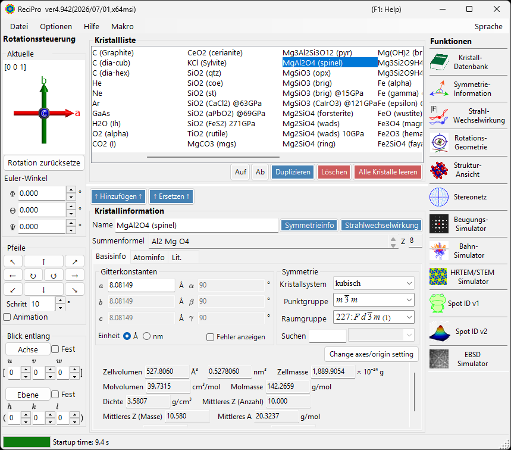

| Bereich | Position | Beschreibung |
|------|----------|-------------|
| **Dateimenü** | Oben | Dateioperationen, Optionen, Hilfe |
| **Rotationssteuerung** | Links | Kristallorientierung ansehen/festlegen |
| **Kristallliste** | Oben Mitte | Kristalle auswählen und verwalten |
| **Kristallinformation** | Unten Mitte | Gitterparameter, Symmetrie, Atome bearbeiten |
| **Funktionen** | Rechts | Simulations-/Analysefenster starten |

---

## Tastatur- & Maus-Kurzbefehle {#keyboard-mouse-shortcuts}

Das Hauptfenster installiert mehrere **anwendungsweite** Kurzbefehle. Sie bleiben aktiv, während die Fenster Strukturansicht, Stereonetz, Beugungssimulator und Spot ID v1 den Fokus haben.

| Kurzbefehl | Aktion |
|----------|--------|
| <kbd>F1</kbd> | Diese Seite des Online-Handbuchs öffnen |
| <kbd>CTRL</kbd>+<kbd>SHIFT</kbd> + Pfeiltasten | Den Kristall einen Schritt in diese Richtung drehen (zwei Pfeile gleichzeitig für diagonal) |
| <kbd>CTRL</kbd> beim Start von ReciPro halten | Mit deaktiviertem OpenGL starten (Wiederherstellung bei Grafikproblemen; nur für diesen Start, wird nicht gespeichert) |
| Mit links das Orientierungs-Widget ziehen (unten links, unter *Orientierung*) | Den Kristall drehen |
| Rechts-Doppelklick auf das Orientierungs-Widget | Das Widget-Bild in die Zwischenablage kopieren |
| Einfachklick auf eine Funktionsschaltfläche | Das betreffende Fenster öffnen / schließen (ein minimiertes Fenster wird stattdessen wiederhergestellt, nicht geschlossen) |
| Doppelklick auf eine Funktionsschaltfläche | Das Fenster sichtbar erzwingen und in den Vordergrund holen |
| Rechtsklick auf einen Kristall in der Liste | Kontextmenü (Umbenennen / Als CIF exportieren / Duplizieren / Löschen) |
| Doppelklick auf die Beschriftung des Zonenachsenindex (`[u v w]`, unter *Orientierung*) | Das max-UVW-Feld ein-/ausblenden |
| Eine Datei auf das Fenster ablegen | Eine Kristallliste (`.xml`, `.out`; es wird gefragt, ob die Liste ersetzt oder ergänzt werden soll) oder einen Kristall (`.cif`, `.amc`) laden <!-- 261105Cl 監査: .cdb2 はドロップで読めないので外した (FormMain.cs:FormMain_DragDrop) --> |
| <kbd>CTRL</kbd>+<kbd>SHIFT</kbd>+<kbd>ALT</kbd>+<kbd>C</kbd> | Das (experimentelle) GUI-Erfassungswerkzeug für das aktive Fenster öffnen |

→ Siehe **[21. Tastatur- & Maus-Kurzbefehle](21-shortcuts.md)** für jedes Fenster auf einen Blick.

---

## Grundlegender Arbeitsablauf

Wenn Sie ReciPro zum ersten Mal verwenden, folgen Sie diesen Schritten:

1. Wählen Sie den gewünschten Kristall in der **Kristallliste**. Um eine CIF/AMC-Datei zu verwenden, ziehen Sie sie per Drag & Drop in die **Kristallinformation**.
2. Wenn Sie Gitterparameter oder Atompositionen bearbeiten, drücken Sie **↑ Hinzufügen ↑** oder **↑ Ersetzen ↑**, damit die Änderungen in die Kristallliste zurückgeschrieben werden.
3. Stellen Sie die Kristallorientierung in der **Rotationssteuerung** über eine Zonenachse, eine Kristallebene, Euler-Winkel oder durch Ziehen mit der Maus ein.
4. Öffnen Sie das gewünschte Werkzeug aus den **Funktionen**. Die Rechenfenster für Beugung, HRTEM/STEM, EBSD und andere verwenden den aktuell ausgewählten Kristall und dessen Orientierung.

---

## Dateimenü

### Datei

| Menüpunkt | Beschreibung |
|-----------|-------------|
| Kristallliste laden (aktuelle Liste ersetzen) | Eine Kristalllisten-Datei (`*.xml`, `*.out`) laden und die aktuelle Liste ersetzen; in einem Dialog wählen Sie, welche Kristalle geladen werden |
| Kristallliste laden (zur aktuellen Liste hinzufügen) | Eine Kristalllisten-Datei laden und an die aktuelle Liste anhängen (mit demselben Auswahldialog) |
| Auf anfängliche Kristallliste zurücksetzen | Die mit ReciPro ausgelieferte Kristallliste neu laden |
| Kristall aus CIF- oder AMC-Datei importieren | Einen einzelnen Kristall aus einer CIF- / AMC-Datei laden |
| Kristallliste speichern | Die aktuelle Kristallliste speichern (in einem Dialog wählen Sie, welche Kristalle geschrieben werden) |
| Ausgewählten Kristall als CIF-Datei exportieren | Den ausgewählten Kristall im CIF-Format speichern |
| Alle Kristalle leeren | Alle Kristalle aus der Liste entfernen |
| Beenden | Die Anwendung schließen |

### Optionen

| Menüpunkt | Beschreibung |
|-----------|-------------|
| Tooltips anzeigen | Die Tooltips in allen Fenstern ein- oder ausblenden — die der Steuerelemente, der Symbolleisten- und Menüeinträge, der Tabellenzellen und der Registerkarten; die Einstellung bleibt für den nächsten Start erhalten <!-- 261106Cl 作者の決定 C9 --> <!-- 261106Cl 作者の決定 A20 --> |
| Dunkler Modus | Zwischen hellem und dunklem Farbdesign umschalten |
| Miller-Bravais-Index (hkil) verwenden | In der gesamten Anwendung die 4-Index-Notation für trigonale/hexagonale Systeme verwenden |
| Ionische Streufaktoren verwenden | In den dynamischen Elektronenrechnungen (Bloch-Wellen-Methode), einschließlich der Kikuchi-Profile, ionische Elektronen-Streufaktoren (Peng) für die den Atomen zugeordneten Ionen verwenden; der Monopolterm für $g \neq 0$ wird nur zu den elastischen Koeffizienten $U_g$ addiert (die TDS-Absorption und die Kikuchi-TDS-Quelle verwenden den endlichen ionischen Anteil). Ohne Häkchen werden Streufaktoren neutraler Atome verwendet. Ist die Elementarzelle nicht ladungsneutral ($\Sigma q \neq 0$), entfällt der Monopolterm und nur der endliche Anteil (abgeschirmtes Ion) wird verwendet; beim Einschalten der Option erscheint ein Hinweis |
| MKL-Bibliothek herunterladen | Die native Intel-MKL-Bibliothek (~55 MB) herunterladen; nach der Installation wird sie automatisch für große Berechnungen verwendet |
| Externe Makrobefehle annehmen (Named Pipe) | Auf der Named Pipe `ReciPro.Macro.v1` lauschen und von externen Programmen gesendete Makros ausführen — siehe [Externe Steuerung](20-macro/3-external-control.md) |
| Registrierungseinstellungen beim Beenden zurücksetzen (wirksam nach Neustart) | Einstellungen beim nächsten Neustart zurücksetzen |
| Crystallography.Native-Bibliothek deaktivieren (Neustart erforderlich) | Auf verwalteten Code zurückfallen, falls die native (C++) Bibliothek nicht geladen werden kann |
| Gesamtes OpenGL-Rendering deaktivieren (Neustart erforderlich) | Für ältere GPUs / Remotedesktop |
| OpenGL-Textrendering deaktivieren (Neustart erforderlich) | Behelfslösung für Textdarstellungsprobleme auf manchen GPUs |
| (experimentell) GUI-Komponenten erfassen... | Entwicklerwerkzeug zum Speichern von GUI-Screenshots |
| Pulverbeugungsfunktion (in Entwicklung) | Das Fenster für polykristalline (Pulver-) Beugung aktivieren |

### Hilfe

| Menüpunkt | Beschreibung |
|-----------|-------------|
| Auf Updates prüfen | Prüfen, ob eine neue Version von ReciPro verfügbar ist, und sie installieren |
| Hinweise | Bedienungshinweise anzeigen (veraltet) |
| Versionsverlauf | Den Versionsverlauf-Dialog öffnen |
| Lizenz | Die MIT-Lizenz anzeigen |
| GitHub-Repository | Das ReciPro-Repository im Browser öffnen |
| Fehler, Wünsche oder Kommentare melden | Die GitHub-Issues-Seite öffnen |
| Hilfe (Web) | Das Online-Handbuch auf GitHub Pages in der zur UI-Sprache passenden Seite öffnen |

Die UI-Sprache wird über das separate Menü **Sprache** umgeschaltet (erfordert Neustart).

### Sprache

Die UI-Sprache umschalten. Elf Sprachen stehen zur Verfügung — English, 日本語 (Japanisch), Deutsch, Français, Español, Português, Italiano, Русский, 简体中文, 繁體中文 und 한국어 — und das Menü zeigt jede in ihrer eigenen Schrift. Die Änderung wird nach einem Neustart von ReciPro wirksam. Das Online-Handbuch folgt derselben Einstellung, sodass <kbd>F1</kbd> und **Hilfe ▸ Hilfe (Web)** die Seite in der gewählten Sprache öffnen.

### Makro

**Editor** öffnet das [Makro](20-macro/index.md)-Fenster, um ReciPro-Operationen mit Python-ähnlichen Skripten zu automatisieren. Die in diesem Fenster registrierten Makros werden außerdem unterhalb von **Editor** aufgelistet; die Auswahl eines Eintrags führt das Makro direkt aus. Für wiederkehrende Arbeitsabläufe siehe die [integrierten Funktionen](20-macro/1-built-in-functions.md) und die [Makro-Beispiele](20-macro/2-examples.md).

---

## Kristallorientierungssteuerung

Der Rotationszustand des Kristalls wird vom Beugungssimulator, der Strukturansicht, dem Stereonetz, dem HRTEM/STEM-Simulator, dem EBSD-Simulator und anderen Fenstern gemeinsam genutzt. Es ist nicht nur eine Ansichtseinstellung — er definiert die Richtung des einfallenden Strahls und die Kristallkoordinatenbeziehung, die in den Simulationen verwendet wird. Ein kurzes Video-Tutorial finden Sie auf der Seite [Bedienung](appendix/a0-how-to-use.md).

### Aktuelle Orientierung

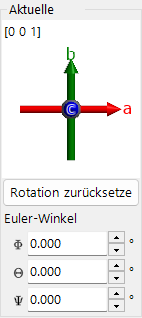

Zeigt die Kristallorientierung. Zum Drehen ziehen. Achsen: rot = *a*, grün = *b*, blau = *c*.

### Rotation rücksetzen
Setzt auf den Anfangszustand zurück: *c*-Achse senkrecht zum Bildschirm, *b*-Achse nach oben.

### Zonenachse
Zeigt die zur Bildschirmnormalen nächstgelegene Zonenachse [*uvw*] an. Kandidaten sind die teilerfremden Indizes (ggT = 1) mit $|u|+|v|+|w| \le$ der Grenze im max-UVW-Feld (1–100, Standard 30); ein Doppelklick auf die Indexbeschriftung blendet dieses Feld ein bzw. aus.

### Euler-Winkel (Z-X-Z)
Stellen Sie die Kristallorientierung mit **Z–X–Z**-Euler-Winkeln ein:

- \(\Phi\): Drehung um die Z-Achse
- \(\Theta\): Drehung um die X-Achse
- \(\Psi\): Drehung um die Z-Achse

Die Drehungen werden in der Reihenfolge \(\Psi \to \Theta \to \Phi\) angewendet. Siehe [Rotationsgeometrie](4-rotation-geometry.md) und [Anhang A1. Koordinatensystem](appendix/a1-coordinate-system/1-orientation.md) für Details.

### Pfeile

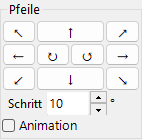

Dreht um den Winkel Schritt (Standard 10°). ↺ / ↻ drehen um die Bildschirmnormale. Aktivieren Sie Animation für kontinuierliche Drehung; Schritt ist dann eine Rate in °/s.

### Blick entlang

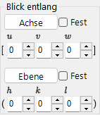

Richtet eine Zonenachse [*uvw*] oder eine Kristallebene (*hkl*) senkrecht zum Bildschirm aus.

- **Fest**: Wenn aktiviert, werden alle nachfolgenden Drehungen (Pfeile, Ziehen mit der Maus) um die angegebene Zonenachse bzw. Ebenennormale ausgeführt, sodass diese Richtung fest bleibt. Nur eines der beiden **Fest**-Kästchen kann aktiv sein, und es lässt sich nicht aktivieren, solange der Index 0 0 0 ist.
- **Achse**: Stellt die eingegebene Zonenachse \([uvw]\) senkrecht zum Bildschirm. Wenn zusätzlich **Ebene** gesetzt ist und die Achse in dieser Ebene liegt ($uh+vk+wl=0$), wird die Ebenennormale auf dem Bildschirm nach oben ausgerichtet; andernfalls wird eine Aufwärtsrichtung automatisch gewählt.
- **Ebene**: Stellt die Normale der eingegebenen Kristallebene \((hkl)\) senkrecht zum Bildschirm. Wenn zusätzlich **Achse** gesetzt ist und in der Ebene liegt ($uh+vk+wl=0$), wird diese Achse auf dem Bildschirm nach oben ausgerichtet; andernfalls wird eine Aufwärtsrichtung automatisch gewählt.

### Grundlegende Möglichkeiten zur Festlegung der Orientierung

| Methode | Anwenden, wenn | Wo |
|--------|----------|-------|
| Ziehen mit der Maus | Sie frei drehen möchten, während Sie die Kristallachsen beobachten. | Panel **Orientierung** |
| Pfeilschaltflächen | Sie kleine, wiederholbare Drehungen möchten. | Panel **Pfeile** |
| Zonenachse | Sie die Blickrichtung kennen, etwa \([001]\) oder \([110]\). | **Blick entlang** / Zonenachsen-Eingabe |
| Ebenennormale | Sie eine Kristallebene \((hkl)\) senkrecht zum Bildschirm möchten. | **Blick entlang** / Ebenen-Eingabe |
| Euler-Winkel | Sie eine reproduzierbare numerische Orientierung benötigen. | **Euler-Winkel (Z-X-Z)** |

Siehe [Rotationsgeometrie](4-rotation-geometry.md) und [Anhang A1. Koordinatensysteme](appendix/a1-coordinate-system/1-orientation.md) für die Rotationsmatrizen und Koordinatenkonventionen.

---

## Kristallliste

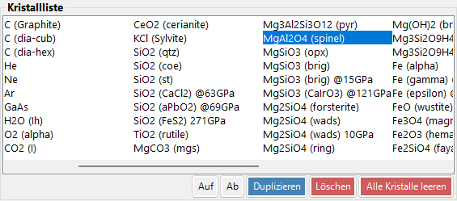

66 Kristalle in der Standardinstallation. Auswählen, um Details anzuzeigen und für Berechnungen festzulegen. **Rechtsklick auf einen Kristall** in der Kristallliste für ein Kontextmenü: *Umbenennen*, *Als CIF exportieren*, *Duplizieren*, *Löschen*.

| Schaltfläche | Aktion |
|--------|--------|
| Auf / Ab | Reihenfolge ändern |
| Duplizieren | Den ausgewählten Kristall kopieren |
| Löschen / Alle Kristalle leeren | Den ausgewählten Kristall / alle Kristalle entfernen |
| ↑ Hinzufügen ↑ / ↑ Ersetzen ↑ | Zur Liste hinzufügen oder den ausgewählten Eintrag ersetzen |

---

## Kristallinformation

Bearbeiten Sie Gitterparameter, Symmetrie und Atome; ziehen Sie CIF/AMC-Dateien per Drag & Drop hinein, um eine Struktur zu laden. Dieses Steuerelement wird von ReciPro, PDIndexer und CSManager gemeinsam genutzt, aber die angezeigten Registerkarten und Funktionen unterscheiden sich je nach Anwendung. ReciPro zeigt die Registerkarten **Basisinfo**, **Atominfo** und **Lit.** (die Registerkarten EOS, Elasticity und andere sind für die anderen Anwendungen und werden in ReciPro nicht angezeigt).

> **Wichtig**: Drücken Sie **↑ Hinzufügen ↑** oder **↑ Ersetzen ↑**, um Änderungen zu speichern.

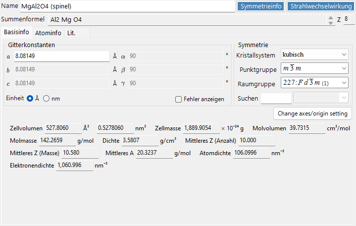

Der obere Bereich des Panels zeigt stets **Name** (Kristallname), **Summenformel** (chemische Formel, aus der Atomliste berechnet), **Z** (Anzahl der Formeleinheiten pro Elementarzelle) und **Farbe** (die Anzeigefarbe des Kristalls, verwendet in der 3D-Strukturansicht und für die Kurven von Beugungsprofilen). Die Schaltflächen **Symmetrieinfo** und **Strahlwechselwirkung** öffnen die Fenster [Symmetrieinformationen](2-symmetry-information.md) und [Strahl-Wechselwirkung](3-beam-interaction.md). Gew.-%, Atom-% und die Umrechnung in Oxide zeigt der Kontextmenüpunkt [Details der chemischen Zusammensetzung](#chemical-composition).

### Registerkarte Basisinfo {#basic-info-tab}

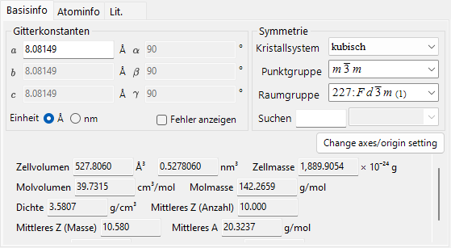

Gitterparameter, Symmetrie und daraus abgeleitete Größen.

| Element | Beschreibung |
|------|------|
| Gitterkonstanten | Gitterparameter a, b, c (**Einheit**: Å = 10⁻¹⁰ m oder nm; die Einheit bleibt für den nächsten Start erhalten) und α, β, γ. Die Wahl einer Symmetrie schränkt sie automatisch ein (z. B. a=b=c, α=β=γ=90° für kubisch). |
| Symmetrie | Wählen Sie **Kristallsystem**, **Punktgruppe** und **Raumgruppe**. Geben Sie in das Feld **Suchen** ein, um passende Kandidaten aufzulisten (Groß-/Kleinschreibung beachten). |
| Zellvolumen / Zellmasse | Volumen und Masse der Elementarzelle. Das Volumen wird entsprechend der **Einheit**-Auswahl in ų / nm³ angezeigt; die Masse in 10⁻²⁴ g. |
| Molvolumen / Molmasse / Dichte | Molvolumen (cm³/mol, pro Formeleinheit), molare Masse (g/mol) und Dichte (g/cm³). Wird **nur angezeigt, wenn Atome eingegeben wurden**. |
| Mittleres Z (Anzahl) / Mittleres Z (Masse) / Mittleres A | Anzahl- bzw. massengewichtete mittlere Ordnungszahl und mittleres Atomgewicht pro Atom (g/mol). Besetzungen werden berücksichtigt. |
| Fehler anzeigen | Die Fehlerfelder (±) der Gitterkonstanten anzeigen. |
| Change axes/origin setting | Wie der Kontextmenüpunkt **Achsen-/Ursprungseinstellung ändern**: in eine andere Achsen-/Ursprungsaufstellung derselben Raumgruppe umwandeln. |
| Atomdichte / Elektronendichte | Anzahl der Atome bzw. Elektronen pro Zellvolumen, angezeigt in Å⁻³ / nm⁻³ entsprechend der **Einheit**-Auswahl. |

### Registerkarte Atominfo {#atom-tab}

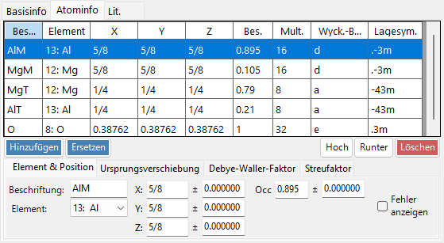

Legen Sie Spezies, Position, Temperaturfaktor und Streufaktor jedes Atoms fest. Bearbeiten Sie die Atomliste mit **Hinzufügen**, **Ersetzen** (die ausgewählte Zeile ersetzen), **Hoch/Runter** (Reihenfolge ändern) und **Löschen**. Die Atomliste zeigt außerdem für jede Lage die Multiplizität (**Mult.**), den Wyckoff-Buchstaben (**Wyck.-Buchst.**) und die Lagesymmetrie (**Lagesym.**). Jedes Atom hat:

| Element | Beschreibung |
|------|------|
| Label | Atomkennung (beliebiger Bezeichner). |
| Element | Element (einschließlich Ionenwertigkeit). |
| X, Y, Z | Fraktionelle Koordinaten (0–1). Brüche wie 1/2 oder 2/3 können eingegeben werden. |
| Occ | Besetzung (0–1). |

Klicken Sie mit der rechten Maustaste auf eine Atomzeile und wählen Sie **Äquivalente Atompositionen anzeigen**, um ein kleines Fenster zu öffnen, das alle durch die Symmetrieoperationen der Raumgruppe erzeugten Positionen auflistet; die Schaltfläche **Copy** kopiert die Liste als tabulatorgetrennten Text (z. B. zum Einfügen in eine Tabellenkalkulation).

**Ursprungsverschiebung**: verschiebt den Ursprung aller Atomkoordinaten. Wählen Sie das Vorzeichen mit **+** / **−** und drücken Sie dann einen der voreingestellten Vektoren — (⅛ ⅛ ⅛), (¼ ¼ ¼), (0 ¼ ⅛), (¼ 0 ¼), (0 ¼ ¼), (¼ ¼ 0), (¼ −¼ 0), (¼ −¼ ¼), (0 ¼ −⅛) — oder verwenden Sie **Apply custom shift** für einen beliebigen Betrag.

**Auslenkung (B)** (Debye–Waller- / Temperaturfaktor):

| Element | Beschreibung |
|------|------|
| Notation | Die U- oder B-Notation verwenden. Beim Umschalten werden die angezeigten Werte umgerechnet ($B = 8\pi^2 U$). |
| Modell | Isotrop oder anisotrop. |
| U##, β## | Für den anisotropen Fall jede Komponente eingeben: $U_{ij}$ in Ų oder in der B-Notation die dimensionslosen $\beta_{ij} = 2\pi^2 a^*_i a^*_j U_{ij}$ (wie B(i,j) in AMCSD-Dateien). |

**Streufaktor**: Wählen Sie den für jedes Atom verwendeten Streufaktor.

| Strahlung | Quelle / Einstellung |
|-----------|------|
| X-ray | Streufaktoren einschließlich Ionenwertigkeit (International Tables for Crystallography, Vol. C). |
| Electron | Elektronen-Streufaktoren — neutrale Atome nach Peng, Ren, Dudarev & Whelan (1996), *Acta Cryst.* **A52**, 257–276; Ionen nach Peng (1998), *Acta Cryst.* **A54**, 481–485. |
| Neutron | Neutronen-Streulängen. Wählen Sie **Natural isotope abundance** oder **Custom isotope abundance** (eine beliebige Isotopenzusammensetzung). |

### Registerkarte Lit. {#reference-tab}

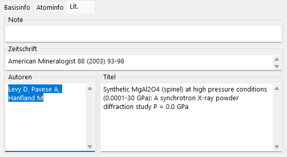

Erfassen Sie die Quelle der Struktur: **Note**, **Autoren**, **Zeitschrift** und **Titel**.

### Kontextmenü (Rechtsklick)

Rechtsklick auf einen leeren Bereich des Steuerelements für diese Hauptaktionen:

| Menüpunkt | Aktion |
|-----------|------|
| Details der chemischen Zusammensetzung | Öffnet das Fenster [Details der chemischen Zusammensetzung](#chemical-composition) (Gew.-%, Atom-%, normierte Atomanzahl, Umrechnung in Oxide). |
| Strahlwechselwirkung | Öffnet das Fenster [Strahl-Wechselwirkung](3-beam-interaction.md). |
| Symmetrieinformation | Öffnet das Fenster [Symmetrieinformationen](2-symmetry-information.md). |
| Aus CIF oder AMC importieren... | Lädt einen Kristall aus einer CIF-/AMC-Datei. |
| Als CIF exportieren | Exportiert den aktuellen Kristall als CIF. |
| Gitterkonstanten zurücksetzen | Stellt die Zellkonstanten auf die zuerst geladenen Werte zurück. |
| In Raumgruppe P1 umwandeln | Erweitert die Struktur auf die Raumgruppe P1. |
| In eine Überstruktur umwandeln | Konvertiert in eine Überstruktur mit ganzzahligen Vielfachen von a, b, c (Größendialog). |
| Achsen-/Ursprungseinstellung ändern | Konvertiert in eine äquivalente Raumgruppe (eine andere Achsenaufstellung). |

#### Details der chemischen Zusammensetzung {#chemical-composition}

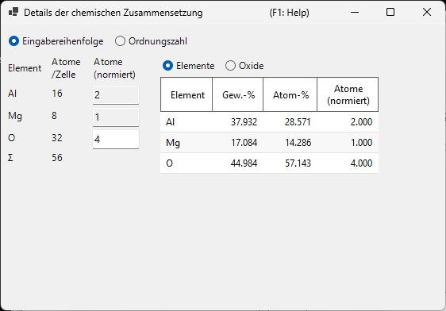

Zeigt die Zusammensetzung des aktuellen Kristalls, berechnet aus der Atomliste (die Atomanzahl jedes Elements ist die Summe von Multiplizität × Besetzung über seine Lagen). Das Fenster folgt dem im Hauptfenster gewählten Kristall.

- Die rechte Tabelle zeigt **Gew.-%**, **Atom-%** und **Atome (normiert)** für jedes Element; die linke Tabelle zeigt die Atome pro Zelle. Klicken Sie in der linken Tabelle auf ein Feld der normierten Spalte, um dieses Element zum Bezug zu machen, und geben Sie seine Atomanzahl ein (z. B. O = 24). Standardmäßig ist O (sonst das erste Element) der Bezug, und die normierte Spalte zeigt die chemische Formel.
- **Oxide**, **Halogenide** und **Sulfide** (nur die für den Kristall möglichen werden angezeigt) rechnen die Zusammensetzung formal in Komponenten um, mit der **Valenz** jedes Elements. Die Valenzen sind editierbar (Brüche wie 8/3 sind erlaubt). Ohne Eingabe gilt für Fe 2, für andere Elemente die Valenz des für den Röntgen-Streufaktor gewählten Ions, sonst eine übliche Oxidationsstufe. **Σ=0** setzt die Valenz, mit der die Gesamtladung null wird, und **Zurücksetzen** löscht die eingegebenen Valenzen. Eingegebene Valenzen bleiben beim Kristall und werden in XML-Kristalllisten gespeichert.
- **Eingabereihenfolge** / **Ordnungszahl** schalten die Reihenfolge der Elemente um.

---

## Funktionen-Panel {#functions}

Die senkrechte Schaltflächenleiste rechts startet die unten aufgeführten Analyse- und Simulationsfenster.

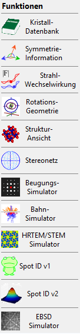

| Schaltfläche | Beschreibung | Details |
|--------|-------------|---------|
| Kristall-Datenbank | Kristalle aus den mitgelieferten / Online-Datenbanken suchen und importieren | [1. Kristalldatenbank](1-crystal-database.md) |
| Symmetrie-Information | Raumgruppeninformationen und Symmetriediagramme aus *International Tables* Vol. A | [2. Symmetrieinformationen](2-symmetry-information.md) |
| Strahl-Wechselwirkung | Strahl-Kristall-Wechselwirkung: Reflexe, Abschwächung, Streufaktoren, Fluoreszenz | [3. Strahl-Wechselwirkung](3-beam-interaction.md) |
| Rotations-Geometrie | 3D-Rotationsmatrix / Goniometerwinkel | [4. Rotationsgeometrie](4-rotation-geometry.md) |
| Struktur-Ansicht | 3D-Kristallstruktur | [5. Strukturansicht](5-structure-viewer.md) |
| Stereonetz | Stereografische Projektion | [6. Stereonetz](6-stereonet.md) |
| Beugungs-Simulator | Einkristall-Röntgen-/Elektronenbeugung | [7. Beugungssimulator](7-diffraction-simulator/index.md) |
| Bahn-Simulator | Monte-Carlo-Simulation von Elektronenbahnen | [8. Elektronenbahnen](8-electron-trajectory.md) |
| HRTEM/STEM-Simulator | HRTEM-/STEM-Bildsimulation | [9. HRTEM/STEM-Simulator](9-hrtem-stem-simulator/index.md) |
| Spot ID v1 | SAED-Musterindizierung (früher „TEM ID") | [10. Spot ID v1](10-spot-id.md) |
| Spot ID v2 | Reflexerkennung & Indizierung | [11. Spot ID v2](11-spot-id-v2.md) |
| EBSD-Simulator | EBSD-Mustersimulation | [12. EBSD-Simulation](12-ebsd-simulation.md) |
| Pulver-Beugung | Polykristalline (Pulver-) Beugung — über **Optionen ▸ Pulverbeugungsfunktion (in Entwicklung)** aktivieren | - |

---

## Siehe auch

- [Kristalldatenbank](1-crystal-database.md)
- [Rotationsgeometrie](4-rotation-geometry.md)
- [Strukturansicht](5-structure-viewer.md)
- [Beugungssimulator](7-diffraction-simulator/index.md)
- [Tastatur- & Maus-Kurzbefehle](21-shortcuts.md)
- [Grundlegendes Koordinatensystem & Kristallorientierung](appendix/a1-coordinate-system/1-orientation.md)
