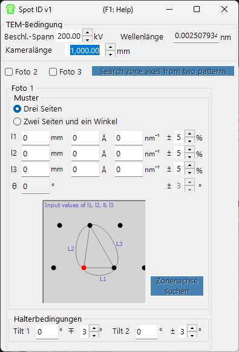

# Spot ID v1

**Spot ID v1** (das frühere **TEM ID**) sucht Kandidaten-Zonenachsen anhand einer numerisch eingegebenen Reflexgeometrie von einem bis drei Beugungsmustern. Reflexerkennung, Fit und Indizierung an einem Bild erfolgen in [Spot ID v2](11-spot-id-v2.md).

---

## Tastatur- & Maus-Kurzbefehle

Spot ID v1 nimmt die Reflexgeometrie als **numerische Eingabe** entgegen (der frühere *TEM ID*-Arbeitsablauf); es hat keine Bildansicht (Laden von Bildern, Mauszoom, Reflexerkennung und manuelles Auswählen von Reflexen gehören zu [Spot ID v2](11-spot-id-v2.md)). Der einzige Kurzbefehl befindet sich im Ergebnisfenster:

| Kurzbefehl | Aktion |
|----------|--------|
| <kbd>F1</kbd> | Diese Seite des Online-Handbuchs öffnen |
| Doppelklick auf eine Zeile in der Ergebnisliste | Diesen Kristall auswählen und in die zugehörige Zonenachse drehen |

→ Siehe **[21. Tastatur- & Maus-Kurzbefehle](21-shortcuts.md)** für einen Überblick über alle Fenster.

---

## Zonenachsensuche aus der Reflexgeometrie (früher TEM ID)

Wenn Sie kein Bild zum Laden haben, können Sie dennoch nach Kandidaten-Zonenachsen suchen, indem Sie die Geometrie eines Feinbereichs-Elektronenbeugungsmusters (SAED) von Hand eingeben. Geben Sie die TEM-Beobachtungsbedingungen und die Reflexgeometrie ein und drücken Sie dann **Zonenachse suchen** eines Fotos (oder **Search zone axes from two patterns** / **Search zone axes from three patterns**, um mehrere Fotos gemeinsam zu verwenden), um Kandidaten für die Kristallorientierung zu finden.

### TEM-Bedingung

Geben Sie **Beschl.-Spannung** (kV, Standard 200) und **Kameralänge** (mm, Standard 1000) ein. Die **Wellenlänge** (nm) wird aus der Spannung berechnet und schreibgeschützt angezeigt.

### Foto 1, 2, 3

Geben Sie die Geometrie der Beugungsreflexe ein.

- Um den Abstand zwischen zwei Reflexen auf dem Detektor einzugeben, verwenden Sie das Feld **mm**.
- Wenn Sie den *d*-Wert kennen, geben Sie ihn in den Einheiten **Å** oder **nm⁻¹** ein.

**Drei Seiten** : Geben Sie die Längen der drei Seiten eines Dreiecks ein, dessen einer Eckpunkt der Primärstrahlreflex ist.

**Zwei Seiten und ein Winkel** : Geben Sie die Längen zweier Seiten ein (einschließlich des Primärstrahlreflexes) sowie den Winkel zwischen ihnen.

- Toleranzen (die **±**-Felder) : Jede Länge hat eine Toleranz in % (0–50, Standard 5), θ eine in Grad (0–30, Standard 3). Der nicht eingegebene Wert (θ im Modus „Drei Seiten“, l3 im Modus „Zwei Seiten und ein Winkel“) wird berechnet und angezeigt, und neben den Eingaben wird eine Skizze des resultierenden Musters gezeichnet.
- **Halterbedingungen** : **Tilt 1** / **Tilt 2** (°) des Goniometerhalters, bei denen das Foto aufgenommen wurde, jeweils mit einer Toleranz (0–10°, Standard 3°). Die Winkel zwischen den Haltereinstellungen der Fotos werden berechnet und angezeigt.
- **Foto 2** / **Foto 3** : aktivieren das zweite und dritte Foto. Die Kontrollkästchen zwischen den Fotos behandeln l1 (bzw. l2) zweier Fotos als denselben Reflex und übernehmen seine Länge.
- **Zonenachse suchen** durchsucht ein Foto; **Search zone axes from two patterns** / **Search zone axes from three patterns** sucht Kombinationen, die mit allen aktivierten Fotos und den Halterkippwinkeln zwischen ihnen vereinbar sind. Die Suche läuft über jeden in der Liste des Hauptfensters ausgewählten Kristall (solange Spot ID v1 geöffnet ist, ist Mehrfachauswahl möglich). Werden mehr als 1000 Kandidaten gefunden, wird nichts aufgelistet und Sie werden gebeten, die Bedingungen einzuschränken; andernfalls öffnet sich das Ergebnisfenster. Doppelklicken Sie auf eine Zeile, um den Kristall auszuwählen und in diese Orientierung zu drehen.

---

## Siehe auch

- [Spot ID v2](11-spot-id-v2.md)
- [Beugungssimulator](7-diffraction-simulator/index.md)
- [Hauptfenster](0-main-window.md)
- [Kristalldatenbank](1-crystal-database.md)
- [EBSD-Simulation](12-ebsd-simulation.md)
