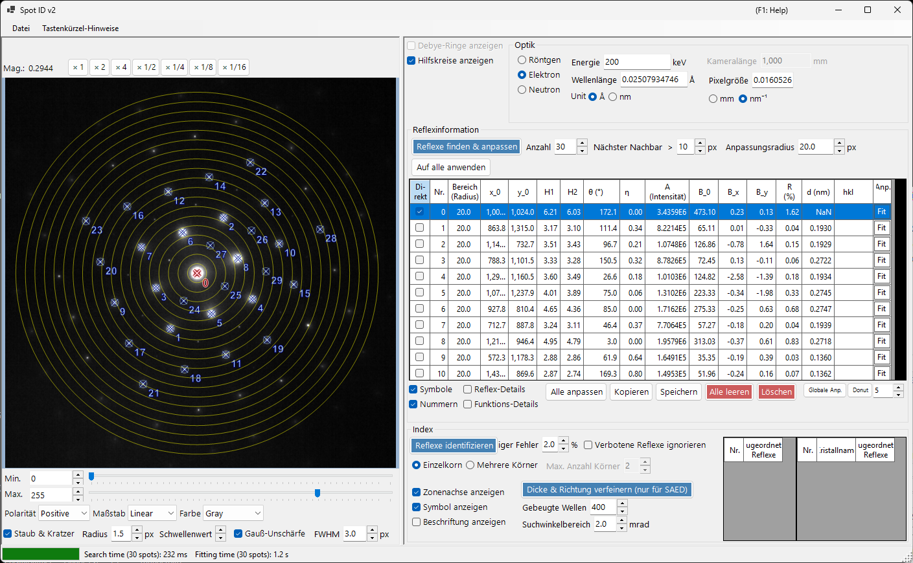
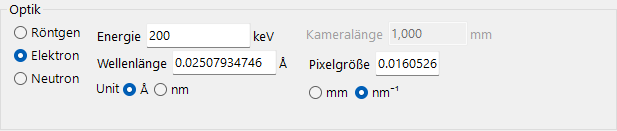
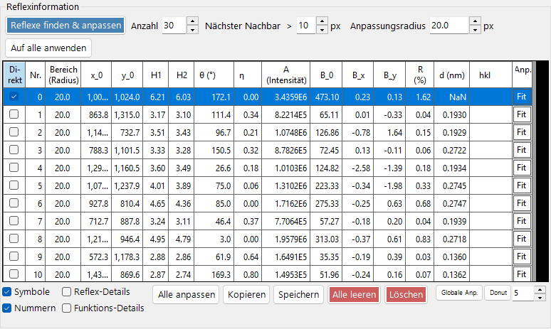
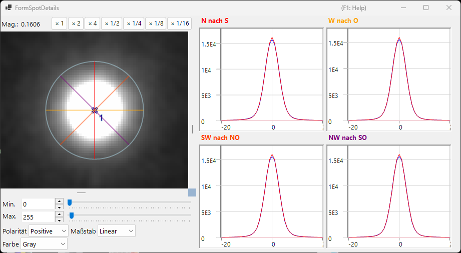
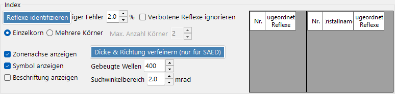

# Spot ID v2

**Spot ID v2** erkennt, fittet und indiziert Beugungsreflexe auf einem experimentellen Beugungsbild. [Spot ID v1](10-spot-id.md) (das frühere TEM ID) nimmt die Reflexgeometrie dagegen als numerische Eingabe entgegen.

---

## Tastatur- & Maus-Kurzbefehle

Die Reflexliste erstellen Sie direkt auf dem geladenen Bild. Der Bildbereich nutzt die standardmäßige [Bildansicht-Navigation](21-shortcuts.md) von ReciPro zum Verschieben/Zoomen; für die Reflexbearbeitung kommen die folgenden Kombinationen hinzu.

| Kurzbefehl | Aktion |
|----------|--------|
| <kbd>F1</kbd> | Diese Seite des Online-Handbuchs öffnen |
| Linker Doppelklick auf das Bild | Einen Reflex an diesem Punkt hinzufügen (Peak-gefittet) |
| <kbd>CTRL</kbd> + linker Doppelklick | Einen Reflex hinzufügen und als direkten (000) Strahl markieren |
| Linksklick auf einen Reflex | Den nächstgelegenen Reflex auswählen |
| <kbd>CTRL</kbd> + Rechtsklick auf einen Reflex | Den nächstgelegenen Reflex löschen |
| <kbd>CTRL</kbd> + Pfeiltasten | Den ausgewählten Reflex um ein Pixel verschieben |
| Linksziehen / Mittelziehen (leerer Bereich) | Das Bild verschieben |
| Mausrad | Am Cursor hinein-/herauszoomen |
| Rechtsziehen eines Rahmens | In den ausgewählten Bereich hineinzoomen |
| Rechter Doppelklick | Herauszoomen |
| Doppelklick auf den Zeilenkopf eines Reflexes (Tabelle) | Auf diesen Reflex zoomen (×2) |

→ Siehe **[21. Tastatur- & Maus-Kurzbefehle](21-shortcuts.md)** für jedes Fenster auf einen Blick.

---

## Menü „Datei“

Ein Beugungsbild öffnen; **Speichern** / **Kopieren** schreiben das angezeigte Bild als Metadatei (EMF) oder als Bild (PNG). Bilder lassen sich auch per Drag & Drop laden. Bei einer in nm⁻¹ kalibrierten Gatan-DM3/DM4-Datei wird die Strahlung auf Elektronen gesetzt, und Beschleunigungsspannung sowie Pixelgröße (nm⁻¹) werden aus der Datei gelesen (die Kameralänge wird in diesem Fall nicht benötigt).

**Speichern ▸ Candidate list (CSV)...** exportiert die durch die Indizierung gefundenen Orientierungskandidaten, **Kopieren ▸ Candidate list (TSV)** legt dieselbe Tabelle in die Zwischenablage: eine Zeile je Kandidat × Korn mit Rang, Kornindex, Kristallname, ZXZ-Eulerwinkeln (°), den neun Elementen der Rotationsmatrix, dem mittleren quadratischen Residuum (nm⁻²), der Zahl der zugeordneten Reflexe und den Zuordnungen Reflex → (hkl). Die CSV-Datei verwendet stets den Punkt als Dezimaltrennzeichen; die TSV-Fassung lässt sich direkt in eine Tabellenkalkulation einfügen.

---

## Optik

### Strahlungsquelle

Wählen Sie den Strahlungstyp (Röntgen / Elektron / Neutron) und stellen Sie die Energie oder Wellenlänge ein.

### Kameralänge / Pixelgröße

Die Kameralänge (mm) und die Detektor-Pixelgröße (mm oder nm⁻¹). Wird eine in nm⁻¹ kalibrierte Gatan-DM-Datei geladen, wird die Pixelgröße (nm⁻¹) aus dem Dateikopf gelesen, und die Kameralänge wird nicht verwendet (das Feld für die Kameralänge ist gesperrt, solange die Einheit nm⁻¹ ist). Eine Änderung der Wellenlänge, der Kameralänge oder der Einheit der Pixelgröße behält die Reflexpositionen (Pixel) bei und berechnet ihre *d*-Werte mit der neuen Kalibrierung neu.

Die Fensterposition und die Kalibrierung (Strahlungsquelle, Energie, Kameralänge sowie Einheit und Wert der Pixelgröße) bleiben für den nächsten Start erhalten; das Öffnen einer Bilddatei, die eine Kalibrierung enthält, überschreibt sie. <!-- 261105Cl 監査: NumericBoxPixelSize_ValueChanged (8860d40)、FormMain.cs の保存・復元 (dc42de3) -->

**Debye-Ringe anzeigen** (standardmäßig aus) zeichnet die Debye-Ringe aller im Hauptfenster ausgewählten Kristalle — bei mehreren ausgewählten Kristallen jeden in seiner eigenen Farbe —, zentriert auf den Primärstrahlreflex und mit der aktuellen Kalibrierung (Wellenlänge, Kameralänge, Pixelgröße); Ringe von Reflexen, die nach den Auslöschungsregeln verboten sind, werden nicht gezeichnet. **Hilfskreise anzeigen** (standardmäßig an) zeichnet Hilfskreise in das Muster. <!-- 261106Cl 作者の決定 I10 -->

---

## Reflexinformation

- **Reflexe finden & anpassen**: Automatische Reflexerkennung mittels lokaler Maxima und Untergrundabzug.
- **Anzahl**: Die maximale Anzahl der zu erkennenden Reflexe.
- **Nächster Nachbar**: Der minimale Abstand (px), der zwischen erkannten Reflexen zulässig ist. Peaks, die enger beieinander liegen, werden zusammengeführt, um eine Doppelerkennung desselben Reflexes zu verhindern.
- **Anpassungsradius**: Der Radius (px) des kreisförmigen Bereichs, der zum Fitten des Peaks jedes Reflexes verwendet wird. Pixel innerhalb dieses Kreises werden mit einer Pseudo-Voigt-Funktion gefittet.
- **Auf alle anwenden**: Setzt den Fit-Radius jedes Reflexes auf den aktuellen Wert von **Anpassungsradius**.
- **Löschen / Alle leeren**: Den ausgewählten Reflex oder alle erkannten Reflexe entfernen.
- **Speichern** / **Kopieren**: Die Reflextabelle in eine CSV-Datei speichern bzw. als tabulatorgetrennten Text in die Zwischenablage kopieren. Beides funktioniert auch mit einem einzigen Reflex. Die CSV-Datei verwendet stets einen Punkt als Dezimaltrennzeichen und kann mit **Datei ▸ Laden** wieder eingelesen werden (zuvor muss ein Bild geladen sein; die Reflexe werden zu den bereits aufgelisteten hinzugefügt). <!-- 261105Cl 監査: GetSpotListText / readCSV (7f65908) -->
- **Alle anpassen**: Positionen und Intensitäten aller erkannten Reflexe neu fitten.
- **Symbole** / **Nummern**: Markierungssymbole / Nummern auf den beobachteten Reflexen anzeigen (beide standardmäßig an).
- **Globale Anp.**: Führt einen globalen Fit aller Reflexpositionen auf einmal durch (experimentell).
- **Donut**: Wendet einen donutförmigen Untergrundabzug an (experimentell); das Feld daneben legt die Breite (px) des Rings um jeden Reflex fest, dessen Mittelwert als lokaler Untergrund abgezogen wird.
- **Reflex-Details**: Wenn aktiviert, öffnet sich ein Fenster mit detaillierten Informationen zum aktuell ausgewählten Reflex.
- **Funktions-Details** (beim Öffnen des Fensters aus): Zeigt eine Abbildung der zweidimensionalen Pseudo-Voigt-Funktion und ihrer in der Reflextabelle verwendeten Parameter (x_0, y_0, H1, H2, θ, η, A, B_0, B_x, B_y).

---

## Index

- **Reflexe identifizieren**: Führt den Indizierungsalgorithmus aus, um den am besten passenden Kristall und die Zonenachse zu finden. Während der Suche tritt eine Schaltfläche **Stopp** an ihre Stelle, mit der die Suche abgebrochen wird. Erforderlich sind ein geladenes Bild, mindestens zwei Reflexe und mindestens ein in der Kristallliste des Hauptfensters ausgewählter Kristall; andernfalls meldet eine Nachricht, was fehlt. Solange Spot ID v2 geöffnet ist, erlaubt die Kristallliste des Hauptfensters Mehrfachauswahl. <!-- 261105Cl 監査: buttonIdentifySpots_Click (494ef52)、FormMain.cs の複数選択 (4020433) -->
- **Zulässiger Fehler**: Relative Toleranz des Netzebenenabstands in % (0,1–10, Standard 2). Die Winkeltoleranz zwischen Reflexen wird daraus als asin(Toleranz)/2 abgeleitet.
- **Verbotene Reflexe ignorieren** (standardmäßig aus; nur Elektronenbeugung): Wenn aktiviert, werden alle systematisch ausgelöschten Reflexe, einschließlich der durch Schraubenachsen und Gleitspiegelebenen verbotenen, von den Kandidatenreflexen ausgeschlossen. Wenn deaktiviert, werden nur die Auslöschungen aufgrund der Gitterzentrierung (I, F, A, B, C, R) ausgeschlossen, sodass durch Schrauben-/Gleitspiegelsymmetrie verbotene Reflexe, die durch Mehrfachbeugung erscheinen können, Kandidaten bleiben. Für Röntgenstrahlen und Neutronen werden stets alle ausgelöschten Reflexe ausgeschlossen (kinematische Behandlung); das Kontrollkästchen wird dann aktiviert und ausgegraut angezeigt und kehrt in seinen vorherigen Zustand zurück, wenn die Quelle wieder auf Elektronen gestellt wird. <!-- 261106Cl 作者の決定 I4 -->
- **Einzelkorn / Mehrere Körner**: Suche nach einer einzelnen Orientierung (Einkristall) oder nach mehreren Orientierungen (ein polykristalliner / Mehrkorn-Bereich). Für mehrere Körner legt **Max. Anzahl Körner** die Obergrenze für die Anzahl der zu suchenden Körner fest.
- **Zonenachse anzeigen** / **Symbol anzeigen** / **Beschriftung anzeigen**: Die Zonenachse sowie die Symbole / Indexbeschriftungen der berechneten Reflexe einblenden.
- **Dicke & Richtung verfeinern (nur für SAED)**: Funktioniert nur mit **Elektron** als Quelle (andernfalls meldet die Statusleiste dies, und es wird nichts berechnet). <!-- 261105Cl 監査: ButtonRefineThicknessAndDirection_Click / Bethe_CbedCompleted (ed018ca) --> Verfeinert die Probendicke (nm) und die Strahlrichtung des ausgewählten Korns, indem die beobachteten Reflexintensitäten mit dynamischen Rechnungen (Bloch-Wellen-Methode) abgeglichen werden. **Gebeugte Wellen** (1–2048, Standard 400) ist die Anzahl der Strahlen, und **Suchwinkelbereich** (mrad, 1–10, Standard 2) ist der halbe Winkelbereich der durchsuchten Einfallsrichtungen. Die Verfeinerung kann nicht abgebrochen werden (die Schaltfläche **Stopp** gehört nur zu **Reflexe identifizieren**); das Fenster ist bis zum Ende gesperrt. Geprüft werden Dicken von 50–549 nm (Schrittweite 1 nm) und Einfallsrichtungen auf einem quadratischen Raster um die aktuelle Orientierung des Korns (Schrittweite = 1/15 des Suchbereichs), und das Paar, das Σ (Iobs − a·Icalc)² über die indizierten Reflexe minimiert (a: bester Skalierungsfaktor), wird übernommen. Die beste Dicke wird an den Beugungssimulator übergeben, und die Orientierung des Korns (die auch auf das Hauptfenster angewandt wird, sofern der Kristall dort während der Rechnung nicht gewechselt wurde) wird so gekippt, dass die beste Richtung zur Strahlrichtung wird; die Drehung in der Bildebene bleibt erhalten. Das Ergebnis (Dicke, Kippung in mrad, Zonenachse, Residuum) wird in der Statusleiste angezeigt. Liegt die beste Richtung am Rand des Suchbereichs, weist die Statusleiste darauf hin, denn das Optimum kann außerhalb liegen: Drücken Sie die Schaltfläche erneut (die Suche wird dann um die verfeinerte Orientierung zentriert) oder vergrößern Sie den Bereich. <!-- 261105Cl 方位の精密化の実装に合わせて追記 (根拠: FormSpotIDV2.cs: ButtonRefineThicknessAndDirection_Click / Bethe_CbedCompleted) -->
- **Results**: Die besten Übereinstimmungen werden mit Kristallname, Zonenachse [uvw] und den einzelnen Reflexindizes (hkl) angezeigt. Die Auswahl einer Zeile eines einzelnen Korns wählt auch dessen Kristall im Hauptfenster aus und stellt diese Orientierung ein. <!-- 261105Cl 監査: bindingSourceGrains_CurrentChanged (I11) -->

---

## Siehe auch

- [Spot ID v1](10-spot-id.md)
- [Beugungssimulator](7-diffraction-simulator/index.md)
- [Hauptfenster](0-main-window.md)
- [Tastatur- & Maus-Kurzbefehle](21-shortcuts.md)
