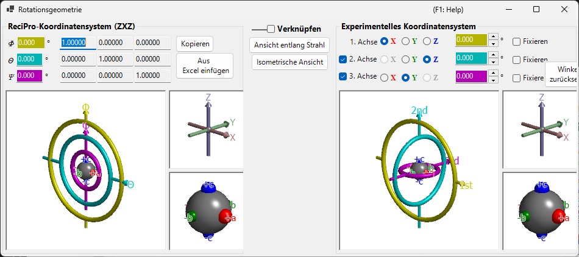

# Rotationsgeometrie

Dieses Fenster stellt den Rotationszustand eines Kristalls als 3×3-Matrix dar und rechnet zwischen verschiedenen Eulerschen Koordinatensystemen um.

ReciPro verwendet drei Eulerwinkel — **Ψ**, **θ** und **Φ** — die in der Reihenfolge **Z–X–Z** angewendet werden. Diese Konvention stimmt jedoch nicht zwangsläufig mit den Goniometerachsen Ihres tatsächlichen Geräts überein. Das Fenster **Rotationsgeometrie** ermöglicht es Ihnen, die Eulerwinkel von ReciPro in ein beliebig definiertes Koordinatensystem umzurechnen, und unterstützt so die Goniometereinstellung im Labor.

---

## Tastatur- & Maus-Kurzbefehle

Alle sechs 3D-Ansichten (die Felder für ReciPro und für das experimentelle Goniometer / die Achsen / die Objekte) sind **verknüpft** — wird eine davon gedreht, drehen sich alle sechs gemeinsam. Sie teilen sich die Standard-[OpenGL-Ansichtsnavigation](21-shortcuts.md) von ReciPro.

| Kurzbefehl | Aktion |
|----------|--------|
| <kbd>F1</kbd> | Diese Seite des Online-Handbuchs öffnen |
| Linksziehen in einer Ansicht | Modell drehen (alle sechs Ansichten drehen sich gemeinsam) |
| Mausrad oder Rechtsziehen nach oben/unten | Zoomen (die großen Goniometeransichten) |
| <kbd>CTRL</kbd> + Rechtsziehen nach oben/unten | Kameraabstand ändern (nur im perspektivischen Modus) |
| <kbd>CTRL</kbd> + Rechtsdoppelklick | Zwischen orthografischer und perspektivischer Projektion umschalten |

In den kleinen Ansichten *Axes* und *Objects* sind Zoomen und Verschieben deaktiviert. Es gibt keine Tastenkürzel außer <kbd>F1</kbd>.

---

## ReciPro-Koordinatensystem (ZXZ)

Die obere Hälfte des Fensters zeigt den Rotationszustand im "ReciPro-Koordinatensystem".

- Die Werte **Φ, θ, Ψ** sind mit den im Hauptfenster eingestellten Eulerwinkeln synchronisiert.
- **Rotationsmatrix** zeigt die 3×3-Matrix an, die dem aktuellen Rotationszustand entspricht.

### Φ, θ, Ψ (Z–X–Z-Eulerwinkel)

Die Kristallorientierung wird durch drei Rotationen parametrisiert. Im **körperfesten (intrinsischen)** Bezugssystem beschrieben, werden sie in dieser Reihenfolge angewendet:

1. **Φ** — erste Rotation um die **Z**-Achse.
2. **θ** — Rotation um die **X**-Achse des einmal gedrehten Bezugssystems.
3. **Ψ** — zweite Rotation um die **Z**-Achse des zweimal gedrehten Bezugssystems.

Dieselbe Rotation, im **raumfesten Labor**-Bezugssystem betrachtet, ist die umgekehrte Abfolge (Ψ um $Z$, dann θ um $X$, dann Φ um $Z$); diese Beschreibung wird in [Anhang A1.1](appendix/a1-coordinate-system/1-orientation.md) verwendet. Beide ergeben die identische Matrix $R$ unten; Φ ist einfach die äußerste (goniometerartige) Achse und Ψ die innerste.

Die Felder Φ, θ, Ψ und die neun Matrixfelder sind **schreibgeschützte** Anzeigen. Um die Orientierung zu ändern, drehen Sie den Kristall im Hauptfenster, verwenden Sie **Aus Excel einfügen** oder bearbeiten Sie (bei aktiviertem **Verknüpfen**) die Winkel der experimentellen Achsen weiter unten; jede Änderung wird an das Hauptfenster und alle verknüpften Simulatoren weitergegeben.

### Rotationsmatrix

Die 3 × 3-Matrix, die aus dem aktuellen (Φ, θ, Ψ) erzeugt wird. Verwenden Sie **Kopieren** / **Aus Excel einfügen**, um die Matrix über eine Tabellenkalkulation hin und zurück zu übertragen.

Die Matrix folgt überall in ReciPro ein und derselben Konvention:

$$
\mathbf{v}_{\mathrm{rot}} = R\,\mathbf{v}_{0}
$$

- \(R\) ist die **aktive** Rotation des Kristalls, ausgedrückt im monitorfesten Laborsystem (\(X\) nach rechts, \(Y\) nach oben, \(Z\) zum Betrachter — siehe [Anhang A1.1](appendix/a1-coordinate-system/1-orientation.md)).
- \(\mathbf{v}_{0}\) : kartesische Koordinaten (Spaltenvektor) einer kristallfesten Richtung in der **Ausgangsorientierung** (\(c \parallel Z\), \(b\) in der \(YZ\)-Ebene).
- \(\mathbf{v}_{\mathrm{rot}}\) : Koordinaten derselben Richtung nach der Rotation, weiterhin im Laborsystem.
- Bei \(\Phi=\theta=\Psi=0\) ist \(R\) die Einheitsmatrix. \(R\) ist orthonormal mit Determinante +1, die Umkehrtransformation ist daher einfach die Transponierte: \(R^{-1}=R^{\mathsf T}\).

In den Eulerwinkeln gilt \(R = R_Z(\Phi)\,R_X(\theta)\,R_Z(\Psi)\) (rechtshändige Rotationen um die festen Achsen; \(\Psi\) wirkt zuerst auf den Vektor):

$$
R=\begin{pmatrix}
\cos\Phi\cos\Psi-\cos\theta\,\sin\Phi\sin\Psi & -\cos\Phi\sin\Psi-\cos\theta\,\sin\Phi\cos\Psi & \sin\theta\,\sin\Phi\\
\sin\Phi\cos\Psi+\cos\theta\,\cos\Phi\sin\Psi & -\sin\Phi\sin\Psi+\cos\theta\,\cos\Phi\cos\Psi & -\sin\theta\,\cos\Phi\\
\sin\theta\,\sin\Psi & \sin\theta\,\cos\Psi & \cos\theta
\end{pmatrix}
$$

Für kristallographische Indizes rechnen Sie diese zuerst in kartesische Koordinaten der Ausgangsorientierung um: eine Richtung \([uvw]\) wird zu \(\mathbf{v}_0 = u\mathbf{a}+v\mathbf{b}+w\mathbf{c}\), eine Ebenennormale \((hkl)\) zu \(\mathbf{v}_0 = h\mathbf{a}^{*}+k\mathbf{b}^{*}+l\mathbf{c}^{*}\) (reziproke Achsen).

Dieselbe Matrix (\(R_{ij}\) = Zeile \(i\), Spalte \(j\)) erscheint als:

- **Kopieren** / **Aus Excel einfügen** in diesem Fenster (3 × 3, tabulatorgetrennt, Zeilen von oben nach unten);
- `Dir.GetRotationMatrix()` / `Dir.SetRotationMatrix()` und `Dir.GetEuler()` in der [Makro-API](20-macro/1-built-in-functions.md) (neun Elemente in Zeilenreihenfolge \(R_{11}, R_{12}, R_{13}, R_{21}, \ldots, R_{33}\));
- die Spalten **R11**–**R33** der Kandidatenliste, die [Spot ID v2](11-spot-id-v2.md) speichert.

### OpenGL-Fenster

Die 3D-Ansicht zeigt die aktuelle Rotation mithilfe von drei farbigen Tori (Donut-Formen):

| Farbe | Eulerwinkel | Goniometerebene |
|--------|------------|-----------------|
| **Gelb** | Φ | 1. (obere) Achse |
| **Hellblau** | θ | 2. (mittlere) Achse |
| **Rosa** | Ψ | 3. (untere) Achse |

Die Pfeile in **Rot**, **Grün** und **Blau** stellen die X-, Y- und Z-Achse in kartesischen Realraumkoordinaten dar. Diese sind *nicht* identisch mit den im Hauptfenster gezeigten Kristallachsen.

Die graue Kugel im Zentrum stellt die Probe dar. Die kleinen roten / grünen / blauen Kugeln (beschriftet mit **+a/−a**, **+b/−b**, **+c/−c**) markieren die Richtungen der normierten Kristallachsen *a*, *b*, *c* nach der Rotation (größere Kugel = +-Ende). Bei Φ = θ = Ψ = 0 zeigen sie die Ausgangsorientierung des Kristalls (*c* ∥ +Z, *b* in der YZ-Ebene), sodass *a* und *b* nur bei orthogonalen Zellen mit +X und +Y zusammenfallen.

> **Hinweis**: Das Ziehen im OpenGL-Fenster ändert nur die *Projektionsrichtung* dieser Ansicht, nicht die Kristallorientierung selbst. Um den Kristall zu drehen, verwenden Sie das Hauptfenster.

### Schaltflächen

| Schaltfläche | Aktion |
|--------|--------|
| Kopieren | Die 3×3-Rotationsmatrix im tabulatorgetrennten Format kopieren |
| Aus Excel einfügen | Rotationsmatrix aus der Zwischenablage setzen (tabulatorgetrennt 3×3) |
| Ansicht entlang Strahl | An die Projektion des Hauptfensters anpassen (Z-Achse senkrecht zum Bildschirm) |
| Isometrische Ansicht | Zur isometrischen Projektion wechseln |

---

## Experimentelles Koordinatensystem

Die untere Hälfte definiert Eulerwinkel auf einem beliebigen Satz von Rotationsachsen und liest bzw. setzt den Goniometerzustand. Dies wird als **Experimentelles Koordinatensystem** bezeichnet.

### 1., 2., 3. Achse

Wählen Sie die Rotationsachse jeder Goniometerebene (1. = oben, 2. = Mitte, 3. = unten) aus **X**, **Y** oder **Z** (nur die positiven Richtungen des Laborsystems). Die 2. Achse darf nicht gleich der 1. sein und die 3. nicht gleich der 2. (das widersprechende Optionsfeld wird deaktiviert). Standard ist **X – Z – Y**. Die Grafik wird entsprechend aktualisiert.

Der Winkel jeder Achse wird im zugehörigen farbigen Feld (gelb, hellblau, rosa) angezeigt und kann direkt eingegeben werden (in Grad; Werte außerhalb von −180…180° werden umgebrochen). Die experimentelle Rotation wird auf dieselbe Weise zusammengesetzt wie ReciPros eigene Matrix, mit der 1. Achse als äußerster:

$$
R_{\mathrm{exp}} = R_{\mathbf{e}_1}(\omega_1)\,R_{\mathbf{e}_2}(\omega_2)\,R_{\mathbf{e}_3}(\omega_3)
$$

(rechtshändige Rotationen um die festen Laborachsen $\mathbf{e}_i$).

| Bedienelement | Aktion |
|---------|--------|
| **2. Achse** / **3. Achse** | Diese Ebene aktivieren oder deaktivieren (ein Goniometer mit nur einer oder zwei Achsen). Beim Deaktivieren wird ihr Winkel auf 0 gesetzt. Das Deaktivieren der 2. Achse deaktiviert auch die 3. |
| **Fest** | Diesen Winkel auf seinem aktuellen Wert halten, während Verknüpfen eine neue Orientierung in Goniometerwinkel zerlegt (siehe unten). |
| **Winkel zurücksetzen** | Alle drei experimentellen Winkel auf 0 setzen. |

---

## Verknüpfen

Wenn **Verknüpfen** aktiviert ist, sind das ReciPro-Koordinatensystem und das experimentelle Koordinatensystem gekoppelt: Ihre Eulerwinkel werden so angepasst, dass die Objektorientierung zwischen beiden Systemen konsistent bleibt.

In dem Moment, in dem **Verknüpfen** aktiviert wird, wird der Versatz $R_{\mathrm{base}} = R_{\mathrm{exp}}^{-1} R$ zwischen beiden Systemen gespeichert, und von da an gilt $R = R_{\mathrm{exp}}\,R_{\mathrm{base}}$. Solange verknüpft ist:

- dreht die Bearbeitung eines experimentellen Winkels den Kristall in jedem Fenster;
- wird eine inkrementelle Rotation (Pfeilschaltflächen, CTRL+SHIFT+Pfeiltasten oder Ziehen im Hauptfenster bzw. in anderen Fenstern) numerisch in die aktivierten, nicht mit **Fest** fixierten Goniometerwinkel zerlegt, und der Kristall wird auf die **nächstgelegene Orientierung gesetzt, die das Goniometer erreichen kann** — bei fixierten oder deaktivierten Achsen folgt der Kristall daher den Einschränkungen des Goniometers statt exakt der Maus;
- wird eine absolute Orientierung (Felder der Euler-Winkel, **Zurücksetzen**, **Blick entlang** Achse/Ebene, **Aus Excel einfügen**) exakt übernommen; dabei werden die 2. und 3. Achse wieder aktiviert, jedes **Fest** aufgehoben und die Orientierung erneut in alle drei Goniometerwinkel zerlegt.

### Beispiel-Arbeitsablauf

1. Stellen Sie im Labor ein Goniometer so ein, dass die *a*-Achse eines Kristalls mit der Einfallsrichtung der Röntgenstrahlung ausgerichtet ist und die *b*-Achse horizontal liegt.
2. Geben Sie die Eulerwinkel des Labor-Goniometers im experimentellen Koordinatensystem ein.
3. Drehen Sie den Kristall im Hauptfenster so, dass die *a*-Achse zur Bildschirmnormalen und die *b*-Achse horizontal weist.
4. Aktivieren Sie **Verknüpfen** — jetzt werden, sobald Sie den Kristall im Hauptfenster auf eine andere Orientierung ausrichten, automatisch die erforderlichen Goniometerwinkel angezeigt.

---

## Siehe auch

- [Hauptfenster](0-main-window.md)
- [Stereonetz](6-stereonet.md)
- [Grundlegendes Koordinatensystem & Kristallorientierung](appendix/a1-coordinate-system/1-orientation.md)
- [Tastatur- & Maus-Kurzbefehle](21-shortcuts.md)
