# Strukturansicht

Die **Strukturansicht** zeichnet die Struktur des ausgewählten Kristalls als dreidimensionales Bild mit OpenGL.

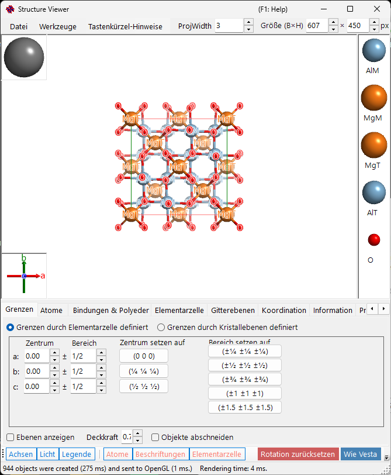

---

## Tastatur- & Maus-Kurzbefehle

Das Fenster besitzt eine große 3-D-Ansicht sowie zwei kleine Gizmos — die **Kristallachsen**-Box (unten links) und die **Lichtrichtungs**-Box (oben links) — und jede reagiert unterschiedlich auf ein Linksziehen. Die Hauptansicht verwendet ReciPros standardmäßige [OpenGL-Ansichtsnavigation](21-shortcuts.md).

| Kurzbefehl | Aktion |
|----------|--------|
| <kbd>F1</kbd> | Diese Seite des Online-Handbuchs öffnen |
| <kbd>CTRL</kbd>+<kbd>SHIFT</kbd>+<kbd>C</kbd> | Das gerenderte Bild in die Zwischenablage kopieren |
| Linksziehen in der Hauptansicht | Das Modell drehen |
| Linker Doppelklick auf ein Atom | Die Koordinaten des angeklickten Atoms sowie die Abstände und Bindungswinkel der Nachbarn um es herum anzeigen (nur dargestellte Atome lassen sich auswählen) <!-- 261105Cl 監査: 近接原子はクリックした位置の周り (ca87b772, 8cc95680) --> |
| Rechtsziehen nach oben/unten oder Mausrad | Zoomen |
| Mittelziehen | Verschieben |
| <kbd>CTRL</kbd> + Rechtsziehen nach oben/unten | Den Kameraabstand ändern (nur im Perspektivmodus) |
| <kbd>CTRL</kbd> + rechter Doppelklick | Zwischen orthografischer und perspektivischer Projektion umschalten |
| Linksziehen am **Kristallachsen**-Gizmo | Das Modell drehen (keine Drehung in der Ebene) |
| Linksziehen am **Licht**-Gizmo | Die Beleuchtungsrichtung ändern |

Die anwendungsweiten <kbd>CTRL</kbd>+<kbd>SHIFT</kbd>-Kurzbefehle aus dem [Hauptfenster](0-main-window.md#keyboard-mouse-shortcuts) funktionieren ebenfalls, solange dieses Fenster den Fokus hat.

→ Siehe **[21. Tastatur- & Maus-Kurzbefehle](21-shortcuts.md)** für eine Übersicht über alle Fenster.

---

## Hauptbereich

Die 3D-Kristallstruktur, dargestellt zusammen mit dem Lichtrichtungs-Gizmo, dem Kristallachsen-Gizmo und der Atomlegende. Position und Größe des Fensters bleiben für den nächsten Start erhalten. <!-- 261106Cl 作者の決定 H6 -->
> Die Box **Größe (B×H)** oben rechts im Fenster legt die Pixelgröße der 3D-Ansicht fest (das Fenster wird entsprechend angepasst); gespeicherte und kopierte Bilder haben diese Größe.
> Die Box **ProjWidth** daneben zeigt die Breite der projizierten Ansicht in nm an. Bearbeiten Sie den Wert, um numerisch zu zoomen — er bleibt mit dem Zoomen per Rechtsziehen / Mausrad in der Ansicht synchronisiert.

---

## Menüleiste

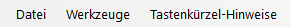

### Menü „Datei“

| Menüeintrag | Beschreibung |
|-------------|--------------|
| Bild speichern ▸ Hauptbild / Legende / Kristallachsen / Lichtrichtung | Die Hauptansicht, die Atomlegende oder eines der Gizmos als PNG speichern |
| Bild in Zwischenablage kopieren ▸ Hauptbild / Legende / Kristallachsen / Lichtrichtung <!-- 261105Cl 監査: copyToClipboardToolStripMenuItem.Text --> | Das Bild kopieren (Ctrl+Shift+C kopiert die Hauptansicht) |
| Video speichern ▸ Hauptbild / Kristallachsen | Ein Rotations-/Translationsvideo der Hauptansicht oder des Kristallachsen-Gizmos als MP4 speichern (Geschwindigkeit, Dauer, fps, Qualität usw.) |
| Export 3D model (3MF/STL) | Die dargestellte Struktur als Volumenmodell für den 3D-Druck ausgeben |

Menü **Werkzeuge**: **Ich mag VESTA** (wie die Symbolleisten-Schaltfläche *Wie Vesta*) und **Enable DDP** (blendet den Eintrag *Dual Depth Peeling* im [Transparenzmodus](#transparenzmodus) ein bzw. aus).

**Tastenkürzel-Hinweise** (ein eigenes Menü der obersten Ebene) listet die Tastenkürzel auf.

**Video speichern** öffnet den unten gezeigten Dialog zur Filmeinstellung. Ein Film kann die Ansicht drehen, das Projektionszentrum verschieben oder beides gleichzeitig tun — aktivieren Sie **Rotation** und/oder **Translation**:

- **Rotation**: dreht die Ansicht mit **Geschwindigkeit** (°/s; negative Werte kehren die Richtung um) um die darunter gewählte Achse — **Aktuelle Projektion** (Kipprichtung, mit den Pfeil-Schaltflächen gewählt), ein **Richtungsindex** [uvw] oder die Normale einer **Gitterebene** (hkl). Die Achse wird aus der Kristallorientierung zum Zeitpunkt des Drückens von **OK** bestimmt. Bei eingeschalteten Miller-Bravais-Indizes werden vier Indizes nur für **Gitterebene** angezeigt; ein **Richtungsindex** ist immer das dreistellige [uvw]. <!-- 261105Cl 監査: FormMovie.cs (OK の時点で回転軸を求め直す、4 指数は格子面だけ, 35fa72fc) -->
- **Translation**: verschiebt das Projektionszentrum entlang des Richtungsindex [uvw] mit **Geschwindigkeit** (Gitterperioden pro Sekunde). Diese Option erscheint nur, wenn der Dialog aus der Strukturansicht geöffnet wurde, und solange sie aktiviert ist, ist **Richtungsindex** der einzige Richtungsmodus.

Legen Sie die Filmlänge (**Dauer**), die Bildrate (**FPS**, 1–120) und die Encoder-Qualität (**Qualität**, 1–100; höhere Werte verwenden eine höhere Bitrate und ergeben eine größere Datei) fest, wählen Sie den Codec (**H264** / **H265**) und drücken Sie **OK**, um eine MP4-Datei zu erzeugen. **Endbild einschließen** hängt einen zusätzlichen Frame bei t = Dauer an, sodass der Film exakt mit der endgültigen Orientierung/Position endet. (Die Liste der Encodiergeschwindigkeit beschriftet nur noch die Fortschrittsanzeige und beeinflusst die eigentliche Encodierung nicht mehr.)

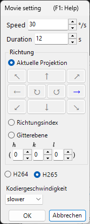

#### Export 3D model (3MF/STL)

**Export 3D model (3MF/STL)** gibt das aktuell dargestellte Strukturmodell als Volumenmodell für den 3D-Druck aus. Exportiert werden können nur geschlossene Körper — Atome (Kugeln und Ellipsoide), Bindungen (Zylinder) und Koordinationspolyeder. Atombeschriftungen, Begrenzungsflächen, Gitterebenen und die Symbole der Symmetrieelemente werden nicht exportiert. <!-- 261105Cl 監査: 配位多面体を出力し、対称要素は出さない (6c31fc0d) --> Der Rahmen der Elementarzelle besteht aus Liniensegmenten und wird nur dann durch Zylinder (mit Kugeln an den Ecken) ersetzt, wenn Sie die entsprechende Option aktivieren. **Objekte an Begrenzungsebenen abschneiden** wird auf die Ausgabe nicht angewandt: Objekte, die die Begrenzungsebenen schneiden, werden vollständig exportiert (der Dialog weist darauf hin). <!-- 261106Cl 作者の決定 H10 -->

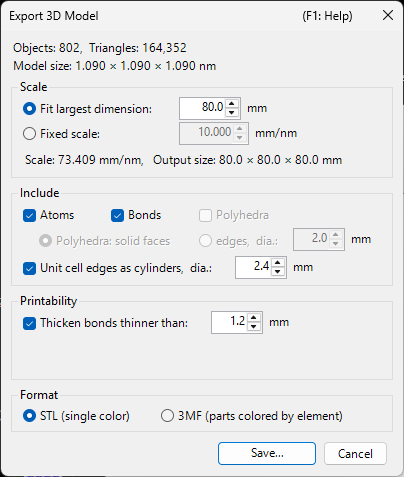

Oben im Dialog stehen die Anzahl der beteiligten Objekte und Dreiecke sowie die reale Größe des Modells (**Modellgröße**, nm).

**Maßstab** : wie die Ausgabegröße bestimmt wird

- **Größte Abmessung** : skaliert das Modell automatisch so, dass seine längste Kante die angegebene Länge erreicht (5–500 mm, standardmäßig 80 mm). Die Dicke der Zylinder, die den Rahmen der Elementarzelle und die Kantengerüste der Polyeder ersetzen, wird mit einbezogen. <!-- 261105Cl 監査: 円柱の太さを含めて合わせる (82e50b62) -->
- **Fester Maßstab** : den Maßstab (mm/nm) direkt angeben. Damit lassen sich mehrere Kristalle im selben Maßstab bauen und nebeneinanderstellen. Beim Umschalten wird der zuvor wirksame Maßstab als Startwert übernommen.
- Die Zeile darunter zeigt den resultierenden Maßstab und die gedruckten Abmessungen (**Ausgabegröße**, mm), ebenfalls einschließlich dieser Zylinderdicke.

**Einschließen** : welche Elemente in den Druck eingehen

- **Atome** / **Bindungen** / **Polyeder** : auswählbar sind nur die gerade dargestellten Arten; wird ein Haken entfernt, bleibt das Objekt auf dem Bildschirm, fällt aber aus dem Druck heraus.
- **Polyeder: Flächen** / **Kanten, Ø** : Koordinationspolyeder werden entweder als massive Körper mit Flächen oder als Kantengerüst (Zylinder plus Kugeln an den Ecken, standardmäßig 2.0 mm) ausgegeben. Beim Gerüst bleiben die Atome im Inneren sichtbar.
- **Gitternetz: Steg-Ø / Teilung** : das Kantengerüst plus ein Gitter aus dünnen Stegen auf jeder Fläche (Stegdurchmesser 0.8–5.0 mm, standardmäßig 1.2 mm; Teilung 1.5–20 mm, standardmäßig 5.0 mm). Aus der Ferne wirken die Flächen geschlossen, das Innere bleibt aber sichtbar.
- **Zellkanten als Zylinder, Ø** : bindet den Rahmen der Elementarzelle ein, ersetzt durch Zylinder des angegebenen Durchmessers (standardmäßig 2.4 mm). Dieses Kästchen ist standardmäßig aktiviert, sobald der Zellrahmen angezeigt wird.

**Druckbarkeit** : Drucktauglichkeit

- **Bindungen verdicken unter** : Bindungen, deren gedruckter Durchmesser unter den angegebenen Wert fiele (standardmäßig 1.2 mm), werden aus der ursprünglichen Primitive mit diesem Durchmesser neu erzeugt, damit dünne Bindungen nicht abbrechen. Bleibt die Option aus, während eine Bindung zu dünn ist, erscheint eine Warnung in Rot.

**Format** : Dateiformat

- **STL (einfarbig)** : eine einfarbige binäre STL-Datei.
- **3MF (nach Element gefärbt)** : 3MF mit nach Element eingefärbten Teilen; die Farbnamen tragen die Elementnamen.

**Speichern...** fragt nach dem Dateinamen. Nach Abschluss des Exports werden Dreieckszahl, gedruckte Abmessungen und Maßstab im Informationsfeld unten links protokolliert.

---

## Tab-Menü

### Durch Zelle definierte Grenzen

Legt den Zeichenbereich des Kristalls fest. Es gibt zwei Modi, die mit den Optionsfeldern oben umgeschaltet werden.

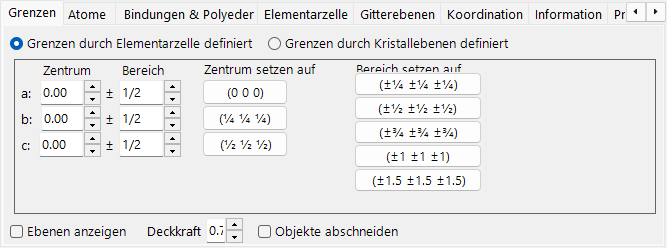

In diesem Modus sind die Achsen *a*, *b*, *c* der Elementarzelle die Einheit des Zeichenbereichs.

- **Zentrum**: Versatz des Zentrums des Zeichenbereichs gegenüber dem [Projektionszentrum](#projektionszentrum), in fraktionellen Koordinaten (positive Werte verschieben ihn in Richtung +*a*, +*b*, +*c*). Der gezeichnete Bereich ist (Projektionszentrum + Zentrum) ± Bereich. <!-- 261106Cl 作者の決定 H3/H18, C4 -->
- **Bereich**: obere/untere Grenze für jede der Achsen *a*, *b*, *c*.
- **Voreinstellungs-Schaltflächen** rechts liefern häufig verwendete Werte (z. B. 1×1×1-Zelle, 2×2×2-Zelle).

### Durch Kristallebenen definierte Grenzen

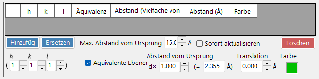

In diesem Modus wird der Zeichenbereich durch eine Reihe von Kristallebenen begrenzt. Wenn die Ebenen keinen räumlich abgeschlossenen Bereich definieren, fügt ReciPro ein nahezu kugelförmiges Polyeder mit dem Radius **Max. Abst. (Proj.-Zentr.)** (Å, gemessen vom [Projektionszentrum](#projektionszentrum)) hinzu, um ihn abzuschließen. <!-- 261106Cl 作者の決定 C4 -->

#### Grenzenliste

Alle für den aktuellen Kristall registrierten Begrenzungsebenen. Verwenden Sie **Hinzufügen / Ersetzen / Löschen**, um die Liste zu bearbeiten; das Kontrollkästchen ganz links deaktiviert eine Ebene vorübergehend, ohne sie zu löschen.

> Um die Änderungen dauerhaft zu speichern, müssen Sie außerdem **Add** oder **Replace** im **Hauptfenster** drücken. Andernfalls gehen die Änderungen verloren, sobald Sie die Auswahl in der Hauptkristallliste das nächste Mal ändern.

#### H-k-l-Indizes

Legt die Begrenzungsebene über ihren Miller-Index fest. Das Kontrollkästchen schließt kristallografisch äquivalente Ebenen ein, die aus dem ausgewählten (*hkl*) erzeugt werden.

#### Abstand vom Proj.-Zentrum

Der Abstand vom [Projektionszentrum](#projektionszentrum) (nicht vom Ursprung der Zelle) zur Begrenzungsebene, eingegeben entweder <!-- 261106Cl 作者の決定 C4 --> als Vielfaches des *d*-Werts (Netzebenenabstand) des ausgewählten (*hkl*) (Feld **d×**) oder in Å (das Feld in Klammern). Die beiden Felder sind gekoppelt: Eine Änderung des einen aktualisiert das andere. Jede Ebene liegt auf der +**g**-Seite des Projektionszentrums (in Richtung ihrer (*hkl*)-Normalen), und gezeichnet wird die Seite, die das Zentrum enthält; bei einer einzigen Ebene ist der Bereich der Halbraum auf der Zentrumsseite dieser Ebene. <!-- 261106Cl 仕上げ R3 D5: Boundary.cs Bound.Reset (面は nᵢ·r ≤ D) -->

- **Verschiebung** (Å): verschiebt den gesamten von den Ebenen begrenzten Bereich um diesen Betrag entlang der Normalen des angegebenen (*hkl*); positive Werte verschieben ihn in Richtung +**g**, d. h. in Richtung der (*hkl*)-Normalen. Dies funktioniert für jede Anzahl von Ebenen, auch für eine einzelne Ebene ohne **Äquivalente Ebenen**. <!-- 261106Cl 作者の決定 B11, C5 -->
- **Max. Abst. (Proj.-Zentr.)** (Å): Radius des abschließenden Polyeders, das verwendet wird, wenn die Ebenen keinen Bereich einschließen (siehe oben).
- **Sofort aktualisieren**: Änderungen an der ausgewählten Ebene übernehmen, ohne **Ersetzen** zu drücken.

#### Ebenen anzeigen / Deckkraft

Blendet die Begrenzungsebenen selbst ein oder aus. Wenn sie angezeigt werden, legt **Deckkraft** die Transparenz fest (0 = transparent, 1 = undurchsichtig).

#### Objekte an Begrenzungsebenen abschneiden

Wenn aktiviert, wird nur der durch die Grenzen definierte Innenbereich gerendert; Atome, Bindungen und Polyeder, die die Grenzen schneiden, werden abgeschnitten.

#### Atome ausblenden

Im Tab „Grenzen“ gibt es dafür kein Kontrollkästchen. Schalten Sie stattdessen die Symbolleisten-Schaltfläche **Atome** aus: Es werden keine Atome erzeugt, sodass auch Bindungen und Polyeder verschwinden — nützlich, wenn nur die Zelle oder die Netzebenen dargestellt werden sollen.

### Atome

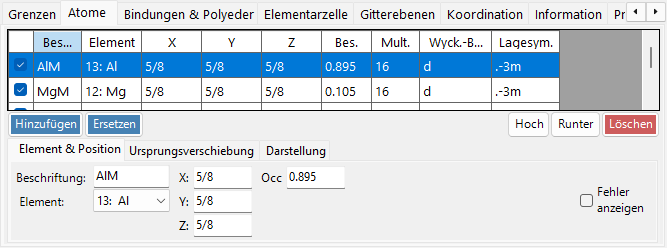

Legt Spezies, Position und Besetzung jedes Atoms fest sowie seine Darstellung (Radius, Farbe, Material).

#### Atomliste

Die Liste der Atome im Kristall. Verwenden Sie **Add / Replace / Delete**, um die Liste zu bearbeiten; das Kontrollkästchen ganz links blendet ein Atom vorübergehend aus.

> Um Änderungen dauerhaft zu speichern, klicken Sie ebenfalls im **Hauptfenster** auf **Add** oder **Replace**.

#### Element und Position

- **Label**: Freitext-Beschriftung für das Atom (wird in Legenden und Tooltips verwendet).
- **Element**: chemisches Element / Ionisierungszustand.
- **X, Y, Z**: fraktionelle Koordinaten. Reelle Zahlen von 0–1 oder Brüche wie `1/2` oder `2/3`.
- **Occ**: Besetzung, eine reelle Zahl von 0–1.

#### Ursprungsverschiebung

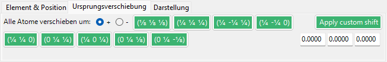

Verschiebt jedes Atom um denselben fraktionellen Versatz. Drücken Sie eine Voreinstellungs-Schaltfläche (zum Beispiel, um zwischen Ursprungswahl 1 / 2 für dieselbe Raumgruppe zu wechseln) oder geben Sie ein benutzerdefiniertes (Δx, Δy, Δz) ein und drücken Sie **Apply custom shift**.

#### Darstellung

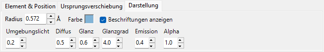

Radius, Farbe und Material pro Atom.

- **Radius**: gezeichneter Atomradius.
- **Farbe**: Oberflächenfarbe.
- **Material**: Textur- / Materialeigenschaften, die vom OpenGL-Shader verwendet werden.
- **Auf gleiches Element anwenden**: wendet den aktuellen Radius und die aktuelle Farbe auf jedes Atom derselben Elementart an.

### Bindungen & Polyeder

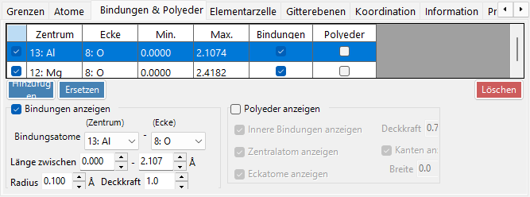

Legt fest, welche Atompaare gebunden sind (nach Spezies und Abstandsbereich), und wie die daraus entstehenden Bindungen und Koordinationspolyeder gezeichnet werden.

#### Bindungsliste

Alle für den Kristall registrierten Bindungs-/Polyederregeln. Verwenden Sie **Add / Replace / Delete**; das Kontrollkästchen ganz links deaktiviert einen Eintrag vorübergehend. Wie bei Atomen und Grenzen ist **Add** / **Replace** im **Hauptfenster** erforderlich, um die Änderung dauerhaft zu machen.

#### Bindungseigenschaft

- **Bindungen anzeigen**: die Bindungen dieser Regel zeichnen (das Kontrollkästchen über den Bindungseinstellungen).
- **Bindungsatome** **(Zentrum)** - **(Ecke)**: Elementart, die als Zentralatom der Bindung / des Polyeders und als Eckpunkt (das andere Ende) verwendet wird.
- **Länge zwischen** … **-** … (Å): untere und obere Abstandsschwelle. Atompaare außerhalb dieses Bereichs werden nicht gezeichnet.
- **Radius** (Å): gezeichnete Bindungsdicke (Zylinderradius).
- **Deckkraft**: Deckkraft der Bindung (0 = transparent, 1 = undurchsichtig).

#### Polyedereigenschaft

- **Polyeder anzeigen**: wenn aktiviert, wird das durch die aktuelle Bindung definierte Polyeder gezeichnet (nur wenn der Zentrum/Eckpunkt-Satz geometrisch gültig ist).
- **Innere Bindungen anzeigen**: zeichnet bei aktiviertem **Polyeder anzeigen** die Bindungen vom Zentrum zu den Ecken (dafür ist auch **Bindungen anzeigen** nötig).
- **Zentralatom anzeigen**: blendet das Zentralatom ein/aus.
- **Eckatome anzeigen**: blendet die Eckatome ein/aus. Ein ausgeblendetes Zentral- oder Eckatom wird dennoch gezeichnet, wenn ein anderes angezeigtes Polyeder es zeigt oder wenn es eine Bindung einer Definition ohne Polyeder abschließt. <!-- 261105Cl 監査: 3 つのチェックが描画に効くようになった (7e198f9d) -->
- **Deckkraft**: Deckkraft der Flächen (0 = transparent, 1 = undurchsichtig).
- **Kanten anzeigen**: zeichnet die Kanten, die die Eckpunkte verbinden.
- **Breite**: Linienbreite der Kanten in Pixeln (1–5). Von älteren Versionen gespeicherte Werte unter 1 werden als 1 px gezeichnet. <!-- 261106Cl 作者の決定 H4 -->
- In diesem Tab gibt es keine Farbfelder: Bindungen erhalten die Farben der Atome an ihren beiden Enden und Polyeder die Farbe ihres Zentralatoms (die Atomfarben werden im Tab [Atome](#atome) eingestellt). <!-- 261105Cl 監査: BondControl の colorControlPolyhedron/Bond/Edges は Visible=False。色は原子の材質から (FormStructureViewer.cs) -->

### Elementarzelle

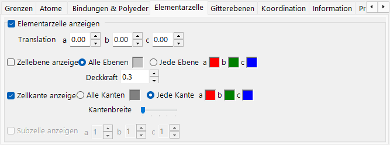

Legt die Position der gezeichneten Elementarzelle fest und ob ihre Flächen und Kanten angezeigt werden.

#### Translation

Jede Raumgruppe hat einen Standardursprung. Um das Zentrum der gezeichneten Elementarzelle von diesem Ursprung wegzubewegen, stellen Sie die Translation entlang *a*, *b*, *c* ein.

Die Translation ist an das [Projektionszentrum](#projektionszentrum) gekoppelt: Wird das Projektionszentrum auf $(x, y, z)$ gesetzt, wird die Translation auf $(x-0.5,\ y-0.5,\ z-0.5)$ gesetzt. Eine positive Translation verschiebt die gezeichnete Zelle in Richtung +*a*, +*b*, +*c*. <!-- 261106Cl 作者の決定 H3/H18 -->

#### Zellebene anzeigen

Ob die sechs Flächen gezeichnet werden, die die Elementarzelle begrenzen. Wenn aktiviert, können Sie die Flächenfarbe und Transparenz einstellen.

#### Zellkante anzeigen

Ob die Kanten der Elementarzelle gezeichnet werden. Die Kantenfarbe ist konfigurierbar.

Das Hauptkontrollkästchen **Elementarzelle anzeigen** (= die Symbolleisten-Schaltfläche *Elementarzelle*) schaltet die gesamte Zelle ein/aus. Flächen- und Kantenfarben lassen sich für **Alle Ebenen** / **Alle Kanten** auf einmal oder für **Jede Ebene** / **Jede Kante** (*a*, *b*, *c* getrennt) festlegen; **Kantenbreite** legt die Linienbreite und **Deckkraft** die Transparenz der Flächen fest.

#### Subzelle anzeigen

**Subzelle anzeigen** zeichnet Gitterlinien, die die Zelle in die in den Feldern **a**, **b**, **c** angegebene Anzahl von Teilen teilen (jeweils 1–10; die Felder sind nur bei aktiviertem Kontrollkästchen bedienbar), auf den Flächen und im Inneren der Zelle. Linien, die mit Zellkanten zusammenfallen, werden nicht gezeichnet. Die Linien übernehmen die Kantenfarbe (**Alle Kanten** / **Jede Kante**), die halbe Kantenbreite (mindestens 1 px) und die Deckkraft 0,5 und werden unabhängig von **Zellkante anzeigen** dargestellt. Sie werden beim Export des 3D-Modells nicht berücksichtigt. <!-- 261106Cl 作者の決定 H5 -->

### Gitterebenen

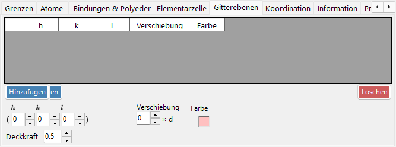

Zeichnet Gitterebenen, die über ihren Miller-Index angegeben werden, optional einschließlich der kristallografisch äquivalenten Ebenen.

#### H-k-l-Indizes

Legt die Netzebene über ihren Miller-Index fest. Das Kontrollkästchen schließt optional kristallografisch äquivalente Ebenen ein, die aus (*hkl*) erzeugt werden.

#### Verschiebung

Verschiebt die gezeichneten Netzebenen entlang ihrer Normalen um einen Bruchteil des *d*-Werts (**× d**, −0,5 bis 0,5); positive Werte verschieben sie in Richtung +**g** (die Ebenen liegen bei **g**·**r** = (*m* + T)*d*). Von früheren Versionen in Kristalllisten gespeicherte Werte werden daher auf der Gegenseite gezeichnet (0 und ±0,5 sehen gleich aus). <!-- 261106Cl 作者の決定 C5 --> Jede Ebene der Schar, die den Zeichenbereich schneidet, wird gezeichnet, eine pro *d*. Die Ebenen sind fest mit dem Kristallgitter verbunden: Bei 0 gehen sie durch die Gitterpunkte, und sie bewegen sich mit der Struktur, wenn sich das [Projektionszentrum](#projektionszentrum) ändert. <!-- 261105Cl 監査: LatticePlaneControl numericBoxDistance (−0.5〜0.5, × d)、FormStructureViewer.cs:SetLatticePlanes (4fd9e8c3)。「d の整数倍」は誤り -->

### Koordination

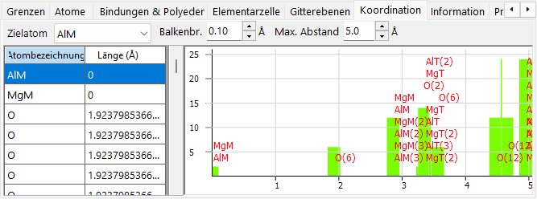

Listet die Atome auf, die ein ausgewähltes Zielatom koordinieren, und stellt sie grafisch dar.

#### Tabelle (linke Seite)

Listet auf, welche Atome das ausgewählte Zielatom umgeben und in welchem Abstand. Das Zielatom wird aus dem Dropdown-Menü oberhalb der Tabelle ausgewählt.

#### Graph (rechte Seite)

Histogramm der Nachbaranzahl in Abhängigkeit vom Abstand, abgeleitet aus denselben Daten wie die Tabelle. Passen Sie **Halbbreite** an (die halbe Breite *w* jedes Balkens, der *d* ± *w* abdeckt), bis sich die Balken sauber in die Koordinationsschalen trennen <!-- 261106Cl 作者の決定 B18 --> — dies liefert eine visuelle Abschätzung der Koordinationszahl.

### Information

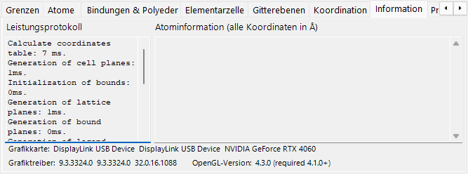

Rendering-Protokoll (Bildzeit, GPU-Informationen) und grundlegende Informationen über das ausgewählte Atom. In Arbeit — die Felder können mit der Zeit erweitert werden.

### Projektion

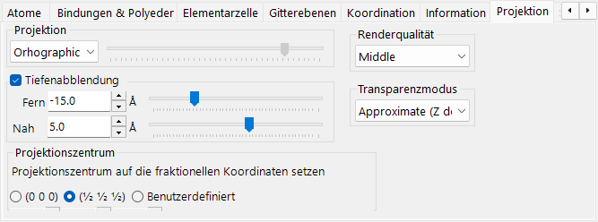

Legt den Projektionsmodus (orthografisch / perspektivisch), die Tiefenausblendung, das Projektionszentrum, die Renderqualität und den Transparenzalgorithmus fest.

#### Projektion

- **Orthographic**: perfekte Parallelprojektion (Betrachtungspunkt im Unendlichen).
- **Perspective**: perspektivische Projektion vom Betrachtungsabstand, der mit dem Schieberegler eingestellt wird.

#### Tiefenausblendung

Blendet entfernte Objekte in der Tiefenrichtung aus (**Tiefenabblendung**). Die Farbe wird linear zur **Hintergrundfarbe** hin gemischt: Objekte näher als **Nah** behalten ihre eigene Farbe, Objekte weiter als **Fern** nehmen die Hintergrundfarbe an, und dazwischenliegende Objekte werden interpoliert. (Die Deckkraft selbst wird nicht verändert.) **Nah** und **Fern** werden in Å angegeben.

#### Projektionszentrum

Setzt das Zentrum der Projektion auf die angegebenen Koordinaten. Aktivieren Sie **Benutzerdefiniert**, um beliebige Koordinaten einzugeben. Eingegebene Werte (−1 bis 1) werden unverändert verwendet. Ein **Translation**-Film (siehe [Menü „Datei“](#menü-datei)) steuert diese Werte automatisch an und faltet dabei jede Koordinate in den Bereich −0,5 bis +0,5 (eine Gitterperiode) zurück. <!-- 261105Cl 監査: 折り畳むのは SetProjectionCenter (動画の経路) だけ。マクロに投影中心の関数は無い -->

#### Renderqualität

Zeichenqualität (Mesh-Unterteilung, Kantenglättung). Höhere Qualität ist langsamer — wählen Sie die Einstellung, die zu Ihrer GPU passt.

#### Transparenzmodus

Algorithmus für durchscheinende Atome und Polyeder.

- **Approximate (Z depth sorting, OpenGL 4.1+)**: schnell, kann aber ungenau sein, wenn sich viele durchscheinende Objekte überlappen.
- **High quality (dual depth peeling, OpenGL 4.1+)**: reihenfolgeunabhängige Transparenz durch Depth Peeling. Wird nur angezeigt, wenn **Werkzeuge ▸ Enable DDP** aktiviert ist (standardmäßig an, wenn PPLL nicht verfügbar ist). Die Anzahl der Peeling-Durchgänge folgt der Einstellung [Renderqualität](#renderqualität).
- **High quality (per-pixel linked list, OpenGL 4.3+)**: exakte reihenfolgeunabhängige Transparenz; wird nur angezeigt, wenn die GPU OpenGL 4.3 unterstützt. Genau, aber langsam; erfordert praktisch eine dedizierte GPU.

### Symmetrieelemente

Der Tab **Sym.-Elem.** zeichnet die Symmetrieoperatoren der Raumgruppe direkt auf das 3D-Modell (umschalten mit der Symbolleisten-Schaltfläche **Sym.-Elem.**). Jede Klasse von Elementen kann unabhängig ein-/ausgeblendet werden:

- **Symmetrieachsen**: **Drehungen**, **Schraubungen**, **Drehinversionen**
- **Ebenen**: **Spiegelungen**, **Gleitspiegelungen**
- **Inversionszentren**

Der Hauptschalter ist **Symmetrieelemente anzeigen**. Für jede Gruppe können Sie die Symbolgröße (%) und die Farbe anpassen, bei Achsen und Ebenen zusätzlich die Linienbreite.

### Sonstiges

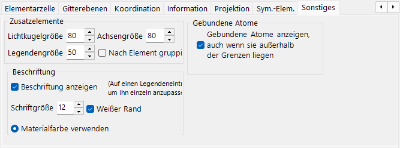

- **Zusatzelemente**: legt die Anzeigegrößen fest (Lichtkugel, Achsen, Legende). **Nach Element gruppieren** schaltet die Legendenanzeige um.
- **Gebundene Atome**: **Gebundene Atome anzeigen, auch wenn sie außerhalb der Grenzen liegen** zeichnet weiterhin Atome, die an Atome innerhalb des Zeichenbereichs gebunden sind, auch wenn sie außerhalb davon liegen.
- **Beschriftung**: Einstellungen der Atombeschriftungen in der 3-D-Ansicht (nicht der Legende) — **Beschriftung anzeigen**, **Schriftgröße**, **Weißer Rand** und die Beschriftungsfarbe (**Materialfarbe verwenden** oder **Feste Farbe verwenden**). Ein Klick auf einen Eintrag der Atomlegende schaltet die Beschriftungen dieses Atoms (bzw. mit **Nach Element gruppieren** dieses Elements) einzeln um.

---

## Symbolleiste

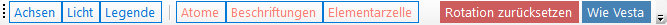

| Schaltfläche | Beschreibung |
|--------|-------------|
| Achsen | Achsenorientierung anzeigen (Größe = Gitterkonstante) |
| Licht | Lichtrichtung einstellen |
| Legende | Atomlegende |
| Atome | Die Atome ein-/ausblenden; Bindungen, Polyeder und Beschriftungen bauen auf den Atomen auf und werden daher ebenfalls ausgeblendet <!-- 261105Cl 監査: toolStripButtonAtomObjects.ToolTipText (2028c4a1) --> |
| Beschriftungen | Atombeschriftungen umschalten |
| Elementarzelle | Kanten der Elementarzelle umschalten |
| Sym.-Elem. | Überlagerung der Symmetrieelemente umschalten (siehe oben) |
| Rotation zurücksetzen | Zur Ausgangsorientierung zurückkehren |
| Wie Vesta | Zu einem Erscheinungsbild im VESTA-Stil wechseln: Atomfarben und -radien werden zurückgesetzt, und die Bindungsliste wird durch die Standardbindungen **ersetzt** |

---

## Siehe auch

- [Hauptfenster](0-main-window.md)
- [Kristalldatenbank](1-crystal-database.md)
- [Symmetrieinformationen](2-symmetry-information.md)
- [Beugungssimulator](7-diffraction-simulator/index.md)
- [Tastatur- & Maus-Kurzbefehle](21-shortcuts.md)
