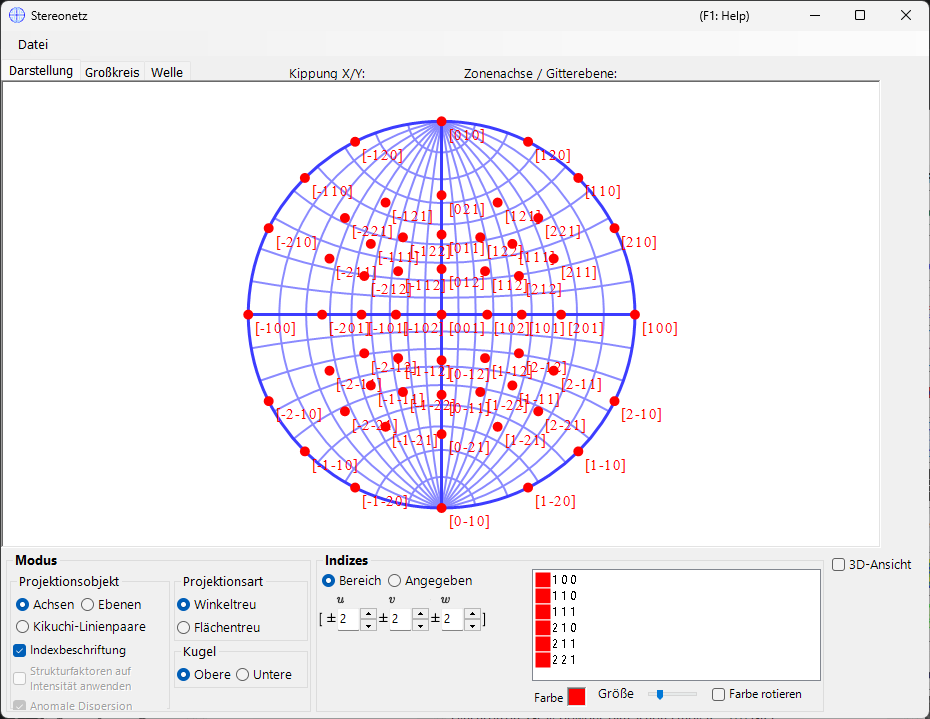
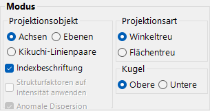
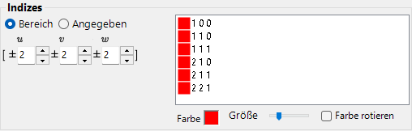
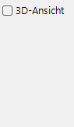
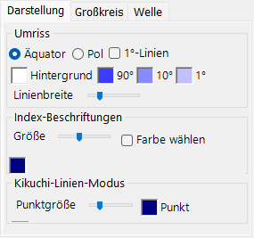
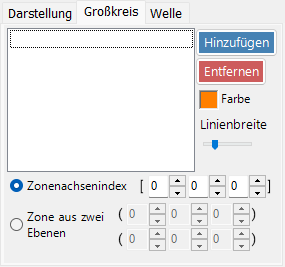
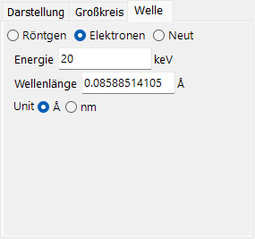

# Stereonetz

Das **Stereonetz** stellt Kristallebenen und Achsenrichtungen mithilfe der stereografischen Projektion dar.

---

## Tastatur- & Maus-Kurzbefehle

Das Stereonetz selbst ist eine 2-D-Projektion; eine optionale 3-D-Kugel kann mit **3D-Ansicht** eingeblendet werden.

| Kurzbefehl | Aktion |
|----------|--------|
| <kbd>F1</kbd> | Diese Seite des Online-Handbuchs öffnen |
| Linksziehen nahe der Mitte | Den Kristall kippen |
| Linksziehen im äußeren Bereich | Den Kristall um die Blickachse drehen |
| Linksdoppelklick | Zwischen der Projektion **Ebenen** und **Achsen** umschalten |
| Rechtsklick | Herauszoomen |
| Rechtsziehen eines Rahmens | In den ausgewählten Bereich hineinzoomen |
| Mittelziehen | Verschieben |
| Maus bewegen (ohne Taste) | Die (hkl)/[uvw] unter dem Cursor ablesen — nützlich zum Indizieren eines gemessenen Reflexes (auch auf der unteren Halbkugel) <!-- 261105Cl 監査: 下半球の読み取り (268779a1) --> |

Das Ziehen auf dem Netz dreht den **Kristall**; der Rotationszustand wird über alle Fenster hinweg geteilt.

Das 3-D-Rendering verwendet ReciPros Standard-[OpenGL-Ansichtsnavigation](21-shortcuts.md) (Linksziehen drehen, Rechtsziehen / Mausrad zoomen, <kbd>CTRL</kbd> + Rechtsdoppelklick schaltet die Projektion um) und dreht nur die 3-D-Ansicht, nicht den Kristall selbst.

Die anwendungsweiten <kbd>CTRL</kbd>+<kbd>SHIFT</kbd>-Kurzbefehle aus dem [Hauptfenster](0-main-window.md#keyboard-mouse-shortcuts) funktionieren ebenfalls, während dieses Fenster den Fokus hat.

→ Siehe **[21. Tastatur- & Maus-Kurzbefehle](21-shortcuts.md)** für jedes Fenster auf einen Blick.

---

## Hauptbereich

Hier wird die Stereonetz-Projektion der Kristallebenen, Richtungsindizes und Kikuchi-Linien des ausgewählten Kristalls angezeigt.

---

## Datei-Menü

Speichern oder Kopieren als Rasterbild (PNG) oder als Vektor-Metadatei (EMF). Eine eingefügte Metadatei erlaubt das Bearbeiten von Schriftarten und Linienstärken in PowerPoint oder anderen Vektoreditoren.

| Menüeintrag | Beschreibung |
|-------------|--------------|
| Bild speichern ▸ als Bild (PNG-Format) / als Metadatei (EMF) | Das Stereonetz als PNG-Datei oder als Vektor-EMF-Datei speichern <!-- 261105Cl 監査: as Metafile (EMF) の保存を配線 (FormStereonet.cs, 268779a1) --> |
| In Zwischenablage kopieren ▸ Als Bild / als Metadatei (EMF) | Das Stereonetz kopieren |
| Video speichern ▸ Stereonetz / 3D | Ein Rotationsvideo (MP4) des Stereonetzes oder der 3-D-Ansicht speichern, mit demselben Dialog zur Filmeinstellung wie in der [Strukturansicht](5-structure-viewer.md#menü-datei) (nur Rotation) |
| Seite einrichten / Druckvorschau / Drucken | Das Stereonetz drucken |

---

## Mode

### Projektionsziel

Wählen Sie aus, was auf das Netz projiziert werden soll.

- **Achsen** — projiziert die Richtungsindizes \([uvw]\).
- **Ebenen** — projiziert die Kristallebenennormalen \((hkl)\).
- **Kikuchi-Linienpaare** — projiziert Kikuchi-Linienpaare.

### Projektionsmethode

| Methode | Beschreibung |
|--------|-------------|
| **Winkeltreu** (Wulff / stereografisch) | Erhält die Winkelbeziehung zwischen den projizierten Merkmalen, aber nicht den Raumwinkel. Wird von klassischen Kristallographen beim Ablesen von Winkeln zwischen Achsen oder Ebenen verwendet. |
| **Flächentreu** (Schmidt / flächentreu / Lambert) | Erhält den Raumwinkel (die Fläche) jeder Region, verzerrt aber die Winkel. Bevorzugt für statistische Polfiguren, bei denen die relative Dichte von Bedeutung ist. |

### Hemisphäre

Wählen Sie die **Obere** oder **Untere** Hemisphäre als Projektionsquelle — dies schaltet um, ob die sichtbare Seite der Kugel diejenige ist, die dem Betrachter am nächsten oder am weitesten von ihm entfernt liegt.
Obere = die $+Z$-Seite (zum Betrachter hin, siehe [Anhang A1.1](appendix/a1-coordinate-system/1-orientation.md)); bei **Untere** wird die $Z$-Komponente jeder Richtung vor der Projektion umgekehrt, und die Punkte werden als **offene Kreise** statt als gefüllte gezeichnet.

### Anzeigeoptionen

- **Indexbeschriftung**: Indexbeschriftungen anzeigen.
- **Strukturfaktoren auf Intensität anwenden**: Wenn **Ebenen** oder **Kikuchi-Linienpaare** ausgewählt ist, wird jedes Element mit seinem Strukturfaktor gewichtet (Wellenquelle und Wellenlänge im [Wave-Tab](#wave) festlegen). Das Gewicht ist $I_{\mathrm{rel}} = |F_{hkl}|^2 / \max|F|^2$ über die angezeigte Menge: Im Modus **Ebenen** wird der Punktradius mit $\sqrt{I_{\mathrm{rel}}}$ multipliziert (d. h. $\propto |F_{hkl}|$); im Modus **Kikuchi-Linienpaare** ist die Deckkraft der Linien $I_{\mathrm{rel}}$.
- **Anomale Dispersion**: bezieht die Terme $f'$, $f''$ der anomalen Röntgendispersion in die Strukturfaktoren ein. Nur für Röntgenstrahlen und im Modus **Ebenen** / **Kikuchi-Linienpaare** verfügbar.

> Für trigonale/hexagonale Kristalle kann die Miller-Bravais-Notation (4-Index) über **Optionen ▸ Miller-Bravais-Index (hkil) verwenden** im Hauptfenster aktiviert werden.

---

## Indices

Legt fest, welche Kristallebenen / Achsen gezeichnet werden.

### Bereichsmodus

Geben Sie einen Bereich von \([uvw]\)- oder \((hkl)\)-Indizes an. ReciPro zählt jeden Index innerhalb der Grenzen auf und projiziert jeden einzelnen.

Im Bereichsmodus sind die Grenzen $\pm$ die eingegebenen Werte; berücksichtigt werden nur teilerfremde Indizes, gruppiert in Sätze kristallographisch äquivalenter Indizes (jeder Satz erhält eine Farbe).

### Strukturfaktor-Modus

Nur für **Ebenen** und **Kikuchi-Linienpaare** verfügbar. Projiziert die Ebenen mit dem größten $|F_{hkl}|^2$ für die aktuelle Wellenquelle. **Max.** legt die Anzahl der zu zeichnenden Ebenen fest (äquivalente Ebenen werden einzeln gezählt; im Modus **Ebenen** wird ein Reflex übersprungen, der zu einem stärkeren parallel ist — eine höhere oder niedrigere Ordnung davon, z. B. 222, wenn 111 stärker ist).

### Spezifizierter Modus

Legt bestimmte Achsen oder Ebenen einzeln fest. Geben Sie einen Index ein, drücken Sie **Hinzufügen**, um ihn zu registrieren, oder **Entfernen**, um ihn zu löschen. Wenn **Äquivalente Indizes einschließen** aktiviert ist, werden auch alle kristallographisch äquivalenten Indizes gezeichnet.

### Colour / Size

Legen Sie **Farbe** und **Größe** der eingezeichneten Punkte fest. Aktivieren Sie **Farbe rotieren**, um jeden Satz äquivalenter Achsen/Ebenen unterschiedlich farblich zu codieren — nützlich, um Familien in einer Mehrindex-Darstellung zu unterscheiden.

---

## 3D Options

Wird angezeigt, wenn **3D-Ansicht** aktiviert ist; die 3-D-Kugel erscheint in einem Bereich rechts neben dem Netz.

- **Startansicht**: setzt die 3-D-Ansicht auf die Standardrichtung und den Standardzoom zurück.
- **Beschriftung**: zeichnet Indexbeschriftungen in 3-D. Richtungen werden als [uvw] beschriftet; die Vier-Index-Form (bei aktiviertem **Miller-Bravais-Index (hkil) verwenden**) wird nur für Ebenen und Kikuchi-Linien verwendet. <!-- 261105Cl 監査: 3D のラベル (FormStereonet.cs, 268779a1) -->
- **Halbkugel**: zeichnet nur die Pole auf der oberen ($Z>0$) Halbkugel.
- **Stereonetz**: zeichnet die Projektionsebene (das Netz) in 3-D, mit den projizierten Punkten der Pole der oberen Halbkugel.
- **Kugel-Umriss**: zeichnet das Breiten-/Längengradgitter der Kugel.
- **Projektionslinien** (bei aktiviertem **Stereonetz**): zeichnet die Hilfsprojektionslinien jedes Pols der oberen Halbkugel — eine Gerade vom Südpol $(0,0,-1)$ zum Pol bei Wulff, einen Bogen bei Schmidt.
- **Tiefenabblendung**: Stärke der Tiefenabblendung der 3-D-Ansicht.

---

## Tab-Menü

### Appearance

#### Outline

Wie der Umriss des Stereonetzes gezeichnet wird — der Begrenzungskreis und das optionale Großkreis-Längen-/Breitengrad-Gitter. Wählen Sie **Äquator** oder **Pol**, schalten Sie **1°-Linien** und die **Hintergrund**-Füllung um, legen Sie die Gitterfarben **90° / 10° / 1°** fest und passen Sie die **Linienbreite** mit dem Schieberegler an.

#### Index labels

- **Size** — Größe der Indexbeschriftungen.
- **Farbe wählen** — verwendet eine einzige feste Farbe für alle Indexbeschriftungen anstelle der punktbezogenen Farbe; nützlich, wenn die Punkte farblich codiert sind, Sie aber alle Beschriftungen zur besseren Lesbarkeit in einer einzigen Farbe wünschen.
- **Trennzeichen** — Zeichen, das zwischen den Indizes jeder Beschriftung gesetzt wird: **Keine** (z. B. 100), **Leerzeichen** (1 0 0) oder **Komma** (1,0,0).

#### Kikuchi line mode

- **Punktgröße** — Größe der eingezeichneten Punkte.
- **Punkt** / **Beschriftung** — Farben der Punkte und ihrer Beschriftungen.

### Großkreis

Zeichnen Sie Großkreise (Kleinkreise werden nicht unterstützt). Geben Sie diese entweder über den **Zonenachsenindex** \([uvw]\) an (der Großkreis, der von der Zone dieser Achse gebildet wird) oder über **Zone aus zwei Ebenen** (die Zonenachse ist ihr Kreuzprodukt). Verwenden Sie **Hinzufügen** / **Entfernen**, um die Liste zu bearbeiten; das Abwählen eines Eintrags blendet diesen Kreis aus. Farbe und Linienstärke der Kreise sind ebenfalls konfigurierbar. Die Kreise folgen der unter [Mode](#mode) gewählten Projektionsmethode und Halbkugel (Wulff oder Schmidt, obere oder untere). <!-- 261105Cl 監査: Schmidt・下半球の大円 (268779a1) -->

### Wave {#wave}

Wird nur verwendet, wenn **Ebenen** oder **Kikuchi-Linienpaare** als Projektionsziel ausgewählt ist (im Modus **Kikuchi-Linienpaare** legt die Wellenlänge außerdem den Bragg-Winkel fest, d. h. den Abstand jedes Linienpaars). Legt die Wellenquelle (X-ray / electron / neutron) sowie die Wellenlänge oder Energie fest, die zur Berechnung der Kristallstrukturfaktoren benötigt werden, die von **Strukturfaktoren auf Intensität anwenden** in [Mode](#mode) verwendet werden.

---

## Siehe auch

- [Hauptfenster](0-main-window.md)
- [Rotationsgeometrie](4-rotation-geometry.md)
- [Strukturansicht](5-structure-viewer.md)
- [Beugungssimulator](7-diffraction-simulator/index.md)
- [Grundlegendes Koordinatensystem & Kristallorientierung](appendix/a1-coordinate-system/1-orientation.md)
