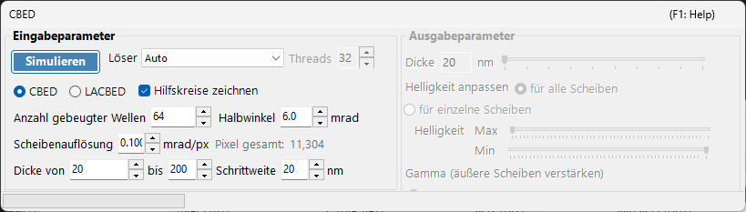
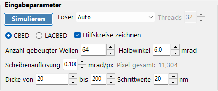
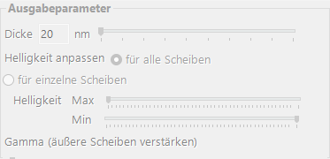

# CBED-Simulation

Die **CBED-Simulation (Convergent-Beam Electron Diffraction)** berechnet und zeigt Beugungsbilder mit konvergenter Beleuchtung mithilfe der Bloch-Wellen-Methode (Bethe) an. CBED-Bilder zeigen Beugungsscheiben statt Reflexpunkten und enthalten reichhaltige Informationen über Kristallsymmetrie, Dicke und Struktur.

> Diese Seite listet alle Einstellungen des speziellen Fensters auf, das sich öffnet, wenn Sie im [Beugungssimulator](index.md) **Wellenquelle = Elektron** und **Optik = Konvergenz (Elektron)** auswählen. Beim Umschalten des einfallenden Strahls auf Konvergenz wird **Intensitätsberechnung** automatisch auf **Dynamische Theorie** gesetzt, und dieses CBED-Einstellungsfenster öffnet sich. Die berechneten Scheiben lassen sich über **Datei > CBED-Scheiben speichern** / **CBED-Scheiben kopieren** des Hauptfensters sichern. Zum Zeichnen und Speichern von Beugungsbildern sowie zu weiteren Vorgängen, die für den Beugungssimulator gemeinsam gelten, siehe die [Übersichtsseite](index.md).

GUI-Bedingungen: Wellenquelle = Elektron · Optik = Konvergenz (Elektron) · Intensitätsberechnung = Dynamische Theorie (automatisch)

---

## Eingabeparameter

Solange dieses Fenster geöffnet ist, sind die Bereiche **Bloch-Wellen-Einstellungen** und **Darstellung** des Hauptfensters deaktiviert; Wellenanzahl und Dicken werden von hier übernommen.

| Parameter | Beschreibung | Standard / Typisch |
|-----------|-------------|-------------------|
| **Mode** | **CBED**: Standardbild mit konvergenter Beleuchtung, bei dem jede Scheibe einem Reflex entspricht, mit der durchgehenden Scheibe (000) im Zentrum. **LACBED** (Large-Angle CBED): Bild mit konvergenter Beleuchtung und großem Winkel, bei dem sich die Scheiben verschiedener Reflexe überlappen. Nützlich zur Beobachtung von HOLZ-Linien (higher-order Laue zone) und Symmetrie | CBED |
| **Halbwinkel (mrad)** | Halbwinkel des Konvergenzkegels des Strahls (0–2000 mrad). Bestimmt die Größe jeder Beugungsscheibe (der Scheibendurchmesser im reziproken Raum entspricht $2\alpha$) | Standard 6 mrad; typisch 5–30 mrad |
| **Scheibenauflösung (mrad/px)** | Winkelauflösung innerhalb jeder Scheibe. Die Scheibe wird auf einem $N\times N$-Raster mit $N = \lceil 2\alpha / \text{resolution} \rceil$ abgetastet, und nur die Punkte innerhalb des Kreises werden berechnet. Kleinere Werte ergeben eine höhere Auflösung, aber die Anzahl der Strahlrichtungen wächst quadratisch, sodass auch die Rechenzeit quadratisch zunimmt. Die resultierende Anzahl (= Gesamtzahl der Strahlrichtungen) wird als **Pixel gesamt** angezeigt | Standard 0,1 mrad/px |
| **Anzahl gebeugter Wellen** | Maximale Anzahl der Strahlen, die in die Bloch-Wellen-Berechnung bei jeder einfallenden Strahlrichtung einbezogen werden (1–2048). Mehr Strahlen ergeben eine höhere Genauigkeit, aber der Aufwand des Eigenwertproblems wächst mit $O(N^3)$ | Standard 64; typisch 100–500 |
| **Dicke von / bis / Schrittweite** | Start-, End- und Schrittwerte der Probendicke (nm, jeweils 1–1000). Mehrere Dicken werden zusammen berechnet und mit dem Dicken-Schieberegler auf der Ausgabeseite umgeschaltet | Standard 20 bis 200 nm, Schrittweite 20 nm |
| **Löser** | Rechenmaschine. **Auto**; **Eigenproblem with Eigen lib.** / **Eigenproblem with MKL lib.** (Diagonalisierung); **Matrix exp. with Eigen lib.** / **Matrix exp. with MKL lib.** (Matrixexponential-Methode, v4.794). **Auto** verwendet die Matrixexponential-Methode mit Eigen und allen logischen Prozessoren, wenn Eigen verfügbar ist, andernfalls das MKL-Eigenwertproblem. Der Matrixexponential-Weg erfordert äquidistante Dicken und fällt sonst auf das Eigenwertproblem zurück. MKL-Einträge werden auf ARM64 nicht angeboten, und Eigen-Einträge sind ausgeblendet, wenn die native Eigen-Bibliothek nicht verfügbar ist | Auto |
| **Threads** | Anzahl der parallelen Threads (1–128). Bei **Auto** deaktiviert; die Auswahl eines Lösers setzt sie auf die Anzahl der logischen Prozessoren (bei MKL ¼ davon) | — |
| **Hilfskreise zeichnen** | Wenn aktiviert, werden gelbe Kreise gezeichnet, die die Grenze jeder Beugungsscheibe im Hauptmuster anzeigen (bei LACBED ein Kreis für 000 und Kreuze für die übrigen Reflexe) | an |

---

## Run / Stop

- **Simulieren** : startet die CBED-Simulation mit den aktuellen Eingabeparametern.
- **Stopp** : bricht die laufende Berechnung ab.

---

## Ausgabeparameter

Sobald die Berechnung abgeschlossen ist, werden die Ausgabeparameter verfügbar. Alle ändern nur die Anzeige, ohne neu zu rechnen.

| Parameter | Beschreibung |
|-----------|-------------|
| **Dicke** | Wählt mit einem Schieberegler die anzuzeigende Probendicke innerhalb des Dickenbereichs der Eingabeparameter aus (die Tabelle der [Beugungsreflex-Informationen](index.md#diffraction-spot-information) folgt ihr) |
| **Helligkeit anpassen** | **für alle Scheiben**: eine gemeinsame Helligkeitsskala, normiert auf das Maximum über alle Scheiben. **für einzelne Scheiben**: jede Scheibe wird auf ihr eigenes Maximum normiert (γ wird auf 0 zurückgesetzt und deaktiviert) |
| **Helligkeit (Max / Min)** | Obere und untere Grenze der angezeigten Intensität als Bruchteile des Maximums (die Schiebereglerposition geht in der 4. Potenz ein). Anpassen, wenn Sie schwache Merkmale hervorheben möchten |
| **Gamma (äußere Scheiben verstärken)** | Multipliziert jedes Pixel mit $\exp(\gamma\,r)$, wobei $r$ sein Abstand vom Musterzentrum ist, um die dunklen äußeren Scheiben bei großen Winkeln im Vergleich zur zentralen durchgehenden Scheibe besser sichtbar zu machen. Nur bei **für alle Scheiben** aktiv |
| **Gradient** | Wählt die Intensitätsabstufung zwischen **Positive** / **Negative** (schwarz-weiß invertiert) aus |
| **Farbe** | Für die Anzeige verwendete Farbkarte: **Gray**, **Cold-Warm**, **Spectrum** oder **Fire** |

---

## Physikalischer Hintergrund

Bei CBED wird der einfallende Strahl als ein Kegel ebener Wellen mit unterschiedlichen Richtungen betrachtet. Für jede Richtung (jeden Punkt innerhalb der Konvergenzblende = eine partielle einfallende ebene Welle) löst die Bloch-Wellen-Methode die Elektronen-Schrödinger-Gleichung im Inneren des Kristalls, und die Ergebnisse werden als Beugungsscheiben angeordnet. HOLZ-Linien (higher-order Laue zone) erscheinen als feine dunkle/helle Linien innerhalb der Scheiben und entstehen durch Reflexe in höheren Laue-Zonen. Sie sind empfindlich gegenüber dem Gitterparameter entlang der $c$-Achse und nützlich für die dreidimensionale Strukturanalyse.

Für die theoretischen Einzelheiten siehe [CBED-Berechnung](../appendix/a3-bloch-wave/cbed.md).

---

## Siehe auch

- [Beugungssimulator (Übersicht)](index.md)
- [SAED-Simulation](1-saed-simulation.md)
- [PED-Simulation](2-ped-simulation.md)
- [CBED-Berechnung](../appendix/a3-bloch-wave/cbed.md)
