# Crystal Diffraction (Beugungssimulator)

**Crystal Diffraction (Beugungssimulator)** simuliert Einkristall-Röntgen-, Neutronen- und Elektronenbeugungsmuster.

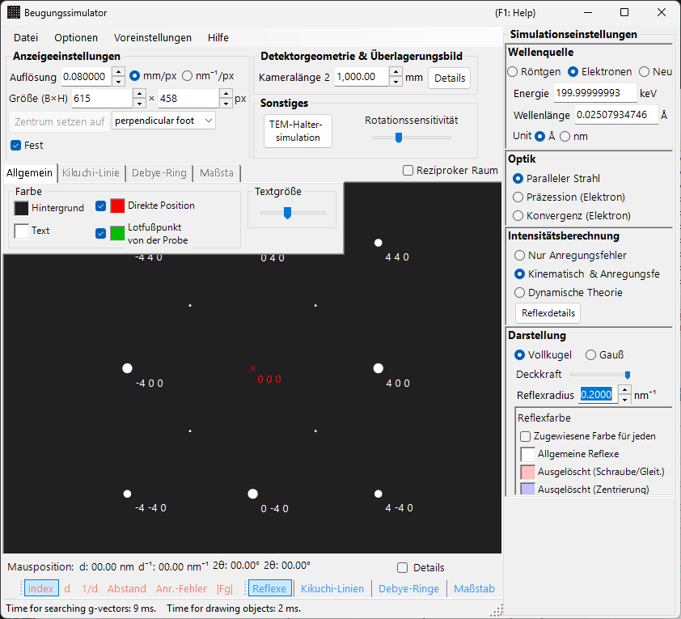

Das Fenster besitzt **links** einen Zeichenbereich für das Beugungsmuster und **rechts** die Einstellungsbereiche für die Reflexeigenschaften (Wellenlänge, einfallender Strahl, Intensitätsberechnung, Darstellung usw.). Die Kombination aus Wellenlänge und einfallendem Strahl bestimmt den Aufnahmemodus (Röntgenbeugung, SAED, PED, CBED), und die rechten Bereiche werden entsprechend neu konfiguriert.

---

## Wie sich diese Seite und die Modus-Seiten die Arbeit aufteilen

- **Diese Seite (Hub)**: fasst die Operationen zusammen, die jedem Modus gemeinsam sind (Kurzbefehle, Menüs, Symbolleiste, Schirm-/Detektorinformationen, Overlay-Registerkarten, Reflexinformationen, Detektorgeometrie, dynamische Kompression).
- **Jede Modus-Seite**: behandelt **jede Einstellung, die rechts erscheint**, wenn dieser Modus ausgewählt ist (Wellenlänge, einfallender Strahl, Intensitätsberechnung, Darstellung, Bloch-Wellen-Einstellungen, Präzessionseinstellungen usw.), sodass jede Seite in sich abgeschlossen ist (zwischen den Modi gibt es einige Überschneidungen).

| Modus | Inhalt | Seite |
|------|----------|------|
| **Röntgenbeugung (und Neutronenbeugung)** | Einkristall-Röntgen-/Neutronenbeugungsmuster (parallel, Präzessions-Röntgen, Back Laue) | [Röntgenbeugungssimulation](5-x-ray-neutron-diffraction.md) |
| **SAED** | Parallelstrahl-Elektronenbeugung (selected-area electron diffraction) | [SAED-Simulation](1-saed-simulation.md) |
| **PED** | Präzessions-Elektronenbeugung | [PED-Simulation](2-ped-simulation.md) |
| **CBED** | Konvergente Elektronenbeugung | [CBED-Simulation](3-cbed-simulation.md) |

> **ALCHEMI ist kein Modus.** Anders als Röntgen / SAED / PED / CBED, die sich aus der Kombination von Wellenlänge und einfallendem Strahl ergeben, ist der ALCHEMI-Simulator ein **Unterfenster**, das über das Menü **Optionen** geöffnet wird; er ist deshalb hier getrennt aufgeführt.

| Unterfenster | Inhalt | Seite |
|------|------|------|
| **ALCHEMI-Simulator** | Platzaufgelöste Ionisations-Rocking-Kurven (channelling-verstärkte Mikroanalyse) | [ALCHEMI-Simulation](4-alchemi-simulation.md) |

---

## Modus-Schnellübersicht

Suchen Sie die benötigte Seite anhand der Kombination aus **Wellenlänge (Quelle)** und **einfallendem Strahl**.

| Wellenlänge | Einfallender Strahl | Modus | Seite |
|------------|--------------------|------|------|
| Elektron | Parallel | SAED | [SAED-Simulation](1-saed-simulation.md) |
| Elektron | Präzession (Elektron = PED) | PED | [PED-Simulation](2-ped-simulation.md) |
| Elektron | Konvergenz (CBED) | CBED | [CBED-Simulation](3-cbed-simulation.md) |
| Röntgen | Parallel | Röntgenbeugung | [Röntgenbeugungssimulation](5-x-ray-neutron-diffraction.md) |
| Röntgen | Präzession (Röntgen) | Präzessions-Röntgen (Präzessionskamera) | [Röntgenbeugungssimulation](5-x-ray-neutron-diffraction.md) |
| Röntgen | Back Laue | Rückstrahl-Laue | [Röntgenbeugungssimulation](5-x-ray-neutron-diffraction.md) |
| Neutron | Parallel | Neutronenbeugung | [Neutronen-Abschnitt der Röntgenbeugungssimulation](5-x-ray-neutron-diffraction.md) |

> **Hinweis**: Die Auswahlmöglichkeiten für den einfallenden Strahl (**Optik**) ändern sich mit der Wellenlänge. Für Elektronen: **Paralleler Strahl, Präzession (Elektron), Konvergenz (Elektron)**; für Röntgenstrahlen: **Paralleler Strahl, Präzession (Röntgen, ZOLZ), Rück-Laue (Röntgen)**; für Neutronen: nur **Paralleler Strahl**. Ein Wechsel der Wellenquelle setzt die Optik stets auf **Paralleler Strahl** zurück. Die Auswahl von **Präzession (Elektron)** oder **Konvergenz (Elektron)** schaltet die Intensitätsberechnung automatisch auf **Dynamische Theorie** um; **Dynamische Theorie** wird nur für Elektronen angeboten (bei Auswahl von Röntgenstrahlen oder Neutronen wird auf **Kinematisch & Anr.-Fehler** zurückgeschaltet). Rück-Laue verwendet einen weißen (polychromatischen) Strahl.

---

## Tastatur- & Maus-Kurzbefehle

Diese gelten für das Beugungsmuster-Fenster, das von der Röntgen-, SAED- und PED-Simulation gemeinsam genutzt wird. Ziehen auf dem Muster dreht den **Kristall**. Zoomen Sie mit dem Mausrad oder mit Rechtsklick / Rechtsziehen.

| Kurzbefehl | Aktion |
|----------|--------|
| <kbd>F1</kbd> | Diese Seite des Online-Handbuchs öffnen |
| Linksziehen nahe der Mitte | Den Kristall kippen |
| Linksziehen im äußeren Bereich | Den Kristall um die Strahlachse drehen |
| Linksdoppelklick auf einen Reflex | Reflexdetails anzeigen (Index, *d*, Strukturfaktor, Anregungsfehler) |
| Mittelziehen | Das Muster verschieben |
| <kbd>CTRL</kbd> + Mittelziehen | Das Detektorzentrum verschieben (wenn der Detektorbereich angezeigt wird) |
| Mausrad | Pro Raststufe um ×2 hinein-/herauszoomen; der Punkt unter dem Cursor wird in die Mitte der Ansicht gebracht (bei angehaktem **Fest** bleibt stattdessen das feste Zentrum erhalten) |
| Rechtsklick | Herauszoomen (×1/1,2) |
| Rechtsziehen eines Rahmens | In den ausgewählten Bereich hineinzoomen |
| Rechtsdoppelklick auf die Statusleiste | Eine Textzusammenfassung der aktuellen Einstellungen kopieren |
| Rechtsdoppelklick auf eine aktive Ebenen-Schaltfläche (Spots / Kikuchi / Debye / Scale) | Diese Ebene ein- und ausblinken lassen |

Die von hier geöffneten Hilfsfenster fügen einige weitere hinzu:

| Kurzbefehl | Aktion |
|----------|--------|
| Linksdoppelklick auf das Stereonetz — **TEM-Halter** | Die Halterkippung auf diesen Punkt setzen |
| Pfeiltasten — **TEM-Halter** | Die Halterkippung schrittweise ändern (zuerst **Pfeiltasten aktivieren** anhaken; wirkt bei jedem ReciPro-Fenster im Vordergrund) |
| Eine `.prm`-Datei oder ein Bild ablegen — **Detektorgeometrie** | Detektorgeometrie / Overlay-Bild laden |
| Ein `.txt`-Profil ablegen — **Dynamische Kompression** | Positions-/Zeit-/Druckprofile laden (die Zeit mit dem Schieberegler **Zeit** wählen; die senkrechten Linien im Diagramm ziehen, um Vorder- und Rückseite festzulegen) |

Die anwendungsweiten <kbd>CTRL</kbd>+<kbd>SHIFT</kbd>-Kurzbefehle des Hauptfensters funktionieren ebenfalls, während dieses Fenster fokussiert ist (siehe [Hauptfenster](../0-main-window.md)).

→ Siehe **[21. Tastatur- & Maus-Kurzbefehle](../21-shortcuts.md)** für alle Fenster auf einen Blick.

---

## Schnellwege nach Ziel

| Ziel | Beginnen bei | Referenz |
|------|------------|-----------|
| Parallelstrahl-Elektronenbeugung (SAED) erzeugen | **Optik** auf **Paralleler Strahl** und **Wellenquelle** auf Elektron setzen | [SAED-Simulation](1-saed-simulation.md), [Parallelstrahl-SAED-Berechnung](../appendix/a3-bloch-wave/calculation.md) |
| Einkristall-Röntgenbeugung erzeugen | **Wellenquelle** auf Röntgen / Synchrotron umschalten | [Röntgenbeugungssimulation](5-x-ray-neutron-diffraction.md) |
| Präzessions-Elektronenbeugung (PED) erzeugen | **Optik** auf **Präzession (Elektron)** setzen, dann Halbwinkel und Schritt festlegen | [PED-Simulation](2-ped-simulation.md) |
| Konvergente Elektronenbeugung (CBED) erzeugen | **Optik** auf **Konvergenz (Elektron)** setzen und die Bedingungen im CBED-Fenster festlegen | [CBED-Simulation](3-cbed-simulation.md), [CBED-Berechnung](../appendix/a3-bloch-wave/cbed.md) |
| Die Reflexliste aus der dynamischen Berechnung prüfen | **Dynamische Theorie** auswählen und **Reflexdetails** drücken | [Dynamische Berechnung (gemeinsamer Kern)](../appendix/a3-bloch-wave/calculation.md) |
| Die Detektorgeometrie mit einem experimentellen Bild abgleichen | Die Detektorgeometrie-Einstellungen über **Details** in **Detektorgeometrie & Überlagerungsbild** öffnen und das Overlay-Bild verwenden | [Detektor-Koordinatensystem](../appendix/a1-coordinate-system/2-diffraction.md) |

---

## Hauptbereich

Das Beugungsmuster wird in der Mitte des Bildschirms simuliert.

### Maussteuerung

Siehe "Tastatur- & Maus-Kurzbefehle" am Anfang dieser Seite.

### Mausposition

Die Zeile **Mausposition:** über dem Muster zeigt für die Cursorposition *d* (nm), *d*⁻¹ (nm⁻¹) und 2θ (in Grad und in rad bzw. unter 0,1 rad in mrad). Das Anhaken von **Details** fügt drei Koordinatenanzeigen hinzu: die Detektorkoordinaten (mm, Ursprung = Lotfußpunkt von der Probe), die Realraumkoordinaten (mm, Ursprung = Kristall) und die Reziprokraumkoordinaten (nm⁻¹). Im Rück-Laue-Modus werden *d* und die Reziprokraumwerte als „-“ angezeigt.

---

## Menü "File"

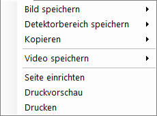

| Menüpunkt | Beschreibung |
|-----------|-------------|
| **Bild speichern** | Das angezeigte Beugungsmuster speichern, **als Bild (PNG-Format)** oder **als Metadatei (EMF)**. |
| **Detektorbereich speichern** | Nur den Ausschnitt des Detektorbereichs speichern (PNG / EMF). Wird nur angezeigt, solange der Detektorbereich dargestellt ist. |
| **CBED-Scheiben speichern** | Nur im CBED-Modus: die berechneten Scheiben **als Einzelbilder (PNG-Format / TIFF-Format)** oder **als Sammelbild (PNG-Format / TIFF-Format)** speichern. |
| **Kopieren** | Das angezeigte Bild in die Zwischenablage kopieren (**als Bild** / **als Metadatei (EMF)**). |
| **Detektorbereich kopieren** | Nur den Ausschnitt des Detektorbereichs kopieren. Wird nur angezeigt, solange der Detektorbereich dargestellt ist. |
| **CBED-Scheiben kopieren** | Nur im CBED-Modus: die Scheiben **als Sammelbild** kopieren. |
| **Video speichern** | Ein Video des **Beugungsmuster**s oder der Ansicht **Reziproker Raum** aufzeichnen. |
| **Seite einrichten / Druckvorschau / Drucken** | Das angezeigte Muster drucken. |

### Preset

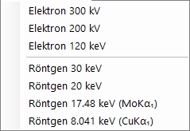

Feste Wellenquellen-Voreinstellungen, die nur die Strahlung und ihre Energie setzen: **Elektron 300 kV**, **Elektron 200 kV**, **Elektron 120 keV**, **Röntgen 30 keV**, **Röntgen 20 keV**, **Röntgen 17.48 keV (MoKα₁)** und **Röntgen 8.041 keV (CuKα₁)** (die letzten beiden wählen die charakteristische Linie Mo bzw. Cu Kα₁). Andere Einstellungen (Detektorgeometrie, Registerkarten, Reflexeigenschaften) werden weder gespeichert noch geändert.

### Menüs Optionen und Hilfe

| Menüpunkt | Beschreibung |
|-----------|-------------|
| **Optionen > Dynamische Kompression** | Öffnet das Fenster [Dynamische Kompression](#dynamische-kompression) (zusammen mit dem Fenster der Detektorgeometrie). |
| **Optionen > ALCHEMI-Simulator...** | Öffnet den [ALCHEMI-Simulator](4-alchemi-simulation.md). |
| **Hilfe > Grundkonzept der Bethe-Methode** | Öffnet den [Anhang zur Bloch-Wellen-Methode](../appendix/a3-bloch-wave/index.md) des Online-Handbuchs im Browser. |

---

## Symbolleiste {#toolbar}

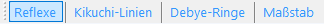

| Schaltfläche | Beschreibung |
|--------|-------------|
| Reflexe | Die Ebene der Beugungsreflexe ein-/ausblenden |
| Kikuchi-Linien | Die Ebene der Kikuchi-Linien ein-/ausblenden |
| Debye-Ringe | Die Ebene der Debye-Ringe ein-/ausblenden |
| Maßstab | Die Ebene der Skalenlinien ein-/ausblenden |
| Index / d / 1/d / Abstand / 2θ / χ / Anregungsfehler / Strukturfaktor | Auswahl der Beschriftung, die an jeden Reflex angehängt wird |

---

## Schirm- und Detektorinformationen

### Schirm

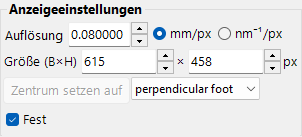

| Element | Beschreibung |
|------|-------------|
| **Auflösung** | Die Größe eines Bildschirmpixels, in **mm/px** (auf der Detektorebene) oder **nm⁻¹/px** (wählbar; Standard 0,08 mm/px). Sie muss nicht der tatsächlichen Detektor-Pixelgröße entsprechen; sie wird als Anzeigemaßstab behandelt und automatisch aktualisiert, wenn Sie mit der Maus zoomen. |
| **Größe (B×H)** | Pixelbreite und -höhe des Zeichenbereichs. Je nach Bildschirmauflösung sind sehr große Werte möglicherweise nicht einstellbar. |
| **Zentrum setzen auf / Fest** | Legt die Mitte des Zeichenbereichs auf den Lotfußpunkt (**perpendicular foot**), den Primärstrahlreflex (**direct spot**) oder das Zentrum des Detektors (**detector**; nur wenn ein Detektorbereich definiert ist). Bei angehaktem **Fest** (Standard) bleibt das Zentrum dort: Das Verschieben mit der Maus ist deaktiviert, und beim Zoomen bleibt dieses Zentrum erhalten. |
| **Horizontal spiegeln / Vertikal spiegeln / Negativbild** | Geometrische Spiegelungen (horizontal / vertikal) und Kontrastumkehr des angezeigten Musters. Verwenden Sie diese, um die Orientierung oder den Kontrast eines experimentellen Bildes anzupassen. |
| **Reziproker Raum** | Öffnet neben dem Muster eine 3D-Ansicht der Ewald-Kugel und der reziproken Gitterpunkte und visualisiert, welche Reflexe angeregt sind. Ihr Feld **Optionen** legt die Farben (Reflexe nahe der / fern der Ewald-Kugel, Ewald-Kugel, Ursprung, Richtungshilfe), den 3D-Reflexradius (nm⁻¹), den Schwellenwert der relativen Intensität (%), die Transparenz der Reflexe fern der Ewald-Kugel, die Beschriftungen und die Blickrichtung fest (Pfeilschaltflächen mit einem Winkel-**Schritt**, **Zurücksetzen**). |

### Detektor (Kameralänge)

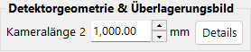

- **Kameralänge 2** : Abstand (mm) von der Probe zum Fußpunkt des auf die Detektorebene gefällten Lots (Standard 1000 mm). Er entspricht der üblichen Kameralänge, wenn der Detektor nicht gekippt ist (τ = 0).
- **Details** : Öffnet das Fenster der Detektorgeometrie-Einstellungen (siehe [Detektorgeometrie](#detector-geometry) unten).

### Misc

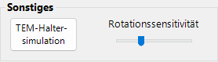

- **Rotationssensitivität** : Betrag der Kristalldrehung pro Pixel des Mausziehens.
- **TEM-Halter-Simulation** : Öffnet das halterverknüpfte Simulationsfenster (siehe unten).

---

## TEM-Halter-Simulation

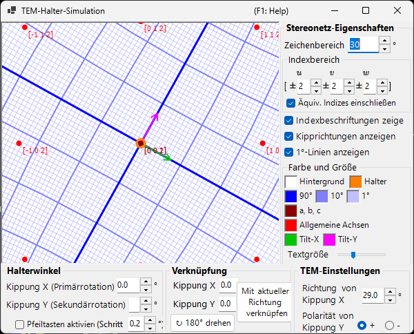

Öffnet ein Fenster, das das Beugungsmuster mit einem Doppelkipp-**TEM-Halter** verknüpft (**Kippung X** = Primär-, **Kippung Y** = Sekundärrotation). Das Festlegen der Halterkippwinkel aktualisiert das Muster und die Kristallorientierung, und die erreichbaren Orientierungen können auf einem Stereonetz angezeigt werden (hinzugefügt in v4.914). **Mit aktueller Richtung verknüpfen** übernimmt die aktuelle Kristallorientierung als Referenz des Halters (bei den angegebenen Werten Kippung X / Kippung Y); **TEM-Einstellungen** geben die Richtung der Achse Kippung X auf dem Bildschirm (Standard −29°) und die Polarität von Kippung Y an, und **↻ 180° drehen** dreht den Kristall um 180° um den Strahl. Ein Linksdoppelklick auf das Stereonetz setzt die Halterkippung auf diesen Punkt, und das Anhaken von **Pfeiltasten aktivieren** lässt ←/→ die Kippung X und ↑/↓ die Kippung Y schrittweise ändern (Schritt 0,1–2°, Standard 0,2°). Solange dieses Fenster geöffnet ist, wirken die Pfeiltasten unabhängig davon, welches ReciPro-Fenster im Vordergrund ist.

---

## Zeichen-Overlay-Registerkarten {#drawing-overlay-tabs}

### General

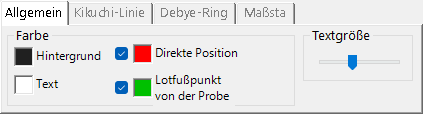

Legt die **Textgröße** der Beschriftungen fest sowie die Farben der Beschriftung (**Text**), der Markierung **Lotfußpunkt von der Probe**, der Markierung **Direkte Position** und des **Hintergrund**s (die beiden Markierungen lassen sich jeweils abschalten). Reflexfarben werden unter **Darstellung** festgelegt (siehe die Seiten der einzelnen Modi), die Farben von Kikuchi-Linien, Debye-Ringen und Skalenlinien in deren eigenen Registerkarten. Die hier vorgenommenen Einstellungen gelten für alle Rendermodi.

### Kikuchi-Linien

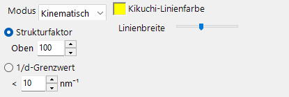

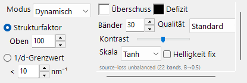

Aktiv, wenn Kikuchi-Linien in der Symbolleiste aktiviert sind.

- **Auswahl der Reflexe** : Wählt aus, welche Reflexe die Kikuchi-Linien erzeugen. Entweder **Strukturfaktor** (die obersten *N* Reflexe nach $\lvert F_{hkl}\rvert$, Feld **Oben**; 1–1000, Standard 100) oder **1/d-Grenzwert** (alle Reflexe, deren 1/d unterhalb des Schwellenwerts liegt; 0–100 nm⁻¹, Standard 10).
- **Modus** : Wie die Kikuchi-Linien gezeichnet werden (Standard **Kinematisch**). Die Einstellungen unter dem Kombinationsfeld wechseln mit dem Modus.
    - **Geometrisch** : alle gewählten Linien in einer festen Farbe.
    - **Kinematisch** : Die Liniendunkelheit folgt der kinematischen relativen Intensität jedes Reflexes.
    - **Dynamisch** : Zweistrahl-dynamische Überschuss-/Defizit-Bandprofile mit thermisch-diffuser Streuung als Quelle, im Hintergrund berechnet. Überschuss-Bänder erscheinen auf der Hochwinkelseite, Defizit-Merkmale zum Direktstrahl hin; die Probendicke wird mit den Intensitätseinstellungen geteilt. Während der Berechnung werden geometrische Linien als Übergang gezeichnet.
- **Einstellungen für Geometrisch / Kinematisch** : **Kikuchi-Linienfarbe** und **Linienbreite**.
- **Einstellungen für Dynamisch** :
    - **Überschuss** / **Defizit** : Farben der hellen (positiver Kontrast) und dunklen (negativer Kontrast) Bandseite.
    - **Bänder** : Anzahl der Bänder mit dynamischen Profilen (die besten *N* nach dynamischem Kontrast; 1–50, Standard 30).
    - **Qualität** : Abtastpunkte quer über jedes Band (Schnell 65 / Standard 129 / Hoch 257; Standard: Standard).
    - **Kontrast** : Anzeigeverstärkung des Bandkontrasts vor der Kompression.
    - **Skala** : Helligkeitskompressionskurve (Linear / Log / Tanh; Standard Tanh) – Darstellungstransformationen, keine physikalischen Kameraantworten.
    - **Helligkeit fix** : Friert die Helligkeitsnormierung ein, z. B. zum Vergleich verschiedener Orientierungen oder Dicken.
    - Die graue Hinweiszeile zeigt den Quelle/Verlust-Hinweis, die Zahl der gezeichneten Bänder und Diagnosen (z. B. Ersatz-*B*-Faktor für Atome mit *B* = 0).
- (Den früheren separaten Parameter **Threshold** gibt es nicht mehr; die Reflexe werden nur durch die obige Auswahl begrenzt.)

### Debye-Ringe

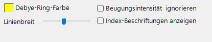

Aktiv, wenn Debye-Ringe in der Symbolleiste aktiviert sind.

- **Beugungsintensität ignorieren** : Falls angehakt, werden alle Debye-Ringe mit derselben Farbe und Intensität gezeichnet (unter Vernachlässigung des Strukturfaktors des Kristalls). Verwenden Sie dies für einen rein geometrischen Vergleich.
- **Index-Beschriftungen anzeigen** : Falls angehakt, erscheint das (*hkl*) in der Nähe jedes Rings.

### Scale

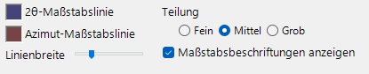

Aktiv, wenn die Skalenlinien in der Symbolleiste aktiviert sind.

- **2θ / Azimuth scale lines** : **2θ** stellt einen konstanten Streuwinkel dar (konzentrische Kreise), **Azimuth** stellt einen konstanten Azimutwinkel dar (radiale Linien vom Zentrum aus). Die Farben sind unabhängig voneinander konfigurierbar.
- **Linienbreite** : Dicke der Skalenlinien.
- **Teilung** : Dichte der Skalenlinien, **Fein** / **Mittel** (Standard) / **Grob**.
- **Maßstabsbeschriftungen anzeigen** : Ob numerische Beschriftungen auf die Skalenlinien gezeichnet werden.

(Eine eigene Registerkarte *Misc* gibt es nicht; die **Rotationssensitivität** der Maus befindet sich in der Gruppe **Sonstiges** im rechten Bereich, siehe [Misc](#misc) oben.)

---

## Beugungsreflex-Informationen {#diffraction-spot-information}

Listet die per Reflex berechneten Details auf, die mit der Bloch-Wellen-Methode (Dynamical-Berechnung) ermittelt wurden. Öffnen Sie es mit der Schaltfläche **Reflexdetails** im Intensitätsberechnungsbereich. Im Modus **Nur Anregungsfehler** / **Kinematisch & Anr.-Fehler** listet die Schaltfläche die aktuell gezeichneten Reflexe mit ihren Elektronenpotentialen sowie $P_g$, $Q_g$ auf (ohne dynamische Amplituden); im CBED-Modus folgt die Tabelle der im CBED-Fenster gewählten Dicke.

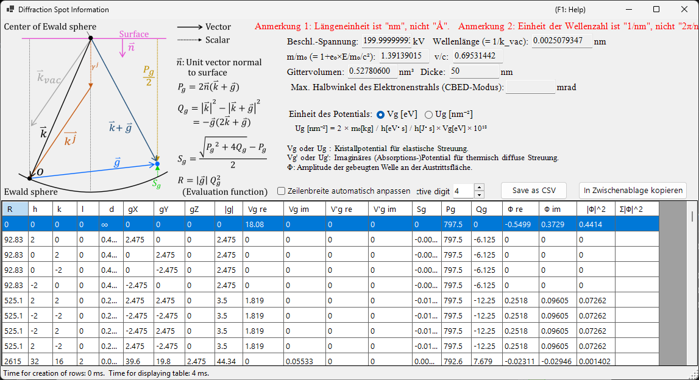

### Schema und Definitionen

Das Schema (oben links) zeigt die Vektoren auf der Ewald-Kugel und definiert die in der Tabelle verwendeten Größen ($\hat{\mathbf{n}}$ ist der Einheitsvektor senkrecht zur Probenoberfläche, $\mathbf{k}$ ist der einfallende Wellenvektor, $\mathbf{g}$ ist der reziproke Gittervektor).

- $P_g = 2\,\hat{\mathbf{n}} \cdot (\mathbf{k} + \mathbf{g})$
- $Q_g = |\mathbf{k}|^2 - |\mathbf{k} + \mathbf{g}|^2 = -\mathbf{g} \cdot (2\mathbf{k} + \mathbf{g})$
- **Anregungsfehler:** $S_g = \dfrac{\sqrt{P_g^2 + 4 Q_g} - P_g}{2}$
- **Bewertungsfunktion:** $R = |\mathbf{g}|\, Q_g^2$ — ordnet Reflexe danach, wie stark sie angeregt sind (kleiner = näher an der Ewald-Kugel = stärker angeregt; der durchgehende Strahl $g=0$ hat $R=0$ und kommt zuerst). Die Tabelle ist nach aufsteigendem $R$ sortiert.

### Tabellenspalten

| Spalte | Bedeutung |
|--------|---------|
| **R** | Bewertungsfunktion $R = \lvert\mathbf{g}\rvert\, Q_g^2$ (oben; verwendet zur Auswahl / Anordnung von Reflexen) |
| **h, k, (i,) l** | Miller-Indizes (*i* ist der redundante hexagonale Index, nur für hexagonale Kristalle angezeigt) |
| **d** | Netzebenenabstand (nm) |
| **gX, gY, gZ** | Komponenten des reziproken Gittervektors *g* (1/nm) |
| **\|g\|** | Betrag von *g* (1/nm) |
| **Vg re / Vg im** | Fourier-Koeffizient des Kristallpotentials für elastische Streuung, $V_g$ (real / imaginär) |
| **V'g re / V'g im** | imaginäres (Absorptions-)Potential für thermisch diffuse Streuung (TDS), $V'_g$ (real / imaginär) |
| **Sg** | Anregungsfehler $S_g$ (oben; 1/nm) |
| **Pg** | Hilfsgröße $P_g = 2\,\hat{\mathbf{n}}\cdot(\mathbf{k}+\mathbf{g})$ (oben) |
| **Qg** | Hilfsgröße $Q_g = -\mathbf{g}\cdot(2\mathbf{k}+\mathbf{g})$ (oben) |
| **Φ re / Φ im** | komplexe Amplitude $\Phi$ der dynamischen gebeugten Welle an der Austrittsoberfläche (real / imaginär) |
| **\|Φ\|^2** | gebeugte Intensität $\lvert\Phi\rvert^2$ dieses Reflexes |
| **Σ\|Φ\|^2** | kumulative Summe von $\lvert\Phi\rvert^2$ (Gesamtsumme über die Reflexe; nützlich als Prüfung der Intensitätserhaltung) |

### Potentialeinheiten und weitere Steuerelemente

- **Unit of potential** : Schaltet das angezeigte Potential zwischen **Vg [eV]** (elektrostatisches Potential, eV) und **Ug [nm⁻²]** um (die skalierte Größe $U_g = (2 m_0/h^2)\, V_g$, die in die Bloch-Wellen-Gleichungen eingeht). Die Spaltenüberschriften wechseln entsprechend zwischen *Vg / V'g* und *Ug / U'g*.
- Über der Tabelle werden die Beschleunigungsspannung, die Wellenlänge ($\lambda = 1/k_\text{vac}$), das relativistische Massenverhältnis $m/m_0$, das Geschwindigkeitsverhältnis $v/c$, das Gittervolumen, die Probendicke und (im CBED-Modus) der maximale Halbwinkel des Elektronenstrahls angezeigt.
- **Note 1:** Die Längeneinheit ist **nm**, nicht Å. **Note 2:** Die Wellenzahleinheit ist **1/nm**, nicht 2π/nm.
- **Effective digit** : Anzahl der in der Tabelle angezeigten signifikanten Stellen (1–16, Standard 4). **Auto resize row width** : Spaltenbreiten automatisch anpassen. **Copy to clipboard** : exportiert die Tabelle als Text, der in eine Tabellenkalkulation eingefügt werden kann. **Save as CSV** : schreibt dieselbe Tabelle (die sichtbaren Spalten) in eine CSV-Datei; das Dezimaltrennzeichen ist stets ein Punkt, sodass die Datei auch in Gebietsschemata mit Dezimalkomma gültig bleibt. (Dieses Formular wird auch unter einer japanischen Oberfläche auf Englisch angezeigt.)

---

## Detektorgeometrie {#detector-geometry}

Ein Fenster für die detaillierte Einrichtung der Detektorgeometrie (Kameralänge, Kippung, Rotation) und die Überlagerung eines experimentellen Bildes. Öffnen Sie es über **Details** im Bereich **Detector geometry**.

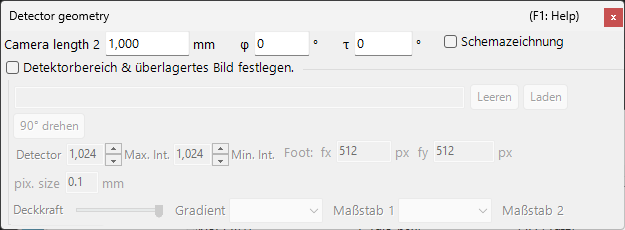

### Detektorgeometrie-Einstellungen

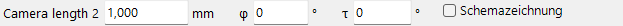

Geben Sie die Reflexionsgeometrie an: **Kameralänge 2** (mm, 1–10000, Standard 1000) und die Detektorkippung **τ** (−200 bis 200°) um eine in der Detektorebene liegende Achse beim Azimut **φ**. Für Rück-Laue (Rückstrahl-Laue) wird nur **Kameralänge 2** verwendet: Das Muster wird stets auf einen Detektor senkrecht zum Strahl auf der Quellenseite projiziert, und τ / φ werden auf diese Projektion nicht angewendet. Das Ablegen einer `.prm`-Datei lädt daraus Wellenlänge, Kameralänge 2, τ, φ, Fußpunktposition und Pixelgröße (die Quelle wird auf Röntgen mit benutzerdefinierter Wellenlänge umgeschaltet, und der Detektorbereich wird eingeschaltet).

### Detektorbereich und überlagertes Bild

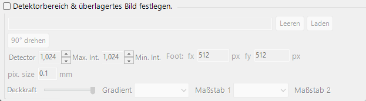

Haken Sie **Detektorbereich & überlagertes Bild festlegen.** an, um den Detektor festzulegen: Größe in Pixeln (Standard 1024 × 1024), **Pix.-Größe** (mm, Standard 0,1) und die Position des Fußpunkts **Fuß: fx, fy** (px, Standard 512, 512). Ein experimentelles Bild lässt sich laden (**Laden** oder Ablegen) und mit **Deckkraft**, **Gradient** (Positiv-/Negativfilm), **Maßstab 1** (log/linear), **Maßstab 2** (Gray / Cold-Warm / Spectrum / Fire), **Max. Int.**/**Min. Int.**, **90° drehen** und **Leeren** überlagern. **Schemazeichnung** zeigt eine Skizze der Geometrie. Verwenden Sie dies, um das simulierte Muster und ein experimentelles Bild zu überlagern und die Detektorgeometrie fein abzustimmen.

Siehe auch [Detektor-Koordinatensystem](../appendix/a1-coordinate-system/2-diffraction.md) für die Definitionen des Koordinatensystems.

---

## Dynamische Kompression

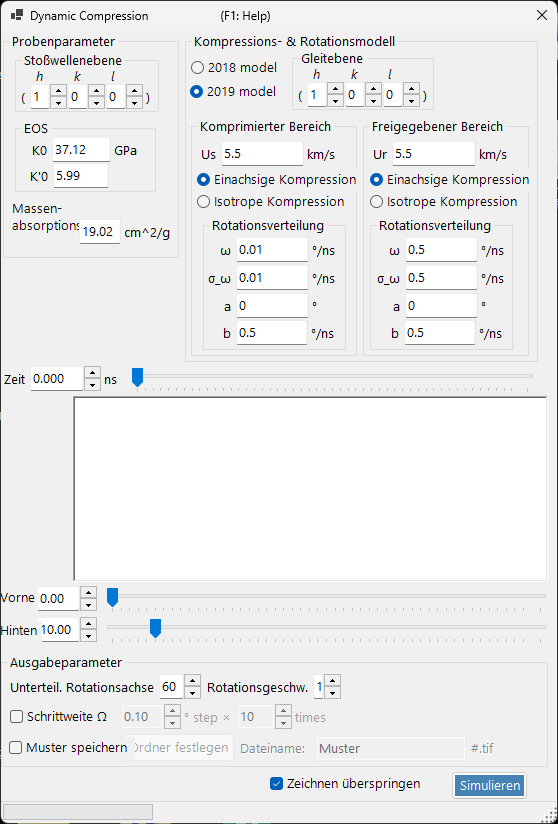

Ein Fenster zur Simulation der Beugung an einer stoßkomprimierten Probe (dynamische Kompression). Legen Sie eine tabulatorgetrennte `.txt`-Datei mit drei Spalten (Position, Zeit, Druck) ab, um für jeden Zeitpunkt Druckprofile zu laden; der Schieberegler **Zeit** (ns) wählt das im Diagramm gezeigte Profil. Die beiden senkrechten Linien im Diagramm (**Vorne** / **Hinten**) lassen sich ziehen, um Vorder- und Rückseite der Kompression festzulegen. Das Fenster enthält außerdem das Kompressionsmodell (**2018 / 2019 model**), die Stoßgeschwindigkeiten (**Us**, **Ur**, km/s), die **EOS** (K0, K'0), **Stoßwellenebene** / **Gleitebene**, die Rotationsverteilungen des komprimierten und des freigegebenen Bereichs, den Massenabsorptionskoeffizienten, die Ω-Schrittweite und **Muster speichern** (`#.tif`) und startet mit **Simulieren**.

---

## ALCHEMI-Simulator

Öffnet ein Unterfenster, das **platzaufgelöste Ionisations-Rocking-Kurven** berechnet: die Ausbeute eines gewählten Ionisationskanals, während der Kristall durch die Bragg-Bedingungen einer systematischen Reihe gekippt wird, getrennt nach Atomplatz. Öffnen über das Menü **Optionen**. Anders als das CBED-Fenster besitzt es einen eigenen Ausgabebereich und zeichnet nicht auf die Leinwand des übergeordneten Fensters.

→ Alle Einstellungen sowie Geltungsbereich und bekannte Grenzen finden Sie unter **[ALCHEMI-Simulation](4-alchemi-simulation.md)**.

---

## Verwandte Themen

- [Röntgenbeugungssimulation](5-x-ray-neutron-diffraction.md)
- [SAED-Simulation](1-saed-simulation.md)
- [PED-Simulation](2-ped-simulation.md)
- [CBED-Simulation](3-cbed-simulation.md)
- [ALCHEMI-Simulation](4-alchemi-simulation.md)
- [Dynamische Berechnung (gemeinsamer Kern)](../appendix/a3-bloch-wave/calculation.md)
- [Detektor-Koordinatensystem](../appendix/a1-coordinate-system/2-diffraction.md)
