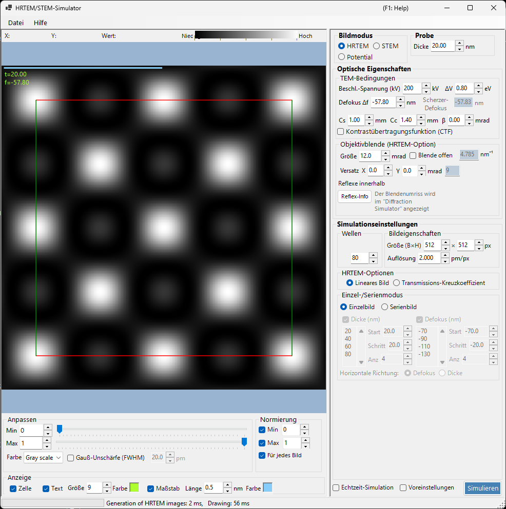
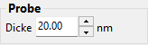
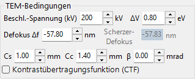
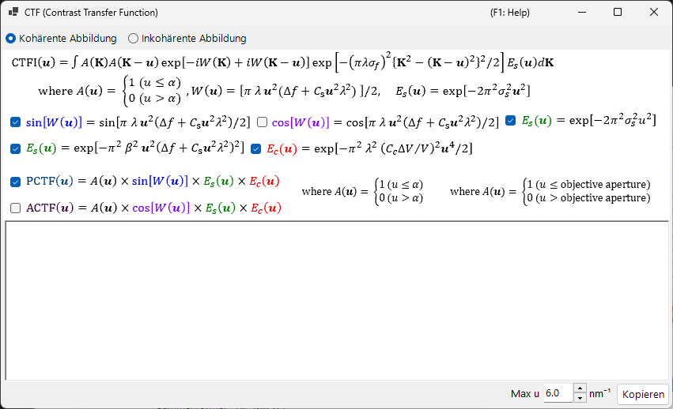
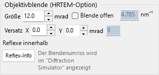
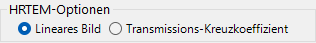
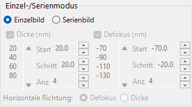
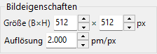
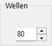

# HRTEM-Simulation

Die **HRTEM-Simulation (High-Resolution Transmission Electron Microscopy)** berechnet hochauflösende TEM-Gitterstreifenbilder. Sie ist der primäre Modus des [HRTEM/STEM-Simulators](index.md).

> Diese Seite listet alle Einstellungen auf, die rechts erscheinen, wenn **Bildmodus = HRTEM** gewählt ist. Für die Steuerelemente links — Anzeige des Ergebnisses und Anpassung seiner Helligkeit — siehe die [Übersichtsseite](index.md#display-settings).

---

## Übersicht

Ein HRTEM-Bild entsteht, wenn die durch die Probe transmittierte Elektronenwelle unter dem Einfluss der Aberrationen der Objektivlinse abgebildet wird. ReciPro berechnet die Ausbreitung der Elektronenwelle in der Probe mit der Bloch-Wellen-Methode (dynamische Berechnung) und erzeugt das HRTEM-Bild über die Phasenkontrast-Übertragungsfunktion (PCTF).

### Berechnungsablauf

1. **Bloch-Wellen-Methode**: Berechnet die Ausbreitung der Elektronenwelle im Kristallpotential und liefert Amplitude und Phase der austretenden Welle
2. **Linsenfunktion**: Wendet die Aberrationen der Objektivlinse an (sphärische Aberration $C_s$, Defokus $\Delta f$)
3. **Partielle Kohärenz**: Berücksichtigt die endliche Quellengröße (räumliche Kohärenz) und die Energiefluktuation (zeitliche Kohärenz)
4. **Bildentstehung**: Berechnet die Intensitätsverteilung $|\psi(\mathbf{r})|^2$

Zur Theorie siehe [Anhang A3.2 — HRTEM-Bildentstehung](../appendix/a3-bloch-wave/hrtem.md).

---

## Probe

- **Dicke** : Probendicke (nm). HRTEM-Bilder hängen stark von der Dicke ab. Im Modus **Serienbild** wird dieser Wert ignoriert und stattdessen die unten beschriebene Dickenliste verwendet.

---

## TEM-Bedingungen {#tem-conditions}

Legt die Abbildungsbedingungen der Objektivlinse fest.

| Parameter | Beschreibung | Standard / typisch |
|-----------|-------------|-------------------|
| **Beschl.-Spannung** <!-- 261105Cl 監査: 見出しから (kV) を外した (numericBoxAccVol.HeaderText)。単位は欄の右に出る --> | Beschleunigungsspannung (kV). Die relativistisch korrigierte Elektronenwellenlänge wird rechts daneben angezeigt | 200 kV |
| **Defokus Δf** | Defokus der Objektivlinse (nm). Der Referenzwert des **Scherzer-Defokus** wird darunter angezeigt | −57.8 nm |
| **Cs** | Sphärischer Aberrationskoeffizient (mm). Beeinflusst die CTF und den Scherzer-Defokus. Negative Werte (−20 bis 20 mm) sind zulässig | 1.0 mm (Standard); 0.5–1.0 (konventionell), < 0.01 (Cs-korrigiert) |
| **Cc** | Chromatischer Aberrationskoeffizient (mm). Bestimmt die durch die Energiebreite verursachte Bildunschärfe | 1.4 mm (Standard); 1.0–2.0 mm |
| **β** | Beleuchtungs-Halbwinkel (mrad). Beschreibt den Effekt der endlichen Quellengröße (räumliche Kohärenz) | 0 mrad (Standard); 0.1–1.0 mrad |
| **ΔV** | Halbwertsbreite der Energiebreite der Elektronen (eV). Bestimmt zusammen mit Cc die Fokusstreuung durch chromatische Aberration | 0.8 eV (Standard); 0.5–2.0 eV |

Die obigen Standardwerte gelten nur beim ersten Start; danach werden die zuletzt verwendeten Werte wiederhergestellt. Intern wird ΔV (FWHM) in eine Standardabweichung $\sigma_V = \Delta V / (2\sqrt{2\ln 2})$ umgerechnet, und die Fokusstreuung ist $\delta = C_c\,\sigma_V / V$. Die Aberrationsfunktion lautet

$$\chi(u) = \pi\lambda\,\Delta f\,u^2 + \tfrac{\pi}{2}\,C_s\lambda^3 u^4 ,$$

und jede gebeugte Welle wird mit $\exp[-i\chi(u)]$ multipliziert, sodass **negatives Δf Unterfokus** bedeutet (die Konvention, in der der Scherzer-Defokus negativ ist).

> **Kontextmenü (Rechtsklick)**: Im Bereich TEM-Bedingungen lassen sich **Defokus auf 0 nm setzen** / **Defokus auf Scherzer-Wert setzen** / **Ideale Bedingungen (Cs, Cc, β, ΔV, Δf = 0)** mit einem Klick anwenden (Letzteres setzt Cs, Cc, β, ΔV **und den Defokus** auf 0). <!-- 261106Cl 作者の決定 E19: 表示名を理想条件に --> Dasselbe Menü enthält vier Mikroskop-Voreinstellungen — *300kV Cold-FEG Cs-frei (Cs 0, Cc 2.8, ΔV 0.3) ARM300F*, *200kV Schottky-FEG UHR (Cs 0.5, Cc 1.1, ΔV 0.8) 2100F*, *200kV Schottky-FEG HR (Cs 1.0, Cc 1.4, ΔV 0.8) 2100F* und *200kV Lab6 HR (Cs 1.0 , Cc 1.4, ΔV 2.0) 2100* —, die Beschleunigungsspannung, Cs, Cc und ΔV wie im Eintrag angegeben setzen und anschließend den Defokus auf den Scherzer-Wert setzen (β bleibt unverändert). Das Kontrollkästchen **Voreinstellungen** unten rechts öffnet das Fenster, in dem Sie eigene Bedingungen speichern (siehe [Voreinstellungsliste](index.md#preset-list)). <!-- 261105Cl 監査: プリセット名は ΔV (FormImageSimulator.resx presets1〜4ToolStripMenuItem.Text) -->

### Scherzer-Defokus

Der Defokuswert, in dessen Nähe der Phasenkontrast optimal ist, berechnet aus der aktuellen Wellenlänge und der sphärischen Aberration $C_s$ (als Referenz angezeigt). Für negatives $C_s$ ist der angezeigte Wert $+\sqrt{\tfrac{4}{3}|C_s|\lambda}$.

$$\Delta f_{\text{Scherzer}} = -\sqrt{\tfrac{4}{3}\,C_s \lambda}\quad\left(\approx -1.155\,\sqrt{C_s \lambda}\right)$$

Unter dieser Bedingung ist die PCTF über einen weiten Bereich von Ortsfrequenzen negativ, sodass Atompositionen als dunkler Kontrast erscheinen. ReciPro verwendet diesen ursprünglichen Scherzer-Wert (abgeleitet, indem das Minimum der Aberrationsphase $\chi$ auf $-2\pi/3$ gesetzt wird), und der in der GUI angezeigte Wert folgt dieser Formel. Beachten Sie, dass manche Quellen stattdessen den *erweiterten Scherzer*-Wert $-1.2\sqrt{C_s\lambda}$ verwenden, der das Übertragungsband weiter verbreitert.

---

## Linsenfunktion / Kontrastübertragungsfunktion (CTF)

Durch Aktivieren von **Kontrastübertragungsfunktion (CTF)** öffnet sich ein Fenster, das darstellt, wie Linsenaberrationen und Defokus den Bildkontrast bei jeder Ortsfrequenz übertragen.

- $\sin\chi(u)$ : Phasenkontrast-Übertragungsfunktion ($\chi(u)$ ist die Aberrationsfunktion der Linse)
- $E_\text{s}(u)$ : Einhüllende der räumlichen Kohärenz; die Dämpfung durch die endliche Quellengröße ($\beta$)
- $E_\text{c}(u)$ : Einhüllende der zeitlichen Kohärenz; die Dämpfung durch die Energiefluktuation ($C_c$, $\Delta V$)

Jede Kurve hat ihr eigenes Kontrollkästchen: $\sin\chi$, $\cos\chi$, $E_\text{s}$, $E_\text{c}$, **PCTF** $=\sin\chi\,E_\text{s}E_\text{c}$ und **ACTF** $=\cos\chi\,E_\text{s}E_\text{c}$; PCTF und ACTF werden außerhalb der Objektivblende auf null gesetzt. Im HRTEM-Modus gilt

$$E_\text{s}(u)=\exp\!\left[-\pi^2\beta^2u^2\left(\Delta f+C_s\lambda^2u^2\right)^2\right],\qquad E_\text{c}(u)=\exp\!\left[-\tfrac{1}{2}\pi^2\lambda^2\delta^2u^4\right].$$

**Max. u** (nm⁻¹, Standard 6) legt die obere Grenze der horizontalen Achse fest. **Kopieren** legt die dargestellten Kurven als tabulatorgetrennten Text in die Zwischenablage. Das Fenster steht auch im STEM-Modus zur Verfügung (siehe [STEM-Simulation](2-stem-simulation.md#ctf-stem)); im Potential-Modus ist es deaktiviert.

---

## Objektivblende (HRTEM-Option)

Beschränkt die gebeugten Wellen, die die Objektivblende passieren. Die Bloch-Wellen-Berechnung selbst verwendet stets die in **Wellen** eingestellte Anzahl von Wellen; die Blende wählt dann aus, welche dieser Strahlen zum Bild beitragen (ein Strahl passiert, wenn $|\mathbf{g}-\mathbf{c}| < 2\sin(\alpha_\text{obj}/2)/\lambda$, mit $\mathbf{c}$ als Blendenmittelpunkt). Passieren weniger als zwei Strahlen, bricht die Berechnung mit einer Meldung ab, die Blende zu vergrößern.

- **Größe** : Halbwinkel der Objektivblende (mrad, Standard 12). Je kleiner er ist, desto mehr gebeugte Wellen großer Winkel werden abgeschnitten und desto glatter werden die hochaufgelösten Details. Der entsprechende Radius im reziproken Raum $\sin\theta/\lambda$ (nm⁻¹) wird angezeigt.
- **Versatz X** / **Y** : Verschiebung des Mittelpunkts der Objektivblende (mrad). Wird für die Dunkelfeldabbildung mit verschobener Blende verwendet; die Beleuchtung selbst wird nicht gekippt.
- **Blende offen** : öffnet die Objektivblende (unendlich), sodass alle gebeugten Wellen zur Abbildung beitragen.
- **Reflexe innerhalb** : die Anzahl der gebeugten Strahlen (Reflexe), die innerhalb der Blende liegen (nur lesbar).
- **Reflex-Info** : öffnet eine Tabelle der gebeugten Strahlen innerhalb der Blende (Intensität, komplexe Amplitude usw.).

> Die Größe der Objektivblende wird auch im **Beugungssimulator** angezeigt.

---

## HRTEM-Optionen (Teilkohärenzmodell)

Wählt, wie die Teilkohärenz (β und die Fokusstreuung δ) berücksichtigt wird. Die Austrittswelle wird für eine einzige Einfallsrichtung (die Strahlachse) berechnet; Beleuchtungs- und Energiebreite gehen nur über die unten genannten Einhüllenden ein.

- **Lineares Bild** (quasikohärentes Modell) : rechnerisch günstig. Jede gebeugte Welle $\psi_g$ der dynamischen Austrittswelle wird mit $\exp[-i\chi(g)]\,E_\text{s}(g)\,E_\text{c}(g)$ multipliziert, und die Wellen werden kohärent summiert: $I(\mathbf{r}) = \left|\sum_g \psi_g\,e^{-i\chi(g)}\,E_\text{s}(g)\,E_\text{c}(g)\,e^{2\pi i\,\mathbf{g}\cdot\mathbf{r}}\right|^2$. Genau, wenn das Bild von der Interferenz mit dem durchgehenden Strahl dominiert wird (dünne Proben).
- **Transmissions-Kreuzkoeffizient** : rechnerisch aufwendig, aber genauer. Jedes Strahlpaar $(g,h)$ wird mit der gemeinsamen Einhüllenden (dem vollständigen Transmissions-Kreuzkoeffizienten) summiert; dies ist das Modell der Wahl für stark streuende Proben, in denen viele starke gebeugte Wellen angeregt werden. Der Aufwand wächst quadratisch mit der Anzahl der Strahlen innerhalb der Blende.

Einzelheiten siehe [Anhang A3.2 — HRTEM-Bildentstehung](../appendix/a3-bloch-wave/hrtem.md).

---

## Einzel-/Serienmodus

- **Einzelbild** : berechnet ein HRTEM-Bild bei der aktuellen Dicke und dem aktuellen Defokus.
- **Serienbild** : erzeugt eine Bildserie mit schrittweise variierter Dicke und variiertem Defokus (Dicken- / Fokusserie). Nützlich, um die Bedingung zu finden, die am besten zu einem experimentellen Bild passt.

Für ein Serienbild legen Sie Folgendes fest.

| Element | Beschreibung |
|------|-------------|
| **Dicke (nm)** / **Defokus (nm)** | Welche Größe variiert wird (beide sind möglich) |
| **Start / Schritt / Anz** | Startwert, Schrittweite und Anzahl der Bilder. Sie werden in das Listenfeld darunter übertragen, das auch direkt bearbeitet werden kann |
| **Horizontale Richtung:** | Wenn Dicke und Defokus beide variiert werden: die Größe, die entlang der horizontalen Richtung des Rasters angeordnet wird (**Defokus** oder **Dicke**) |

Werden Dicke und Defokus beide variiert, entsteht eine Bildmatrix aus Zeilen × Spalten. **Anz** ist für jede Größe auf 20 begrenzt. Wird nur eine Größe variiert und sind es mehr als zwei Bilder, wird die Zeile in ein annähernd quadratisches Raster umgebrochen.

---

## Bildeigenschaften

- **Größe (B×H)** : Anzahl der Pixel des simulierten Bildes (Standard 512×512).
- **Auflösung** : Abtastauflösung (pm/px, Standard 2). Das Sichtfeld ist Größe × Auflösung; ein kleinerer Wert tastet die Streifen daher feiner über eine kleinere Fläche ab. Das Bild wird an jedem Pixel durch eine direkte Fourier-Summe über die Strahlen synthetisiert (keine FFT), sodass die Rechenzeit von der Pixelzahl und der Anzahl der Strahlen abhängt, nicht von diesem Wert.

---

## Wellen

- Maximale Anzahl der in der Bethe-Methode (dynamische Berechnung) verwendeten Bloch-Wellen, standardmäßig 80. Eine größere Anzahl verbessert die Genauigkeit, aber das Eigenwertproblem benötigt $O(N^3)$ Zeit.

---

## Siehe auch

- [HRTEM/STEM-Simulator (Übersicht)](index.md)
- [STEM-Simulation](2-stem-simulation.md)
- [Potential-Simulation](3-potential-simulation.md)
- [Anhang A3.2 — HRTEM-Bildentstehung](../appendix/a3-bloch-wave/hrtem.md)
