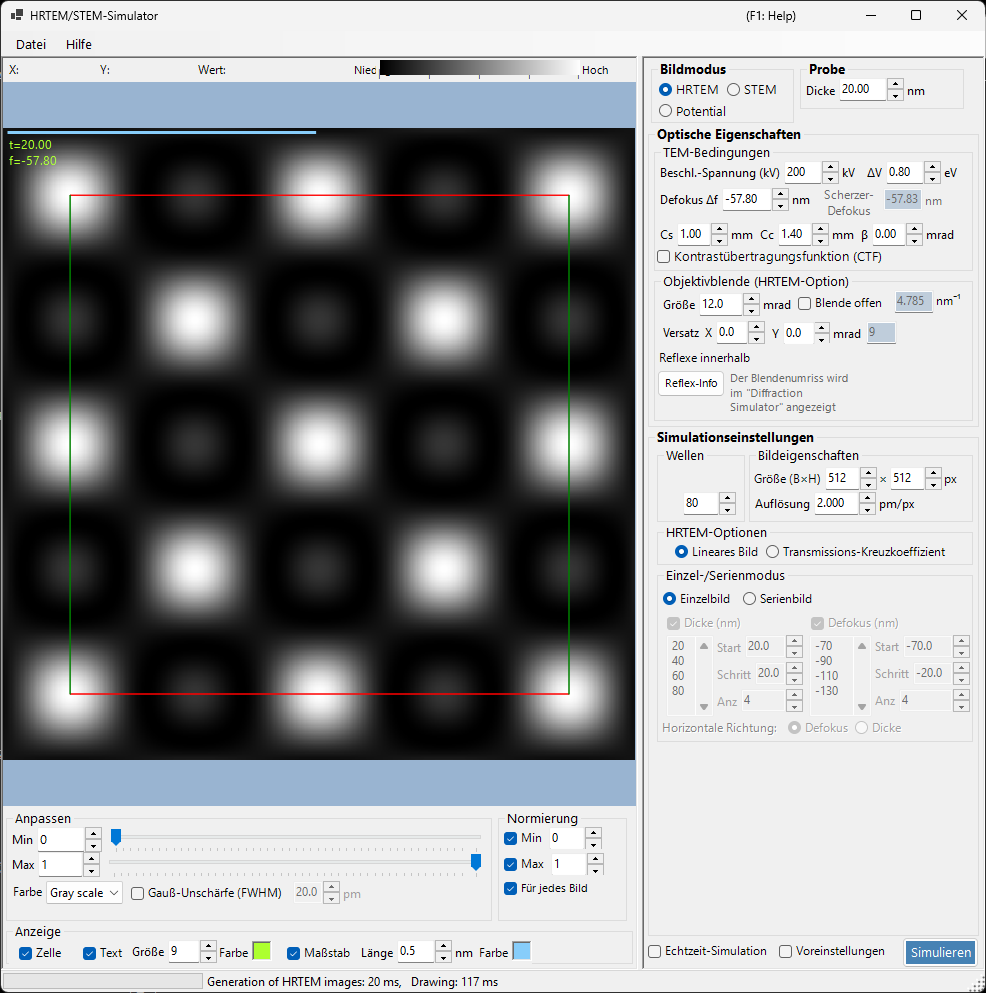
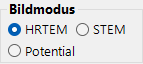
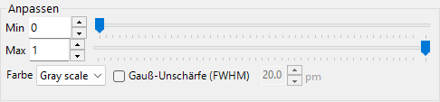
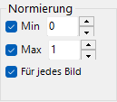
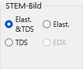
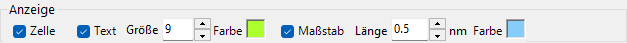
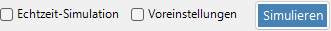
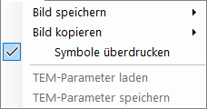
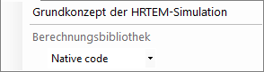

# HRTEM / STEM Simulator

Der **HRTEM/STEM-Simulator** simuliert TEM-Gitterstreifenbilder (HRTEM), STEM-Bilder und projizierte Kristallpotentiale für den ausgewählten Kristall und seine Orientierung. Klicken Sie auf **Simulieren**, um die Berechnung zu starten.

Das Fenster ist in zwei Hälften geteilt. Die **linke Seite** zeigt das Simulationsergebnis und steuert dessen Darstellung (Bildbereiche, Helligkeit, Farbe, Maßstabsbalken usw.); die **rechte Seite** enthält die Berechnungsbedingungen (**Optische Eigenschaften** und **Simulationseinstellungen**).

---

## Diese Seite und die Modusseiten

- **Diese Seite (Übersicht)**: die Bedienvorgänge, die allen Modi gemeinsam sind, zusammen mit den **Steuerelementen zur Anzeige und Anpassung des Ergebnisses auf der linken Seite**.
- **Modusseiten**: alle Einstellungen, die im jeweiligen Modus auf der **rechten Seite** erscheinen, so beschrieben, dass jede Seite für sich allein verständlich ist (einige Einstellungen erscheinen daher auf mehreren Seiten).

| Modus | Inhalt | Seite |
|------|----------|------|
| **HRTEM** | Hochauflösende TEM-Gitterstreifenbilder | [HRTEM-Simulation](1-hrtem-simulation.md) |
| **STEM** | Bilder der Raster-Transmissionselektronenmikroskopie (BF / ABF / LAADF / HAADF) | [STEM-Simulation](2-stem-simulation.md) |
| **Potential** | Projiziertes Kristallpotential ($U_g$ / $U'_g$) | [Potential-Simulation](3-potential-simulation.md) |

---

## Tastatur- & Maus-Kurzbefehle

Die Ergebnisse werden als ein oder mehrere Bildbereiche angezeigt. Sie verwenden die Standard-[Bildansicht-Navigation](../21-shortcuts.md) von ReciPro, und alle Bereiche werden gemeinsam verschoben und gezoomt.

| Kurzbefehl | Aktion |
|----------|--------|
| <kbd>F1</kbd> | Diese Seite des Online-Handbuchs öffnen |
| <kbd>CTRL</kbd>+<kbd>C</kbd> (Bildraster fokussiert) | Das/die Bild(er) als Metafile in die Zwischenablage kopieren |
| Linke Maustaste ziehen / mittlere Maustaste ziehen | Bild verschieben (alle Bereiche bewegen sich gemeinsam) |
| Mausrad nach oben / unten | Hinein- (×2) / Herauszoomen (×0.5) an der Cursorposition |
| Mit rechter Maustaste ein Rechteck ziehen | In den ausgewählten Bereich hineinzoomen |
| Rechtsklick / Rechter Doppelklick | Herauszoomen (×0.5) |
| <kbd>CTRL</kbd> + mit rechter Maustaste ein Rechteck ziehen | Einen rechteckigen Bereich auswählen |
| Linker Doppelklick auf einen Bereich | Diesen Bereich maximieren / das Raster wiederherstellen (Mehrbereich-Layouts) |
| Maus bewegen (ohne Taste) | Position (pm) und Pixelwert an der Cursorposition ablesen |

→ Siehe **[21. Tastatur- & Maus-Kurzbefehle](../21-shortcuts.md)** für einen Überblick über jedes Fenster.

---

## Schnellwege nach Ziel

| Ziel | Ausgangspunkt | Referenz |
|------|------------|-----------|
| Ein HRTEM-Bild berechnen | **Bildmodus** auf **HRTEM** setzen, dann Beschleunigungsspannung und Defokus in **TEM-Bedingungen** einstellen | [HRTEM-Simulation](1-hrtem-simulation.md), [HRTEM-Bildentstehung](../appendix/a3-bloch-wave/hrtem.md) |
| Ein STEM-Bild berechnen | **Bildmodus** auf **STEM** setzen, dann Konvergenzwinkel und Detektor in **STEM-Optionen** einstellen | [STEM-Simulation](2-stem-simulation.md), [STEM-Berechnung](../appendix/a3-bloch-wave/stem.md) |
| Projiziertes Potential ansehen | **Bildmodus** auf **Potential** setzen | [Potential-Simulation](3-potential-simulation.md) |
| Eine Dicken-/Defokus-Serie erzeugen | Im HRTEM-Modus den **Einzel-/Serienmodus** und die Bildbedingungen konfigurieren | [HRTEM-Simulation](1-hrtem-simulation.md) |
| HAADF-STEM mit TDS verwenden | Atomare Temperaturfaktoren ungleich null setzen und den STEM-Detektor auf LAADF / HAADF stellen | [STEM-Berechnung](../appendix/a3-bloch-wave/stem.md) |

---

## Grundlegender Arbeitsablauf

1. Wählen Sie Kristall und Orientierung im Hauptfenster aus und öffnen Sie dann dieses Fenster.
2. Wählen Sie HRTEM, STEM oder Potential im **Bildmodus**.
3. Stellen Sie Beschleunigungsspannung, Defokus, Aberrationen, Blende, STEM-Konvergenzwinkel usw. in **Optische Eigenschaften** ein (siehe die Modusseiten).
4. Stellen Sie Dicke, Bildgröße, Auflösung, Bloch-Wellen-Anzahl, Teilkohärenzmodell usw. in **Simulationseinstellungen** ein (siehe die Modusseiten).
5. Klicken Sie auf **Simulieren** und passen Sie die Darstellung bei Bedarf links mit **Anpassen**, **Normierung** und **Anzeige** an.

---

## Auswahl des Bildmodus

{ align=left }

Der **Bildmodus** oben rechts wählt die Art der Berechnung. Die Bereiche auf der rechten Seite (**Optische Eigenschaften** und **Simulationseinstellungen**) passen sich dem gewählten Modus an.

- **HRTEM** — hochauflösende TEM-Gitterstreifenbilder → [HRTEM-Simulation](1-hrtem-simulation.md)
- **STEM** — Bilder der Raster-Transmissionselektronenmikroskopie → [STEM-Simulation](2-stem-simulation.md)
- **Potential** — projiziertes Kristallpotential → [Potential-Simulation](3-potential-simulation.md)

---

## Bildbereich (linke Seite)

Die linke Hälfte des Fensters zeigt das simulierte Bild. Die Statusleiste am oberen Rand meldet die Cursorposition (**X:**, **Y:**) und den Bildwert **Wert:** (Intensität) unter dem Cursor, neben einer Intensitätsskala **Niedrig → Hoch**, die die aktuelle Farbskala und den Helligkeitsbereich widerspiegelt.

Werden mehrere Bilder erzeugt (ein Serienbild oder Betrag/Phase eines Potentials), werden sie in einem Raster angeordnet, und alle Bereiche werden gemeinsam gezoomt und verschoben.

---

## Anzeige und Anpassung der Ergebnisse (linker Bereich) {#display-settings}

Der Bereich unten links passt die Darstellung des Ergebnisses an — Helligkeit, Farbe, Normierung und Überlagerungen. Diese Einstellungen gelten für alle Modi und wirken ohne Neuberechnung.

### Anpassen

- **Min** / **Max** : unteres (schwarzes) und oberes (weißes) Ende des angezeigten Intensitätsbereichs. Mit den Schiebereglern wird der Kontrast eingestellt.
- **Farbe** : Farbskala des Bildes — **Gray scale** (Graustufen) oder **Cold-warm** (blau bis rot).
- **Gauß-Unschärfe (FWHM)** : wenn aktiviert, wird eine Gaußsche Unschärfe mit der rechts angegebenen Halbwertsbreite (pm) angewendet, die eine endliche Auflösung (Punktspreizfunktion) nachbildet. Solange es aktiviert ist, werden auch neu berechnete Bilder verwischt. Die Halbwertsbreite wird mit der **Auflösung** (pm/px), mit der das jeweilige Bild berechnet wurde, in Pixel umgerechnet. <!-- 261105Cl 監査: FormImageSimulator.cs:ApplyGaussianBlur -->

### Normierung

- **Für jedes Bild** : wenn aktiviert, wird jedes Bild einzeln normiert (wenn deaktiviert, teilt sich die gesamte Serie eine gemeinsame Skala).
- **Min** / **Max** : legt das untere / obere Ende der Normierung auf den rechts angegebenen Wert fest, statt auf das Minimum / Maximum des Bildes.
- **EDX gemeinsam** : nur sichtbar, solange eine [EDX-Karte](2-stem-simulation.md#stem-edx) angezeigt wird und der Lauf mehr als einen Kanal erzeugt hat; legt alle Kanäle derselben Größe auf einen gemeinsamen Anzeigebereich. EDX-Karten werden nie durch **Min** / **Max** umskaliert: Ihr unteres Ende ist auf 0 festgelegt, und nur das obere Ende folgt **Für jedes Bild** / **EDX gemeinsam**.
- Diese Gruppe ist im Potential-Modus ausgeblendet.

### STEM-Bild

Nur im STEM-Modus sichtbar. Wählt, welche Streukomponente des berechneten STEM-Bildes angezeigt wird (**Elast.**, **TDS** oder **Elast. & TDS**). Wurden im selben Lauf auch [STEM-EDX-Elementverteilungen](2-stem-simulation.md#stem-edx) berechnet, steht **EDX** als vierte Option zur Verfügung. Da diese Einstellung STEM-spezifisch ist, wird sie auch auf der Seite [STEM-Simulation](2-stem-simulation.md) beschrieben.

### Anzeige

Legt fest, welche Elemente über das Bild gelegt werden.

- **Zelle** : blendet den Umriss der projizierten Elementarzelle ein, sodass sich der Bildkontrast dem Kristallgitter zuordnen lässt. Die Kanten parallel zu **a**, **b** und **c** werden rot, grün und blau gezeichnet, zentriert auf die Bildmitte.
- **Text** : blendet die Beschriftung jedes Bildfelds ein — Dicke `t=` und Defokus `f=` (nm) bei HRTEM / STEM bzw. den Namen des Bildfelds (z. B. *Ug magnitude*) im Potential-Modus. **Größe** (Schriftgröße) und **Farbe** lassen sich festlegen.
- **Maßstab** : blendet einen Maßstabsbalken ein. **Länge** (nm) und **Farbe** lassen sich festlegen.

---

## Ausführen der Simulation

- **Simulieren** : führt die Berechnung mit dem aktuellen Kristall, den Mikroskopbedingungen, der Dicke, dem Defokus und den Anzeigeeinstellungen aus.
- **Stopp** : bricht die laufende Berechnung ab (nur während der Berechnung sichtbar).
- **Echtzeit-Simulation** : wenn aktiviert, wird beim Drehen des Kristalls sofort neu berechnet (im STEM-Modus ausgeblendet).
- **Voreinstellungen** : blendet das Voreinstellungsfenster ein oder aus, in dem TEM-Abbildungsbedingungen gespeichert und wieder aufgerufen werden (siehe [Voreinstellungsliste](#preset-list) unten).

### Voreinstellungsliste {#preset-list}

<!-- screenshot: Preset list window (FormPresets) with a few entries -->

Das Fenster **Voreinstellungsliste** bewahrt benannte Momentaufnahmen der Simulatoreinstellungen auf. Eine Momentaufnahme speichert Bildmodus, Beschleunigungsspannung, Cs, Cc, ΔV, Defokus, β, Objektivblende (Größe und Versatz), das HRTEM-Teilkohärenzmodell, die Dicke, den Einzel-/Serienmodus, welche Größen eine Serie variiert (Dicke / Defokus) mit ihren Werten **Start / Schritt / Anz**, die Dicken-/Defokuslisten der Serie, Bildgröße und Auflösung, die Anzahl der Bloch-Wellen und die STEM-Einstellungen (Konvergenzwinkel, Detektorwinkel, Quellgröße, Schichtdicke, Winkelauflösung, **EDX-Karten berechnen** und **Linienserien (Kα, Lα…)**). Die Liste wird mit den Einstellungen von ReciPro gespeichert und bleibt über einen Neustart hinweg erhalten. Von früheren Versionen gespeicherte Voreinstellungen enthalten die Einzel-/Serien-Einstellungen nicht; ihre Anwendung lässt diese Einstellungen unverändert. <!-- 261105Cl 監査: FormPresets.cs ImageSimulatorSetting (SerialImageMode ほか) -->

- Ein Klick auf einen Eintrag wendet ihn sofort an.
- **OK** schließt das Fenster und behält die aktuellen Einstellungen; **Abbrechen** (oder <kbd>Esc</kbd>) schließt es und stellt die Einstellungen wieder her, die beim Öffnen des Fensters galten.
- **Voreinstellungsliste verwalten** : wenn aktiviert, wählt ein Klick einen Eintrag nur aus (er wird nicht angewendet), und das Feld **Name** mit **Hinzufügen** / **Ersetzen** / **Umbenennen** / **Löschen** erscheint. **Hinzufügen** hängt die aktuellen Einstellungen unter dem angegebenen Namen an, **Ersetzen** überschreibt den ausgewählten Eintrag an Ort und Stelle mit den aktuellen Einstellungen und dem Namen im Feld **Name**, **Umbenennen** ändert nur seinen Namen.

Die Mikroskop-Voreinstellungen (ARM300F, 2100F, …) sind nicht in dieser Liste; sie befinden sich im Rechtsklickmenü von **TEM-Bedingungen** (siehe [HRTEM-Simulation](1-hrtem-simulation.md#tem-conditions)).

---

## Menü Datei

- **Bild speichern** : speichert **als Bild (PNG-Format)**, **als Bild (TIFF-Format)** oder **als Metadatei (EMF)**. PNG und EMF speichern das Angezeigte (Anzeigebereich und Farbskala); **Einzeln speichern im Serienbildmodus** (standardmäßig an) schreibt jedes Bildfeld in eine eigene Datei statt in ein gekacheltes Gesamtbild. TIFF schreibt stets eine Gleitkommadatei pro Bildfeld, ohne Overlays. Es speichert die Pixelwerte nach der **Normierung** (und nach einer etwaigen **Gauß-Unschärfe (FWHM)**), nicht den Anzeigebereich von **Anpassen**; mit den Standardwerten (**Min** 0, **Max** 1, **Für jedes Bild**) wird jedes Bild auf 0–1 skaliert — deaktivieren Sie daher **Min** / **Max**, um die berechneten Intensitäten zu exportieren. EDX-Karten werden stets unskaliert geschrieben.
- **Bild kopieren** : kopiert in die Zwischenablage **als Bild** oder **als Metadatei (EMF)**.
- **Symbole überdrucken** (standardmäßig an) : brennt Elementarzelle, Beschriftungen und Maßstabsbalken in das gespeicherte oder kopierte PNG-/EMF-Bild ein.
- **TEM-Parameter laden** / **TEM-Parameter speichern** : lesen oder schreiben die Simulatoreinstellungen als XML-Datei (`*.rpis`). Die Datei enthält dieselben Einträge wie eine [Voreinstellung](#preset-list) — Bildmodus, Beschleunigungsspannung, Aberrationen, Defokus, Objektivblende, Dicke und die Einzel-/Serien-Einstellungen, Bildgröße und Auflösung, STEM-Einstellungen usw. —, sodass Bedingungen aufbewahrt oder zwischen Rechnern ausgetauscht werden können. In einer Datei fehlende Einträge (z. B. bei einer von einer älteren Version geschriebenen Datei) werden auf die Anfangswerte des Fensters gesetzt, unbekannte Einträge werden ignoriert; eine nicht lesbare Datei wird mit einer Meldung gemeldet. Das Laden berechnet das Bild nicht neu. <!-- 261106Cl 作者の決定 E7: FormPresets.cs ImageSimulatorSetting.SaveXml/LoadXml -->

## Menü Hilfe

- **Grundkonzept der HRTEM-Simulation** : öffnet die Erläuterung der HRTEM-Bildentstehung ([Anhang A3.2](../appendix/a3-bloch-wave/hrtem.md)).
Die Berechnungsbibliothek wird in diesem Fenster nicht mehr gewählt: Die HRTEM-Bildsynthese verwendet automatisch die native Bibliothek (C++/Eigen), sofern sie verfügbar ist. Um sie nicht zu verwenden, aktivieren Sie im [Hauptfenster](../0-main-window.md) **Optionen ▸ Crystallography.Native-Bibliothek deaktivieren (Neustart erforderlich)**. <!-- 261106Cl 作者の決定 E12: 計算ライブラリの切替を廃止 -->

---

## Siehe auch

- [HRTEM-Simulation](1-hrtem-simulation.md)
- [STEM-Simulation](2-stem-simulation.md)
- [Potential-Simulation](3-potential-simulation.md)
- [Dynamische Beugung (Bloch-Welle)](../appendix/a3-bloch-wave/index.md)
- [Beugungssimulator](../7-diffraction-simulator/index.md)
- [Elektronenbahnen](../8-electron-trajectory.md)
