# Main Window

When ReciPro launches, the main window appears. From this window you select the crystal, control its rotation, and invoke various functions.

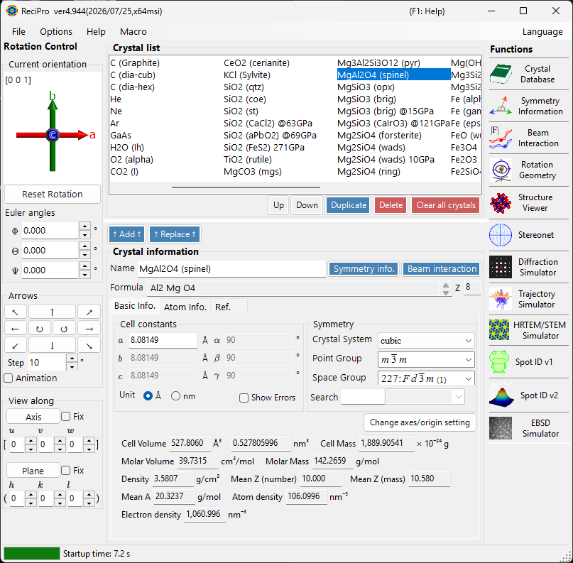

| Area | Location | Description |
|------|----------|-------------|
| **File menu** | Top | File operations, options, help |
| **Rotation control** | Left | View/set crystal orientation |
| **Crystal List** | Upper centre | Select and manage crystals |
| **Crystal Information** | Lower centre | Edit lattice parameters, symmetry, atoms |
| **Functions** | Right | Launch simulation/analysis windows |

---

## Keyboard & mouse shortcuts {#keyboard-mouse-shortcuts}

<!-- 261105Cl コードから起こした修正。別担当がコードと再照合済み (誤りは訂正) (根拠: FormMain.cs:FormMain_Load (KeyDown += FormMain_KeyDown は StructureViewer/Stereonet/DiffractionSimulator/SpotIDv1 のみ), FormMain_DragDrop, labelCurrentIndex_DoubleClick, contextMenuStripListBox, toolStripButtons_MouseDown; Crystallography.Controls/FormCaptureGUI.cs:InstallShortcutFilter) -->
The main window installs several **application-wide** shortcuts. They keep working while the Structure Viewer, Stereonet, Diffraction Simulator, and Spot ID v1 windows are focused.

| Shortcut | Action |
|----------|--------|
| <kbd>F1</kbd> | Open this page of the online manual |
| <kbd>CTRL</kbd>+<kbd>SHIFT</kbd> + arrow keys | Rotate the crystal one step in that direction (hold two arrows for a diagonal) |
| Hold <kbd>CTRL</kbd> while ReciPro starts | Start with OpenGL disabled (recovery for graphics problems; this launch only, not saved) |
| Left-drag the orientation widget (bottom-left, under *Current orientation*) | Rotate the crystal |
| Right double-click the orientation widget | Copy the widget image to the clipboard |
| Single-click a function button | Open / close that window (a minimised window is restored instead of closed) |
| Double-click a function button | Force the window visible and bring it to the front |
| Right-click a crystal in the list | Context menu (Rename / Export as CIF / Duplicate / Delete) |
| Double-click the zone-axis index label (`[u v w]`, under *Current orientation*) | Show / hide the max-UVW box |
| Drop a file on the window | Load a crystal list (`.xml`, `.out`; asks whether to replace or append) or a crystal (`.cif`, `.amc`) <!-- 261105Cl 監査: .cdb2 はドロップで読めないので外した (FormMain.cs:FormMain_DragDrop) --> |
| <kbd>CTRL</kbd>+<kbd>SHIFT</kbd>+<kbd>ALT</kbd>+<kbd>C</kbd> | Open the (experimental) GUI-capture tool for the active window |

→ See **[21. Keyboard & mouse shortcuts](21-shortcuts.md)** for every window at a glance.

---

## Basic Workflow

If you are new to ReciPro, refer to the following steps:

1. Select the target crystal in **Crystal List**. To use a CIF/AMC file, drag and drop it into **Crystal Information**.
2. If you edit lattice parameters or atom positions, press **Add** or **Replace** so the changes are written back to the crystal list.
3. Set the crystal orientation in **Rotation control** using a zone axis, crystal plane, Euler angles, or mouse dragging.
4. Open the desired tool from **Functions**. Diffraction, HRTEM/STEM, EBSD, and other calculation windows use the currently selected crystal and orientation.

---

## File menu

### File

| Menu item | Description |
|-----------|-------------|
| Load Crystal List (Replace current list) | Load a crystal-list file (`*.xml`, `*.out`), replacing the current list; a dialog lets you choose which crystals to load <!-- 261105Cl コードから起こした修正。別担当がコードと再照合済み (誤りは訂正) (根拠: FormMain.cs:ReadCrystalList (showSelectionDialog=true → FormCrystalSelection), SaveCrystalDataToolStripMenuItem_Click) --> |
| Load Crystal List (Add to current list) | Load a crystal-list file and append it to the current list (with the same selection dialog) |
| Reset to initial crystal list | Reload the crystal list ReciPro ships with |
| Import Crystal from a CIF or AMC File | Load a single crystal from a CIF / AMC file |
| Save crystal list | Save the current crystal list (a dialog lets you choose which crystals to write) |
| Export the Selected Crystal as a CIF File | Save the selected crystal in CIF format |
| Clear all crystals | Remove every crystal from the list |
| Exit | Close the application |

### Options

| Menu item | Description |
|-----------|-------------|
| Show Tooltips | Toggle tooltip display |
| Dark mode | Switch between light and dark colour themes |
| Use Miller-Bravais (hkil) index | Use 4-index notation for trigonal/hexagonal systems throughout the app |
| Use ionic scattering factors | Use ionic electron scattering factors (Peng) for the atoms' assigned ions in the dynamical (Bloch-wave) electron calculations, including Kikuchi profiles; the $g \neq 0$ monopole term is added only to the elastic coefficients $U_g$ (TDS absorption and the Kikuchi TDS source use the finite ionic part). When unchecked, neutral-atom factors are used. If the unit cell is not charge-neutral ($\Sigma q \neq 0$), the monopole term is dropped and only the finite (screened-ion) part is used; a notice is shown when the option is switched on <!-- 261105Cl コードから起こした修正。別担当がコードと再照合済み (誤りは訂正) (根拠: FormMain.cs:toolStripMenuItemIonicScattering_CheckedChanged, BetheMethod.cs:ElasticIonModel) --> |
| Download MKL Library | Download the Intel MKL native library (~55 MB); once installed it is used automatically for large computations |
| Accept external macro commands (named pipe) | Listen on the named pipe `ReciPro.Macro.v1` and run macros sent by external programs — see [External control](20-macro/3-external-control.md) |
| Reset registry settings on exit (effective after restart) | Reset settings on next restart |
| Disable Crystallography.Native library (requires restart) | Fall back to managed code if the native (C++) library fails to load |
| Disable all OpenGL rendering (requires restart) | For older GPUs / remote desktop |
| Disable OpenGL text rendering (requires restart) | Workaround for text-rendering issues on some GPUs |
| (experimental) Capture GUI Components | Developer tool for saving GUI screenshots |
| (experimental) Powder diffraction function | Enable the polycrystalline (powder) diffraction window |

### Help

| Menu item | Description |
|-----------|-------------|
| Check for Updates | Check whether a new version of ReciPro is available and install it |
| Hints | Display usage hints (deprecated) |
| Version History | Open the version-history dialog |
| License | Display the MIT licence |
| GitHub Repository | Open the ReciPro repository in a browser |
| Report Bugs, Requests, or Comments | Open the GitHub Issues page |
| Help (Web) | Open the online manual on GitHub Pages, in the page matching the UI language |

The UI language is switched from the separate **Language** menu (requires restart).

### Language

Switch the UI language. Eleven languages are available — English, 日本語 (Japanese), Deutsch, Français, Español, Português, Italiano, Русский, 简体中文, 繁體中文 and 한국어 — and the menu shows each of them in its own script. The change takes effect after restarting ReciPro. The online manual follows the same setting, so <kbd>F1</kbd> and **Help ▸ Help (Web)** open the page in the language you have chosen.

### Macro

<!-- 261105Cl コードから起こした修正。別担当がコードと再照合済み (誤りは訂正) (根拠: FormMain.cs:editorToolStripMenuItem_Click, SetMacroToMenu, macroMenuItem_Click) -->
**Editor** opens the [Macro](20-macro/index.md) window to automate ReciPro operations with Python-style scripts. The macros registered in that window are also listed below **Editor**; choosing one runs it directly. For repeated workflows, see the [built-in functions](20-macro/1-built-in-functions.md) and [macro examples](20-macro/2-examples.md).

---

## Crystal orientation control

The crystal's rotation state is shared by the diffraction simulator, Structure Viewer, Stereonet, HRTEM/STEM simulator, EBSD simulator, and other windows. It is not just a view setting — it defines the incident beam direction and the crystal coordinate relationship used by the simulations. A short video tutorial is available on the [How to use](appendix/a0-how-to-use.md) page.

### Current orientation

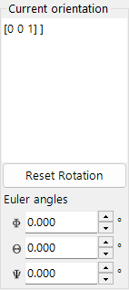

Shows crystal orientation. Drag to rotate. Axes: red = *a*, green = *b*, blue = *c*.

### Reset rotation
Resets to initial: *c*-axis perpendicular to screen, *b*-axis upward.

### Zone axis
<!-- 261105Cl コードから起こした修正。別担当がコードと再照合済み (誤りは訂正) (根拠: FormMain.cs:numericBoxMaxUVW_ValueChanged, labelCurrentIndex_DoubleClick; FormMain.Designer.cs numericBoxMaxUVW (1–100, 既定 30)) -->
Shows the zone axis [*uvw*] closest to the screen normal. The candidates are the irreducible indices (gcd = 1) with $|u|+|v|+|w| \le$ the limit in the max-UVW box (1–100, default 30); double-click the index label to show or hide that box.

### Euler angles (Z-X-Z)
Set the crystal orientation with **Z–X–Z** Euler angles:

- \(\Phi\): Z-axis rotation
- \(\Theta\): X-axis rotation
- \(\Psi\): Z-axis rotation

The rotations are applied in the order \(\Psi \to \Theta \to \Phi\). See [Rotation Geometry](4-rotation-geometry.md) and [Appendix A1. Coordinate System](appendix/a1-coordinate-system/1-orientation.md) for details.

### Arrows

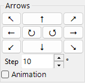

<!-- 261105Cl コードから起こした修正。別担当がコードと再照合済み (誤りは訂正) (根拠: FormMain.cs:ButtonDirection_Click, CheckBoxAnimation_CheckedChanged, Timer_Tick; FormMain.Designer.cs numericBoxStep (既定 10°)) -->
Rotate by angle Step (default 10°). ↺ / ↻ rotate about the screen normal. Check Animation for continuous rotation; Step is then a rate in °/s.

### View along

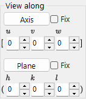

Align a zone axis [*uvw*] or crystal plane (*hkl*) perpendicular to the screen.

<!-- 261105Cl コードから起こした修正。別担当がコードと再照合済み (誤りは訂正) (根拠: FormMain.cs:buttonSetVector_Click, Rotate(Vector3DBase,double), checkBoxFixAxis_CheckedChanged/checkBoxFixPlane_CheckedChanged) -->
- **Fix**: when checked, subsequent rotations (arrows, mouse drag) are all performed about the specified zone axis or plane normal, so that direction stays fixed. Only one of the two **Fix** boxes can be on, and it cannot be checked while the index is 0 0 0.
- **Axis**: places the entered zone axis \([uvw]\) perpendicular to the screen. If **Plane** is also set and the axis lies in that plane ($uh+vk+wl=0$), the plane normal is pointed upward on the screen; otherwise an upward direction is chosen automatically.
- **Plane**: places the normal of the entered crystal plane \((hkl)\) perpendicular to the screen. If **Axis** is also set and lies in the plane ($uh+vk+wl=0$), that axis is pointed upward on the screen; otherwise an upward direction is chosen automatically.

### Basic ways to set the orientation

| Method | Use when | Where |
|--------|----------|-------|
| Mouse drag | You want to rotate freely while watching the crystal axes. | **Current orientation** panel |
| Arrow buttons | You want small, repeatable rotations. | **Arrows** panel |
| Zone axis | You know the viewing direction, such as \([001]\) or \([110]\). | **View along** / zone-axis input |
| Plane normal | You want a crystal plane \((hkl)\) normal to the screen. | **View along** / plane input |
| Euler angles | You need a reproducible numeric orientation. | **Euler angles (Z-X-Z)** |

See [Rotation Geometry](4-rotation-geometry.md) and [Appendix A1. Coordinate systems](appendix/a1-coordinate-system/1-orientation.md) for the rotation matrices and coordinate conventions.

---

## Crystal List

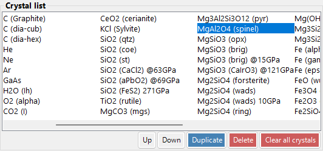

<!-- 261105Cl コードから起こした修正。別担当がコードと再照合済み (誤りは訂正) (根拠: ReciPro/initial.xml (Crystal 66 件)) -->
66 crystals in the default installation. Select to view details and set for calculations. **Right-click a crystal** in the Crystal List for a context menu: *Rename*, *Export as CIF*, *Duplicate*, *Delete*.

| Button | Action |
|--------|--------|
| Up / Down | Reorder |
| Duplicate | Copy the selected crystal |
| Delete / Clear all crystals | Remove the selected crystal / every crystal <!-- 261105Cl コードから起こした修正。別担当がコードと再照合済み (誤りは訂正) (根拠: FormMain.resx buttonClearAllCrystals.Text) --> |
| Add / Replace | Add to list or replace the selected entry |

---

## Crystal Information

Edit lattice parameters, symmetry, and atoms; drag & drop CIF/AMC files to load a structure. This control is shared by ReciPro, PDIndexer, and CSManager, but the tabs and features shown differ per application. ReciPro shows the **Basic Info.**, **Atom Info.**, and **Ref.** tabs (the EOS, Elasticity, and other tabs are for the other applications and are not shown in ReciPro).

> **Important**: Press **Add** or **Replace** to save changes.

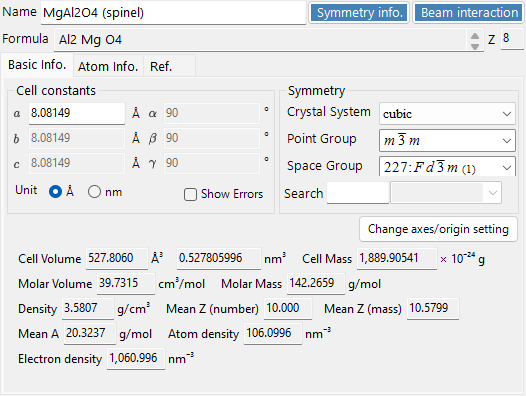

<!-- 261105Cl コードから起こした修正。別担当がコードと再照合済み (誤りは訂正) (根拠: CrystalControl.resx colorControl.HeaderText/ToolTip) -->
The top of the panel always shows **Name** (crystal name), **Formula** (chemical formula, computed from the atom list), **Z** (number of formula units per unit cell), and **Color** (the crystal's display colour, used in the 3D structure view and in diffraction-profile curves). The **Symmetry info.** and **Beam interaction** buttons open the [Symmetry Information](2-symmetry-information.md) and [Beam Interaction](3-beam-interaction.md) windows. Right-click the panel and choose [Details of the chemical composition](#chemical-composition) for wt%, at% and conversion to oxides.

### Basic Info. tab {#basic-info-tab}

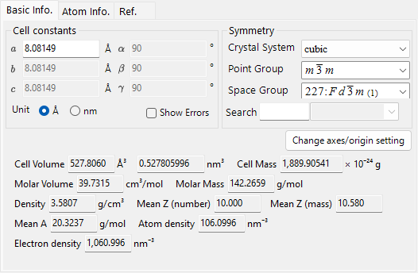

Lattice parameters, symmetry, and quantities derived from them.

| Item | Description |
|------|------|
| Cell constants | Lattice parameters a, b, c (**Unit**: Å = 10⁻¹⁰ m or nm) and α, β, γ. Choosing a symmetry constrains them automatically (e.g. a=b=c, α=β=γ=90° for cubic). |
| Symmetry | Choose the **Crystal System**, **Point Group**, and **Space Group**. Type in the **Search** box to list matching candidates (case-sensitive). |
| Cell Volume / Cell Mass | Volume and mass of the unit cell. The volume is shown in ų / nm³ following the **Unit** selection; the mass is in 10⁻²⁴ g. <!-- 261105Cl コードから起こした修正。別担当がコードと再照合済み (誤りは訂正) (根拠: CrystalControl.resx numericBox*.FooterText/HeaderText, SymmetryControl.resx checkBoxShowError, CrystalControl.cs:buttonChangeAxesOriginSetting_Click) --> |
| Molar Volume / Molar Mass / Density | Molar volume (cm³/mol, per formula unit), molar mass (g/mol), and density (g/cm³). Shown **only when atoms have been entered**. |
| Mean Z (number) / Mean Z (mass) / Mean A | Number- and mass-averaged atomic number, and the mean atomic weight per atom (g/mol). Occupancies are included. |
| Show Errors | Show the error (±) fields of the cell constants. |
| Change axes/origin setting | Same as the context-menu item **Change the axes/origin setting**: convert to another axis/origin setting of the same space group. |
| Atom density / Electron density | Numbers of atoms and electrons per unit-cell volume, shown in Å⁻³ / nm⁻³ following the **Unit** selection. |

### Atom Info. tab {#atom-tab}

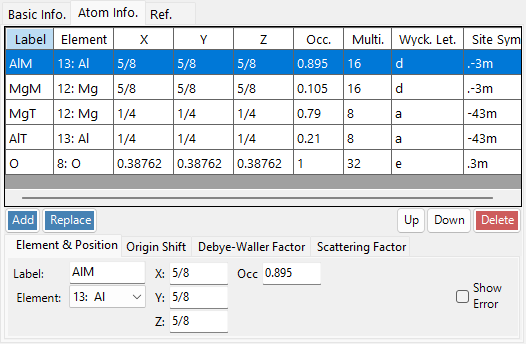

<!-- 261105Cl コードから起こした修正。別担当がコードと再照合済み (誤りは訂正) (根拠: AtomControl.resx multi/wyckLet/siteSymDataGridViewTextBoxColumn.HeaderText) -->
Set the species, position, temperature factor, and scattering factor of each atom. Edit the atom list with **Add**, **Replace** (replace the selected row), **Up/Down** (reorder), and **Delete**. The atom list also shows, for each site, its multiplicity (**Multi.**), Wyckoff letter (**Wyck. Let.**) and site symmetry (**Site Sym.**). Each atom has:

| Item | Description |
|------|------|
| Label | Atom label (any identifier). |
| Element | Element (including ionic valence). |
| X, Y, Z | Fractional coordinates (0–1). Fractions such as 1/2 or 2/3 may be entered. |
| Occ | Occupancy (0–1). |

Right-click an atom row and choose **Show equivalent atom positions** to open a small window listing all positions generated by the space-group symmetry operations; its **Copy** button copies the list as tab-separated text (e.g. for pasting into a spreadsheet).

<!-- 261105Cl コードから起こした修正。別担当がコードと再照合済み (誤りは訂正) (根拠: AtomControl.resx: radioButtonOriginShiftPlus/Minus, buttonOriginShift1–9, buttonOriginShiftCustom) -->
**Origin Shift**: shifts the origin of all atomic coordinates. Choose the sign with **+** / **−**, then press one of the preset vectors — (⅛ ⅛ ⅛), (¼ ¼ ¼), (0 ¼ ⅛), (¼ 0 ¼), (0 ¼ ¼), (¼ ¼ 0), (¼ −¼ 0), (¼ −¼ ¼), (0 ¼ −⅛) — or use **Apply custom shift** for an arbitrary amount.

**Debye–Waller factor (temperature factor)**:

| Item | Description |
|------|------|
| Notation | Use the U or B notation. Switching converts the displayed values ($B = 8\pi^2 U$). |
| Model | Isotropic or anisotropic. |
| U##, β## | For the anisotropic case, enter each component: $U_{ij}$ in Ų, or in the B notation the dimensionless $\beta_{ij} = 2\pi^2 a^*_i a^*_j U_{ij}$ (the same as B(i,j) in AMCSD files). |

**Scattering factor**: choose the scattering factor used for each atom.

| Radiation | Source / setting |
|-----------|------|
| X-ray | Scattering factors including ionic valence (International Tables for Crystallography, Vol. C). |
| Electron | Electron scattering factors — neutral atoms from Peng, Ren, Dudarev & Whelan (1996), *Acta Cryst.* **A52**, 257–276; ions from Peng (1998), *Acta Cryst.* **A54**, 481–485. |
| Neutron | Neutron scattering lengths. Choose **Natural isotope abundance** or **Custom isotope abundance** (an arbitrary isotope composition). |

### Ref. tab {#reference-tab}

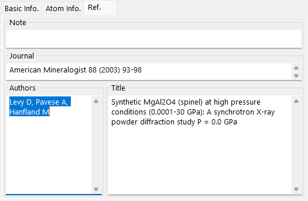

Record the source of the structure: **Note**, **Authors**, **Journal**, and **Title**.

### Context menu (right-click)

Right-click an empty area of the control for these main actions:

| Menu item | Action |
|-----------|------|
| Details of the chemical composition | Open the [Details of the chemical composition](#chemical-composition) window (wt%, at%, normalized atoms, conversion to oxides). |
| Beam Interaction | Open the [Beam Interaction](3-beam-interaction.md) window. |
| Symmetry Information | Open the [Symmetry Information](2-symmetry-information.md) window. |
| Import from CIF or AMC... | Load a crystal from a CIF / AMC file. |
| Export to CIF | Export the current crystal as CIF. |
| Revert cell constants | Restore the cell constants to the values first loaded. |
| Convert to P1 Space Group | Expand the structure to space group P1. |
| Convert to a superstructure | Convert to a superstructure with integer multiples of a, b, c (size dialog). |
| Change the axes/origin setting | Convert to an equivalent space group (a different axis setting). |

#### Details of the chemical composition {#chemical-composition}

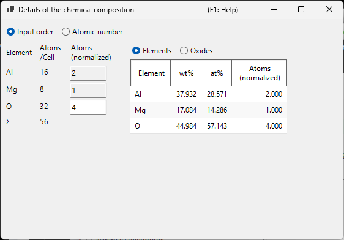

Shows the composition of the current crystal, computed from the atom list (the number of atoms of each element is the sum of multiplicity × occupancy over its sites). The window follows the crystal selected in the main window.

- The right table lists **wt%**, **at%** and **Atoms (normalized)** for each element; the left table lists the atoms per unit cell. Click a box in the normalized column of the left table to make that element the basis, then type its number of atoms (e.g. O = 24). By default the basis is O (or the first element) and the normalized column shows the chemical formula.
- **Oxides**, **Halides** and **Sulfides** (only those that apply to the crystal are shown) convert the composition formally into components, using the **Valence** of each element. Valences can be edited (fractions such as 8/3 are accepted). Unless entered, Fe is 2, other elements take the valence of the ion chosen for the X-ray scattering factor, or else a common oxidation state. **Σ=0** sets the valence that makes the total charge zero, and **Default** clears the entered valences. Entered valences are kept with the crystal and saved in XML crystal lists.
- **Input order** / **Atomic number** switch the order of the elements.

---

## Functions panel {#functions}

The vertical button strip on the right launches the analysis and simulation windows listed below.

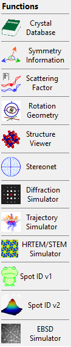

| Button | Description | Details |
|--------|-------------|---------|
| Crystal Database | Search and import crystals from the bundled / online databases | [1. Crystal database](1-crystal-database.md) |
| Symmetry Information | Space-group info and *International Tables* Vol. A symmetry diagrams | [2. Symmetry information](2-symmetry-information.md) |
| Beam Interaction | Beam–crystal interaction: reflections, attenuation, scattering factors, fluorescence | [3. Beam interaction](3-beam-interaction.md) |
| Rotation Geometry | 3D rotation matrix / goniometer angles | [4. Rotation Geometry](4-rotation-geometry.md) |
| Structure Viewer | 3D crystal structure | [5. Structure viewer](5-structure-viewer.md) |
| Stereonet | Stereographic projection | [6. Stereonet](6-stereonet.md) |
| Diffraction Simulator | Single-crystal X-ray / electron diffraction | [7. Diffraction simulator](7-diffraction-simulator/index.md) |
| Trajectory Simulator | Monte-Carlo electron-trajectory simulation | [8. Electron trajectory](8-electron-trajectory.md) |
| HRTEM/STEM Simulator | HRTEM / STEM image simulation | [9. HRTEM/STEM simulator](9-hrtem-stem-simulator/index.md) |
| Spot ID v1 | SAED pattern indexing (formerly "TEM ID") | [10. Spot ID v1](10-spot-id.md) |
| Spot ID v2 | Spot detection & indexing | [11. Spot ID v2](11-spot-id-v2.md) |
| EBSD Simulator | EBSD pattern simulation | [12. EBSD simulation](12-ebsd-simulation.md) |
| Powder Diffraction | Polycrystalline (powder) diffraction — enable via **Options ▸ (experimental) Powder diffraction function** | - |

---

## See also

- [Crystal database](1-crystal-database.md)
- [Rotation geometry](4-rotation-geometry.md)
- [Structure viewer](5-structure-viewer.md)
- [Diffraction simulator](7-diffraction-simulator/index.md)
- [Keyboard & mouse shortcuts](21-shortcuts.md)
- [Basic coordinate system & crystal orientation](appendix/a1-coordinate-system/1-orientation.md)
