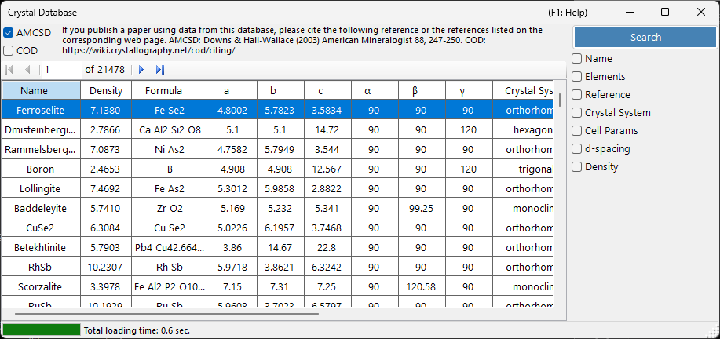
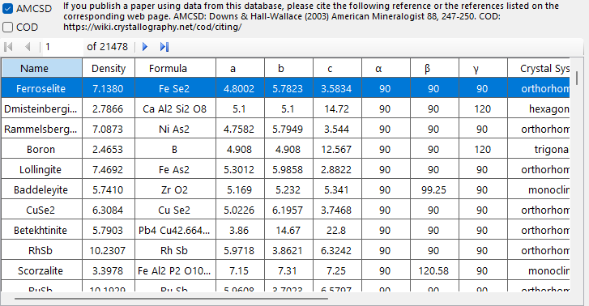
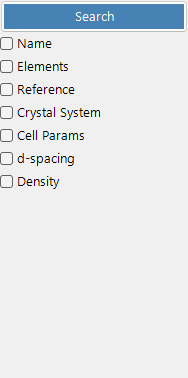
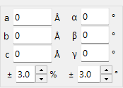

# Crystal Database

The **Crystal Database** provides functions to search and import crystal structures from two sources, selectable with the **AMCSD** and **COD** check boxes:

- **AMCSD** : the bundled [American Mineralogist Crystal Structure Database](https://www.rruff.net/) (more than 20,000 structures).
- **COD** : the [Crystallography Open Database](https://www.crystallography.net/cod/). Because the file is large it is not bundled with the installer; the database file is downloaded automatically on first use. When the file is updated on the server, you are prompted to download it again.

Please cite the following references when using these databases.

When using **AMCSD**:

> Downs, R.T. and Hall-Wallace, M. (2003) The American Mineralogist Crystal Structure Database. *American Mineralogist* **88**, 247-250.

When using **COD**:

> Gražulis, S. et al. (2009) Crystallography Open Database – an open-access collection of crystal structures. *Journal of Applied Crystallography* **42**, 726-729.
>
> Gražulis, S. et al. (2012) Crystallography Open Database (COD): an open-access collection of crystal structures and platform for world-wide collaboration. *Nucleic Acids Research* **40**, D420-D427.

---

## Keyboard & mouse shortcuts

This window has no modifier-key combinations; it is driven by ordinary clicks. The only non-obvious inputs are:

| Shortcut | Action |
|----------|--------|
| <kbd>F1</kbd> | Open this page of the online manual |
| <kbd>ENTER</kbd> in any search field | Run the database search (same as the **Search** button) |
| Click a row in the result table | Load that crystal into the main window |
| Click an element in the **Periodic table** popup | Cycle its filter: *ignore* → *must include* → *must exclude* |

→ See **[21. Keyboard & mouse shortcuts](21-shortcuts.md)** for every window at a glance.

---

## Table

Displays crystals matching search criteria. Select a crystal to transfer to Main window's Crystal Information. Press **Add** or **Replace** to add to Crystal List.

---

## Search options

Enter the search criteria below and press the **Search** button or the **Enter** key.

| Criterion | Description |
|-----------|-------------|
| **Name** | Crystal name |
| **Elements** | Periodic table selector (may/must/must-not include) <!-- 261105Cl draft: コードから起こした修正・著者未査読 (根拠: SearchCrystalControl.resx checkBoxSearchElements/checkBoxSearchCellParameter.Text) --> |
| **Reference** | Title, journal, author |
| **Crystal system** | Select crystal system |
| **Cell Params** | Lattice constants and error |
| **d-spacing** | Strong-reflection d-values and error |
| **Density** | Density and error |

### Name

<!-- 261105Cl draft: コードから起こした修正・著者未査読 (根拠: SearchCrystalControl.cs:backgroundWorkerSearch_DoWork) -->
Free-text match against the crystal name. Partial matches are allowed; case is ignored. Only the criteria whose check boxes are ticked are applied, and they are combined with AND.

### Element

Press the **Periodic Table** button to open the element selector. Each element button cycles between three states:

<!-- 261105Cl draft: コードから起こした修正・著者未査読 (根拠: FormPeriodicTable.cs: NeutralColor=LightYellow, IncludeColor=LightBlue, ExcludeColor=LightCoral, button_Click) -->
- **May or may not include** (default — yellow)
- **Must include** (blue)
- **Must exclude** (red)

A crystal must contain every *must include* element and none of the *must exclude* elements; entries without atom data are excluded while the **Elements** criterion is on.

The three buttons at the top of the window reset every element to one of the three states in one click.

### Reference

Free-text match (partial, case-insensitive) against the publication metadata: paper title, journal name, and author list.

### Crystal system

Restrict the search to a specific crystal system (cubic, tetragonal, orthorhombic, hexagonal, trigonal, monoclinic, triclinic). The first item, *Unknown*, applies no restriction.

### Cell parameter search

<!-- 261105Cl draft: コードから起こした修正・著者未査読 (根拠: SearchCrystalControl.cs:buttonSearch_Click/backgroundWorkerSearch_DoWork, SearchCrystalControl.resx numericBoxCell*.ToolTip/FooterText) -->
Enter target lattice constants *a*, *b*, *c* (Å) and *α*, *β*, *γ* (°) and the acceptable errors: one relative tolerance (±%) common to *a*, *b*, *c*, and one absolute tolerance (±°) common to the angles. A value of 0 means that parameter is ignored.

### d-spacing

<!-- 261105Cl draft: コードから起こした修正・著者未査読 (根拠: SearchCrystalControl.cs:backgroundWorkerSearch_DoWork/calcDlist, CrystalMinimum.cs:d (強度上位 8 本の d 値)) -->
Enter up to three *d*-spacings (Å; tick each one to use it), each with a relative tolerance (±%). A crystal matches when every entered value agrees with one of its eight strongest reflections. With **Ignore scattering factor** checked, the values are instead compared with all geometrically possible *d*-spacings computed from the unit cell (including systematically absent reflections). Useful when only the diffraction peak positions are known from an experiment.

### Density

Filter by mass density (g/cm³) within a relative tolerance (±%).

---

## See also

- [Main window](0-main-window.md)
- [Symmetry information](2-symmetry-information.md)
- [Beam interaction](3-beam-interaction.md)
- [Structure viewer](5-structure-viewer.md)
