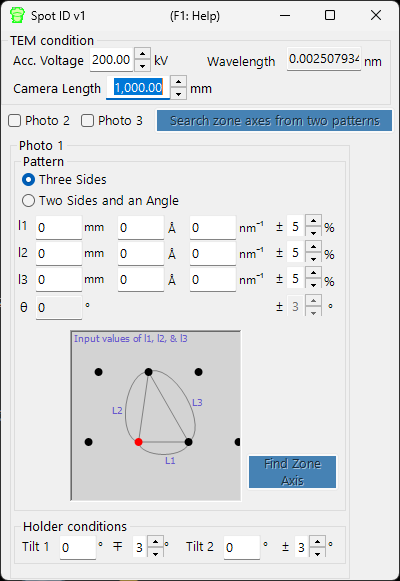

# Spot ID v1

<!-- 261105Cl draft: コードから起こした修正・著者未査読 (根拠: FormSpotIDv1.Designer.cs (画像・スポット検出のコントロール無し)) -->
**Spot ID v1** (the former **TEM ID**) searches for candidate zone axes from a numerically entered spot geometry of one to three diffraction patterns. Spot detection, fitting and indexing on an image are done in [Spot ID v2](11-spot-id-v2.md).

---

## Keyboard & mouse shortcuts

<!-- 261105Cl draft: コードから起こした修正・著者未査読 (根拠: FormSpotIDv1.Designer.cs) -->
Spot ID v1 takes spot geometry as **numeric input** (the former *TEM ID* workflow); it has no image view (image loading, mouse zoom, spot detection and manual spot picking belong to [Spot ID v2](11-spot-id-v2.md)). The one shortcut is in the results window:

| Shortcut | Action |
|----------|--------|
| <kbd>F1</kbd> | Open this page of the online manual |
| Double-click a row in the results list | Select that crystal and rotate it to the matching zone axis |

→ See **[21. Keyboard & mouse shortcuts](21-shortcuts.md)** for every window at a glance.

---

<!-- 261105Cl 要確認: FormSpotIDv1 (Designer.cs) には画像表示・画像調整・Optics・スポット検出/フィッティング・Index のコントロールが一つも無い (TEM ID の数値入力のみ)。この節から「指数付け」節までは Spot ID v2 (FormSpotIDV2) の機能。削除または 11-spot-id-v2 への移設を著者が判断すること -->
## Main area

Displays the diffraction image for reference. Load images by drag & drop or from the **File** menu.

### Image adjustments

| Setting | Description |
|---------|-------------|
| Min / Max | Brightness range (also adjustable via track bar) |
| Gradient | Positive or Negative |
| Scale | Linear or Log |
| Colour | Grey scale or Cold-Warm |
| Dust & Scratch | Remove exceptional bright/dark pixels (set range and threshold) |
| Gaussian blur | Apply blur (range in pixels) |

---

## Optics

Enter the incident source, energy/wavelength, camera length, and detector pixel size.

> If a dm3/dm4 file (Gatan Digital Micrograph) is loaded, these values are set automatically.

---

## Spot detection and fitting

Press **Detect & fit spots** to automatically detect diffraction spots and fit them with a 2D Pseudo-Voigt function. Results appear in the table.

### Detection options

| Parameter | Description |
|-----------|-------------|
| Number | Maximum number of spots to detect |
| Nearest neighbour | Minimum distance between detected spots |
| Fitting range | Radius (pixels) around each spot for fitting |

### Table controls

| Button | Action |
|--------|--------|
| Reset range | Re-set fitting range for all spots |
| Show label/symbol | Overlay labels/symbols on the image |
| Clear all spots | Remove all spots |
| Save / Copy | Export table in tab-separated (Excel) format |
| Re-fit all | Re-fit all spots |

### Spot detail window

Check the box to open a detail window showing the selected spot (left) and profiles in four directions (right). Blue = observed data, red = fit.

---

## Index

Press **Identify spots** to index detected spots against the crystal selected in the Main window.

| Setting | Description |
|---------|-------------|
| Acceptable error | Tolerance for indexing |
| Single grain / Multi grains | Index as single crystal or multiple grains (set max grain count) |
| Show label/symbol | Overlay indexed labels on image |
| Refine thickness and direction | Apply dynamical theory (Bethe method) to refine sample thickness and crystal orientation that best matches the detected intensities |

---

## Zone-axis search from spot geometry (former TEM ID)

When you do not have an image to load, you can still search for candidate zone axes by entering the geometry of a selected-area electron diffraction (SAED) pattern by hand. Enter the TEM observation conditions and the spot geometry, then press **Find Zone Axis** of a photo (or **Search zone axes from two/three patterns** to use several photos together) to find candidate crystal orientations.

### TEM condition

<!-- 261105Cl draft: コードから起こした修正・著者未査読 (根拠: FormSpotIDv1.Designer.cs: numericBoxAccVol / numericBoxCamaraLength / textBoxWaveLength) -->
Enter **Acc. Voltage** (kV, default 200) and **Camera Length** (mm, default 1000). **Wavelength** (nm) is computed from the voltage and shown read-only.

### Photo 1, 2, 3

Enter the geometry of the diffraction spots.

- To enter spot-to-spot distance on the detector, use the **mm** box.
- If you know the *d*-value, enter it in **Å** or **nm⁻¹** units.

**Three sides mode** : Enter the lengths of the three sides of a triangle with the direct spot as one vertex.

**Two sides and an angle mode** : Enter the lengths of two sides (including the direct spot) and the angle between them.

<!-- 261105Cl draft: コードから起こした修正・著者未査読 (根拠: FormSpotIDv1.cs: textBox_TextChanged / buttonSearch_Click / buttonSearchAll_Click / checkBoxEquivalent*_CheckedChanged、FormSpotIDv1.resx の ToolTip) -->
- **Tolerances** (**±**) : each length has a tolerance in % (0–50, default 5) and θ in degrees (0–30, default 3). The value not entered (θ in three-sides mode, l3 in two-sides mode) is computed and shown, and a sketch of the resulting pattern is drawn beside the inputs.
- **Holder conditions** : **Tilt 1** / **Tilt 2** (°) of the goniometer holder at which the photo was taken, each with a tolerance (0–10°, default 3°). The angles between the holder settings of the photos are computed and shown.
- **Photo 2** / **Photo 3** : enable the second and third photos. The checkboxes between the photos treat l1 (or l2) of two photos as the same reflection and copy its length.
- **Find Zone Axis** searches one photo; **Search zone axes from two patterns** / **from three patterns** searches combinations consistent with all enabled photos and the holder-tilt angles between them. The search runs over every crystal selected in the main-window list (multiple selection is enabled while Spot ID v1 is open). If more than 1000 candidates are found, nothing is listed and you are asked to narrow the conditions; otherwise the results window opens. Double-click a row to select the crystal and rotate it to that orientation.

---

## See also

- [Spot ID v2](11-spot-id-v2.md)
- [Diffraction simulator](7-diffraction-simulator/index.md)
- [Main window](0-main-window.md)
- [Crystal database](1-crystal-database.md)
- [EBSD simulation](12-ebsd-simulation.md)
