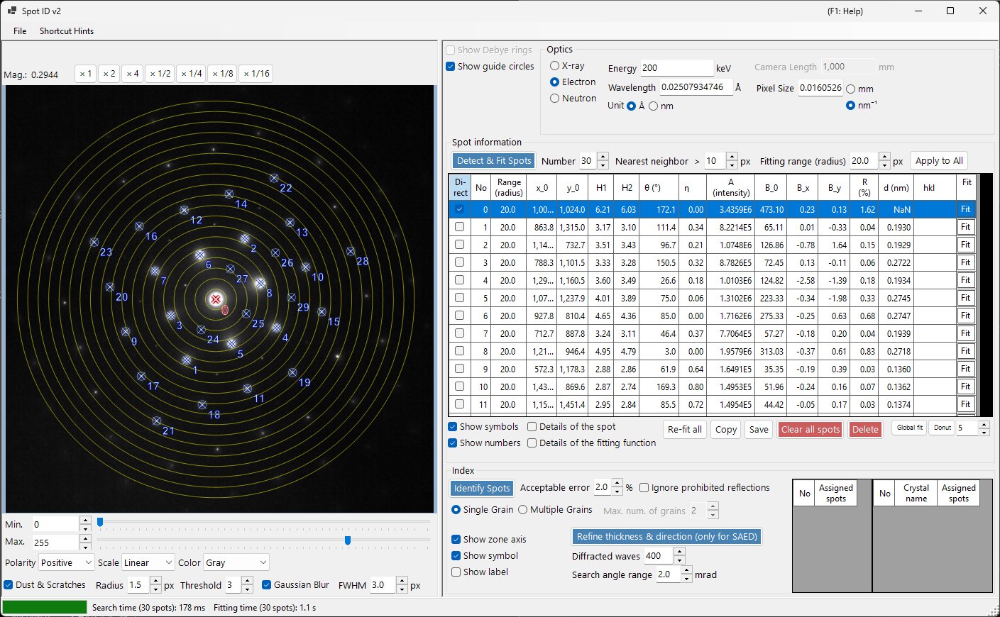
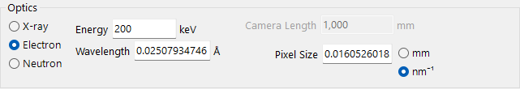
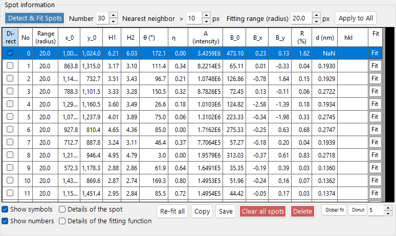
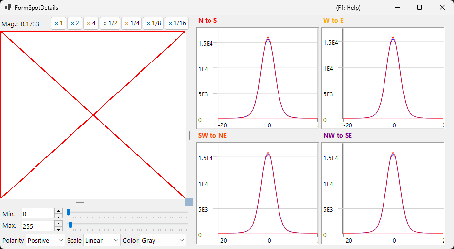
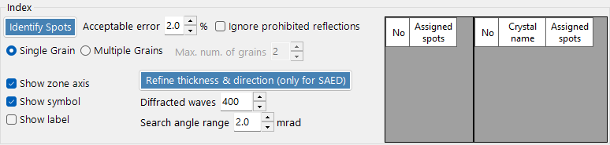

# Spot ID v2

<!-- 261105Cl コードから起こした修正。別担当がコードと再照合済み (誤りは訂正) (根拠: FormSpotIDv1.Designer.cs / FormSpotIDV2.Designer.cs) -->
**Spot ID v2** detects, fits and indexes diffraction spots on an experimental diffraction image. [Spot ID v1](10-spot-id.md) (the former TEM ID) instead takes the spot geometry as numeric input.

---

## Keyboard & mouse shortcuts

You build the spot list directly on the loaded image. The image pane uses ReciPro's standard [image-view navigation](21-shortcuts.md) for pan/zoom; spot editing adds the combinations below.

| Shortcut | Action |
|----------|--------|
| <kbd>F1</kbd> | Open this page of the online manual |
| Left double-click the image | Add a spot at that point (peak-fitted) |
| <kbd>CTRL</kbd> + Left double-click | Add a spot and mark it as the direct (000) beam |
| Left-click a spot | Select the nearest spot |
| <kbd>CTRL</kbd> + Right-click a spot | Delete the nearest spot |
| <kbd>CTRL</kbd> + arrow keys | Nudge the selected spot by one pixel |
| Left-drag / Middle-drag (empty area) | Pan the image |
| Mouse wheel | Zoom in / out at the cursor |
| Right-drag a box | Zoom in to the selected region |
| Right double-click | Zoom out |
| Double-click a spot's row header (table) | Zoom to that spot (×2) |

→ See **[21. Keyboard & mouse shortcuts](21-shortcuts.md)** for every window at a glance.

---

## File menu

<!-- 261105Cl コードから起こした修正。別担当がコードと再照合済み (誤りは訂正) (根拠: FormSpotIDv1.Designer.cs (画像読み込み無し) / FormSpotIDV2.Designer.cs: saveToolStripMenuItem, copyToolStripMenuItem) -->
Open a diffraction image; **Save** / **Copy** write the displayed image as a Metafile (EMF) or an image (PNG). Images can also be loaded by drag and drop. For a Gatan DM3/DM4 file calibrated in nm⁻¹, the radiation is set to electrons and the accelerating voltage and the pixel size (nm⁻¹) are read from the file (the camera length is not needed in that case).

**Save ▸ Candidate list (CSV)...** exports the orientation candidates found by the indexing, and **Copy ▸ Candidate list (TSV)** puts the same table on the clipboard: one row per candidate × grain, with the rank, the grain index, the crystal name, the ZXZ Euler angles (°), the nine rotation-matrix elements, the mean-squared residual (nm⁻²), the number of assigned spots and the spot → (hkl) assignments. The CSV always uses a period as the decimal separator; the TSV can be pasted straight into a spreadsheet.

---

## Optics

### Incident source

Select the radiation type (X-ray / electron / neutron) and set the energy or wavelength.

### Camera length / Pixel size

The camera length (mm) and detector pixel size (mm or nm⁻¹). When a Gatan DM file calibrated in nm⁻¹ is loaded, the pixel size (nm⁻¹) is read from the file header and the camera length is not used.

<!-- 261105Cl コードから起こした修正。別担当がコードと再照合済み (誤りは訂正) (根拠: FormSpotIDV2.Designer.cs: panel1 の checkBoxShowDebyeRing / checkBoxGuideCircles) -->
**Show Debye rings** (default off) and **Show guide circles** (default on) draw the Debye rings of the crystal and guide circles on the pattern.

---

## Spot information

- **Detect & Fit Spots**: Automatic spot detection using local maxima and background subtraction.
- **Number**: The maximum number of spots to detect.
- **Nearest neighbor**: The minimum separation (px) allowed between detected spots. Peaks closer than this are merged, preventing double-detection of the same spot.
- **Fitting range (radius)**: The radius (px) of the circular region used to fit each spot's peak. Pixels inside this circle are fitted with a pseudo-Voigt function.
- **Apply to All**: Sets the fitting radius of every spot to the current **Fitting range (radius)** value.
- **Delete / Clear all spots**: Remove the selected spot, or all detected spots.
- **Save** / **Copy**: Save the spot table to a file, or copy it to the clipboard. <!-- 261105Cl コードから起こした修正。別担当がコードと再照合済み (誤りは訂正) (根拠: FormSpotIDV2.Designer.cs / FormSpotIDV2.resx の ToolTip) -->
- **Re-fit all**: Re-fit the positions and intensities of all detected spots.
- **Show symbols** / **Show numbers**: Show marker symbols / numbers on the observed spots (both on by default).
- **Global fit**: Perform a global fit of all spot positions at once (experimental).
- **Donut**: Apply donut-shaped background subtraction (experimental); the adjacent box sets the width (px) of the annular ring around each spot whose average is subtracted as the local background.
- **Details of the spot**: When checked, opens a window showing detailed information about the currently selected spot.
- **Details of the fitting function** (off when the window opens): Show a figure of the two-dimensional pseudo-Voigt function and its parameters (x_0, y_0, H1, H2, θ, η, A, B_0, B_x, B_y) used in the spot table.

---

## Index

- **Identify Spots**: Run the indexing algorithm to find the best-matching crystal and zone axis.
- **Acceptable error**: Relative d-spacing tolerance in % (0.1–10, default 2). The angle tolerance between spots is derived from it as asin(tolerance)/2. <!-- 261105Cl コードから起こした修正。別担当がコードと再照合済み (誤りは訂正) (根拠: FormSpotIDV2.cs: ToleranceLength / ToleranceAngle) -->
- **Ignore prohibited reflections** (default off; electron diffraction only): When checked, all systematically absent reflections, including those forbidden by screw axes and glide planes, are excluded from the candidate reflections. When unchecked, only the absences due to lattice centring (I, F, A, B, C, R) are excluded, so screw/glide-forbidden reflections that can appear through multiple diffraction remain candidates. For X-rays all absent reflections are always excluded. <!-- 261105Cl コードから起こした修正。別担当がコードと再照合済み (誤りは訂正) (根拠: FormSpotIDV2.cs: SetGVector(..., checkBoxIgnoreMultipleDiffraction.Checked, ...) / PolyCrystal.cs: SetGVector) -->
- **Single Grain / Multiple Grains**: Search for a single orientation (single crystal), or for several orientations (a polycrystalline / multi-grain region). For multiple grains, **Max. num. of grains** sets the upper limit on the number of grains to search for.
- **Show zone axis** / **Show symbol** / **Show label**: Overlay the zone axis and the symbols / index labels of the calculated spots. <!-- 261105Cl コードから起こした修正。別担当がコードと再照合済み (誤りは訂正) (根拠: FormSpotIDV2.Designer.cs / FormSpotIDV2.resx の ToolTip) -->
- **Refine thickness & direction (only for SAED)**: Refine the specimen thickness (nm) and the beam direction of the selected grain by matching the observed spot intensities to dynamical (Bloch-wave) calculations. **Diffracted waves** (1–2048, default 400) is the number of beams, and **Search angle range** (mrad, 1–10, default 2) is the angular half-range of incident directions searched. **Stop** interrupts the computation. Thicknesses of 50–549 nm (1 nm step) and incident directions on a square grid around the current orientation of the grain (step = 1/15 of the search range) are tried, and the pair that minimises Σ (Iobs − a·Icalc)² over the indexed spots (a: best scale factor) is taken. The best thickness is passed to the Diffraction simulator, and the orientation of the grain (also applied to the main window) is tilted so that the best direction becomes the beam direction; the in-plane rotation is kept. The result (thickness, tilt in mrad, zone axis, residual) is shown in the status bar. If the best direction lies at the edge of the search range, the status bar says so, because the optimum may lie outside it: press the button again (the search is then centred on the refined orientation) or widen the range. <!-- 261105Cl 方位の精密化の実装に合わせて追記 (根拠: FormSpotIDV2.cs: ButtonRefineThicknessAndDirection_Click / Bethe_CbedCompleted) -->
- **Results**: The best matches are displayed with crystal name, zone axis [uvw], and individual spot indices (hkl).

---

## See also

- [Spot ID v1](10-spot-id.md)
- [Diffraction simulator](7-diffraction-simulator/index.md)
- [Main window](0-main-window.md)
- [Keyboard & mouse shortcuts](21-shortcuts.md)
