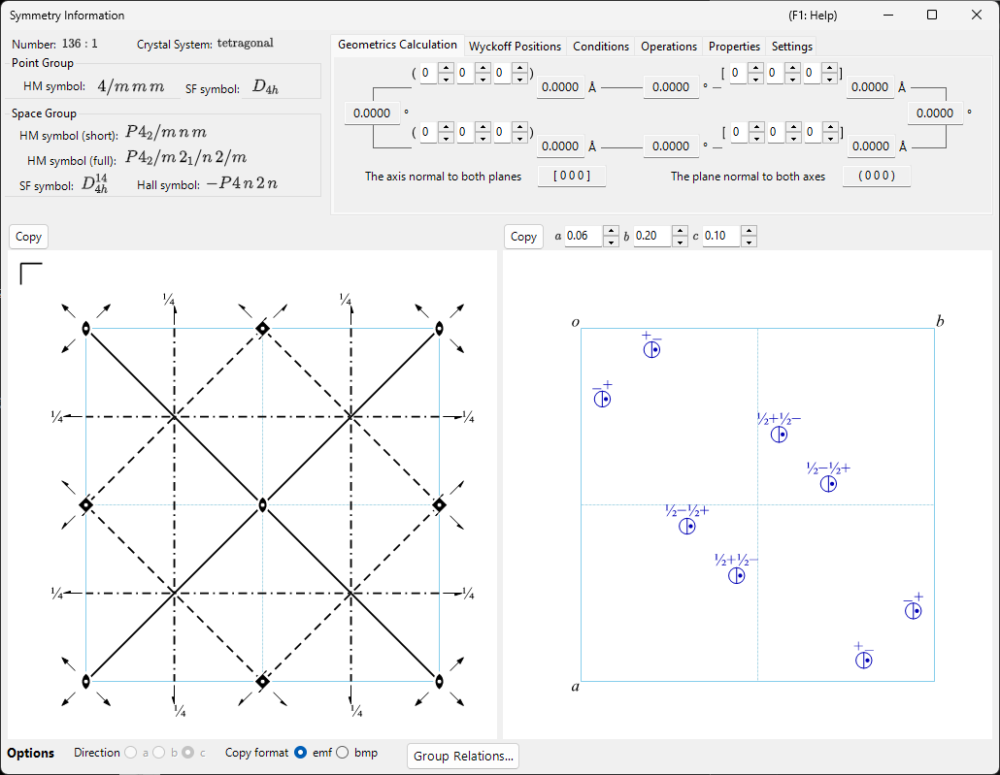
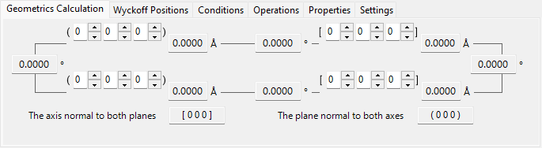
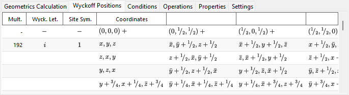
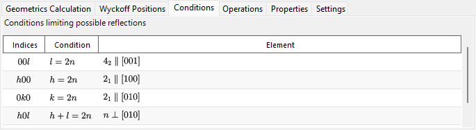
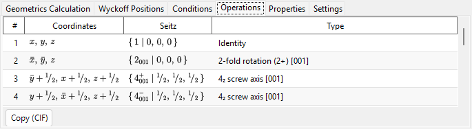
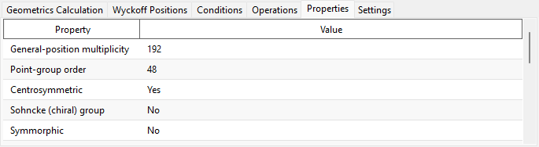
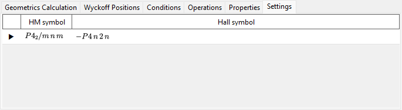
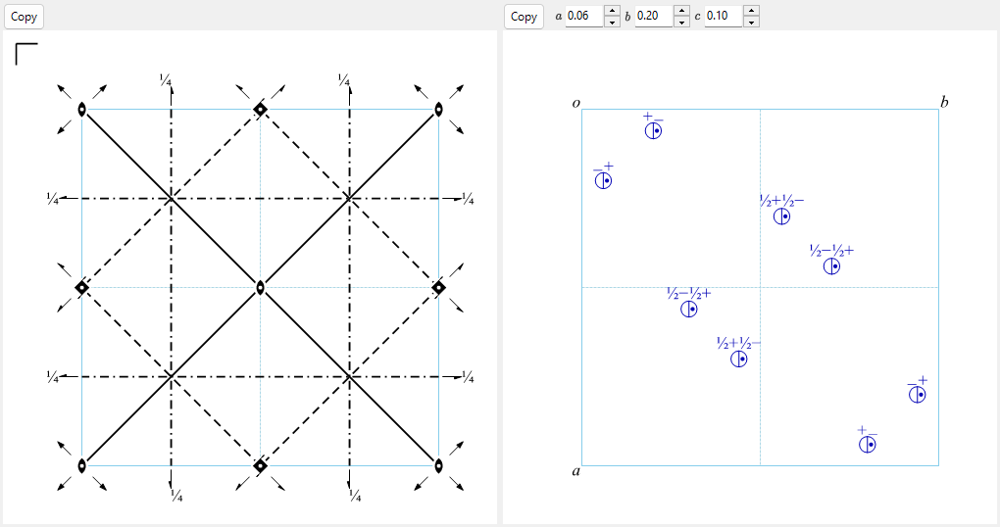

# Symmetry Information

**Symmetry Information** displays detailed information about the space-group symmetry of the selected crystal, and additionally renders schematic diagrams of the symmetry elements and general positions in the style of *International Tables for Crystallography* Vol. A.

The window is divided into a space-group identity area (top left), a calculation/table area with tabs (top right), and two schematic diagrams (bottom).

!!! tip "Symmetry theory (Appendix A4)"
    What a Hermann–Mauguin/Hall/Schoenflies symbol actually encodes, the group-theoretical classifications on the **Properties** tab (centrosymmetric, Sohncke, symmorphic, polar, …), the meaning of the symmetry-element/general-position diagrams below, and the group–subgroup relations shown by **Group Relations…** are all explained in **[Appendix A4. Symmetry and Space Groups](appendix/a4-symmetry-space-groups/index.md)**.

---

## Keyboard & mouse shortcuts

This window has no special key or mouse combinations. <kbd>F1</kbd> opens this manual page, and the two **Copy** buttons place the symmetry-element diagram and the general-position diagram on the clipboard (as vector **emf** or raster **bmp**, chosen with **Copy format**).

→ See **[21. Keyboard & mouse shortcuts](21-shortcuts.md)** for every window at a glance.

---

## Space-group identity

The top-left panel lists, for the current space group:

- **Number** (1–230) and the setting index
- **Crystal System**
- **Point Group** : Hermann–Mauguin (HM) and Schoenflies (SF) symbols
- **Space Group** : HM short symbol, HM full symbol, SF symbol, and **Hall symbol**

---

## Geometrics Calculation

Enter two crystal planes \((h_1, k_1, l_1)\), \((h_2, k_2, l_2)\) or two direction indices \([u_1, v_1, w_1]\), \([u_2, v_2, w_2]\) to obtain:

- the d-spacing of each plane / the length of each axis,
- the angle between the two planes (or two axes),
<!-- 261105Cl draft: コードから起こした修正・著者未査読 (根拠: FormSymmetryInformation.cs:numericBox_ValueChanged) -->
- the angle between plane 1 and axis 1, and between plane 2 and axis 2,
- **the direction index normal to both planes** and **the plane index normal to both axes**.

These calculations respect the metric of the current unit cell. Lengths are shown in Å and angles in degrees.

---

## Wyckoff Positions

<!-- 261105Cl draft: コードから起こした修正・著者未査読 (根拠: FormSymmetryInformation.cs:SetupExtraTables/SetWyckoffPosition) -->
Lists every Wyckoff position with its multiplicity (**Mult.**), Wyckoff letter (**Wyck. Let.**), site symmetry (**Site Sym.**), and **Coordinates** (up to four per row; longer lists continue on the following rows). The first Wyckoff entry (highest multiplicity) is the general position. For centred lattices, the lattice translation vectors are shown in the header row.

---

## Conditions

The reflection conditions arising from the lattice centring and from the glide/screw symmetry operators.

<!-- 261105Cl draft: コードから起こした修正・著者未査読 (根拠: FormSymmetryInformation.cs:SetupExtraTables/ChangeCrystal) -->
Each row has three columns: **Indices** (the reflection class, e.g. $hkl$, $h0l$, $00l$), **Condition** (e.g. $h+k=2n$), and **Element** (the lattice centring or symmetry element responsible). *No Condition* is shown when there is none.

---

## Operations

Lists every symmetry operation of the general position (lattice-centring translations already expanded in) as a coordinate triplet, a Seitz symbol, and a plain-language geometric type (e.g. *"3-fold rotation"*, *"c-glide plane"*, *"screw axis"*). **Copy (CIF)** copies the full list to the clipboard as a CIF `_space_group_symop_operation_xyz` loop.

→ See **[Appendix A4.1](appendix/a4-symmetry-space-groups/symbols-and-diagrams.md#symmetry-operations-operations-tab)** for how to read these three notations.

---

## Properties

Reports group-theoretical classifications of the current space group (general-position multiplicity, point-group order, centrosymmetric, Sohncke, symmorphic, polar direction, enantiomorphic partner, crystal family/lattice system/Bravais type, arithmetic crystal class, Patterson symmetry) and which macroscopic physical properties (pyroelectric/ferroelectric, piezoelectric, second-harmonic generation, optical activity) are allowed by that symmetry.

→ See **[Appendix A4.1](appendix/a4-symmetry-space-groups/symbols-and-diagrams.md#group-theoretical-classification-properties-tab)** for what each term means.

---

## Settings

Lists every tabulated origin/axis-setting choice sharing the current space group's IT number, each with its HM and Hall symbol, for reference; the currently displayed setting is marked. Selecting a row does not change the crystal.

---

## Symmetry-element & general-position diagrams

The two panels at the bottom reproduce the schematic symmetry diagrams of the space group in the notation of *International Tables for Crystallography* Vol. A.

- **Symmetry elements (left)**: rotation/screw axes, mirror/glide planes, and inversion centres/rotoinversion points are drawn with the conventional graphical symbols.
  - For the \(F\) lattice of the cubic system, only the upper-left quarter of the projected cell is shown (see [Appendix A4.1](appendix/a4-symmetry-space-groups/symbols-and-diagrams.md#symmetry-element-diagram)).
  - These symmetry elements can also be drawn directly onto the 3D model in the [Structure Viewer](5-structure-viewer.md).
<!-- 261105Cl draft: コードから起こした修正・著者未査読 (根拠: SymmetryDiagramPositions.cs:ComputeDepthLabel) -->
- **General positions (right)**: the general equivalent positions are plotted as circles (a comma denotes a mirror image), each annotated with its height along the projection axis (`+`, `−`, `½+`, …; see [Appendix A4.1](appendix/a4-symmetry-space-groups/symbols-and-diagrams.md)).
  - The test point $(x,y,z)$ is set with the **a** / **b** / **c** boxes next to the general-position **Copy** button (range −1 to 1, step 0.01). It is reset to a default for the point group whenever the point group changes, and kept when only the space group changes within the same point group.
  - For the cubic system only, auxiliary lines connect the three circles related by a three-fold rotation axis.

<!-- 261105Cl draft: コードから起こした修正・著者未査読 (根拠: FormSymmetryInformation.cs:ChangeCrystal, SymmetryDiagramCommon.cs:ResolveProjectionAxis) -->
Controls (the **Options** panel at the bottom of the window, and the **Copy** button above each diagram):

- **Direction** (`a` / `b` / `c`) : choose the crystal axis to project along. It is selectable only for orthorhombic space groups (default `c`); for monoclinic groups the unique axis is used automatically, and for all other crystal systems `c`.
- **Copy** : copies each diagram to the clipboard in the format selected with **Copy format** (vector **emf** / raster **bmp**); emf can be ungrouped and edited in PowerPoint.
- **Group Relations…** opens a browser for the maximal-subgroup/minimal-supergroup relations of the current space group. See [Appendix A4.2](appendix/a4-symmetry-space-groups/group-subgroup-relations.md) for how to read it.

---

## See also

- [Crystal database](1-crystal-database.md)
- [Structure viewer](5-structure-viewer.md)
- [Stereonet](6-stereonet.md)
- [Rotation geometry](4-rotation-geometry.md)
- [Main window](0-main-window.md)
- [Appendix A4. Symmetry and Space Groups](appendix/a4-symmetry-space-groups/index.md) — the crystallographic and group-theoretical background behind every tab and diagram on this page.
