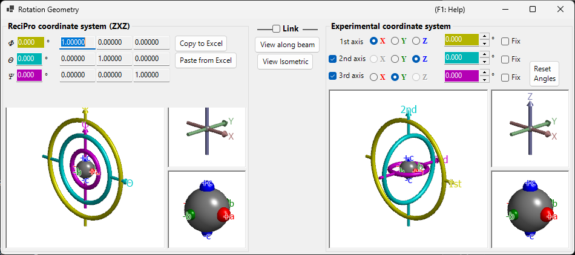

# Rotation Geometry

This window represents the rotational state of a crystal as a 3×3 matrix and converts between different Eulerian coordinate systems.

ReciPro uses three Euler angles — **Ψ**, **Θ**, and **Φ** — applied in **Z–X–Z** order. However, this convention does not necessarily match the goniometer axes of your actual instrument. The **Rotation Geometry** window lets you convert ReciPro's Euler angles to an arbitrarily defined coordinate system, supporting goniometer adjustment in the laboratory. <!-- 261105Cl 監査: 画面の欄の見出し・ツールチップ (Φ, Θ, Ψ) に合わせ θ → Θ に統一 -->

---

## Keyboard & mouse shortcuts

All six 3-D views (the ReciPro and experimental goniometer / axes / objects panels) are **linked** — rotating any one rotates all six together. They share ReciPro's standard [OpenGL view navigation](21-shortcuts.md).

| Shortcut | Action |
|----------|--------|
| <kbd>F1</kbd> | Open this page of the online manual |
| Left-drag a view | Rotate the model (all six views rotate together) |
| Mouse wheel, or Right-drag up/down | Zoom (the large goniometer views) |
| <kbd>CTRL</kbd> + Right-drag up/down | Change the camera distance (perspective mode only) |
| <kbd>CTRL</kbd> + Right double-click | Toggle orthographic / perspective projection |

The small *Axes* and *Objects* views have zoom and pan disabled. There are no keyboard shortcuts other than <kbd>F1</kbd>.

---

## ReciPro coordinate system (ZXZ)

The upper half of the window shows the rotation state in the "ReciPro coordinate system".

- **Φ, Θ, Ψ** are read-only boxes that show the current orientation (the Euler angles of the Main window). Rotations made while this window is closed are shown when it is reopened. <!-- 261105Cl 監査: 読み取り専用の表示・開き直したときの反映 (FormRotation.cs) -->
- **Rotation matrix** displays the 3×3 matrix corresponding to the current rotation state.

### Φ, Θ, Ψ (Z–X–Z Euler angles)

The crystal orientation is parametrised by three rotations. Described in the **body-fixed (intrinsic)** frame, they are applied in this order:

1. **Φ** — first rotation about the **Z** axis.
2. **Θ** — rotation about the **X** axis of the once-rotated frame.
3. **Ψ** — second rotation about the **Z** axis of the twice-rotated frame.

The same rotation seen in the **fixed laboratory** frame is the reverse sequence — Ψ about $Z$, then Θ about $X$, then Φ about $Z$ — which is the description used in [Appendix A1.1](appendix/a1-coordinate-system/1-orientation.md). Both give the identical matrix $R$ below; Φ is simply the outermost (goniometer-like) axis and Ψ the innermost.

<!-- 261105Cl コードから起こした修正。別担当がコードと再照合済み (誤りは訂正) (根拠: FormRotation.Designer.cs:numericBoxPhi/Theta/Psi, numericBox11–33 ReadOnly=true) -->
The Φ, Θ, Ψ boxes and the nine matrix boxes are **read-only** displays. To change the orientation, rotate the crystal in the Main window, use **Paste from Excel**, or (with **Link** on) edit the experimental-axis angles below; every change is propagated to the Main window and all linked simulators.

### Rotation matrix

The 3 × 3 matrix produced from the current (Φ, Θ, Ψ). Use **Copy to Excel** / **Paste from Excel** to round-trip the matrix through a spreadsheet.

The matrix follows one fixed convention everywhere it appears in ReciPro:

$$
\mathbf{v}_{\mathrm{rot}} = R\,\mathbf{v}_{0}
$$

- \(R\) is the **active** rotation of the crystal, expressed in the monitor-fixed laboratory frame (\(X\) right, \(Y\) up, \(Z\) toward the viewer — see [Appendix A1.1](appendix/a1-coordinate-system/1-orientation.md)).
- \(\mathbf{v}_{0}\) : Cartesian coordinates (a column vector) of a crystal-fixed direction in the **initial orientation** (\(c \parallel Z\), \(b\) in the \(YZ\) plane).
- \(\mathbf{v}_{\mathrm{rot}}\) : coordinates of the same direction after the rotation, still in the laboratory frame.
- At \(\Phi=\Theta=\Psi=0\), \(R\) is the identity. \(R\) is orthonormal with determinant +1, so the inverse transform is simply the transpose: \(R^{-1}=R^{\mathsf T}\).

In terms of the Euler angles, \(R = R_Z(\Phi)\,R_X(\Theta)\,R_Z(\Psi)\) (right-handed rotations about the fixed axes; \(\Psi\) acts on the vector first):

$$
R=\begin{pmatrix}
\cos\Phi\cos\Psi-\cos\Theta\,\sin\Phi\sin\Psi & -\cos\Phi\sin\Psi-\cos\Theta\,\sin\Phi\cos\Psi & \sin\Theta\,\sin\Phi\\
\sin\Phi\cos\Psi+\cos\Theta\,\cos\Phi\sin\Psi & -\sin\Phi\sin\Psi+\cos\Theta\,\cos\Phi\cos\Psi & -\sin\Theta\,\cos\Phi\\
\sin\Theta\,\sin\Psi & \sin\Theta\,\cos\Psi & \cos\Theta
\end{pmatrix}
$$

To apply it to crystallographic indices, first convert them to Cartesian coordinates in the initial orientation: a direction \([uvw]\) becomes \(\mathbf{v}_0 = u\mathbf{a}+v\mathbf{b}+w\mathbf{c}\), and a plane normal \((hkl)\) becomes \(\mathbf{v}_0 = h\mathbf{a}^{*}+k\mathbf{b}^{*}+l\mathbf{c}^{*}\) (reciprocal axes).

The same matrix, with \(R_{ij}\) = row \(i\), column \(j\), appears as:

- **Copy to Excel** / **Paste from Excel** in this window (3 × 3, tab-separated, rows from top to bottom);
- `Dir.GetRotationMatrix()` / `Dir.SetRotationMatrix()` and `Dir.GetEuler()` in the [macro API](20-macro/1-built-in-functions.md) (nine elements in row order \(R_{11}, R_{12}, R_{13}, R_{21}, \ldots, R_{33}\));
- the columns **R11**–**R33** of the candidate list saved by [Spot ID v2](11-spot-id-v2.md).

### OpenGL windows

The 3D view shows the current rotation using three coloured tori (doughnut shapes):

| Colour | Euler angle | Goniometer level |
|--------|------------|-----------------|
| **Yellow** | Φ | 1st (upper) axis |
| **Light blue** | Θ | 2nd (middle) axis |
| **Pink** | Ψ | 3rd (lower) axis |

The **red**, **green**, and **blue** arrows represent the X, Y, Z axes in real-space Cartesian coordinates. These are *not* the same as the crystal axes shown in the Main window.

<!-- 261105Cl コードから起こした修正。別担当がコードと再照合済み (誤りは訂正) (根拠: FormRotation.cs:createObject) -->
The grey sphere at the centre represents the sample. The small red / green / blue spheres (labelled **+a/−a**, **+b/−b**, **+c/−c**) mark the directions of the crystal's normalised *a*, *b*, *c* axes after the rotation (larger sphere = + end). At Φ = Θ = Ψ = 0 they show the initial crystal orientation (*c* ∥ +Z, *b* in the YZ plane), so *a* and *b* coincide with +X and +Y only for orthogonal cells.

> **Note**: Dragging in the OpenGL window changes only the *projection direction* of this view, not the crystal orientation itself. To rotate the crystal, use the Main window.

### Buttons

| Button | Action |
|--------|--------|
| Copy to Excel | Copy the 3×3 rotation matrix as tab-separated text, one row per line; it can be pasted back with **Paste from Excel** |
| Paste from Excel | Set the rotation matrix from the clipboard (3×3, tab-separated). Values that are not a rotation matrix (orthonormal rows and columns, determinant +1) are rejected with a message; small deviations such as spreadsheet rounding (up to 10⁻³) are corrected to the nearest rotation matrix <!-- 261105Cl 監査: FormRotation.cs の Paste の検査 (RᵀR − I ≤ 1e-3, det > 0) と Copy の改行 (\r\n) --> |
| View along beam | Match the Main window projection (Z-axis perpendicular to screen) |
| View Isometric | Switch to isometric projection |

---

## Experimental coordinate system

The lower half defines Euler angles on an arbitrary set of rotation axes and gets/sets the goniometer state. This is called the **Experimental coordinate system**.

### 1st, 2nd, 3rd axes

<!-- 261105Cl コードから起こした修正。別担当がコードと再照合済み (誤りは訂正) (根拠: FormRotation.cs:getExpDirections, RadioButton_CheckedChanged, checkBox1st_CheckedChanged, NumericBoxExp_ValueChanged, RotExp; FormRotation.Designer.cs) -->
Select the rotation axis of each goniometer level (1st = upper, 2nd = middle, 3rd = lower) from **X**, **Y** or **Z** (positive directions of the laboratory frame only). The 2nd axis cannot be the same as the 1st, nor the 3rd the same as the 2nd (the conflicting radio button is disabled). The default is **X – Z – Y**. The graphics update accordingly.

The angle of each axis is shown in the corresponding coloured box (yellow, light blue, pink) and can be entered directly (degrees; values outside −180…180° are wrapped). The experimental rotation is composed in the same way as ReciPro's own matrix, with the 1st axis outermost:

$$
R_{\mathrm{exp}} = R_{\mathbf{e}_1}(\omega_1)\,R_{\mathbf{e}_2}(\omega_2)\,R_{\mathbf{e}_3}(\omega_3)
$$

(right-handed rotations about the fixed laboratory axes $\mathbf{e}_i$).

| Control | Action |
|---------|--------|
| **2nd axis** / **3rd axis** | Enable or disable that level (a goniometer with only one or two axes). Disabling sets its angle to 0. Disabling the 2nd axis also disables the 3rd. |
| **Fix** | Keep that angle at its current value while Link decomposes a new orientation into goniometer angles (see below). |
| **Reset Angles** | Set all three experimental angles to 0. |

---

## Link

When **Link** is checked, the ReciPro coordinate system and the Experimental coordinate system are coupled: their Euler angles are adjusted so that the object orientation is consistent between the two systems.

<!-- 261105Cl コードから起こした修正。別担当がコードと再照合済み (誤りは訂正) (根拠: FormRotation.cs:CheckBoxLink_CheckedChanged, SetRotation(Matrix3D), NumericBoxExp_ValueChanged; FormMain.cs:Rotate) -->
At the moment **Link** is checked, the offset $R_{\mathrm{base}} = R_{\mathrm{exp}}^{-1} R$ between the two systems is stored, and from then on $R = R_{\mathrm{exp}}\,R_{\mathrm{base}}$. While linked:

- editing an experimental angle rotates the crystal in every window;
- an incremental rotation (arrow buttons, CTRL+SHIFT+arrows, or dragging in the Main window or other windows) is decomposed numerically into the enabled, non-**Fix**ed goniometer angles, and the crystal is set to the **nearest orientation the goniometer can reach** — so with fixed or disabled axes the crystal follows the goniometer's constraints rather than the mouse exactly;
- the Main window's **Fix** check boxes still apply: with one of them on, the incremental rotation is made about that zone axis or plane normal before it is decomposed; <!-- 261105Cl 監査: Link 中も主窓の Fix が効く (FormMain.cs, bc75fdc4) -->
- setting an absolute orientation — typing into the Main window's **Euler angles** boxes (the Φ, Θ, Ψ boxes of this window are read-only), **Reset Rotation**, **View along** ▸ **Axis** / **Plane**, or **Paste from Excel** in this window — applies it exactly, re-enables the 2nd and 3rd axes, clears every **Fix**, and re-decomposes it into all three goniometer angles.

If the crystal is rotated while this window is closed with **Link** on, reopening the window re-bases the link on the current orientation (as if **Link** were ticked again), so neither the crystal orientation nor the goniometer angles jump. <!-- 261105Cl 監査: 開き直したときの Link の扱い (FormRotation.cs, ecdcec9a) -->

### Example workflow

1. In the laboratory, set a goniometer so that the *a*-axis of a crystal is aligned with the X-ray incidence direction and the *b*-axis is horizontal.
2. Enter the laboratory goniometer's Euler angles in the Experimental coordinate system.
3. In the Main window, rotate the crystal so that the *a*-axis faces the screen normal and the *b*-axis faces horizontal.
4. Check **Link** — now, whenever you point the crystal to a different orientation in the Main window, the required goniometer angles are automatically displayed.

---

## See also

- [Main window](0-main-window.md)
- [Stereonet](6-stereonet.md)
- [Basic coordinate system & crystal orientation](appendix/a1-coordinate-system/1-orientation.md)
- [Keyboard & mouse shortcuts](21-shortcuts.md)
