# Structure Viewer

**Structure Viewer** draws the structure of the selected crystal as a three-dimensional image using OpenGL.

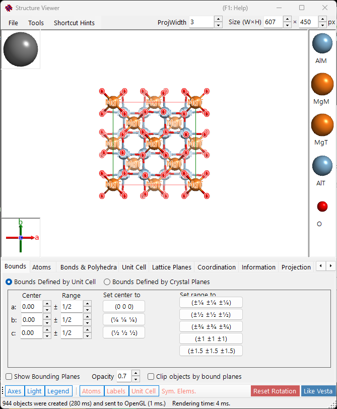

---

## Keyboard & mouse shortcuts

The window has a main 3-D view plus two small gizmos — the **crystal-axes** box (bottom-left) and the **light-direction** box (top-left) — and each responds to a left-drag differently. The main view uses ReciPro's standard [OpenGL view navigation](21-shortcuts.md).

| Shortcut | Action |
|----------|--------|
| <kbd>F1</kbd> | Open this page of the online manual |
| <kbd>CTRL</kbd>+<kbd>SHIFT</kbd>+<kbd>C</kbd> | Copy the rendered image to the clipboard |
| Left-drag the main view | Rotate the model |
| Left double-click an atom | Show the coordinates of the clicked atom and the distances and bond angles of the neighbours around it (only displayed atoms can be picked) <!-- 261105Cl 監査: 近接原子はクリックした位置の周り (ca87b772, 8cc95680) --> |
| Right-drag up/down, or Mouse wheel | Zoom |
| Middle-drag | Pan |
| <kbd>CTRL</kbd> + Right-drag up/down | Change the camera distance (perspective mode only) |
| <kbd>CTRL</kbd> + Right double-click | Toggle orthographic / perspective projection |
| Left-drag the **crystal-axes** gizmo | Rotate the model (no in-plane spin) |
| Left-drag the **light** gizmo | Change the lighting direction |

The application-wide <kbd>CTRL</kbd>+<kbd>SHIFT</kbd> shortcuts from the [main window](0-main-window.md#keyboard-mouse-shortcuts) also work while this window is focused.

→ See **[21. Keyboard & mouse shortcuts](21-shortcuts.md)** for every window at a glance.

---

## Main area

The 3-D crystal structure, drawn together with the light-direction gizmo, the crystal-axes gizmo and the atom legend. The window's position and size are kept for the next start. <!-- 261106Cl 作者の決定 H6 -->
<!-- 261105Cl コードから起こした修正。別担当がコードと再照合済み (誤りは訂正) (根拠: FormStructureViewer.cs:sizeControl1_ValueChanged) -->
> The **Size (W×H)** box at the top right of the window sets the pixel size of the 3-D view (the window is resized to match); saved and copied images have this size.
> The **ProjWidth** box next to it shows the width of the projected view in nm. Edit the value to zoom numerically — it stays synchronized with right-drag / wheel zooming on the view.

---

## Menu bar

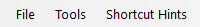

### File menu

<!-- 261105Cl コードから起こした修正。別担当がコードと再照合済み (誤りは訂正) (根拠: FormStructureViewer.designer.cs:menuStrip1 / saveImageToolStripMenuItem_Click / initializeDdpDeveloperMenu) -->
| Menu item | Description |
|-----------|-------------|
| Save image ▸ Main image / Legend / Crystal axes / Light direction | Save the main view, the atom legend or one of the gizmos as PNG |
| Copy image to clipboard ▸ Main image / Legend / Crystal axes / Light direction <!-- 261105Cl 監査: copyToClipboardToolStripMenuItem.Text --> | Copy the image (Ctrl+Shift+C copies the main view) |
| Save movie ▸ Main image / Crystal axes | Save a rotation/translation movie of the main view or of the crystal-axes gizmo as MP4 (speed, duration, fps, quality and so on) |
| Export 3D model (3MF/STL) | Write the displayed structure out as a solid model for 3D printing |

**Tools** menu: **I like VESTA** (same as the *Like Vesta* toolbar button) and **Enable DDP** (shows/hides the *Dual Depth Peeling* entry in [Transparency mode](#transparency-mode)).

**Shortcut hints** (a separate top-level menu) lists the keyboard shortcuts.

**Save movie** opens the Movie setting dialog below. A movie can rotate the view, translate the projection center, or do both at once — tick **Rotation** and/or **Translation**:

- **Rotation**: rotates the view at **Speed** (°/s; negative values reverse the direction) about the axis chosen below — **Current projection** (tilt direction picked with the arrow buttons), a **Direction index** [uvw], or the normal of a **Lattice plane** (hkl). The axis is taken from the crystal orientation at the moment **OK** is pressed. With Miller–Bravais indices on, four indices are shown only for **Lattice plane**; a **Direction index** is always the three-index [uvw]. <!-- 261105Cl 監査: FormMovie.cs (OK の時点で回転軸を求め直す、4 指数は格子面だけ, 35fa72fc) -->
- **Translation**: moves the projection center along the direction index [uvw] at **Speed** (lattice periods per second). This option appears only when the dialog is opened from the Structure Viewer, and while it is enabled **Direction index** is the only direction mode.

Set the movie length (**Duration**), the frame rate (**FPS**, 1–120), and the encoder quality (**Quality**, 1–100; higher values use a higher bitrate and give a larger file), choose the codec (**H264** / **H265**), and press **OK** to generate an MP4 file. **Include final frame** appends one extra frame at t = Duration so the movie ends exactly at the final orientation/position. (The encode-speed list only labels the progress display and no longer affects the actual encoding.)

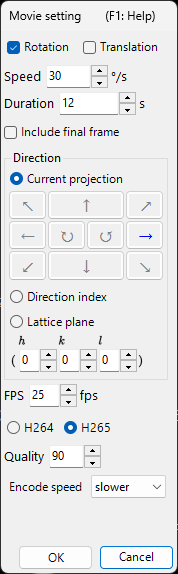

#### Export 3D model (3MF/STL)

**Export 3D model (3MF/STL)** writes the structure currently drawn on screen out as a solid model for 3D printing. Only closed solids can be exported — atoms (spheres and ellipsoids), bonds (cylinders) and coordination polyhedra. Atom labels, bound planes, lattice planes and symmetry-element symbols are not exported. <!-- 261105Cl 監査: 配位多面体を出力し、対称要素は出さない (6c31fc0d) --> The unit cell frame is made of line segments, so it is replaced by cylinders (with spheres at the corners) only when you tick the corresponding option. **Clip objects by bound planes** is not applied to the output: objects crossing the bound planes are exported whole (the dialog notes this). <!-- 261106Cl 作者の決定 H10 -->

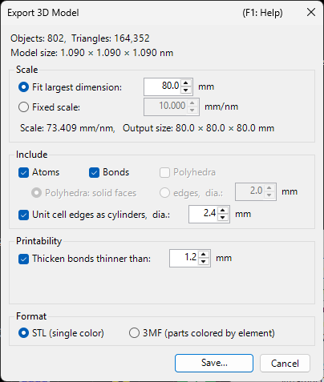

The top of the dialog reports the number of objects and triangles involved, and the real size of the model (**Model size**, nm).

**Scale** : how the output size is decided

- **Fit largest dimension** : scales the model automatically so that its longest edge reaches the length you give (5–500 mm, 80 mm by default). The thickness of the cylinders that replace the unit-cell frame and the polyhedron edge frames is included. <!-- 261105Cl 監査: 円柱の太さを含めて合わせる (82e50b62) -->
- **Fixed scale** : give the scale (mm/nm) directly. Use this to build several crystals at the same scale so they can be placed side by side. Switching to it starts from the scale that was in effect a moment before.
- The line below shows the resulting scale and the printed dimensions (**Output size**, mm), also including that cylinder thickness.

**Include** : which elements go into the print

- **Atoms** / **Bonds** / **Polyhedra** : only the kinds currently displayed can be selected; unticking one keeps it on screen but leaves it out of the print.
- **Polyhedra: solid faces** / **edges, dia.** : export coordination polyhedra either as solid bodies with faces, or as an edge frame (cylinders plus spheres at the vertices, 2.0 mm by default). The frame leaves the atoms inside visible.
- **see-through mesh: bar dia. / pitch** : the edge frame plus a grid of thin bars on each face (bar diameter 0.8–5.0 mm, 1.2 mm by default; pitch 1.5–20 mm, 5.0 mm by default). The faces look filled from a distance but the inside stays visible. <!-- 261105Cl コードから起こした修正。別担当がコードと再照合済み (誤りは訂正) (根拠: FormExport3DModel.cs:PolyhedraAsMesh/PolyBarRadiusNm/PolyPitchNm; FormStructureViewer.cs:ExportModel) -->
- **Unit cell edges as cylinders, dia.** : include the unit cell frame, replaced by cylinders of the given diameter (2.4 mm by default). This box is ticked by default whenever the cell frame is displayed.

**Printability** : print soundness

- **Thicken bonds thinner than** : bonds whose printed diameter would fall below the given value (1.2 mm by default) are rebuilt at that diameter from the original primitive. This keeps thin bonds from snapping. If you leave it off while a bond is too thin, a warning appears in red.

**Format** : file format

- **STL (single color)** : a single-colour binary STL.
- **3MF (parts colored by element)** : 3MF with the parts coloured by element; the colour names carry the element names.

**Save...** asks for the file name. Once the export finishes, the triangle count, printed dimensions and scale are logged in the information box at the bottom left.

---

## Tab menu

### Bounds defined by cell

Specify the drawing range of the crystal. There are two modes, switched with the radio buttons at the top.

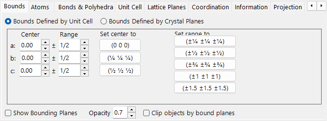

In this mode the *a*, *b*, *c* axes of the unit cell are the unit of the drawing range.

- **Center**: offset of the centre of the drawing range from the [Projection center](#projection-center), in fractional coordinates (positive values move it toward +*a*, +*b*, +*c*). The drawn range is (projection center + Center) ± Range. <!-- 261106Cl 作者の決定 H3/H18, C4 -->
- **Range**: upper/lower limit for each of the *a*, *b*, *c* axes.
- **Preset buttons** on the right give frequently used values (e.g. 1×1×1 cell, 2×2×2 cell).

### Bounds defined by crystal planes

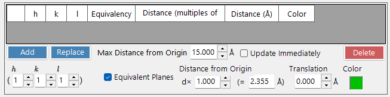

<!-- 261105Cl コードから起こした修正。別担当がコードと再照合済み (誤りは訂正) (根拠: FormStructureViewer.cs:initBounds; BoundControl.resx:numericBoxMaximumDistanceFromOrigin) -->
In this mode the drawing area is bounded by a set of crystal planes. If the planes do not define a spatially closed region, ReciPro adds a near-spherical polyhedron of radius **Max dist. (proj. center)** (Å, measured from the [projection center](#projection-center)) to close it. <!-- 261106Cl 作者の決定 C4 -->

#### Bound list

All bound planes registered for the current crystal. Use **Add / Replace / Delete** to manipulate the list; the leftmost checkbox temporarily disables a plane without deleting it.

> To save the changes permanently, you must also press **Add** or **Replace** in the **Main Window**. Otherwise the changes are lost the next time you change the selection in the main crystal list.

#### H k l indices

Set the bound plane by its Miller index. The checkbox includes crystallographically equivalent planes generated from the selected (*hkl*).

#### Distance from proj. center

<!-- 261105Cl コードから起こした修正。別担当がコードと再照合済み (誤りは訂正) (根拠: BoundControl.resx:numericBoxDistanceD/numericBoxDistance/numericBoxTranslation/checkBoxImmediateUpdate) -->
The distance from the [projection center](#projection-center) (not from the origin of the cell) to the bound plane, entered either <!-- 261106Cl 作者の決定 C4 --> as a multiple of the *d*-spacing of the selected (*hkl*) (**d×** box) or in Å (the box in parentheses). The two boxes are linked: changing one updates the other. Each plane lies on the +**g** side of the projection center (along its (*hkl*) normal), and the side containing the center is drawn; with a single plane, the region is the half-space on the center side of that plane. <!-- 261106Cl 仕上げ R3 D5: Boundary.cs Bound.Reset (面は nᵢ·r ≤ D) -->

- **Translation** (Å): moves the whole region bounded by the planes by this amount along the normal of the specified (*hkl*); positive values move it toward +**g**, i.e. in the direction of the (*hkl*) normal. It works for any number of planes, including a single plane without **Equivalent planes**. <!-- 261106Cl 作者の決定 B11, C5 -->
- **Max dist. (proj. center)** (Å): radius of the closing polyhedron used when the planes do not enclose a region (see above).
- **Update immediately**: apply edits of the selected plane without pressing **Replace**.

#### Show bounding planes / Opacity

Show or hide the bound planes themselves. When shown, **Opacity** sets transparency (0 = transparent, 1 = opaque).

#### Clip objects by bound planes

If checked, only the inside region defined by the bounds is rendered; atoms, bonds, and polyhedra that intersect the bounds are clipped.

<!-- 261105Cl コードから起こした修正。別担当がコードと再照合済み (誤りは訂正) (根拠: FormStructureViewer.cs:setAtoms, toolStripButtonAtomObjects_CheckedChanged (Bounds タブに該当チェックボックスは無い)) -->
#### Hiding atoms

There is no check box for this in the Bounds tab. Turn off the **Atoms** toolbar button instead: no atoms are generated, so bonds and polyhedra disappear as well — useful when only the cell or lattice planes need to be visualised.

### Atoms

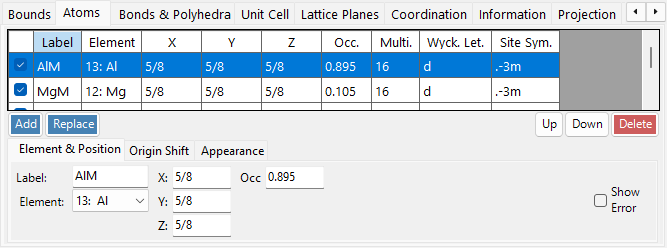

Sets the species, position and occupancy of every atom, and how each one is drawn (radius, colour, material).

#### Atom list

The list of atoms in the crystal. Use **Add / Replace / Delete** to manipulate the list; the leftmost checkbox temporarily hides an atom.

> To save changes permanently, click **Add** or **Replace** in the **Main Window** as well.

#### Element & position

- **Label**: free-text label for the atom (used in legends and tooltips).
- **Element**: chemical element / ionisation state.
- **X, Y, Z**: fractional coordinates. Real numbers in 0–1, or fractions such as `1/2` or `2/3`.
- **Occ**: occupancy, a real number 0–1.

#### Origin shift

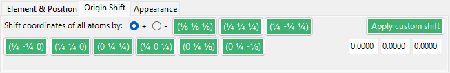

Shifts every atom by the same fractional offset. Press a preset button (for example, to swap origin choice 1 / 2 for the same space group), or enter a custom (Δx, Δy, Δz) and press **Apply custom shift**.

#### Appearance

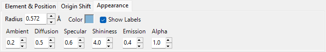

Per-atom radius, colour, and material.

- **Radius**: drawn atomic radius.
- **Atom color**: surface colour.
- **Material**: texture / material properties used by the OpenGL shader.
- **Apply to same elements**: applies the current radius and colour to every atom of the same element species.

### Bonds & Polyhedra

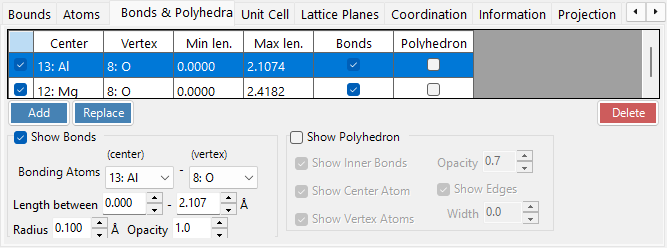

Defines which atom pairs are bonded (by species and distance range) and how the resulting bonds and coordination polyhedra are drawn.

#### Bond list

All bond/polyhedron rules registered for the crystal. Use **Add / Replace / Delete**; the leftmost checkbox temporarily disables an entry. As with atoms and bounds, **Add** / **Replace** in the **Main Window** is required to make the change permanent.

#### Bond property

- **Show bonds**: draw the bonds of this rule (the check box above the bond settings).
- **Bonding atoms** **(center)** - **(vertex)**: element species used as the centre atom of the bond / polyhedron and as the vertex (the other end).
- **Length between** … **-** … (Å): lower and upper distance thresholds. Atom pairs outside this range are not drawn.
- **Radius** (Å): drawn bond thickness (cylinder radius).
- **Opacity**: bond opacity (0 = transparent, 1 = opaque).

#### Polyhedron property

- **Show polyhedron**: when checked, the polyhedron defined by the current bond is drawn (only if the centre/vertex set is geometrically valid).
- **Show inner bonds**: with **Show polyhedron** on, draw the bonds from the centre to the vertices (they also need **Show bonds**).
- **Show center atom**: show/hide the centre atom.
- **Show vertex atoms**: show/hide the vertex atoms. A hidden centre or vertex atom is still drawn when another displayed polyhedron shows it, or when it ends a bond of a definition without a polyhedron. <!-- 261105Cl 監査: 3 つのチェックが描画に効くようになった (7e198f9d) -->
- **Opacity**: face opacity (0 = transparent, 1 = opaque).
- **Show edges**: draw the edges connecting the vertices.
- **Width**: line width of the edges in pixels (1–5). Values below 1 saved by older versions are drawn as 1 px. <!-- 261106Cl 作者の決定 H4 -->
- There are no colour boxes in this tab: bonds take the colours of the atoms at their two ends, and polyhedra the colour of their centre atom (atom colours are set in the [Atoms](#atoms) tab). <!-- 261105Cl 監査: BondControl の colorControlPolyhedron/Bond/Edges は Visible=False。色は原子の材質から (FormStructureViewer.cs) -->

### Unit cell

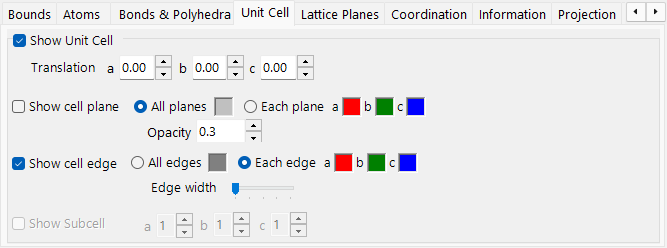

Sets the position of the drawn unit cell and whether its faces and edges are shown.

#### Translation

Every space group has a default origin. To move the centre of the drawn unit cell away from that origin, set the translation along *a*, *b*, *c*.

<!-- 261105Cl コードから起こした修正。別担当がコードと再照合済み (誤りは訂正) (根拠: FormStructureViewer.cs:numericBoxProjectionCenterX_ValueChanged) -->
The translation is tied to the [Projection center](#projection-center): setting the projection center to $(x, y, z)$ sets the translation to $(x-0.5,\ y-0.5,\ z-0.5)$. A positive translation moves the drawn cell toward +*a*, +*b*, +*c*. <!-- 261106Cl 作者の決定 H3/H18 -->

#### Show cell plane

Whether to draw the six faces that bound the unit cell. When enabled, you can set the face colour and transparency.

#### Show cell edge

Whether to draw the unit-cell edges. The edge colour is configurable.

<!-- 261105Cl コードから起こした修正。別担当がコードと再照合済み (誤りは訂正) (根拠: FormStructureViewer.cs:setUnitCellPlanes; FormStructureViewer.resx) -->
The master check box **Show unit cell** (= the *Unit cell* toolbar button) switches the whole cell on/off. Face and edge colours can be set for **All planes** / **All edges** at once or for **Each plane** / **Each edge** (*a*, *b*, *c* separately); **Edge width** sets the line width and **Opacity** the face transparency.

#### Show subcell

**Show subcell** draws grid lines that divide the cell into the numbers of parts given in the **a**, **b**, **c** boxes (1–10 each; the boxes are usable only while it is ticked), on the faces and inside the cell. Lines that coincide with cell edges are not drawn. The lines take the edge colour (**All edges** / **Each edge**), half the edge width (at least 1 px) and opacity 0.5, and are shown independently of **Show cell edge**. They are not included in the 3D-model export. <!-- 261106Cl 作者の決定 H5 -->

### Lattice planes

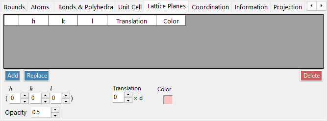

Draws lattice planes given by their Miller index, optionally including the crystallographically equivalent planes.

#### H k l indices

Specify the lattice plane by its Miller index. The checkbox optionally includes crystallographically equivalent planes generated from (*hkl*).

#### Translation

Shift the drawn lattice planes along their normal by a fraction of the *d*-spacing (**× d**, −0.5 to 0.5); positive values move them toward +**g** (the planes lie at **g**·**r** = (*m* + T)*d*). Values saved in crystal lists by earlier versions are therefore drawn on the opposite side (0 and ±0.5 look the same). <!-- 261106Cl 作者の決定 C5 --> Every plane of the family that crosses the drawing range is drawn, one per *d*. The planes are fixed to the crystal lattice: at 0 they pass through the lattice points, and they move with the structure when the [Projection center](#projection-center) changes. <!-- 261105Cl 監査: LatticePlaneControl numericBoxDistance (−0.5〜0.5, × d)、FormStructureViewer.cs:SetLatticePlanes (4fd9e8c3)。「d の整数倍」は誤り -->

### Coordination

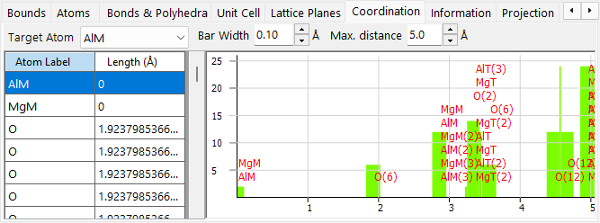

Lists and plots the atoms coordinating a chosen target atom.

#### Table (left side)

Lists which atoms surround the selected target atom and at what distance. The target atom is selected from the dropdown above the table.

#### Graph (right side)

Histogram of neighbour count versus distance, derived from the same data as the table. Adjust **Half-width** (the half width *w* of each bar, which covers *d* ± *w*) until the bars cleanly separate the coordination shells <!-- 261106Cl 作者の決定 B18 --> — this gives a visual estimate of the coordination number.

### Information

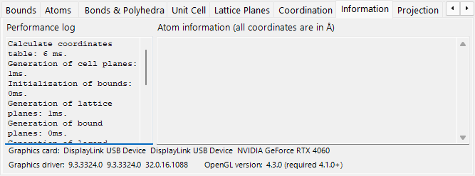

Rendering log (frame time, GPU info) and basic information about the selected atom. Under construction — fields may grow over time.

### Projection

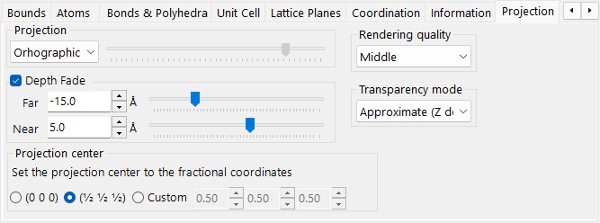

Sets the projection mode (orthographic / perspective), depth fading, the projection centre, the rendering quality and the transparency algorithm.

#### Projection

- **Orthographic**: perfect parallel projection (viewpoint at infinity).
- **Perspective**: perspective projection from the viewpoint distance set by the slider.

#### Depth fading out

<!-- 261105Cl コードから起こした修正。別担当がコードと再照合済み (誤りは訂正) (根拠: Crystallography.OpenGL/Shaders/fragZSORT.c, fragPPLL.c:applyDepthCueing; FormStructureViewer.cs:checkBoxDepthCueing_CheckedChanged) -->
Fades distant objects in the depth direction (**Depth fade**). The colour is blended linearly toward the **background colour**: objects closer than **Near** keep their own colour, objects farther than **Far** take the background colour, and objects in between are interpolated. (Opacity itself is not changed.) **Near** and **Far** are given in Å.

#### Projection center

Sets the centre of projection to the specified coordinates. Turn on **Custom** to enter arbitrary coordinates. Typed values (−1 to 1) are used as they are. A **Translation** movie (see the [File menu](#file-menu)) drives these values automatically and folds each coordinate into −0.5 to +0.5 (one lattice period) as it moves. <!-- 261105Cl 監査: 折り畳むのは SetProjectionCenter (動画の経路) だけ。マクロに投影中心の関数は無い -->

#### Rendering quality

Drawing quality (mesh subdivision, anti-aliasing). Higher quality is slower — choose the setting that matches your GPU.

#### Transparency mode

Algorithm used for translucent atoms and polyhedra.

<!-- 261105Cl コードから起こした修正。別担当がコードと再照合済み (誤りは訂正) (根拠: FormStructureViewer.cs:rebuildTransparencyModeItems, comboBoxTransparency_SelectedIndexChanged; FormStructureViewer.resx:comboBoxTransparency.Items) -->
- **Approximate (Z depth sorting, OpenGL 4.1+)**: fast but can be inaccurate when many translucent objects overlap.
- **High quality (dual depth peeling, OpenGL 4.1+)**: order-independent transparency by depth peeling. Shown only when **Tools ▸ Enable DDP** is on (on by default when PPLL is not available). The number of peeling passes follows the [Rendering quality](#rendering-quality) setting.
- **High quality (per-pixel linked list, OpenGL 4.3+)**: exact order-independent transparency; shown only when the GPU supports OpenGL 4.3. Accurate but slow; effectively requires a discrete GPU.

### Symmetry Elements

The **Sym. elems.** tab draws the space-group symmetry operators directly onto the 3D model (toggle with the **Sym. elems.** toolbar button). Each class of element can be shown/hidden independently:

<!-- 261105Cl コードから起こした修正。別担当がコードと再照合済み (誤りは訂正) (根拠: FormStructureViewer.resx:groupBoxAxes/groupBoxPlanes/groupBoxInversion) -->
- **Symmetry axes**: **Rotations**, **Screws**, **Rotinversions**
- **Planes**: **Mirrors**, **Glides**
- **Inversion centers**

The master switch is **Show symmetry elements**. For each group you can adjust the symbol size (%) and colour, and for axes and planes also the line width.

### Misc.

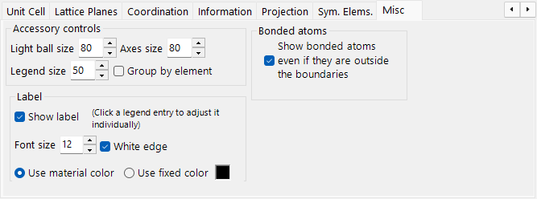

- **Accessory controls**: set the display sizes (light ball, axes, legend). **Group by element** toggles the legend display.
- **Bonded atoms**: **Show bonded atoms even if they are outside the boundaries** keeps drawing atoms that are bonded to atoms inside the drawing range, even when they fall outside it.
- **Label**: settings of the atom labels in the 3-D view (not the legend) — **Show label**, **Font size**, **White edge**, and the label colour (**Use material color** or **Use fixed color**). Clicking an entry of the atom legend toggles the labels of that atom (or element, with **Group by element**) individually. <!-- 261105Cl コードから起こした修正。別担当がコードと再照合済み (誤りは訂正) (根拠: FormStructureViewer.cs:legendControl_MouseClick; FormStructureViewer.resx:groupBoxLabel) -->

---

## Toolbar

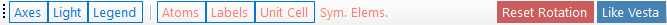

<!-- 261105Cl コードから起こした修正。別担当がコードと再照合済み (誤りは訂正) (根拠: FormStructureViewer.cs:toolStripButtonLikeVesta_Click) -->
| Button | Description |
|--------|-------------|
| Axes | Show axis orientation (size = lattice constant) |
| Light | Set light direction |
| Legend | Atom legend |
| Atoms | Show/hide the atoms; bonds, polyhedra and labels are built on the atoms, so they are hidden as well <!-- 261105Cl 監査: toolStripButtonAtomObjects.ToolTipText (2028c4a1) --> |
| Labels | Toggle atom labels |
| Unit cell | Toggle unit-cell edges |
| Sym. elems. | Toggle the symmetry-element overlay (see above) |
| Reset rotation | Return to the initial orientation |
| Like Vesta | Switch to a VESTA-style appearance: atom colours and radii are reset, and the bond list is **replaced** by the default bonds |

---

## See also

- [Main window](0-main-window.md)
- [Crystal database](1-crystal-database.md)
- [Symmetry information](2-symmetry-information.md)
- [Diffraction simulator](7-diffraction-simulator/index.md)
- [Keyboard & mouse shortcuts](21-shortcuts.md)
