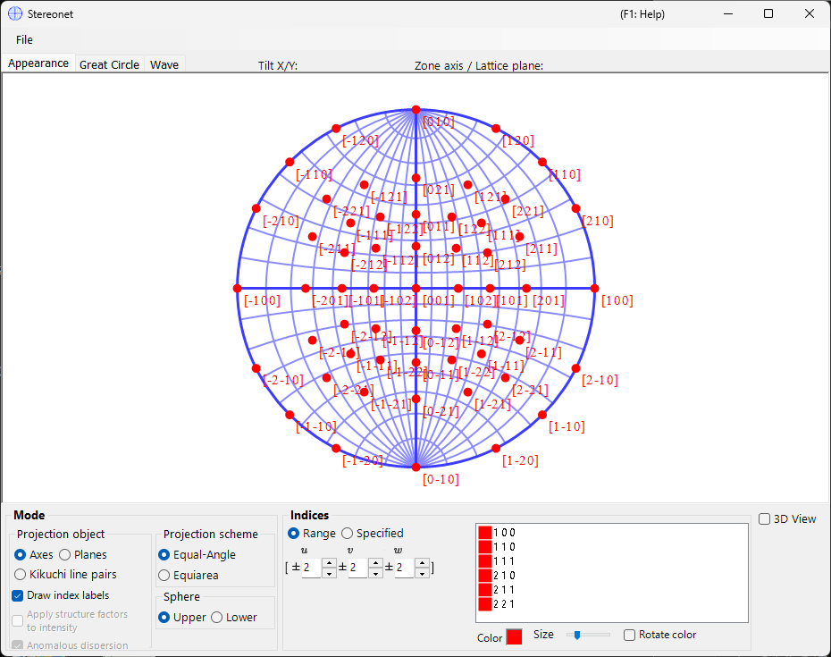
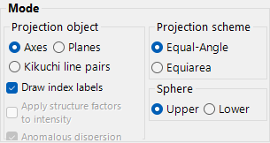
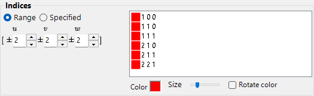
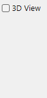
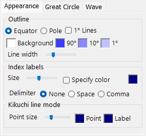
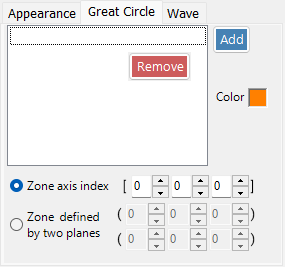
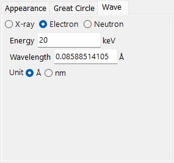

# Stereonet

**Stereonet** displays crystal plane and axis directions using stereographic projection.

---

## Keyboard & mouse shortcuts

The stereonet itself is a 2-D projection; an optional 3-D sphere can be shown with **3D View**.

| Shortcut | Action |
|----------|--------|
| <kbd>F1</kbd> | Open this page of the online manual |
| Left-drag near the centre | Tilt the crystal |
| Left-drag the outer area | Spin the crystal about the view axis |
| Left double-click | Switch between **Planes** and **Axes** projection |
| Right-click | Zoom out |
| Right-drag a box | Zoom in to the selected region |
| Middle-drag | Pan |
| Move the mouse (no button) | Read off the (hkl)/[uvw] under the cursor — useful for indexing a measured spot (also in the lower hemisphere) <!-- 261105Cl 監査: 下半球の読み取り (268779a1) --> |

Dragging on the net rotates the **crystal**; the rotation state is shared across all windows.

The 3-D rendering uses ReciPro's standard [OpenGL view navigation](21-shortcuts.md) (left-drag rotate, right-drag / wheel zoom, <kbd>CTRL</kbd> + right double-click toggles projection) and rotates only the 3-D view, not the crystal itself.

The application-wide <kbd>CTRL</kbd>+<kbd>SHIFT</kbd> shortcuts from the [main window](0-main-window.md#keyboard-mouse-shortcuts) also work while this window is focused.

→ See **[21. Keyboard & mouse shortcuts](21-shortcuts.md)** for every window at a glance.

---

## Main area

The stereonet projection of the selected crystal's crystal planes, direction indices, and Kikuchi lines is displayed.

---

## File menu

Save or copy as a raster image (PNG) or a vector metafile (EMF). A pasted metafile lets you edit fonts and line widths in PowerPoint or other vector editors.

<!-- 261105Cl コードから起こした修正。別担当がコードと再照合済み (誤りは訂正) (根拠: FormStereonet.Designer.cs:fileToolStripMenuItem; FormStereonet.cs:toolStripMenuItemSaveMovieStereonet_Click/toolStripMenuItemSaveMovie3D_Click) -->
| Menu item | Description |
|-----------|-------------|
| Save Image ▸ as Image (PNG format) / as Metafile (EMF) | Save the stereonet as a PNG file or as a vector EMF file <!-- 261105Cl 監査: as Metafile (EMF) の保存を配線 (FormStereonet.cs, 268779a1) --> |
| Copy to clipboard ▸ As Image / as Metafile (EMF) | Copy the stereonet |
| Save Movie ▸ Stereonet / 3D | Save a rotation movie (MP4) of the stereonet or of the 3-D view, using the same Movie setting dialog as the [Structure Viewer](5-structure-viewer.md#file-menu) (rotation only) |
| Page Setup / Print Preview / Print | Print the stereonet |

---

## Mode

### Projection target

Select what to project onto the net.

- **Axes** — projects direction indices \([uvw]\).
- **Planes** — projects crystal-plane normals \((hkl)\).
- **Kikuchi line pairs** — projects Kikuchi-line pairs.

### Projection method

| Method | Description |
|--------|-------------|
| **Equal-Angle** (Wulff / stereographic) | Preserves the angle relation between projected features but not solid angle. Used by classical crystallographers when reading inter-axis or inter-plane angles. |
| **Equiarea** (Schmidt / equal-area / Lambert) | Preserves the solid-angle (area) of each region but distorts angles. Preferred for statistical pole figures where relative density matters. |

### Hemisphere

Choose **Upper** or **Lower** hemisphere as the projection source — switches whether the visible face of the sphere is the one closest to or farthest from the observer.
<!-- 261105Cl コードから起こした修正。別担当がコードと再照合済み (誤りは訂正) (根拠: FormStereonet.cs:DrawStereoNet) -->
Upper = the $+Z$ side (toward the viewer, see [Appendix A1.1](appendix/a1-coordinate-system/1-orientation.md)); with **Lower** the $Z$ component of every direction is inverted before projection, and the points are drawn as **open circles** instead of filled ones.

### Display options

- **Draw index labels**: show index labels.
- **Apply structure factors to intensity**: when **Planes** or **Kikuchi line pairs** is selected, weight each item by its structure factor (set the wave source and wavelength in the [Wave tab](#wave)). The weight is $I_{\mathrm{rel}} = |F_{hkl}|^2 / \max|F|^2$ over the displayed set: in **Planes** mode the point radius is multiplied by $\sqrt{I_{\mathrm{rel}}}$ (i.e. $\propto |F_{hkl}|$); in **Kikuchi line pairs** mode the line opacity is $I_{\mathrm{rel}}$. <!-- 261105Cl コードから起こした修正。別担当がコードと再照合済み (誤りは訂正) (根拠: FormStereonet.cs:setVector, DrawStereoNet) -->
- **Anomalous dispersion**: include the X-ray anomalous-dispersion terms $f'$, $f''$ in the structure factors. Enabled only for X-rays and in **Planes** / **Kikuchi line pairs** mode.

> For trigonal/hexagonal crystals, Miller–Bravais (4-index) notation can be enabled from **Options ▸ Use Miller-Bravais (hkil) index** in the main window.

---

## Indices

Sets which crystal planes / axes are drawn.

### Range mode

Specify a range of \([uvw]\) or \((hkl)\) indices. ReciPro enumerates every index within the limits and projects each one.

<!-- 261105Cl コードから起こした修正。別担当がコードと再照合済み (誤りは訂正) (根拠: FormStereonet.cs:setVector, radioButtonRange_CheckedChanged) -->
In Range mode the limits are $\pm$ the entered values; only irreducible indices are taken, grouped into sets of crystallographically equivalent indices (each set gets one colour).

### Structure factor mode

Available only for **Planes** and **Kikuchi line pairs**. Projects the planes with the largest $|F_{hkl}|^2$ for the current wave source. **Top** sets the number of planes to draw (equivalent planes are counted individually; in **Planes** mode a reflection parallel to a stronger one — a higher or lower order of it, e.g. 222 when 111 is stronger — is skipped).

### Specified mode

Specifies particular axes or planes individually. Type an index, press **Add** to register it, or **Remove** to delete it. When **include equivalent indices** is checked, all crystallographically equivalent indices are drawn as well.

### Colour / Size

<!-- 261105Cl コードから起こした修正。別担当がコードと再照合済み (誤りは訂正) (根拠: FormStereonet.resx:checkBoxRotateColor.Text) -->
Set the **colour** and **size** of the plotted points. Tick **Rotate color** to colour-code each set of equivalent axes/planes differently — useful for distinguishing families on a multi-index plot.

---

## 3D Options

<!-- 261105Cl コードから起こした修正。別担当がコードと再照合済み (誤りは訂正) (根拠: FormStereonet.resx:checkBox3dOption*/button3D_reset/label29; FormStereonet.cs:button3D_reset_Click, Draw3D) -->
Shown when **3D View** is ticked; the 3-D sphere appears in a pane to the right of the net.

- **Reset**: return the 3-D view to the default direction and zoom.
- **Label**: draw index labels in 3-D. Directions are labelled [uvw]; the four-index form (with **Use Miller-Bravais (hkil) index** on) is used only for planes and Kikuchi lines. <!-- 261105Cl 監査: 3D のラベル (FormStereonet.cs, 268779a1) -->
- **Hemisphere**: draw only the poles on the upper ($Z>0$) hemisphere.
- **Stereonet**: draw the projection plane (net) in 3-D, with the projected points of the upper-hemisphere poles.
- **Sphere outline**: draw the latitude/longitude grid of the sphere.
- **Projection lines** (with **Stereonet** on): draw the auxiliary projection lines of each upper-hemisphere pole — a straight line from the south pole $(0,0,-1)$ to the pole for Wulff, an arc for Schmidt.
- **Depth Fade**: strength of the depth fading of the 3-D view.

---

## Tab menu

### Appearance

#### Outline

How the stereonet outline is drawn — the bounding circle and the optional great-circle latitude/longitude grid. Pick **Equator** or **Pole**, toggle **1° Lines** and the **Background** fill, set the **90° / 10° / 1°** grid colours, and adjust the **Line width** with the track bar.

#### Index labels

- **Size** — size of the index labels.
- **Specify color** — use a single fixed colour for all index labels instead of the per-spot colour, useful when the points are colour-coded but you want all labels in one colour for readability.
- **Delimiter** — character placed between the indices in each label: **None** (e.g. 100), **Space** (1 0 0), or **Comma** (1,0,0).

#### Kikuchi line mode

- **Point size** — size of the plotted points.
- **Point** / **Label** — colours of the points and their labels.

### Great Circle

<!-- 261105Cl コードから起こした修正。別担当がコードと再照合済み (誤りは訂正) (根拠: FormStereonet.cs:buttonAddCircle_Click, DrawCircles) -->
Draw great circles (small circles are not supported). Specify either by **Zone axis index** \([uvw]\) (the great circle formed by the zone of that axis) or by **Zone defined by two planes** (the zone axis is their cross product). Use **Add** / **Remove** to edit the list; unticking an entry hides that circle. The colour and line width of the circles are also configurable. The circles follow the projection method and hemisphere chosen in [Mode](#mode) (Wulff or Schmidt, upper or lower). <!-- 261105Cl 監査: Schmidt・下半球の大円 (268779a1) -->

### Wave {#wave}

<!-- 261105Cl コードから起こした修正。別担当がコードと再照合済み (誤りは訂正) (根拠: FormStereonet.cs:setVector, DrawStereoNet) -->
Used only when **Planes** or **Kikuchi line pairs** is selected as the projection target (in **Kikuchi line pairs** mode the wavelength also sets the Bragg angle, i.e. the separation of each line pair). Sets the wave source (X-ray / electron / neutron) and the wavelength or energy required to compute the crystal structure factors used by **Apply structure factors to intensity** in [Mode](#mode).

---

## See also

- [Main window](0-main-window.md)
- [Rotation geometry](4-rotation-geometry.md)
- [Structure viewer](5-structure-viewer.md)
- [Diffraction simulator](7-diffraction-simulator/index.md)
- [Basic coordinate system & crystal orientation](appendix/a1-coordinate-system/1-orientation.md)
