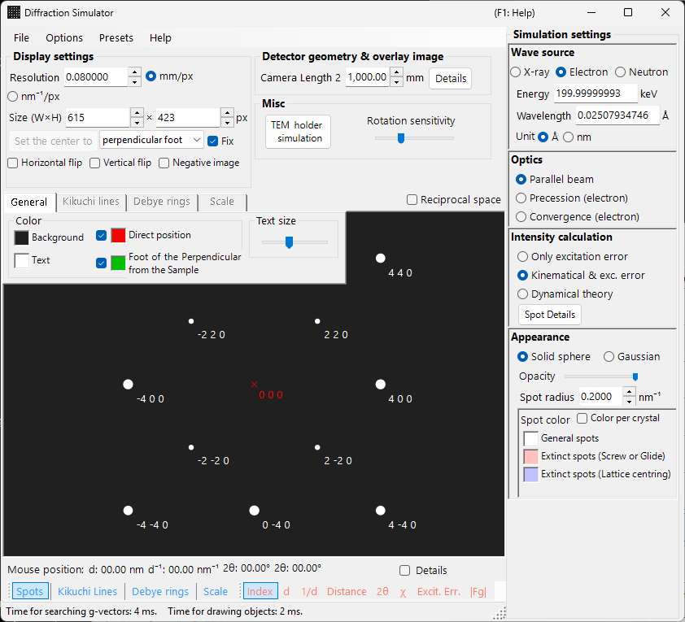
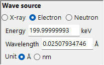
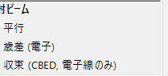
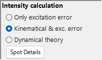
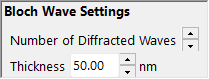
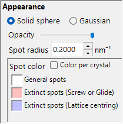

# SAED (Selected Area Electron Diffraction) Simulation

**SAED (Selected Area Electron Diffraction)** simulation calculates single-crystal electron diffraction patterns produced by a parallel electron beam. This is the default mode of the [diffraction simulator](index.md).

> This page lists every setting that appears in the **Simulation settings** panel on the right when you choose **Wave source** = **Electron** and **Optics** = **Parallel beam**. For window-wide operations such as drawing and saving, see the [overview page](index.md).

GUI conditions: Wave source = Electron, Optics = Parallel beam, Intensity calculation = Only excitation error / Kinematical & exc. error / Dynamical theory.

---

## Overview

Simulates the diffraction pattern produced when a parallel electron beam passes through a thin specimen. Spot positions are fixed by the geometric relationship between the Ewald sphere and the reciprocal-lattice points, and the brightness of each spot is computed according to the selected intensity-calculation mode.

---

## Wave source {#wave-length}

Set the radiation source to **Electron**. Enter the energy (keV) or wavelength (Å or nm, switchable; default Å) and the relativistically corrected wavelength is computed. <!-- 261105Cl コードから起こした修正。別担当がコードと再照合済み (誤りは訂正) (根拠: FormDiffractionSimulator.Designer.cs:waveLengthControl, presetToolStripMenuItem) --> The initial value is 200 keV; the **Presets** menu sets 300 / 200 / 120 kV in one click. For X-ray and neutron sources, see [X-ray diffraction simulation](5-x-ray-neutron-diffraction.md).

---

## Optics {#incident-beam-mode}

Set **Optics** (the incident-beam geometry) to **Parallel beam**. This is the standard plane-wave geometry used for SAED and X-ray diffraction.

> **Note**: For electrons you can choose **Parallel beam** / **Precession (electron)** / **Convergence (electron)**. Choosing **Precession (electron)** gives a [PED simulation](2-ped-simulation.md) and choosing **Convergence (electron)** gives a [CBED simulation](3-cbed-simulation.md); in both cases the intensity calculation automatically switches to **Dynamical theory**.

---

## Intensity calculation

Selects how spot intensities are computed.

### Only excitation error

Intensity is determined solely from the geometric distance between the Ewald sphere and the reciprocal-lattice point (the excitation error $S_g$). It is largest at $S_g = 0$ — exactly on the sphere — and falls off as $\lvert S_g\rvert$ grows, reaching zero once $\lvert S_g\rvert$ exceeds the **Spot radius** given for the reciprocal-lattice point. Because the crystal structure factor is ignored, this is the fastest mode and is suited to checking diffraction-spot positions.

<!-- 261105Cl コードから起こした修正。別担当がコードと再照合済み (誤りは訂正) (根拠: FormDiffractionSimulator.cs:radioButtonIntensityCalculationMethod_CheckedChanged, CheckBoxExtinctionAll_CheckedChanged; FormDiffractionSimulator.Designer.cs:checkBoxExtinctionAll/Lattice, checkBoxDrawSameSize) -->
Only in this mode, the following options appear:

| Option | Description |
|--------|-------------|
| **Exclude all prohibited reflections** | Hide every reflection forbidden by the space group (lattice centring, screw axes and glide planes). Ticking it also ticks and locks the next option. |
| **Exclude reflections prohibited by lattice centring** | Hide only reflections forbidden by lattice centring (default on). |
| **Draw all spots with the same radius** | Draw every excited spot with the full radius *R*, regardless of $S_g$. |

Forbidden reflections that remain visible are drawn in the **Extinct spots** colours (see [Spot appearance](#spot-appearance)).

### Kinematical

In addition to the excitation error, the kinematical structure factor $\lvert F_{hkl} \rvert^2$ is folded into the intensity. Extinction rules are correctly reflected, making this mode suited to thin specimens or weak diffraction.

### Dynamical (Bloch-wave method, electron only)

A rigorous dynamical calculation by the Bloch-wave method (Bethe method). It reproduces multiple scattering and the thickness-dependent variation of intensity, and is required for thick specimens or strong diffraction. Available only when Electron is selected. For the theory, see [Appendix A3. Bloch-wave method](../appendix/a3-bloch-wave/calculation.md).

> **Note**: When **Dynamical** is selected, a **Bloch wave settings** panel appears below.

---

## Bloch wave settings (Dynamical theory)

Active only when **Intensity calculation = Dynamical**.

<!-- 261105Cl コードから起こした修正。別担当がコードと再照合済み (誤りは訂正) (根拠: FormDiffractionSimulator.Designer.cs:numericBoxNumOfBlochWave, numericBoxThickness) -->
| Parameter | Description |
|-----------|-------------|
| **Number of diffracted waves** | Number of Bloch waves included in the eigenvalue problem (8–1000, default 240). Larger values give more accurate intensities but increase computation time as $O(N^3)$ |
| **Thickness** | Specimen thickness (nm) used in the dynamical calculation (0.01–10000 nm, default 50 nm) |

---

## Spot appearance

Controls how each diffraction spot is rendered.

<!-- 261105Cl コードから起こした修正。別担当がコードと再照合済み (誤りは訂正) (根拠: FormDiffractionSimulator.cs:DrawDiffractionSpots, radioButtonPointSpread_CheckedChanged, comboBoxScaleColorScale_SelectedIndexChanged; FormDiffractionSimulator.Designer.cs:flowLayoutPanelAppearance) -->

- **Solid sphere / Gaussian** : the geometric model of the reciprocal-lattice point (default **Solid sphere**). **Solid sphere** draws the cross-section (a circle) between a sphere and the Ewald sphere: the sphere radius is $R\,I^{1/3}$ for **Kinematical & exc. error** (sphere volume ∝ intensity) and $R$ for **Only excitation error**; for **Dynamical theory** a disc of radius $R\,I_\text{dyn}^{1/2}$ (area ∝ intensity) is drawn without the Ewald-sphere cut. **Gaussian** draws the cross-section (a 2-D Gaussian) of a 3-D Gaussian with $\sigma = R$, with its integral corresponding to the diffraction intensity.
- **Opacity** : transparency of the spot (0 = transparent, 1 = opaque).
- **Spot radius (R)** : virtual radius of the reciprocal-lattice point (nm⁻¹; 0.01–1, default 0.2). The spot size is fixed by the combination of **Appearance** mode and **Intensity calculation** (see above).
- **Brightness**, **Color scale**, **Log scale** : shown only in **Gaussian** mode. **Brightness** scales the integrated intensity of the rendered Gaussian; **Color scale** is **Gray** (spots in the spot colours below), **Cold-warm**, **Spectrum** or **Fire**; **Log scale** displays intensities on a logarithmic scale (useful for patterns with large intensity contrast).
- **Spot color** : shown while the **Color scale** is **Gray** (the initial setting). **General spots**, **Extinct spots (screw or glide)** and **Extinct spots (lattice centring)** set the colours of allowed and forbidden reflections.
- **Color per crystal** : when checked, spots are drawn in the colour assigned to each crystal (also for a single crystal).

---

## Spot labels

The labels overlaid on the spots are selected from the [toolbar](index.md#toolbar).

<!-- 261105Cl コードから起こした修正。別担当がコードと再照合済み (誤りは訂正) (根拠: FormDiffractionSimulator.cs:DrawDiffractionSpotsLabel) -->
| Label | Content |
|-------|---------|
| **Index** | Miller indices $(hkl)$; four indices $(hkil)$ when the main window's **Options ▸ Use Miller-Bravais (hkil) index** is on and the crystal uses hexagonal axes (the Kikuchi-line, Debye-ring and 3-D labels follow the same setting) <!-- 261105Cl 監査: C23 --> |
| **d** | interplanar spacing $d$, in Å or nm following the main window's length unit <!-- 261106Cl 作者の決定 C20 --> |
| **1/d** | reciprocal of the interplanar spacing $1/d$, in nm⁻¹ or Å⁻¹ following the main window's length unit <!-- 261106Cl 作者の決定 C2 --> |
| **Distance** | distance on the detector from the spot to the transmitted (direct) spot (mm), measured between the drawn positions, so it also holds for a tilted detector, the X-ray precession camera and Back Laue (measured from the beam hole); not shown when the transmitted beam misses the detector <!-- 261105Cl 監査: DrawDiffractionSpotsLabel (C15)。L2 tan2θ は傾けない平板の検出器だけ --> |
| **2θ** | scattering angle $2\theta$ (same definition as the concentric 2θ scale circles) |
| **χ** | azimuth angle $\chi$, measured from the upward (12 o'clock) direction, positive clockwise (same definition as the radial azimuth scale lines) |
| **Excit. err.** | excitation error $S_g$, in nm⁻¹ or Å⁻¹ following the main window's length unit |
| **Intens.** | relative intensity (%) in **Kinematical & exc. error** mode; in **Dynamical theory** mode the relative intensity (% of the strongest diffracted beam, 000 excluded) and the complex exit-surface amplitude. Nothing is shown for **Only excitation error** |

---

## Shared operations

Detector information, flipping, reciprocal-space display, Kikuchi lines, Debye rings, scale lines, colour settings, saving, and the like are common to all modes. See the [overview page](index.md). The per-reflection details obtained from the dynamical calculation can be browsed in [diffraction spot information](index.md#diffraction-spot-information).

---

## See also

- [Diffraction simulator (overview)](index.md)
- [Parallel-beam SAED calculation](../appendix/a3-bloch-wave/calculation.md#parallel-beam-saed)
- [X-ray diffraction simulation](5-x-ray-neutron-diffraction.md)
- [Precession electron diffraction (PED) simulation](2-ped-simulation.md)
- [Definition of the coordinate system](../appendix/a1-coordinate-system/1-orientation.md)
