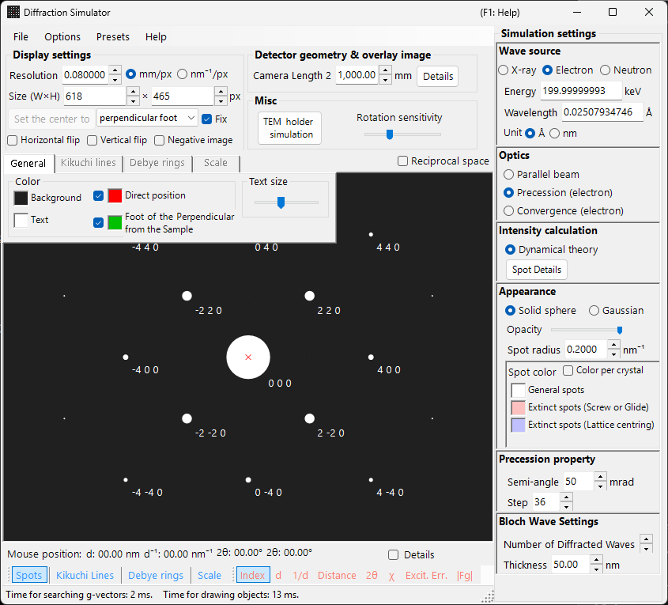
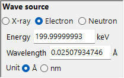
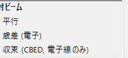
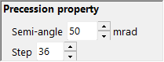
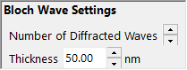
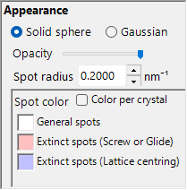

# Precession Electron Diffraction (PED) Simulation

**PED (Precession Electron Diffraction)** simulation calculates electron diffraction patterns obtained by precessing the incident beam in a cone around the optic axis.

> This page lists every setting that appears on the right-hand side when you select **Wave source = Electron, Optics = Precession (electron), Intensity calculation = Dynamical theory (automatic)**. Note that **selecting Precession (electron) in Optics automatically switches the intensity calculation to Dynamical theory**. For window-wide operations such as drawing and saving, see the [overview page](index.md).

GUI conditions: **Wave source = Electron, Optics = Precession (electron), Intensity calculation = Dynamical theory (automatic)**

---

## Overview

In PED the electron beam is precessed in a cone around the optic axis, and the diffraction patterns obtained for each beam direction on the precession cone are integrated. Compared with conventional SAED, this offers the following advantages:

- Dynamical effects are averaged out, yielding intensity data close to kinematical intensity ratios
- Higher-order Laue zone (HOLZ) reflections are observed more clearly
- Intensity data suitable for structure analysis can be obtained

---

## Wave source {#wavelength-setup}

Since PED is electron diffraction, select **Electron** as the **Wave source**. Entering the electron energy (keV) or wavelength (Å or nm, switchable; default Å) computes the relativistically corrected wavelength.

---

## Optics {#incident-beam}

In **Optics** (the incident-beam geometry), select **Precession (electron)** (available only when **Electron** is selected).

> **Note** : Selecting **Precession (electron)** **automatically switches the intensity calculation to Dynamical theory**, and the Bloch-wave settings panel and the precession settings panel appear. **Only excitation error** / **Kinematical & exc. error** can no longer be selected.

---

## Precession settings

Set the shape and sampling of the precession cone.

<!-- 261105Cl コードから起こした修正。別担当がコードと再照合済み (誤りは訂正) (根拠: FormDiffractionSimulator.Designer.cs:numericBoxPED_Semiangle, numericBoxPED_Step) -->
| Parameter | Description | Recommended |
|-----------|-------------|-------------|
| **Semi-angle** | Half-angle of the precession cone (mrad; 0.1–500, default 50) | 10–40 mrad |
| **Step** | Number of parallel-beam directions sampled on the precession cone (2–1080, default 36). Larger values give smoother integration but increase the computation time linearly | 36–72 |

---

## Intensity calculation and Bloch-wave settings

The moment **Precession (electron)** is selected, **Intensity calculation** is fixed to **Dynamical theory** (automatic). For the parallel beam in each precession direction, the diffraction intensity is computed by the Bloch-wave method (Dynamical calculation), and integrating over all directions yields the PED pattern.

<!-- 261105Cl コードから起こした修正。別担当がコードと再照合済み (誤りは訂正) (根拠: FormDiffractionSimulator.Designer.cs:numericBoxNumOfBlochWave, numericBoxThickness) -->
| Parameter | Description | Recommended |
|-----------|-------------|-------------|
| **Number of Diffracted Waves** | Number of Bloch waves included in the eigenvalue problem (8–1000, default 240). Larger values give more accurate intensities but the computation time grows as $O(N^3)$ | 50–200 |
| **Thickness** | Specimen thickness used in the dynamical calculation (nm; 0.01–10000, default 50) | — |

The computational cost is roughly "number of steps × Bloch-wave calculation per direction". For details of the dynamical calculation, see [Dynamical calculation (Bloch-wave method)](../appendix/a3-bloch-wave/calculation.md).

---

## Spot appearance

Controls how each diffraction spot is drawn.

- **Solid sphere / Gaussian** : Geometric model of the reciprocal lattice points. **Solid sphere** draws the cross-section of a sphere of radius $R$ with the Ewald sphere, and **Gaussian** draws the cross-section (a 2D Gaussian) of a 3D Gaussian with $\sigma = R$ and the Ewald sphere.
- **Opacity** : Spot transparency (0 = transparent, 1 = opaque).
- **Spot radius (R)** : Radius of the reciprocal lattice points. For dynamical intensities, the Gaussian integral $=$ Brightness $\times I_\text{dyn}$, and the Solid sphere uses radius $R \times I_\text{dyn}^{1/2}$ (so the area is proportional to the dynamical intensity).
- **Brightness**, **Color scale**, **Log scale** : shown only in **Gaussian** mode. **Brightness** scales the integrated intensity of the drawn Gaussian; **Color scale** is **Gray** (spots in the spot colours below), **Cold-Warm**, **Spectrum** or **Fire**; **Log scale** displays intensity on a logarithmic scale. <!-- 261105Cl コードから起こした修正。別担当がコードと再照合済み (誤りは訂正) (根拠: FormDiffractionSimulator.cs:DrawDiffractionSpots, comboBoxScaleColorScale_SelectedIndexChanged; FormDiffractionSimulator.Designer.cs:flowLayoutPanelGaussianOption, comboBoxScaleColorScale) -->
- **Spot color** : shown while the **Color scale** is **Gray** (the initial setting): **General spots** / **Extinct spots (Screw or Glide)** / **Extinct spots (Lattice centring)**.
- **Color per crystal** : Draw spots in the colour assigned to each crystal.

---

## Comparison with SAED

| Feature | SAED | PED |
|---------|------|-----|
| Beam | Parallel, fixed | Precessing (cone scan) |
| Dynamical effects | Large | Averaged, smaller |
| HOLZ reflections | Weak | Appear strongly |
| Intensity reliability | May be insufficient for structure analysis | Suitable for structure analysis |
| Computation time | Short | Long |

---

## See also

- [Diffraction simulator (overview)](index.md)
- [X-ray diffraction simulation](5-x-ray-neutron-diffraction.md)
- [SAED simulation](1-saed-simulation.md)
- [Dynamical calculation (Bloch-wave method)](../appendix/a3-bloch-wave/calculation.md)
