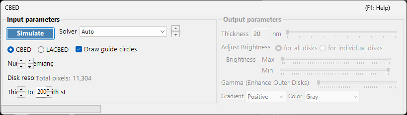
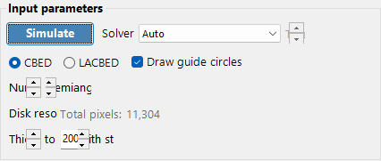
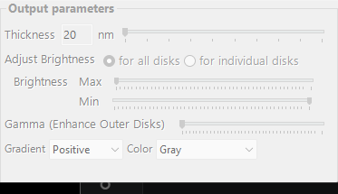

# CBED Simulation

**CBED (Convergent-Beam Electron Diffraction) simulation** computes and displays convergent-beam diffraction patterns using the Bloch wave (Bethe) method. CBED patterns show diffraction disks instead of spots and contain rich information about crystal symmetry, thickness, and structure.

> This page lists all settings of the dedicated window that opens when you select **Wave source** = **Electron** and **Optics** = **Convergence (electron)** in the [Diffraction Simulator](index.md). Selecting **Convergence (electron)** automatically switches **Intensity calculation** to **Dynamical theory**, and this CBED settings window opens. <!-- 261105Cl コードから起こした修正。別担当がコードと再照合済み (誤りは訂正) (根拠: FormDiffractionSimulatorCBED.cs:FormDiffractionSimulatorCBED_VisibleChanged) --> The computed disks can be saved from **File > Save CBED disks** / **Copy CBED disks** of the main window. For drawing and saving diffraction patterns and other operations common to the diffraction simulator, see the [overview page](index.md).

GUI conditions: Wave source = Electron · Optics = Convergence (electron) · Intensity calculation = Dynamical theory (automatic)

---

## Input parameters

<!-- 261105Cl コードから起こした修正。別担当がコードと再照合済み (誤りは訂正) (根拠: FormDiffractionSimulatorCBED.Designer.cs; FormDiffractionSimulatorCBED.cs:コンストラクタ, ComboBoxSolver_SelectedIndexChanged, buttonSimulate_Click; BetheMethod.cs:cbed_DoWork; FormDiffractionSimulator.cs:radioButtonBeamParallel_CheckedChanged, DrawDiffractionSpots) -->
While this window is open, the **Bloch Wave Settings** and **Appearance** panels of the main window are disabled; the number of waves and the thicknesses are taken from here.

| Parameter | Description | Default / Typical |
|-----------|-------------|-------------------|
| **CBED** / **LACBED** | **CBED**: standard convergent-beam pattern where each disk corresponds to one reflection, with the transmitted disk (000) at the center. **LACBED** (Large-Angle CBED): large-angle convergent-beam pattern where disks from different reflections overlap. Useful for observing higher-order Laue zone (HOLZ) lines and symmetry | CBED |
| **Semiangle (mrad)** | Half-angle of the convergent beam cone (0–2000 mrad). Determines the size of each diffraction disk (the disk diameter in reciprocal space corresponds to $2\alpha$) | default 6 mrad; typically 5–30 mrad |
| **Disk resolution (mrad/px)** | Angular resolution within each disk. The disk is sampled on an $N\times N$ grid with $N = \lceil 2\alpha / \text{resolution} \rceil$, and only the points inside the circle are computed. Smaller values give higher resolution, but the number of beam directions grows as the square, so the computation time also increases quadratically. The resulting count (= total number of beam directions) is shown as **Total pixels** | default 0.1 mrad/px |
| **Number of diffracted waves** | Maximum number of beams included in the Bloch wave calculation at each incident beam direction (1–2048). More beams give higher accuracy, but the cost of the eigenvalue problem grows as $O(N^3)$ | default 64; typically 100–500 |
| **Thickness from / to / with step of** | Start, end, and step values of the sample thickness (nm, each 1–1000). Multiple thicknesses are computed together and switched with the thickness slider on the output side | default 20 to 200 nm, step 20 nm |
| **Solver** | Calculation engine. **Auto**; **Eigenproblem with Eigen lib.** / **Eigenproblem with MKL lib.** (diagonalization); **Matrix exp. with Eigen lib.** / **Matrix exp. with MKL lib.** (matrix-exponential method, v4.794). **Auto** uses the matrix-exponential method with Eigen and all logical processors when Eigen is available, otherwise the MKL eigenproblem. The matrix-exponential path requires equally spaced thicknesses and otherwise falls back to the eigenproblem. MKL entries are not offered on ARM64, and Eigen entries are hidden when the native Eigen library is unavailable | Auto |
| **Threads** | Number of parallel threads (1–128). Disabled for **Auto**; selecting a solver sets it to the number of logical processors (¼ of it for MKL) | — |
| **Draw guide circles** | When checked, draws yellow circles indicating the boundary of each diffraction disk on the main pattern (in LACBED, a circle for 000 and crosses for the other reflections) | on |

---

## Run / Stop

- **Simulate** : starts the CBED simulation with the current input parameters. <!-- 261105Cl コードから起こした修正。別担当がコードと再照合済み (誤りは訂正) (根拠: FormDiffractionSimulatorCBED.resx:buttonSimulate.Text) -->
- **Stop** : cancels the running calculation.

---

## Output parameters

Once the calculation completes, the output parameters become available. All of them change only the display without recomputing.

<!-- 261105Cl コードから起こした修正。別担当がコードと再照合済み (誤りは訂正) (根拠: FormDiffractionSimulatorCBED.cs:generateImage, radioButtonAllDisks_CheckedChanged, TrackBarOutputThickness_Scroll) -->
| Parameter | Description |
|-----------|-------------|
| **Thickness** | Selects the sample thickness to display, within the thickness range of the input parameters, using a slider (the [diffraction spot information](index.md#diffraction-spot-information) table follows it) |
| **Adjust Brightness** | **for all disks**: one brightness scale, normalized to the maximum over all disks. **for individual disks**: every disk is normalized to its own maximum (γ is reset to 0 and disabled) |
| **Brightness (Max / Min)** | Upper and lower limits of the displayed intensity, as fractions of the maximum (the slider position is applied to the 4th power). Adjust when you want to emphasize weak features |
| **Gamma (Enhance Outer Disks)** | Multiplies each pixel by $\exp(\gamma\,r)$, where $r$ is its distance from the pattern centre, to make the dark outer high-angle disks easier to see relative to the central transmitted disk. Active only with **for all disks** |
| **Gradient** | Selects the intensity gradation from **Positive** / **Negative** (black-white inverted) |
| **Color** | Color map used for display: **Gray**, **Cold-Warm**, **Spectrum** or **Fire** |

---

## Physical background

In CBED, the incident beam is regarded as a cone of plane waves with different directions. For each direction (each point within the convergence aperture = a partial incident plane wave), the Bloch wave method solves the electron Schrödinger equation inside the crystal, and the results are rearranged as diffraction disks. HOLZ (higher-order Laue zone) lines appear as fine dark/bright lines within the disks, arising from reflections in upper Laue zones. They are sensitive to the lattice parameter along the $c$ axis and are useful for three-dimensional structure analysis.

For the theoretical details, see [CBED calculation](../appendix/a3-bloch-wave/cbed.md).

---

## See also

- [Diffraction simulator (overview)](index.md)
- [SAED simulation](1-saed-simulation.md)
- [PED simulation](2-ped-simulation.md)
- [CBED calculation](../appendix/a3-bloch-wave/cbed.md)
