# Crystal Diffraction (Diffraction Simulator)

**Crystal Diffraction (Diffraction Simulator)** simulates single-crystal X-ray, neutron, and electron diffraction patterns.

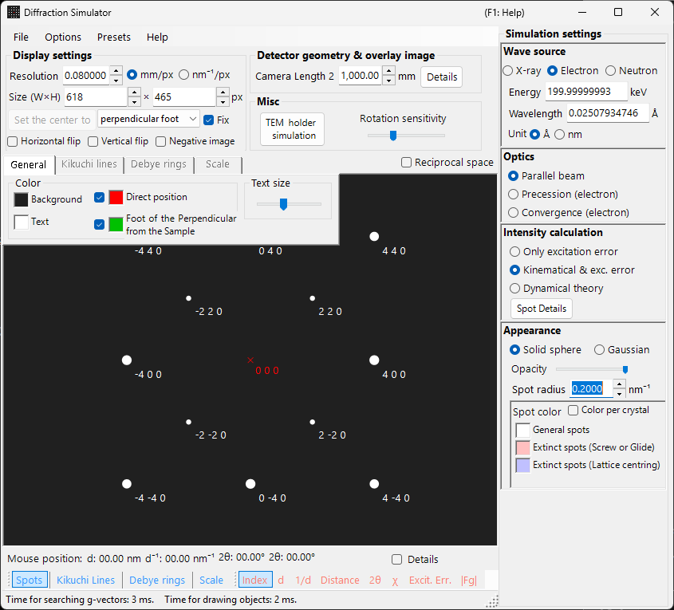

The window has a diffraction-pattern drawing area on the **left** and, on the **right**, the setting panels for the spot properties (wavelength, incident beam, intensity calculation, appearance, and so on). The combination of wavelength and incident beam determines the acquisition mode (X-ray diffraction, SAED, PED, CBED), and the right-hand panels reconfigure accordingly.

---

## How this page and the mode pages divide the work

- **This page (hub)**: collects the operations common to every mode (shortcuts, menus, toolbar, screen/detector information, overlay tabs, spot information, detector geometry, dynamic compression).
- **Each mode page**: covers **every setting that appears on the right** when that mode is selected (wavelength, incident beam, intensity calculation, appearance, Bloch-wave settings, precession settings, and so on), so each page is self-contained (some overlap exists between modes).

| Mode | Contents | Page |
|------|----------|------|
| **X-ray (and neutron) diffraction** | Single-crystal X-ray / neutron diffraction pattern (parallel, precession X-ray, Back Laue) | [X-ray Diffraction Simulation](5-x-ray-neutron-diffraction.md) |
| **SAED** | Parallel-beam electron diffraction (selected-area electron diffraction) | [SAED Simulation](1-saed-simulation.md) |
| **PED** | Precession electron diffraction | [PED Simulation](2-ped-simulation.md) |
| **CBED** | Convergent-beam electron diffraction | [CBED Simulation](3-cbed-simulation.md) |

> **ALCHEMI is not a mode.** Unlike X-ray / SAED / PED / CBED, which are selected by the combination of wavelength and incident beam, the ALCHEMI simulator is a **child window** opened from the **Options** menu, so it is listed separately here.

| Child window | Contents | Page |
|------|------|------|
| **ALCHEMI simulator** | Site-resolved ionization rocking curves (channelling-enhanced microanalysis) | [ALCHEMI Simulation](4-alchemi-simulation.md) |

---

## Mode quick reference

Look up the page you need from the combination of **wavelength (source)** and **incident beam**.

| Wavelength | Incident beam | Mode | Page |
|------------|--------------------|------|------|
| Electron | Parallel | SAED | [SAED Simulation](1-saed-simulation.md) |
| Electron | Precession (electron = PED) | PED | [PED Simulation](2-ped-simulation.md) |
| Electron | Convergence (CBED) | CBED | [CBED Simulation](3-cbed-simulation.md) |
| X-ray | Parallel | X-ray diffraction | [X-ray Diffraction Simulation](5-x-ray-neutron-diffraction.md) |
| X-ray | Precession (X-ray) | Precession X-ray (precession camera) | [X-ray Diffraction Simulation](5-x-ray-neutron-diffraction.md) |
| X-ray | Back Laue | Back-reflection Laue | [X-ray Diffraction Simulation](5-x-ray-neutron-diffraction.md) |
| Neutron | Parallel | Neutron diffraction | [neutron section of X-ray Diffraction Simulation](5-x-ray-neutron-diffraction.md) |

<!-- 261105Cl draft: コードから起こした修正・著者未査読 (根拠: FormDiffractionSimulator.cs:WaveLengthControl_WaveSourceChanged, radioButtonBeamParallel_CheckedChanged; FormDiffractionSimulator.resx) -->
> **Note**: The incident-beam (**Optics**) choices change with the wavelength. For electrons: **Parallel beam, Precession (electron), Convergence (electron)**; for X-rays: **Parallel beam, Precession (X-ray, ZOLZ), Back Laue (X-ray)**; for neutrons: **Parallel beam** only. Changing the wave source always resets the optics to **Parallel beam**. Selecting **Precession (electron)** or **Convergence (electron)** automatically switches the intensity calculation to **Dynamical theory**; **Dynamical theory** is offered only for electrons (selecting X-ray or neutron falls back to **Kinematical**). Back Laue uses a white (polychromatic) beam.

---

## Keyboard & mouse shortcuts

<!-- 261105Cl draft: コードから起こした修正・著者未査読 (根拠: FormDiffractionSimulator.cs:graphicsBox_MouseWheel / graphicsBox_MouseUp; GraphicsBox.cs:GetWheelZoomFactor) -->
These apply to the diffraction-pattern window shared by the X-ray, SAED, and PED simulations. Dragging on the pattern rotates the **crystal**. Zoom with the mouse wheel or with right-click / right-drag.

| Shortcut | Action |
|----------|--------|
| <kbd>F1</kbd> | Open this page of the online manual |
| Left-drag near the centre | Tilt the crystal |
| Left-drag the outer area | Spin the crystal about the beam axis |
| Left double-click a spot | Show reflection details (index, *d*, structure factor, excitation error) |
| Middle-drag | Pan the pattern |
| <kbd>CTRL</kbd> + Middle-drag | Move the detector centre (when the detector area is shown) |
| Mouse wheel | Zoom in / out by ×2 per notch, centred on the cursor (on the fixed centre when **Fix** is ticked) |
| Right-click | Zoom out (×1/1.2) |
| Right-drag a box | Zoom in to the selected region |
| Right double-click the status bar | Copy a text summary of the current settings |
| Right double-click a lit layer button (Spots / Kikuchi / Debye / Scale) | Blink that layer on and off |

The auxiliary windows opened from here add a few more:

| Shortcut | Action |
|----------|--------|
| Left double-click the stereonet — **TEM holder** | Set the holder tilt to that point |
| Arrow keys — **TEM holder** | Step the holder tilt (tick **Enable arrow keys** first; works with any ReciPro window in front) |
| Drop a `.prm` file or an image — **Detector geometry** | Load detector geometry / overlay image |
| Drop a `.txt` profile — **Dynamic compression** | Load position/time/pressure profiles (choose the time with the **Time** slider; drag the vertical lines in the graph to set front/back) |

The application-wide <kbd>CTRL</kbd>+<kbd>SHIFT</kbd> shortcuts of the main window also work while this window is focused (see [main window](../0-main-window.md)).

→ See **[21. Keyboard & mouse shortcuts](../21-shortcuts.md)** for every window at a glance.

---

## Quick Routes by Goal

| Goal | Start from | Reference |
|------|------------|-----------|
| Produce parallel-beam electron diffraction (SAED) | Set **Incident beam** to **Parallel** and **Wavelength** to electron | [SAED Simulation](1-saed-simulation.md), [parallel-beam SAED calculation](../appendix/a3-bloch-wave/calculation.md) |
| Produce single-crystal X-ray diffraction | Switch **Wavelength** to X-ray / Synchrotron | [X-ray Diffraction Simulation](5-x-ray-neutron-diffraction.md) |
| Produce precession electron diffraction (PED) | Set **Incident beam** to **Precession (electron)**, then set the semi-angle and step | [PED Simulation](2-ped-simulation.md) |
| Produce convergent-beam electron diffraction (CBED) | Set **Incident beam** to **Convergence (CBED, electron only)** and set the conditions in the CBED window | [CBED Simulation](3-cbed-simulation.md), [CBED calculation](../appendix/a3-bloch-wave/cbed.md) |
| Inspect the reflection list from the dynamical calculation | Select **Dynamical theory** and press **Spot Details** | [Dynamical calculation (shared core)](../appendix/a3-bloch-wave/calculation.md) |
| Match detector geometry against an experimental image | Open the detector-geometry settings from **Details** in **Detector geometry & overlay image** and use the overlay image | [Detector coordinate system](../appendix/a1-coordinate-system/2-diffraction.md) |

---

## Main area

The diffraction pattern is simulated in the centre of the screen.

### Mouse operation

See "Keyboard & mouse shortcuts" at the top of this page.

### Mouse position

<!-- 261105Cl draft: コードから起こした修正・著者未査読 (根拠: FormDiffractionSimulator.cs:graphicsBox_MouseMove, checkBoxMousePositionDetailes_CheckedChanged) -->
The **Mouse position:** line above the pattern shows, for the cursor position, *d* (nm), *d*⁻¹ (nm⁻¹) and 2θ (in degrees and in rad, or mrad below 0.1 rad). Ticking **Details** adds three coordinate read-outs: the detector coordinates (mm, origin = foot of the perpendicular from the sample), the real-space coordinates (mm, origin = crystal), and the reciprocal-space coordinates (nm⁻¹). In Back Laue mode the *d* and reciprocal-space values are shown as "-".

---

## File menu

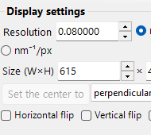

<!-- 261105Cl draft: コードから起こした修正・著者未査読 (根拠: FormDiffractionSimulator.Designer.cs:fileToolStripMenuItem; FormDiffractionSimulator.cs:radioButtonIntensityCalculationMethod_CheckedChanged, FormDiffractionSimulatorCBED.cs:FormDiffractionSimulatorCBED_VisibleChanged) -->
| Menu item | Description |
|-----------|-------------|
| **Save Image** | Save the displayed diffraction pattern, **as Image (PNG format)** or **as Metafile (EMF)**. |
| **Save detector area** | Save only the detector-area crop (PNG / EMF). Shown only while the detector area is displayed. |
| **Save CBED disks** | CBED mode only: save the computed disks **As Individual Images (PNG / TIFF Format)** or **as collective image (PNG / Tiff format)**. |
| **Copy** | Copy the displayed image to the clipboard (**as Image** / **as Metafile (EMF)**). |
| **Copy detector area** | Copy only the detector-area crop. Shown only while the detector area is displayed. |
| **Copy CBED disks** | CBED mode only: copy the disks **as collective image**. |
| **Save Movie** | Record a movie of the **Diffraction pattern** or of the **Reciprocal space** view. |
| **Page Setup / Print Preview / Print** | Print the displayed pattern. |

### Preset

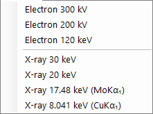

<!-- 261105Cl draft: コードから起こした修正・著者未査読 (根拠: FormDiffractionSimulator.cs:presetToolStripMenuItem_Click; FormDiffractionSimulator.Designer.cs:presetToolStripMenuItem) -->
Fixed wave-source presets that only set the radiation and its energy: **Electron 300 kV**, **Electron 200 kV**, **Electron 120 keV**, **X-ray 30 keV**, **X-ray 20 keV**, **X-ray 17.48 keV (MoKα₁)** and **X-ray 8.041 keV (CuKα₁)** (the last two select the Mo / Cu Kα₁ characteristic line). Other settings (detector geometry, tabs, spot properties) are not stored or changed.

### Options and Help menus

| Menu item | Description |
|-----------|-------------|
| **Options > Dynamic Compression** | Opens the [Dynamic compression](#dynamic-compression) window (together with the detector-geometry window). |
| **Options > ALCHEMI simulator...** | Opens the [ALCHEMI simulator](4-alchemi-simulation.md). |
| **Help > Basic concept of Bethe's method** | Opens the [Bloch-wave appendix](../appendix/a3-bloch-wave/calculation.md) of the online manual in the browser. |

---

## Toolbar {#toolbar}

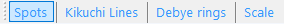

| Button | Description |
|--------|-------------|
| Spots | Show / hide the diffraction-spot layer |
| Kikuchi | Show / hide the Kikuchi-line layer |
| Debye | Show / hide the Debye-ring layer |
| Scale | Show / hide the scale-line layer |
| Index / d / 1/d / Distance / 2θ / χ / Excitation error / Structure factor | Choice of label attached to each spot |

---

## Screen and detector information

### Screen

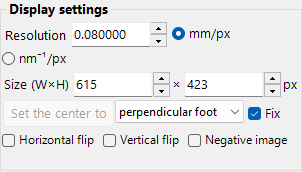

<!-- 261105Cl draft: コードから起こした修正・著者未査読 (根拠: FormDiffractionSimulator.Designer.cs:numericBoxResolution, comboBoxCenter; FormDiffractionSimulator.cs:FixedCenter, radioButtonResoUnit_CheckedChanged) -->
| Item | Description |
|------|-------------|
| **Resolution** | The size of one screen pixel, in **mm/px** (on the detector plane) or **nm⁻¹/px** (selectable; default 0.08 mm/px). It need not be the actual detector pixel size; it is treated as a display scale and is updated automatically when you zoom with the mouse. |
| **Size (W×H)** | Pixel width and height of the drawing area. Depending on your display resolution, very large values may not be settable. |
| **Set the center to / Fix** | Puts the centre of the drawing area on the **perpendicular foot**, the **direct spot**, or the **detector** centre (the last only when a detector area is defined). With **Fix** ticked (default) the centre stays there: mouse panning is disabled and zooming keeps that centre. |
| **Horizontal flip / Vertical flip / Negative image** | Geometric flips (horizontal / vertical) and contrast inversion of the displayed pattern. Use these to match the orientation or contrast of an experimental image. |
| **Reciprocal space** | Opens a 3-D view of the Ewald sphere and the reciprocal-lattice points beside the pattern, visualizing which reflections are excited. Its **Options** panel sets the colours (spots near / away from the Ewald sphere, Ewald sphere, origin, direction guide), the 3-D spot radius (nm⁻¹), the relative-intensity threshold (%), transparency of spots away from the Ewald sphere, labels, and the view direction (arrow buttons with an angular **Step**, **Reset**). |

### Detector (camera length)

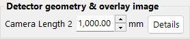

- **Camera Length 2** : Distance (mm) from the sample to the foot of the perpendicular dropped on the detector plane (default 1000 mm). It equals the usual camera length when the detector is not tilted (τ = 0). <!-- 261105Cl draft: コードから起こした修正・著者未査読 (根拠: FormDiffractionSimulator.cs:CameraLength2, DetectorRotation; FormDiffractionSimulator.Designer.cs:numericBoxCameraLength2) -->
- **Details** : Opens the detector-geometry settings window (see [Detector geometry](#detector-geometry) below).

### Misc

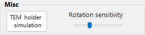

- **Rotation sensitivity** : Amount of crystal rotation per pixel of mouse drag.
- **TEM holder simulation** : Opens the holder-linked simulation window (see below).

---

## TEM holder simulation

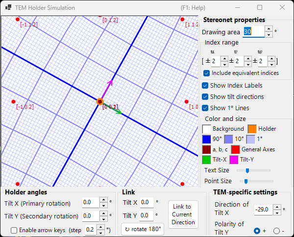

<!-- 261105Cl draft: コードから起こした修正・著者未査読 (根拠: FormDiffractionSimulatorHolder.cs:tiltByArrowKey, buttonLink_Click; FormDiffractionSimulatorHolder.Designer.cs) -->
Opens a window that links the diffraction pattern to a double-tilt **TEM holder** (**Tilt X** = primary, **Tilt Y** = secondary rotation). Setting the holder tilt angles updates the pattern and the crystal orientation, and the reachable orientations can be shown on a stereonet (added in v4.914). **Link to Current Direction** takes the current crystal orientation as the holder's reference (at the given Tilt X / Tilt Y); **TEM-specific settings** give the direction of the Tilt X axis on the screen (default −29°) and the polarity of Tilt Y, and **↻ rotate 180°** turns the crystal by 180° about the beam. Left double-click on the stereonet sets the holder tilt to that point, and ticking **Enable arrow keys** lets ←/→ step Tilt X and ↑/↓ step Tilt Y (step 0.1–2°, default 0.2°). While this window is open, the arrow keys work no matter which ReciPro window is in front.

---

## Drawing overlay tabs {#drawing-overlay-tabs}

### General

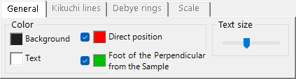

<!-- 261105Cl draft: コードから起こした修正・著者未査読 (根拠: FormDiffractionSimulator.Designer.cs:tabPageGeneral (groupBoxStringSize, groupBoxColor)) -->
Sets the label **Text size**, and the colours of the label **Text**, the **Foot of the Perpendicular from the Sample** marker, the **Direct position** marker and the **Background** (the two markers can each be switched off). Spot colours are set in **Appearance** (see the mode pages); Kikuchi-line, Debye-ring and scale-line colours in their own tabs. The settings here apply to all rendering modes.

### Kikuchi lines

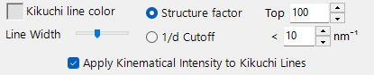

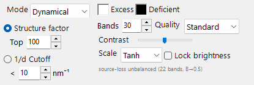

Active when Kikuchi lines are enabled on the toolbar.

- **Reflection selection** : Choose which reflections generate the Kikuchi lines. Either **Structure factor** (the **Top** *N* reflections by $\lvert F_{hkl}\rvert$; 1–1000, default 100) or **1/d Cutoff** (all reflections whose 1/d is below the threshold; 0–100 nm⁻¹, default 10). <!-- 261105Cl draft: コードから起こした修正・著者未査読 (根拠: FormDiffractionSimulator.Designer.cs:numericBoxKikuchiThresholdOfStructureFactor/OfLength; FormDiffractionSimulator.cs:コンストラクタ (comboBoxKikuchiMode/Quality/Scale.SelectedIndex)) -->
- **Mode** : How the Kikuchi lines are drawn (default **Kinematical**). The settings below the combo box change with the mode.
    - **Geometric** : all selected lines in a single fixed colour.
    - **Kinematical** : line darkness follows the kinematical relative intensity of each reflection.
    - **Dynamical** : two-beam dynamical excess/deficient band profiles fed by a thermal-diffuse-scattering source, computed in a background thread. Excess bands appear on the high-angle side and deficient features toward the direct beam; the specimen thickness is shared with the intensity settings. Geometric lines are drawn as a fallback while the computation runs.
- **Geometric / Kinematical settings** : **Kikuchi line color** and **Line Width**.
- **Dynamical settings** :
    - **Excess** / **Deficient** : Colours of the bright (positive contrast) and dark (negative contrast) sides of the bands.
    - **Bands** : Number of bands drawn with dynamical profiles (the top *N* by dynamical contrast; 1–50, default 30).
    - **Quality** : Sample points across each band (Fast 65 / Standard 129 / High 257; default Standard).
    - **Contrast** : Display gain applied to the band contrast before compression.
    - **Scale** : Brightness-compression curve (Linear / Log / Tanh; default Tanh). These are visualization transforms, not physical camera responses.
    - **Lock brightness** : Freezes the brightness normalization, e.g. to compare different orientations or thicknesses.
    - The grey notice line reports the source/loss mismatch tag, the number of bands drawn, and diagnostics such as a default *B* factor substituted for atoms with *B* = 0.
- (The former separate **Threshold** parameter no longer exists; reflections are limited only by the selection above.) <!-- 261105Cl draft: コードから起こした修正・著者未査読 (根拠: FormDiffractionSimulator.Designer.cs:tabPageKikuchi (旧 Threshold コントロールは存在しない)) -->

### Debye rings

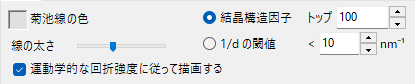

Active when Debye rings are enabled on the toolbar.

- **Ignore diffraction intensity** : If checked, all Debye rings are drawn with the same colour and intensity (ignoring the crystal structure factor). Use it for a purely geometric comparison.
- **Show index label** : If checked, the (*hkl*) appears near each ring.

### Scale

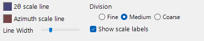

Active when the scale lines are enabled on the toolbar.

- **2θ / Azimuth scale lines** : **2θ** represents constant scattering angle (concentric circles), **Azimuth** represents constant azimuth angle (radial lines from the centre). The colours are independently configurable.
- **Line width** : Thickness of the scale lines.
- **Division** : Density of the scale lines, **Fine** / **Medium** (default) / **Coarse**. <!-- 261105Cl draft: コードから起こした修正・著者未査読 (根拠: FormDiffractionSimulator.Designer.cs:radioButtonScaleDivisionFine/Medium/Coarse) -->
- **Show scale labels** : Whether to draw numeric labels on the scale lines.

<!-- 261105Cl draft: コードから起こした修正・著者未査読 (根拠: FormDiffractionSimulator.Designer.cs:tabControl (タブは General/Kikuchi/Debye/Scale の 4 枚のみ)) -->
(There is no separate *Misc* tab; the mouse **Rotation sensitivity** is in the **Misc** group of the right-hand panel, see [Misc](#misc) above.)

---

## Diffraction spot information {#diffraction-spot-information}

<!-- 261105Cl draft: コードから起こした修正・著者未査読 (根拠: FormDiffractionSimulator.cs:ButtonDetailsOfSpots_Click; FormDiffractionSpotInfo.cs:SetTable(double, Crystal)) -->
Lists the per-reflection details computed by the Bloch-wave method (Dynamical calculation). Open it with the **Spot Details** button in the intensity-calculation panel. In **Only excitation error** / **Kinematical** mode the button lists the currently drawn reflections with their electron potentials and $P_g$, $Q_g$ (no dynamical amplitudes); in CBED mode the table follows the thickness selected in the CBED window.

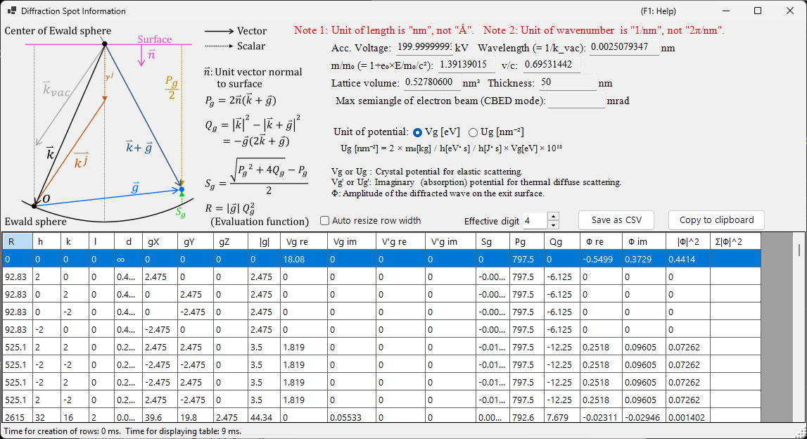

### Schematic and definitions

The schematic (top left) shows the vectors on the Ewald sphere and defines the quantities used in the table ($\hat{\mathbf{n}}$ is the unit vector normal to the sample surface, $\mathbf{k}$ is the incident wavevector, $\mathbf{g}$ is the reciprocal-lattice vector).

- $P_g = 2\,\hat{\mathbf{n}} \cdot (\mathbf{k} + \mathbf{g})$
- $Q_g = |\mathbf{k}|^2 - |\mathbf{k} + \mathbf{g}|^2 = -\mathbf{g} \cdot (2\mathbf{k} + \mathbf{g})$
- **Excitation error:** $S_g = \dfrac{\sqrt{P_g^2 + 4 Q_g} - P_g}{2}$
- **Evaluation function:** $R = |\mathbf{g}|\, Q_g^2$ — ranks reflections by how strongly they are excited (smaller = closer to the Ewald sphere = more strongly excited; the transmitted beam $g=0$ has $R=0$ and comes first). The table is sorted by ascending $R$.

### Table columns

| Column | Meaning |
|--------|---------|
| **R** | evaluation function $R = \lvert\mathbf{g}\rvert\, Q_g^2$ (above; used for selecting / ordering reflections) |
| **h, k, (i,) l** | Miller indices (*i* is the redundant hexagonal index, shown only for hexagonal crystals) |
| **d** | interplanar spacing (nm) |
| **gX, gY, gZ** | components of the reciprocal-lattice vector *g* (1/nm) |
| **\|g\|** | magnitude of *g* (1/nm) |
| **Vg re / Vg im** | Fourier coefficient of the crystal potential for elastic scattering, $V_g$ (real / imaginary) |
| **V'g re / V'g im** | imaginary (absorption) potential for thermal diffuse scattering (TDS), $V'_g$ (real / imaginary) |
| **Sg** | excitation error $S_g$ (above; 1/nm) |
| **Pg** | auxiliary quantity $P_g = 2\,\hat{\mathbf{n}}\cdot(\mathbf{k}+\mathbf{g})$ (above) |
| **Qg** | auxiliary quantity $Q_g = -\mathbf{g}\cdot(2\mathbf{k}+\mathbf{g})$ (above) |
| **Φ re / Φ im** | complex amplitude $\Phi$ of the dynamical diffracted wave on the exit surface (real / imaginary) |
| **\|Φ\|^2** | diffracted intensity $\lvert\Phi\rvert^2$ of that reflection |
| **Σ\|Φ\|^2** | cumulative sum of $\lvert\Phi\rvert^2$ (total over reflections; useful as an intensity-conservation check) |

### Potential units and other controls

- **Unit of potential** : Switches the displayed potential between **Vg [eV]** (electrostatic potential, eV) and **Ug [nm⁻²]** (the scaled quantity $U_g = (2 m_0/h^2)\, V_g$ that enters the Bloch-wave equations). The column headers change accordingly between *Vg / V'g* and *Ug / U'g*.
- Above the table, the accelerating voltage, wavelength ($\lambda = 1/k_\text{vac}$), relativistic mass ratio $m/m_0$, speed ratio $v/c$, lattice volume, sample thickness, and (in CBED mode) the maximum semi-angle of the electron beam are shown.
- **Note 1:** the unit of length is **nm**, not Å. **Note 2:** the unit of wavenumber is **1/nm**, not 2π/nm.
- **Effective digit** : number of significant digits shown in the table (1–16, default 4). **Auto resize row width** : auto-fit column widths. **Copy to clipboard** : exports the table as text that can be pasted into a spreadsheet. **Save as CSV** : writes the same table (the visible columns) to a CSV file; the decimal separator is always a period, so the file stays valid in comma-decimal locales. (This form is shown in English even under a Japanese UI.)

---

## Detector geometry {#detector-geometry}

A window for the detailed setup of the detector geometry (camera length, tilt, rotation) and overlay of an experimental image. Open it from **Details** in the **Detector geometry** panel.

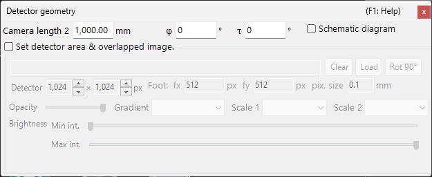

### Detector geometry settings

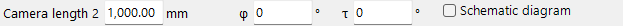

<!-- 261105Cl draft: コードから起こした修正・著者未査読 (根拠: FormDiffractionSimulatorGeometry.Designer.cs; FormDiffractionSimulatorGeometry.cs:FormDiffractionSimulatorGeometry_DragDrop) -->
Specify the reflection geometry: **Camera length 2** (mm, 1–10000, default 1000), and the detector tilt **τ** (−200 to 200°) about an in-plane axis at azimuth **φ**. For Back Laue (back-reflection Laue), set the geometry that places the detector on the source side here. Dropping a `.prm` file loads wavelength, camera length 2, τ, φ, foot position and pixel size from it.

### Detector area and overlapped image

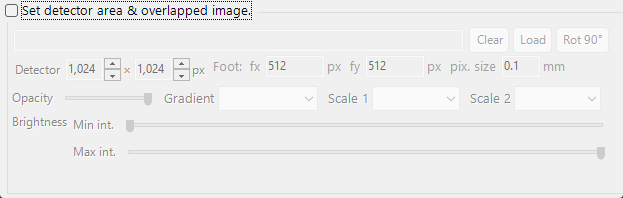

Tick **Set detector area & overlapped image.** to specify the detector: size in pixels (default 1024 × 1024), **pix. size** (mm, default 0.1) and the **Foot** position **fx, fy** (px, default 512, 512). An experimental image can be loaded (**Load** or drop) and overlaid with **Opacity**, **Gradient** (positive/negative film), **Scale 1** (log/linear), **Scale 2** (Gray / Cold-Warm / Spectrum / Fire), **Max/Min int.**, **Rot 90°** and **Clear**. **Schematic diagram** shows a sketch of the geometry. Use this to overlay the simulated pattern and an experimental image and fine-tune the detector geometry.

See also [Detector coordinate system](../appendix/a1-coordinate-system/2-diffraction.md) for the coordinate-system definitions.

---

## Dynamic compression

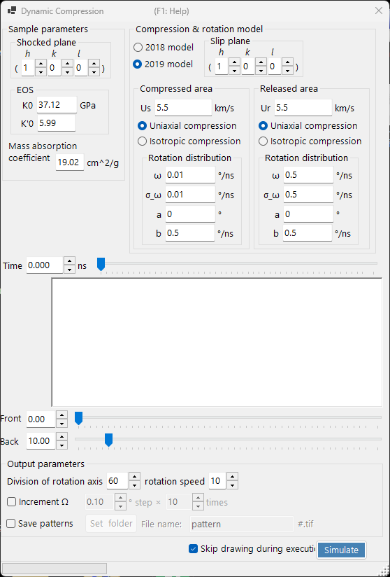

<!-- 261105Cl draft: コードから起こした修正・著者未査読 (根拠: FormDiffractionSimulatorDynamicCompression.cs:FormDiffractionSimulatorDynamicCompression_DragDrop, buttonPaste_Click, graphControl1_LinePositionChanged) -->
A window for simulating diffraction from a shock-compressed (dynamic-compression) sample. Drop a tab-separated `.txt` file with three columns (position, time, pressure) to load pressure profiles for each time; the **Time** slider (ns) selects the profile shown in the graph. The two vertical lines in the graph (**Front** / **Back**) can be dragged to set the compression front and back. The window also holds the compression model (**2018 / 2019 model**), shock velocities (**Us**, **Ur**, km/s), **EOS** (K0, K'0), **Shocked plane** / **Slip plane**, rotation distributions of the compressed and released areas, the mass absorption coefficient, the Ω stepping and **Save patterns** (`#.tif`), and runs with **Simulate**.

---

## ALCHEMI simulator

Opens a child window that computes **site-resolved ionization rocking curves**: the yield of a chosen ionization channel while the crystal is tilted through the Bragg conditions of a systematic row, resolved per atomic site. Open it from the **Options** menu. Unlike the CBED window it has its own output area and does not draw on the parent canvas.

→ See **[ALCHEMI Simulation](4-alchemi-simulation.md)** for every setting and for the scope and known limitations.

---

## Related topics

- [X-ray Diffraction Simulation](5-x-ray-neutron-diffraction.md)
- [SAED Simulation](1-saed-simulation.md)
- [PED Simulation](2-ped-simulation.md)
- [CBED Simulation](3-cbed-simulation.md)
- [ALCHEMI Simulation](4-alchemi-simulation.md)
- [Dynamical calculation (shared core)](../appendix/a3-bloch-wave/calculation.md)
- [Detector coordinate system](../appendix/a1-coordinate-system/2-diffraction.md)
