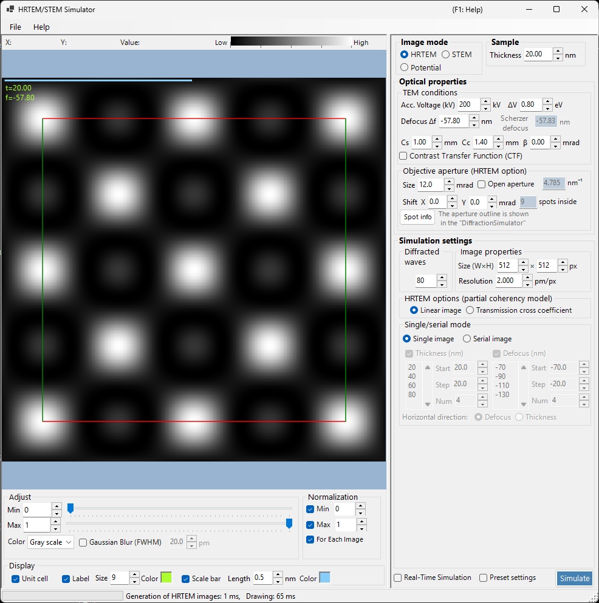
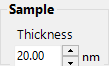
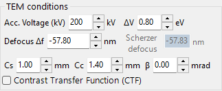
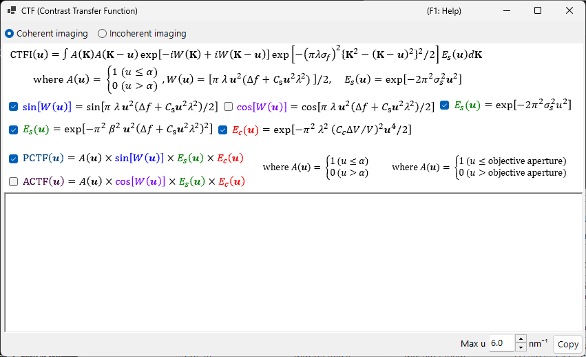
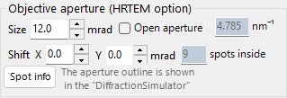
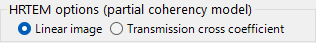
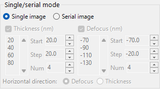
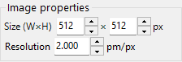
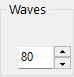

# HRTEM Simulation

**HRTEM (High-Resolution Transmission Electron Microscopy)** simulation calculates high-resolution TEM lattice-fringe images. It is the primary mode of the [HRTEM/STEM simulator](index.md).

> This page covers every setting that appears on the right side when **Image mode = HRTEM**. For the controls on the left side — displaying the result and adjusting its brightness — see the [overview page](index.md#display-settings).

---

## Overview

An HRTEM image is formed when the electron wave transmitted through the specimen is imaged under the influence of the objective-lens aberrations. ReciPro computes the propagation of the electron wave inside the specimen with the Bloch-wave method (dynamical calculation) and generates the HRTEM image through the phase-contrast transfer function (PCTF).

### Calculation flow

1. **Bloch-wave method**: compute the electron wave propagation in the crystal potential and obtain the amplitude and phase of the exit wave
2. **Lens function**: apply the objective-lens aberrations (spherical aberration $C_s$, defocus $\Delta f$)
3. **Partial coherence**: account for the finite source size (spatial coherence) and the energy fluctuation (temporal coherence)
4. **Image formation**: compute the intensity distribution $|\psi(\mathbf{r})|^2$

For the theory, see [Appendix A3.2 — HRTEM image formation](../appendix/a3-bloch-wave/hrtem.md).

---

## Sample

- **Thickness** : specimen thickness (nm). HRTEM images depend strongly on thickness. In **Serial image** mode this value is ignored and the thickness list described below is used instead.

---

## TEM conditions {#tem-conditions}

Sets the imaging conditions of the objective lens.

| Parameter | Description | Default / typical |
|-----------|-------------|-------------------|
| **Acc. Voltage (kV)** | Accelerating voltage. The relativistically corrected electron wavelength is shown to the right | 200 kV |
| **Defocus Δf** | Defocus of the objective lens (nm). The reference **Scherzer defocus** value is shown below it | −57.8 nm |
| **Cs** | Spherical aberration coefficient (mm). Affects the CTF and the Scherzer defocus. Negative values (−20 to 20 mm) are accepted | 1.0 mm (default); 0.5–1.0 (conventional), < 0.01 (Cs-corrected) |
| **Cc** | Chromatic aberration coefficient (mm). Determines the image blur caused by the energy spread | 1.4 mm (default); 1.0–2.0 mm |
| **β** | Illumination semi-angle (mrad). Represents the finite-source-size effect (spatial coherence) | 0 mrad (default); 0.1–1.0 mrad |
| **ΔV** | Full width at half maximum of the electron energy spread (eV). Together with Cc it determines the focus spread due to chromatic aberration | 0.8 eV (default); 0.5–2.0 eV |

<!-- 261105Cl draft: コードから起こした修正・著者未査読 (根拠: FormImageSimulator.cs:Cs/DeltaVol/Scherzer, FormCTF.cs:Renew, BetheMethod.cs:GetHRTEMImage) -->
The defaults above apply on first start only; afterwards the last-used values are restored. Internally ΔV (FWHM) is converted to a standard deviation $\sigma_V = \Delta V / (2\sqrt{2\ln 2})$ and the focus spread is $\delta = C_c\,\sigma_V / V$. The aberration function is

$$\chi(u) = \pi\lambda\,\Delta f\,u^2 + \tfrac{\pi}{2}\,C_s\lambda^3 u^4 ,$$

and each diffracted wave is multiplied by $\exp[-i\chi(u)]$, so **negative Δf is underfocus** (the convention in which the Scherzer defocus is negative).

<!-- 261105Cl draft: コードから起こした修正・著者未査読 (根拠: FormImageSimulator.cs:zeroAllToolStripMenuItem_Click / presets1ToolStripMenuItem_Click〜presets4) -->
> **Right-click menu**: on the TEM conditions panel you can apply **Set Defocus to 0 nm** / **Set defocus to Scherzer value** / **Set all aberrations to zero** with a single click (the last one sets Cs, Cc, β, ΔV **and the defocus** to 0). The same menu holds four microscope presets — *300kV Cold-FEG Cs-free (ARM300F)*, *200kV Schottky-FEG UHR (2100F)*, *200kV Schottky-FEG HR (2100F)* and *200kV LaB6 HR (2100)* — which set the accelerating voltage, Cs, Cc and ΔV as written in the item and then set the defocus to the Scherzer value (β is left unchanged). The **Preset settings** window at the lower left stores your own conditions (see [Preset list](index.md#preset-list)).

### Scherzer defocus

The defocus value near which the phase contrast is optimal, calculated from the current wavelength and spherical aberration $C_s$ (shown for reference). <!-- 261105Cl draft: コードから起こした修正・著者未査読 (根拠: FormImageSimulator.cs:Scherzer) -->For negative $C_s$ the displayed value is $+\sqrt{\tfrac{4}{3}|C_s|\lambda}$.

$$\Delta f_{\text{Scherzer}} = -\sqrt{\tfrac{4}{3}\,C_s \lambda}\quad\left(\approx -1.155\,\sqrt{C_s \lambda}\right)$$

Under this condition the PCTF is negative over a wide range of spatial frequencies, so atomic positions appear as dark contrast. ReciPro adopts this original Scherzer value (derived by setting the minimum of the aberration phase $\chi$ to $-2\pi/3$), and the value shown in the GUI follows this formula. Note that some references instead use the *extended Scherzer* value $-1.2\sqrt{C_s\lambda}$, which broadens the transfer band further.

---

## Lens function / Contrast Transfer Function (CTF)

Checking **Contrast Transfer Function (CTF)** opens a window that plots how the lens aberrations and defocus transfer the image contrast at each spatial frequency.

- $\sin\chi(u)$ : phase-contrast transfer function ($\chi(u)$ is the aberration function of the lens)
- $E_\text{s}(u)$ : spatial-coherence envelope function; the damping due to the finite source size ($\beta$)
- $E_\text{c}(u)$ : temporal-coherence envelope function; the damping due to the energy fluctuation ($C_c$, $\Delta V$)

<!-- 261105Cl draft: コードから起こした修正・著者未査読 (根拠: FormCTF.cs:Renew / ButtonCopyGraph_Click) -->
Each curve has its own checkbox: $\sin\chi$, $\cos\chi$, $E_\text{s}$, $E_\text{c}$, **PCTF** $=\sin\chi\,E_\text{s}E_\text{c}$ and **ACTF** $=\cos\chi\,E_\text{s}E_\text{c}$; PCTF and ACTF are set to zero outside the objective aperture. In HRTEM mode

$$E_\text{s}(u)=\exp\!\left[-\pi^2\beta^2u^2\left(\Delta f+C_s\lambda^2u^2\right)^2\right],\qquad E_\text{c}(u)=\exp\!\left[-\tfrac{1}{2}\pi^2\lambda^2\delta^2u^4\right].$$

**Max u** (nm⁻¹, default 6) sets the upper limit of the horizontal axis. **Copy** puts the plotted curves on the clipboard as tab-separated text. The window is also available in STEM mode (see [STEM simulation](2-stem-simulation.md#ctf-stem)); it is disabled in Potential mode.

---

## Objective aperture (HRTEM option)

<!-- 261105Cl draft: コードから起こした修正・著者未査読 (根拠: FormImageSimulator.cs:SimulateHRTEM, BetheMethod.cs:GetHRTEMImage / ExtractInsideBeams) -->
Restricts the diffracted waves that pass through the objective aperture. The Bloch-wave calculation itself always uses the number of waves set in **Diffracted waves**; the aperture then selects which of those beams contribute to the image (a beam passes when $|\mathbf{g}-\mathbf{c}| < 2\sin(\alpha_\text{obj}/2)/\lambda$, with $\mathbf{c}$ the aperture centre). If fewer than two beams pass, the calculation stops with a message asking you to enlarge the aperture.

- **Size** : semi-angle of the objective aperture (mrad, default 12). The smaller it is, the more high-angle diffracted waves are cut, and the smoother the high-resolution detail becomes. The equivalent reciprocal-space radius $\sin\theta/\lambda$ (nm⁻¹) is displayed.
<!-- 261105Cl draft: コードから起こした修正・著者未査読 (根拠: FormImageSimulator.cs:SimulateHRTEM, BetheMethod.cs:GetHRTEMImage (入射ベクトル k=(0,0) 固定)) -->
- **Shift X** / **Y** : shift of the objective-aperture center (mrad). Used for displaced-aperture dark-field imaging; the illumination itself is not tilted.
- **Open aperture** : opens the objective aperture (infinite), so that all diffracted waves are used for imaging.
- **spots inside** : the number of diffracted beams (spots) that fall inside the aperture (read-only).
- **Spot info** : opens a table listing the diffracted beams inside the aperture (intensity, complex amplitude, and so on).

> The size of the objective aperture is also shown in the **Diffraction Simulator**.

---

## HRTEM options (partial coherency model)

<!-- 261105Cl draft: コードから起こした修正・著者未査読 (根拠: BetheMethod.cs:GetHRTEMImage (入射方向は k=(0,0) の 1 方向のみ)) -->
Selects how partial coherence (β and the focus spread δ) is included. The exit wave is computed for a single incident direction (the beam axis); the illumination spread and energy spread enter only through the envelope functions below.

<!-- 261105Cl draft: コードから起こした修正・著者未査読 (根拠: BetheMethod.cs:GetHRTEMImage (quasiMode)) -->
- **Linear image** (quasi-coherent model) : computationally cheap. Each diffracted wave $\psi_g$ of the dynamical exit wave is multiplied by $\exp[-i\chi(g)]\,E_\text{s}(g)\,E_\text{c}(g)$ and the image is $\left|\sum_g\right|^2$. Accurate when the image is dominated by interference with the transmitted beam (thin specimens).
- **Transmission cross coefficient** : computationally expensive but more accurate. Every beam pair $(g,h)$ is summed with the mutual envelope (the full transmission cross coefficient), and is the model to use for strong scatterers that excite many strong diffracted waves. The cost grows as the square of the number of beams inside the aperture.

For details, see [Appendix A3.2 — HRTEM image formation](../appendix/a3-bloch-wave/hrtem.md).

---

## Single/serial mode

- **Single image** : calculates one HRTEM image at the current thickness and defocus.
- **Serial image** : generates a set of images with the thickness and defocus varied stepwise (a through-thickness / through-focus series). Useful for finding the condition that best matches an experimental image.

For a serial image, set the following.

| Item | Description |
|------|-------------|
| **Thickness (nm)** / **Defocus (nm)** | Which quantity to sweep (both are allowed) |
| **Start / Step / Num** | Start value, step width, and number of images. They are expanded into the list box below, which can also be edited directly |
| **Horizontal direction:** | When both thickness and defocus are swept, the quantity laid out along the horizontal direction of the grid (**Defocus** or **Thickness**) |

Sweeping both thickness and defocus produces a row × column matrix of images. <!-- 261105Cl draft: コードから起こした修正・著者未査読 (根拠: FormImageSimulator.Designer.cs:numericBoxThicknessNum / BuildPseudoGrid) -->**Num** is limited to 20 for each quantity. When only one quantity is swept and there are more than two images, the row is wrapped into a near-square grid.

---

## Image properties

- **Size (W×H)** : number of pixels of the simulated image (512×512 by default).
<!-- 261105Cl draft: コードから起こした修正・著者未査読 (根拠: BetheMethod.cs:GetHRTEMImage) -->
- **Resolution** : sampling resolution (pm/px, default 2). The field of view is Size × Resolution, so a smaller value samples the fringes more finely over a smaller area. The image is synthesised by a direct Fourier sum over the beams at every pixel (no FFT), so the computing time depends on the pixel count and the number of beams, not on this value.

---

## Diffracted waves

<!-- 261105Cl draft: コードから起こした修正・著者未査読 (根拠: FormImageSimulator.resx:groupBoxDiffractedWaves.Text) -->

- Maximum number of Bloch waves used in the Bethe method (dynamical calculation), 80 by default. A larger number improves accuracy, but the eigenvalue problem takes $O(N^3)$ time to solve.

---

## See also

- [HRTEM/STEM simulator (overview)](index.md)
- [STEM simulation](2-stem-simulation.md)
- [Potential simulation](3-potential-simulation.md)
- [Appendix A3.2 — HRTEM image formation](../appendix/a3-bloch-wave/hrtem.md)
