# STEM Simulation

**STEM (Scanning Transmission Electron Microscopy)** simulation computes scanning transmission electron microscopy images using the Bloch-wave method.

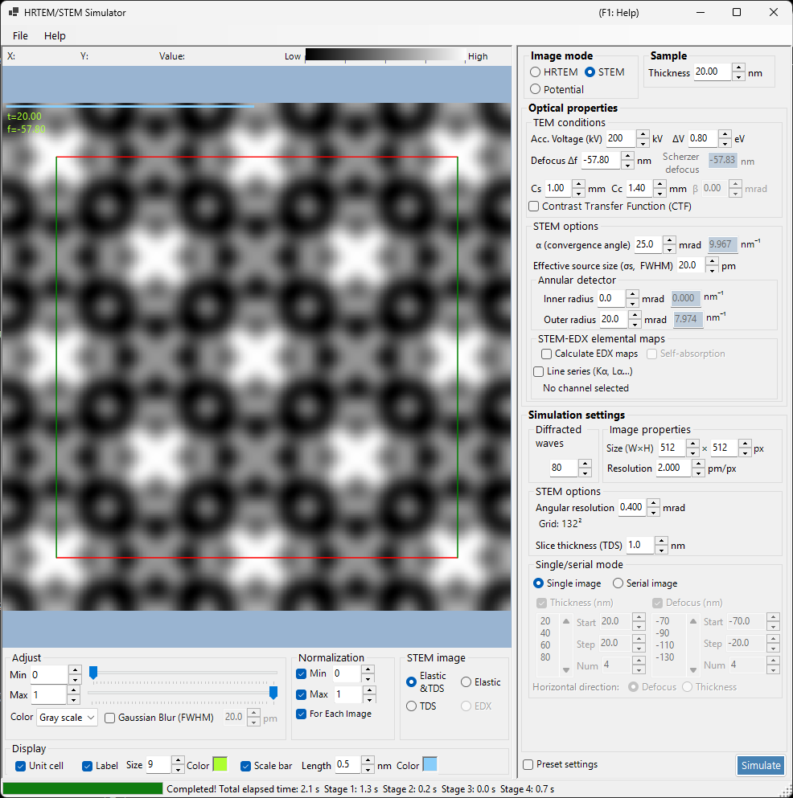

> This page lists every setting that appears on the right when **Image mode = STEM**. For the result display, brightness, and normalisation controls on the left, see the [overview page](index.md). Only the STEM-specific **display target** is repeated below.

---

## Overview

A convergent electron beam is scanned across the specimen, and the transmitted and scattered electrons at each scan position are collected by annular detectors. ReciPro computes the STEM image with the Bloch-wave method (dynamical calculation).

### Calculation flow

1. At each scan position, compute the diffracted intensities with the Bloch-wave method for every incident direction of the convergent probe.
2. Integrate the scattered intensity over the detector's angular range.
3. Both elastic and thermal-diffuse scattering (TDS) contributions can be computed.

See [Appendix A3.4 — STEM calculation](../appendix/a3-bloch-wave/stem.md) for the theory.

---

## Detector types

| Detector | Angle range | Main contribution | Contrast |
|----------|-------------|-------------------|----------|
| **BF** (bright field) | 0 – convergence angle | Elastic | Phase contrast |
| **ABF** (annular bright field) | Inner part of the convergence angle | Elastic | Light-element sensitive |
| **LAADF** (low-angle annular dark field) | Just outside the convergence angle | Elastic + TDS | Strain sensitive |
| **HAADF** (high-angle annular dark field) | Well outside the convergence angle | TDS (inelastic) | Z-contrast ($\propto Z^2$) |

> **Typical detector settings** (each available with one click from the right-click menu of the STEM options, all with convergence angle α = 25 mrad):
> BF (0–5 mrad) / ABF (12–24 mrad) / LAADF (26–60 mrad) / HAADF (80–250 mrad)

---

## Specimen parameters

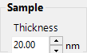

- **Thickness** : specimen thickness (nm). This value is ignored in **Serial image** mode.

---

## TEM conditions

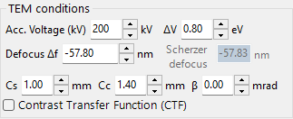

| Parameter | Description | Default / typical |
|-----------|-------------|-------------------|
| **Acc. Voltage (kV)** | Accelerating voltage. The relativistically corrected electron wavelength is shown alongside | 200 kV |
| **Defocus Δf** | Defocus of the objective (probe-forming) lens (nm) | −57.8 nm |
| **Cs** | Spherical aberration coefficient (mm). Affects the probe size | 0.5–1.0 mm |
| **Cc** | Chromatic aberration coefficient (mm) | 1.0–2.0 mm |
| **ΔV** | Full width at half maximum of the electron energy spread (eV) | 0.5–2.0 eV |

> **β (illumination semi-angle) is disabled in STEM mode**, because the convergence angle α takes its role. <!-- 261105Cl コードから起こした修正。別担当がコードと再照合済み (誤りは訂正) (根拠: BetheMethod.cs:RunSTEM Lenz) --> Defocus and Cs enter the probe through the same aberration function $\chi$ as in HRTEM (negative Δf = underfocus; see [HRTEM simulation](1-hrtem-simulation.md#tem-conditions)). The right-click menu of **TEM conditions** (zero aberrations, Scherzer defocus, microscope presets) works here too.

---

## STEM options (optical)

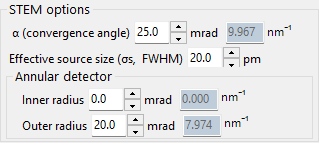

Set the geometry of the convergent probe and the annular detector. Each angle is also shown converted to a reciprocal-space radius $\sin\theta/\lambda$ (nm⁻¹) on the right.

| Parameter | Description | Default / typical |
|-----------|-------------|-------------------|
| **α (convergence angle)** | Semi-angle of the convergent probe (mrad). Larger values give a finer probe and change the diffraction contrast | 25 mrad (default); 15–25 mrad <!-- 261105Cl コードから起こした修正。別担当がコードと再照合済み (誤りは訂正) (根拠: FormImageSimulator.resx:numericBoxSTEM_*.HeaderText/FooterText/ToolTip, BetheMethod.cs:RunSTEM) --> |
| **Annular detector — Inner radius** | Inner collection semi-angle of the annular detector (mrad). Signal inside this angle is excluded | 0 (default); BF: 0, HAADF: 80 |
| **Annular detector — Outer radius** | Outer collection semi-angle of the annular detector (mrad). Signal outside this angle is excluded | 20 (default); BF: 5, HAADF: 250 |
| **Effective source size (σs, FWHM)** | Effective electron source size (pm). Applied after the calculation as a Gaussian convolution of every Elastic / TDS / EDX image. Larger values blur the image and reduce fine-detail contrast | 20 pm (default) |

The detector angles apply only to the STEM reference image (Elastic / TDS / Elastic & TDS); STEM-EDX maps do not use them. The defaults apply on first start only; afterwards the last-used values are restored.

---

## STEM options (simulation)

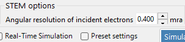

<!-- 261105Cl コードから起こした修正。別担当がコードと再照合済み (誤りは訂正) (根拠: FormImageSimulator.cs:StemProbeDivision / RenewProbeGridLabel, FormImageSimulator.resx:numericBoxSTEM_SliceThicknessForInelastic.HeaderText) -->
- **Slice thickness (TDS)** : specimen slice thickness (nm, default 1, range 0.1–10) used when computing the TDS (thermal-diffuse, inelastic) intensity. Smaller values are more accurate but slower.
- **Angular resolution** : angular sampling resolution of the incident probe directions (mrad, default 0.4). Smaller values sample the probe more finely but are slower. The probe directions form an $N\times N$ grid with $N=\lceil 2\times1.05\,\alpha/\Delta\alpha\rceil$, of which those inside a disk about 5 % larger than the convergence angle (a margin for interpolation) are computed; the count therefore grows as the square of $\alpha/\Delta\alpha$, so it is the main lever on calculation time. The line under the box shows the grid (for example `Grid: 132²`); see [Angular sampling of the probe](../appendix/a3-bloch-wave/stem.md#angular-sampling) for measured convergence.

---

## Image mode (single / serial)

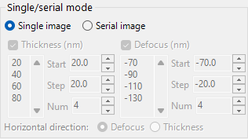

- **Single image** : compute one STEM image at the current thickness.
- **Serial image** : generate a series of images with thickness / defocus stepped in stages (set by **Start / Step / Num**; the list below can also be edited directly).

---

## Image property

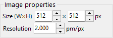

<!-- 261105Cl コードから起こした修正。別担当がコードと再照合済み (誤りは訂正) (根拠: BetheMethod.cs:RunSTEM (imageSize は I(Q) 計算後の実空間合成でのみ使用)) -->
- **Size (W×H)** : number of pixels in the scanned image (default 512×512). The eigen-solution and the $I(Q)$ calculation (Stages 1–4 in the status bar) do not depend on it; it only enters the final synthesis of the real-space image from the $I(Q)$ coefficients, whose cost is proportional to pixels × number of $Q$ vectors.
- **Resolution** : sampling resolution (pm/px).

---

## Diffracted waves

<!-- 261105Cl コードから起こした修正。別担当がコードと再照合済み (誤りは訂正) (根拠: FormImageSimulator.resx:groupBoxDiffractedWaves.Text) -->
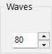

- Maximum number of Bloch waves used in the Bethe method (default 80). The eigenvalue-problem cost scales as the cube of the number of waves.

---

<!-- 261105Cl コードから起こした修正。別担当がコードと再照合済み (誤りは訂正) (根拠: FormCTF.cs:Renew / SetControl) -->
## Contrast Transfer Function (STEM) {#ctf-stem}

The **Contrast Transfer Function (CTF)** checkbox in **TEM conditions** opens the same CTF window as in HRTEM mode. In STEM mode it has two choices:

- **Coherent imaging** : plots $\sin\chi$, $\cos\chi$, $E_\text{s}$, $E_\text{c}$, PCTF and ACTF as in HRTEM, but $E_\text{s}(u)=\exp(-2\pi^2\sigma_s^2u^2)$ is taken from the effective source size ($\sigma_s$ = FWHM / $2\sqrt{2\ln2}$), and PCTF / ACTF are cut at the convergence angle.
- **Incoherent imaging** : plots the incoherent transfer function, computed by integrating the lens function over the overlap of two probe-forming apertures (192 × 192 sampling of the aperture) and multiplying by $\exp(-2\pi^2\sigma_s^2u^2)$.

<!-- screenshot: FormCTF in STEM mode, Incoherent imaging selected -->

---

## STEM display target (result side) {#stem-display-target}

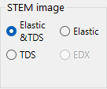

The display switch at the bottom-left of the window selects which scattering component of the already-computed STEM image to show (switchable without recomputing).

| Display target | Description |
|----------------|-------------|
| **Elastic** | Elastic-scattering only image |
| **TDS** | Thermal-diffuse-scattering only image |
| **Elastic & TDS** | Sum of elastic + TDS |
| **EDX** | Characteristic X-ray map. The line to show (for example `O-K`) is chosen in the combo box below, and **EDX: Common** in *Normalization* puts the channels of the same quantity (shell channels: vacancies; line series: X-ray photons) on one shared display range, so switching between them does not rescale the image |

!!! note
    All three images are reconstructed from the real part of the Fourier sum, so **Elastic & TDS** is exactly the sum of the other two. Versions up to 4.944 took the magnitude instead, which broke that identity and slightly brightened the dark pixels. See [Reconstructing a real image](../appendix/a3-bloch-wave/stem.md#real-image-reconstruction).

---

## STEM-EDX elemental maps {#stem-edx}

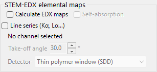

Tick **Calculate EDX maps** to compute characteristic X-ray maps alongside the ADF-type image. This is not a separate mode: the elastic, TDS and EDX signals all come out of the same STEM run, and you switch between them afterwards in [STEM image](#stem-display-target) without recomputing.

There is no element selector. When the checkbox is on, **every element/shell channel that can be calculated for this crystal at this accelerating voltage** is computed, and the line under the checkbox lists them (for example `3 map(s): O-K, Mg-K, Al-K`). A channel is available when the accelerating voltage is within 30–400 kV (the range of the shipped table), the ionisation edge lies below it and the shell is covered by the shipped data — K: C–Sn (Z = 6–50), L1–L3: Ca–Rn (Z = 20–86), M1–M3: Zn–Rn (Z = 30–86), M4–M5: As–Rn (Z = 33–86); the L and M channels add up the subshells that are present. The shipped table stores fully relativistic ionisation form factors for every channel out to a scattering vector of 16 Å⁻¹, or less at low accelerating voltages. Nothing is extrapolated: where the calculation needs a larger scattering vector than a row covers, the form factor is set to zero and the channel is marked ⚠ in the EDX combo box. If nothing is available the run is refused with an explanatory message rather than producing an empty map.

<!-- 261105Cl コードから起こした修正。別担当がコードと再照合済み (誤りは訂正) (根拠: FormImageSimulator.Designer.cs:flowLayoutPanel11 (labelEdxProbeGrid), FormImageSimulator.cs:RenewProbeGridLabel) -->
The probe direction grid is reported under **Angular resolution** in *STEM options (simulation)*; while **Calculate EDX maps** is ticked it adds the recommended division, for example `Grid: 132² (recommended: ≥48²)`. This grid is set by **Angular resolution** and the convergence angle; see [Angular sampling of the probe](../appendix/a3-bloch-wave/stem.md#angular-sampling). Below the recommended division the ±q Hermitian residual can exceed the tolerance and abort the run, so the value turns orange and a confirmation dialog appears before the calculation starts.

!!! warning "What the values are"
    For a shell channel (K, L, M) the map is the **number of inner-shell vacancies generated per incident electron**; no fluorescence yield is applied. For a line series (Kα, Kβ, Lα, Lβ, Mα), computed when **Line series (Kα, Lα…)** is ticked, it is the **number of X-ray photons generated per incident electron**, in all directions and before detection: fluorescence yield, Coster–Kronig and radiative cascades and line branching (xraylib 4.2.1) are applied; the Auger cascade is not. Both are model quantities, not predicted X-ray counts: self-absorption in the specimen, detector solid angle and detector efficiency are **not** applied. Use the maps for spatial distribution and for comparing thickness or orientation, not for absolute quantification.

### Detector parameters (reserved)

**Self-absorption**, **Take-off angle** and **Detector** are laid out but disabled: they belong to the detector model that is not implemented yet. They are shown so that the panel does not move when the model lands. Their eventual effect differs in kind:

| Factor | Pixel-to-pixel contrast in one map | Ratio between element maps |
|---|---|---|
| Self-absorption (take-off angle) | **changes it** | **changes it** |
| Detector window / dead layer / efficiency | no effect | **changes it strongly** |
| Detector solid angle, beam current, dwell time | no effect | no effect |

The last row is why ReciPro does not expose beam current or dwell time at all: they multiply every pixel of every map by the same number, cancel in any ratio, and are invisible after the display normalisation.

### Accuracy and cost

STEM-EDX places no extra limit on the wave count or the slice thickness: it runs through the same calculation paths as the ADF-type image, so whatever settings work for STEM work for EDX too.

Accuracy is left to you, exactly as it is for the wave count or the angular resolution. For reference, the depth-integration error grows roughly in proportion to **Slice thickness (TDS)** — about 2–3 % at 1 nm, 4–8 % at 2 nm and 12–23 % at 4 nm (peak-relative, SrTiO₃ at 39 nm). Halving the slice thickness roughly halves the error and roughly doubles the depth-integration work.

With aberrations set (for example Cs = 1 mm with Scherzer defocus at α = 25 mrad), the aberration phase oscillates quickly across the probe direction grid, and STEM-EDX may refuse to run with a *non-Hermitian residual* error even at a fine grid — the refusal protects the map from grid artefacts of a few per cent. Reduce Cs and defocus (the scan average of an EDX map does not depend on the aberrations at all), or make **Angular resolution** substantially finer and accept the longer run.

---

## Computational cost

STEM simulation is computationally expensive, so set the following parameters appropriately.

| Factor | Impact |
|--------|--------|
| **Convergence angle** | Larger → more CBED disk overlap → higher cost |
| **Bloch waves** | Eigenvalue-problem cost scales as N³ |
| **Angular resolution** | Finer → more accurate but cost scales as N² |
| **Image pixels (Size)** | <!-- 261105Cl コードから起こした修正。別担当がコードと再照合済み (誤りは訂正) (根拠: BetheMethod.cs:RunSTEM) --> Only the final real-space synthesis (pixels × number of $Q$ vectors); Stages 1–4 do not depend on it |

---

## Importance of the temperature factor

For HAADF-STEM simulation, atoms must have a non-zero isotropic temperature factor (Debye-Waller factor). If the value is unknown, set $B \approx 0.5\ \text{Å}^2$. With a zero temperature factor the TDS intensity is zero and the HAADF image is not computed correctly.

| Detector | Range | Main contribution |
|----------|-------|-------------------|
| BF, ABF | Inside the convergence angle | Elastic |
| LAADF, HAADF | Outside the convergence angle | Inelastic (TDS) |

---

## Comparison with Dr. Probe

ReciPro's STEM simulations have been confirmed to agree closely with the widely used Dr. Probe GUI (v1.10). The figure below compares the two for BF, ABF, LAADF and HAADF detectors over a thickness series (2.96–60.05 nm), both aberration-free (left) and with Cs = 0.2 mm, defocus = −25.9 nm (right). The two codes agree across all detector types and thicknesses.

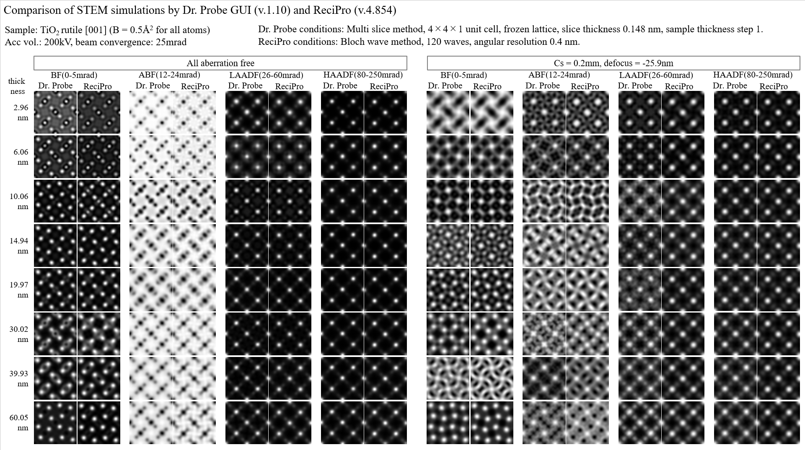

A more detailed report is available as a PDF: [Comparison of STEM simulations by Dr. Probe GUI (v1.10) and ReciPro (v4.854)](https://github.com/seto77/ReciPro/files/10976084/ComparisonSTEMsimulations.pdf).

---

## Comparison with py_multislice

ReciPro's STEM-EDX maps have also been checked against [py_multislice](https://github.com/HamishGBrown/py_multislice), an independent multislice / frozen-phonon code. The figure below compares O-K, Ti-K and Sr-L maps of SrTiO₃ [001] at 200 kV over a thickness series (3.91–62.48 nm), aberration-free (left) and with Cs = 0.2 mm, defocus = −25.9 nm (right).

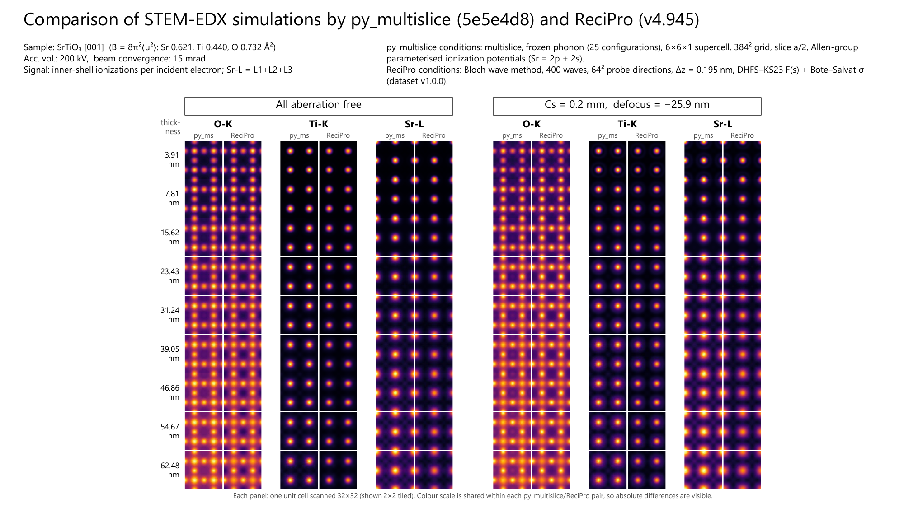

The normalised map shapes agree to 1–2 % for Ti-K and Sr-L in the thin limit. The **totals** differ by ±10–17 % because the two codes take their ionisation cross-sections from different sources (Bote–Salvat in ReciPro, the Allen-group tables in py_multislice). The ReciPro / py_multislice ratio also falls with thickness, because ReciPro's absorptive model removes thermally scattered electrons while frozen phonon keeps them ionising — which quantifies the practical error of the absorptive approximation for EDX.

The full report, including the quantitative curves and the spatial-frequency analysis, is available as a PDF: [Comparison of STEM-EDX simulations by py_multislice and ReciPro (v4.945, ionisation dataset v3.0.0)](../../assets/references/STEM_EDX_pyms_comparison.pdf).

---

## See also

- [HRTEM/STEM simulator (overview)](index.md)
- [HRTEM simulation](1-hrtem-simulation.md)
- [Potential simulation](3-potential-simulation.md)
- [Appendix A3.4 — STEM calculation](../appendix/a3-bloch-wave/stem.md)
