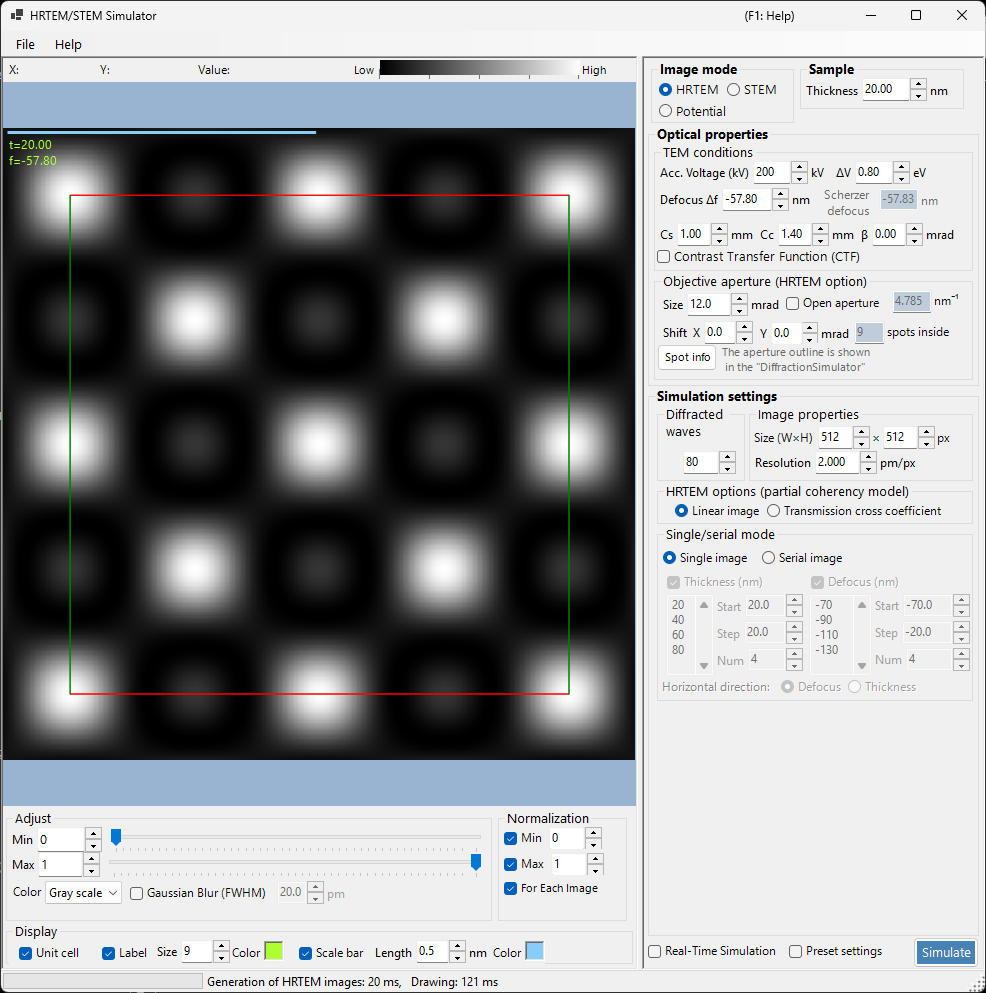
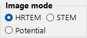
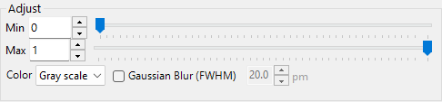
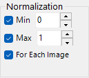
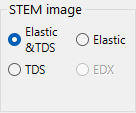
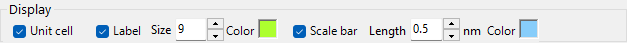
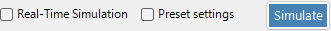
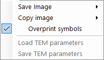
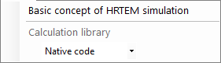

# HRTEM / STEM Simulator

The **HRTEM/STEM Simulator** simulates TEM lattice-fringe (HRTEM) images, STEM images, and projected crystal potentials for the selected crystal and orientation. Click **Simulate** to run.

The window is split into two halves. The **left side** displays the simulation result and controls its appearance (image panes, brightness, color, scale bar, and so on); the **right side** holds the calculation conditions (**Optical properties** and **Simulation settings**).

---

## This page and the mode pages

- **This page (overview)**: the operations common to every mode, together with the **result display and adjustment controls on the left side**.
- **Mode pages**: every setting that appears on the **right side** for that mode, covered so that each page is self-contained (some settings therefore appear on more than one page).

| Mode | Contents | Page |
|------|----------|------|
| **HRTEM** | High-resolution TEM lattice-fringe images | [HRTEM simulation](1-hrtem-simulation.md) |
| **STEM** | Scanning transmission electron microscope images (BF / ABF / LAADF / HAADF) | [STEM simulation](2-stem-simulation.md) |
| **Potential** | Projected crystal potential ($U_g$ / $U'_g$) | [Potential simulation](3-potential-simulation.md) |

---

## Keyboard & mouse shortcuts

Results are shown as one or more image panes. They use ReciPro's standard [image-view navigation](../21-shortcuts.md), and all panes pan and zoom together.

| Shortcut | Action |
|----------|--------|
| <kbd>F1</kbd> | Open this page of the online manual |
| <kbd>CTRL</kbd>+<kbd>C</kbd> (image grid focused) | Copy the image(s) to the clipboard as a metafile |
| Left-drag / Middle-drag | Pan the image (all panes move together) |
| Mouse wheel up / down | Zoom in (×2) / out (×0.5) at the cursor |
| Right-drag a box | Zoom in to the selected region |
| Right-click / Right double-click | Zoom out (×0.5) |
| <kbd>CTRL</kbd> + Right-drag a box | Select a rectangular area |
| Left double-click a pane | Maximize that pane / restore the grid (multi-pane layouts) |
| Move the mouse (no button) | Read the position (pm) and pixel value at the cursor |

→ See **[21. Keyboard & mouse shortcuts](../21-shortcuts.md)** for every window at a glance.

---

## Quick routes by goal

| Goal | Start from | Reference |
|------|------------|-----------|
| Calculate one HRTEM image | Set **Image mode** to **HRTEM**, then set the accelerating voltage and defocus in **TEM conditions** | [HRTEM simulation](1-hrtem-simulation.md), [HRTEM image formation](../appendix/a3-bloch-wave/hrtem.md) |
| Calculate a STEM image | Set **Image mode** to **STEM**, then set the convergence angle and detector in **STEM options** | [STEM simulation](2-stem-simulation.md), [STEM calculation](../appendix/a3-bloch-wave/stem.md) |
| View the projected potential | Set **Image mode** to **Potential** | [Potential simulation](3-potential-simulation.md) |
| Generate a thickness / defocus series | In HRTEM, configure **Single/serial mode** and the image conditions | [HRTEM simulation](1-hrtem-simulation.md) |
| Use HAADF-STEM with TDS | Set non-zero atomic temperature factors and move the STEM detector to LAADF / HAADF | [STEM calculation](../appendix/a3-bloch-wave/stem.md) |

---

## Basic workflow

1. Select the crystal and orientation in the main window, then open this window.
2. Choose HRTEM, STEM, or Potential in **Image mode**.
3. Set the accelerating voltage, defocus, aberrations, aperture, STEM convergence angle, and so on in **Optical properties** (see the mode pages).
4. Set the thickness, image size, resolution, Bloch-wave count, partial-coherence model, and so on in **Simulation settings** (see the mode pages).
5. Click **Simulate**, then tune the appearance with **Adjust**, **Normalization**, and **Display** on the left as needed.

---

## Selecting the image mode

{ align=left }

**Image mode** at the top right selects the kind of calculation. The panels on the right (**Optical properties** and **Simulation settings**) change to match the mode you choose.

- **HRTEM** — high-resolution TEM lattice-fringe images → [HRTEM simulation](1-hrtem-simulation.md)
- **STEM** — scanning transmission electron microscope images → [STEM simulation](2-stem-simulation.md)
- **Potential** — projected crystal potential → [Potential simulation](3-potential-simulation.md)

---

## Image area (left side)

The left half of the window shows the simulated image. The status bar across the top reports the cursor position (**X:**, **Y:**) and the image **Value:** (intensity) under the cursor, next to a **Low → High** intensity scale that reflects the current color map and brightness range.

When several images are produced (a serial image, or the magnitude/phase of a potential) they are tiled in a grid, and all panes zoom and pan together.

---

## Displaying and adjusting results (left panel) {#display-settings}

The panel at the lower left adjusts how the result looks — brightness, color, normalization, and overlays. These apply to every mode and take effect without recalculating.

### Adjust

- **Min** / **Max** : lower (black) and upper (white) ends of the displayed intensity range. Use the trackbars to adjust the contrast.
- **Color** : color scale of the image — **Gray scale** or **Cold-warm** (blue to red).
- **Gaussian blur (FWHM)** : when checked, applies a Gaussian blur with the full width at half maximum (pm) given on the right, approximating a finite resolution (point-spread function). While it is checked, newly calculated images are blurred as well. The FWHM is converted to pixels with the **Resolution** (pm/px) each image was calculated with. <!-- 261105Cl 監査: FormImageSimulator.cs:ApplyGaussianBlur -->

### Normalization

- **For each image** : when checked, normalizes each image separately (when unchecked, the whole series shares a common scale).
- **Min** / **Max** : fixes the lower / upper end of the normalization to the value given on the right instead of the minimum / maximum of the image.
- **EDX: common** : shown only while an [EDX map](2-stem-simulation.md#stem-edx) is displayed and the run produced more than one channel; puts all channels of the same quantity on one display range. EDX maps are never rescaled by **Min** / **Max**: their lower end is fixed at 0 and only the upper end follows **For each image** / **EDX: common**. <!-- 261105Cl コードから起こした修正。別担当がコードと再照合済み (誤りは訂正) (根拠: FormImageSimulator.cs:FillEdxGrid / RadioButtonHRTEM_CheckedChanged) -->
- This group is hidden in Potential mode.

### STEM image

Shown in STEM mode only. Selects which scattering component of the calculated STEM image is displayed (**Elastic**, **TDS**, or **Elastic & TDS**). When the run also computed [STEM-EDX maps](2-stem-simulation.md#stem-edx), **EDX** is available as a fourth choice. Because it is specific to STEM, it is also described on the [STEM simulation](2-stem-simulation.md) page.

### Display

Sets the items overlaid on the image.

- **Unit cell** : overlays the outline of the projected unit cell, so you can relate the image contrast to the crystal lattice. <!-- 261105Cl コードから起こした修正。別担当がコードと再照合済み (誤りは訂正) (根拠: FormImageSimulator.cs:drawSymbols) --> The edges parallel to **a**, **b** and **c** are drawn in red, green and blue, centred on the image centre.
- **Label** : overlays the label of each pane — the thickness `t=` and defocus `f=` (nm) in HRTEM / STEM, or the pane name (for example *Ug magnitude*) in Potential mode. **Size** (font size) and **Color** can be specified. <!-- 261105Cl コードから起こした修正。別担当がコードと再照合済み (誤りは訂正) (根拠: FormImageSimulator.cs:BuildPseudoGrid / simulatePotential) -->
- **Scale bar** : overlays a scale bar. **Length** (nm) and **Color** can be specified.

---

## Running the simulation

- **Simulate** : runs the calculation with the current crystal, microscope conditions, thickness, defocus, and display settings.
- **Stop** : aborts the running calculation (shown only while calculating).
- **Real-time simulation** : when checked, recalculates immediately as the crystal is rotated (hidden in STEM mode).
- **Preset settings** : toggles the preset window, which stores and recalls TEM imaging conditions (see [Preset list](#preset-list) below).

<!-- 261105Cl コードから起こした修正。別担当がコードと再照合済み (誤りは訂正) (根拠: FormPresets.cs:buttonAdd_Click ほか / ImageSimulatorSetting) -->
### Preset list {#preset-list}

<!-- screenshot: Preset list window (FormPresets) with a few entries -->

The **Preset list** window keeps named snapshots of the simulator settings. A snapshot stores the image mode, accelerating voltage, Cs, Cc, ΔV, defocus, β, objective aperture (size and shift), HRTEM partial-coherence model, thickness, the single/serial mode, which quantities a series sweeps (thickness / defocus) with their **Start / Step / Num**, the serial thickness / defocus lists, image size and resolution, number of Bloch waves, and the STEM settings (convergence angle, detector angles, source size, slice thickness, angular resolution, **Calculate EDX maps** and **Line series (Kα, Lα…)**). The list is saved with ReciPro's settings and survives a restart. Presets saved by earlier versions do not hold the single/serial settings; applying them leaves those settings unchanged. <!-- 261105Cl 監査: FormPresets.cs ImageSimulatorSetting (SerialImageMode ほか) -->

- Clicking an entry applies it immediately.
- **OK** closes the window and keeps the current settings; **Cancel** (or <kbd>Esc</kbd>) closes it and restores the settings that were in effect when the window was opened.
- **Manage the preset list** : when checked, clicking an entry only selects it (it is not applied) and the **Name** box with **Add** / **Replace** / **Rename** / **Delete** appears. **Add** appends the current settings under the given name, **Replace** overwrites the selected entry in place with the current settings and the name in the **Name** box, **Rename** changes only its name.

The microscope presets (ARM300F, 2100F, …) are not in this list; they are in the right-click menu of **TEM conditions** (see [HRTEM simulation](1-hrtem-simulation.md#tem-conditions)).

---

## File menu

<!-- 261105Cl コードから起こした修正。別担当がコードと再照合済み (誤りは訂正) (根拠: FormImageSimulator.cs:Save / FormImageSimulator.resx: loadTEMParameterToolStripMenuItem.Enabled=False) -->
- **Save image** : save as **as image (PNG format)**, **as image (TIFF format)**, or **as metafile (EMF)**. PNG and EMF save what is displayed (display range and color scale); **Save individually for serial image mode** (on by default) writes each pane to its own file instead of one tiled image. TIFF always writes one floating-point file per pane, without overlays. It stores the pixel values after **Normalization** (and after **Gaussian blur (FWHM)** if applied), not the **Adjust** display range; with the defaults (**Min** 0, **Max** 1, **For each image**) each image is scaled to 0–1, so uncheck **Min** / **Max** to export the computed intensities. EDX maps are always written unscaled.
- **Copy image** : copy to the clipboard **as image** or **as metafile (EMF)**.
- **Overprint symbols** (on by default) : burns the unit cell, labels, and scale bar into the saved or copied PNG / EMF image.
- **Load TEM parameters** / **Save TEM parameters** : read or write the simulator settings as an XML file (`*.rpis`). The file holds the same items as a [preset](#preset-list) — image mode, accelerating voltage, aberrations, defocus, objective aperture, thickness and the single/serial settings, image size and resolution, STEM settings and so on — so conditions can be kept or shared between computers. Items missing from a file (for example one written by an older version) are set to the window's initial values and unknown items are ignored; a file that cannot be read is reported with a message. Loading does not recalculate the image. <!-- 261106Cl 作者の決定 E7: FormPresets.cs ImageSimulatorSetting.SaveXml/LoadXml -->

## Help menu

- **Basic concept of HRTEM simulation** : opens the explanation of HRTEM image formation ([Appendix A3.2](../appendix/a3-bloch-wave/hrtem.md)).

The calculation library is no longer chosen in this window: the HRTEM image synthesis uses the native library (C++/Eigen) automatically when it is available. To stop using it, turn on **Options ▸ Disable Crystallography.Native library (requires restart)** in the [main window](../0-main-window.md). <!-- 261106Cl 作者の決定 E12: 計算ライブラリの切替を廃止 -->

---

## See also

- [HRTEM simulation](1-hrtem-simulation.md)
- [STEM simulation](2-stem-simulation.md)
- [Potential simulation](3-potential-simulation.md)
- [Dynamical diffraction (Bloch-wave)](../appendix/a3-bloch-wave/index.md)
- [Diffraction simulator](../7-diffraction-simulator/index.md)
- [Electron trajectory](../8-electron-trajectory.md)
