# Ventana principal

Al iniciar ReciPro, aparece la ventana principal. Desde esta ventana selecciona el cristal, controla su rotación e invoca diversas funciones.

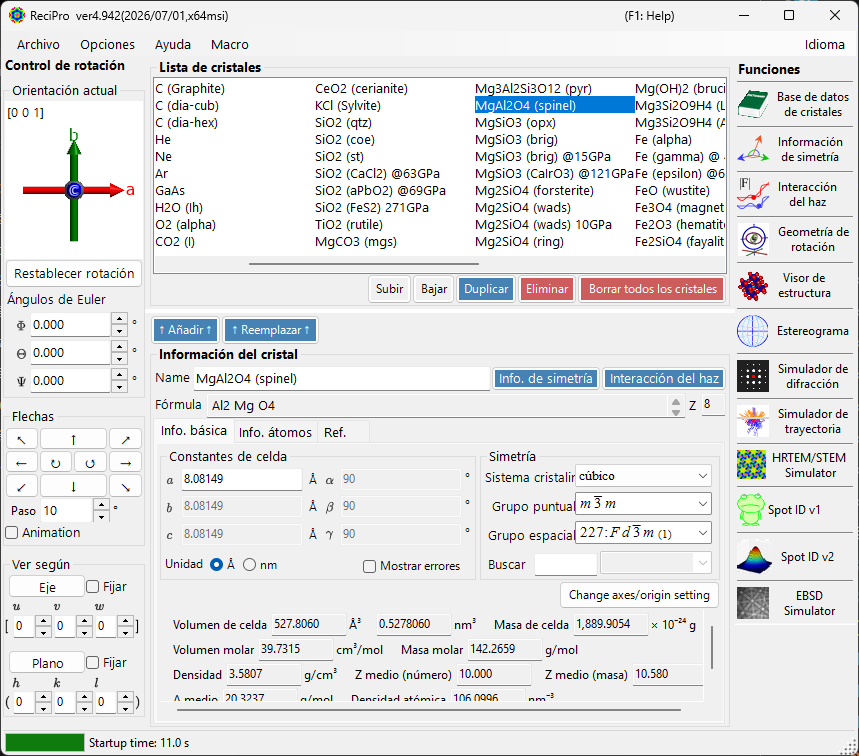

| Área | Posición | Descripción |
|------|----------|-------------|
| **Menú Archivo** | Arriba | Operaciones de archivo, opciones, ayuda |
| **Control de rotación** | Izquierda | Ver/establecer la orientación del cristal |
| **Lista de cristales** | Centro superior | Seleccionar y gestionar cristales |
| **Información del cristal** | Centro inferior | Editar parámetros de red, simetría, átomos |
| **Funciones** | Derecha | Iniciar ventanas de simulación/análisis |

---

## Atajos de teclado y ratón {#keyboard-mouse-shortcuts}

La ventana principal instala varios atajos **de ámbito global de la aplicación**. Siguen funcionando mientras las ventanas Visor de estructura, Estereograma, Simulador de difracción y Spot ID v1 tienen el foco.

| Atajo | Acción |
|----------|--------|
| <kbd>F1</kbd> | Abrir esta página del manual en línea |
| <kbd>CTRL</kbd>+<kbd>SHIFT</kbd> + teclas de flecha | Rotar el cristal un paso en esa dirección (mantenga dos flechas para una diagonal) |
| Mantener <kbd>CTRL</kbd> mientras ReciPro arranca | Iniciar con OpenGL desactivado (recuperación ante problemas gráficos; solo para ese inicio, no se guarda) |
| Arrastrar con el botón izquierdo el widget de orientación (abajo a la izquierda, bajo *Orientación actual*) | Rotar el cristal |
| Doble clic derecho sobre el widget de orientación | Copiar la imagen del widget al portapapeles |
| Un solo clic sobre un botón de función | Abrir / cerrar esa ventana (si la ventana está minimizada, se restaura en lugar de cerrarse) |
| Doble clic sobre un botón de función | Forzar que la ventana se muestre y traerla al frente |
| Clic derecho sobre un cristal de la lista | Menú contextual (Cambiar nombre / Exportar como CIF / Duplicar / Eliminar) |
| Doble clic sobre la etiqueta del índice de eje de zona (`[u v w]`, bajo *Orientación actual*) | Mostrar / ocultar el cuadro max-UVW |
| Soltar un archivo sobre la ventana | Cargar una lista de cristales (`.xml`, `.out`; pregunta si se reemplaza o se añade a la lista actual) o un cristal (`.cif`, `.amc`) <!-- 261105Cl 監査: .cdb2 はドロップで読めないので外した (FormMain.cs:FormMain_DragDrop) --> |
| <kbd>CTRL</kbd>+<kbd>SHIFT</kbd>+<kbd>ALT</kbd>+<kbd>C</kbd> | Abrir la herramienta (experimental) de captura de la GUI para la ventana activa |

→ Consulte **[21. Atajos de teclado y ratón](21-shortcuts.md)** para ver todas las ventanas de un vistazo.

---

## Flujo de trabajo básico

Si utiliza ReciPro por primera vez, siga estos pasos:

1. Seleccione el cristal deseado en la **Lista de cristales**. Para usar un archivo CIF/AMC, arrástrelo y suéltelo en **Información del cristal**.
2. Si edita parámetros de red o posiciones atómicas, pulse **Añadir** o **Reemplazar** para que los cambios se escriban de vuelta en la lista de cristales.
3. Establezca la orientación del cristal en el **Control de rotación** mediante un eje de zona, un plano cristalino, ángulos de Euler o arrastrando con el ratón.
4. Abra la herramienta deseada desde **Funciones**. Las ventanas de cálculo de difracción, HRTEM/STEM, EBSD y otras utilizan el cristal y la orientación seleccionados actualmente.

---

## Menú Archivo

### Archivo

| Elemento del menú | Descripción |
|-----------|-------------|
| Cargar lista de cristales (reemplazar lista actual) | Cargar un archivo de lista de cristales (`*.xml`, `*.out`) y reemplazar la lista actual; un diálogo permite elegir qué cristales se cargan |
| Cargar lista de cristales (añadir a la lista actual) | Cargar un archivo de lista de cristales y añadirlo a la lista actual (con el mismo diálogo de selección) |
| Restablecer a la lista de cristales inicial | Recargar la lista de cristales incluida con ReciPro |
| Importar cristal desde un archivo CIF o AMC | Cargar un único cristal desde un archivo CIF / AMC |
| Guardar lista de cristales | Guardar la lista de cristales actual (un diálogo permite elegir qué cristales se escriben) |
| Exportar el cristal seleccionado como archivo CIF | Guardar el cristal seleccionado en formato CIF |
| Borrar todos los cristales | Eliminar todos los cristales de la lista |
| Salir | Cerrar la aplicación |

### Opciones

| Elemento del menú | Descripción |
|-----------|-------------|
| Mostrar descripciones emergentes | Mostrar u ocultar las descripciones emergentes en todas las ventanas — las de los controles, de los elementos de la barra de herramientas y de los menús, de las celdas de las tablas y de las pestañas; el ajuste se conserva para el próximo inicio <!-- 261106Cl 作者の決定 C9 --> <!-- 261106Cl 作者の決定 A20 --> |
| Modo oscuro | Alternar entre el tema de color claro y oscuro |
| Usar índices de Miller-Bravais (hkil) | Usar la notación de 4 índices para los sistemas trigonal/hexagonal en toda la aplicación |
| Usar factores de dispersión iónicos | Usar factores de dispersión de electrones iónicos (Peng) para los iones asignados a los átomos en los cálculos dinámicos de electrones (ondas de Bloch), incluidos los perfiles de Kikuchi; el término monopolar de $g \neq 0$ se añade solo a los coeficientes elásticos $U_g$ (la absorción TDS y la fuente TDS de Kikuchi usan la parte iónica finita). Si no está marcada, se usan factores de átomos neutros. Si la celda elemental no es eléctricamente neutra ($\Sigma q \neq 0$), se omite el término monopolar y solo se usa la parte finita (ion apantallado); al activar la opción se muestra un aviso |
| Descargar biblioteca MKL | Descargar la biblioteca nativa Intel MKL (~55 MB); una vez instalada se usa automáticamente en cálculos grandes |
| Accept external macro commands (named pipe) | Escuchar en la canalización con nombre `ReciPro.Macro.v1` y ejecutar macros enviadas por programas externos — véase [Control externo](20-macro/3-external-control.md) |
| Restablecer configuración del registro al salir (efectivo tras reiniciar) | Restablecer los ajustes en el próximo reinicio |
| Desactivar biblioteca Crystallography.Native (requiere reinicio) | Recurrir al código administrado si la biblioteca nativa (C++) no se puede cargar |
| Desactivar todo el renderizado OpenGL (requiere reinicio) | Para GPU antiguas / escritorio remoto |
| Desactivar renderizado de texto OpenGL (requiere reinicio) | Solución alternativa para problemas de representación de texto en algunas GPU |
| Capturar componentes de la GUI... | Herramienta de desarrollador para guardar capturas de pantalla de la GUI |
| Función de difracción de polvo (en desarrollo) | Habilitar la ventana de difracción policristalina (de polvo) |

### Ayuda

| Elemento del menú | Descripción |
|-----------|-------------|
| Buscar actualizaciones | Comprobar si hay una nueva versión de ReciPro disponible e instalarla |
| Sugerencias | Mostrar sugerencias de uso (obsoleto) |
| Historial de versiones | Abrir el diálogo de historial de versiones |
| Licencia | Mostrar la licencia MIT |
| Repositorio de GitHub | Abrir el repositorio de ReciPro en el navegador |
| Informar de errores, peticiones o comentarios | Abrir la página de GitHub Issues |
| Ayuda (web) | Abrir el manual en línea en GitHub Pages, en la página que coincide con el idioma de la interfaz |

El idioma de la interfaz se cambia desde el menú independiente **Idioma** (requiere reinicio).

### Idioma

Cambiar el idioma de la interfaz. Hay once idiomas disponibles — English, 日本語, Deutsch, Français, Español, Português, Italiano, Русский, 简体中文, 繁體中文 y 한국어 — cada uno mostrado en su propia escritura. El cambio surte efecto tras reiniciar ReciPro. El manual en línea sigue la misma configuración, de modo que <kbd>F1</kbd> y **Ayuda ▸ Ayuda (web)** abren la página en el idioma elegido.

### Macro

**Editor** abre la ventana [Macro](20-macro/index.md) para automatizar operaciones de ReciPro con scripts de estilo Python. Las macros registradas en esa ventana también aparecen debajo de **Editor**; al elegir una, se ejecuta directamente. Para flujos de trabajo repetidos, consulte las [funciones integradas](20-macro/1-built-in-functions.md) y los [ejemplos de macros](20-macro/2-examples.md).

---

## Control de orientación del cristal

El estado de rotación del cristal es compartido por el simulador de difracción, el Visor de estructura, el Estereograma, el simulador HRTEM/STEM, el simulador EBSD y otras ventanas. No es solo un ajuste de vista: define la dirección del haz incidente y la relación de coordenadas del cristal utilizada por las simulaciones. Hay un breve tutorial en vídeo disponible en la página [Cómo usar](appendix/a0-how-to-use.md).

### Orientación actual

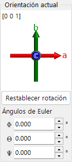

Muestra la orientación del cristal. Arrastre para rotar. Ejes: rojo = *a*, verde = *b*, azul = *c*.

### Restablecer rotación
Restablece al estado inicial: eje *c* perpendicular a la pantalla, eje *b* hacia arriba.

### Eje de zona
Muestra el eje de zona [*uvw*] más cercano a la normal de la pantalla. Los candidatos son los índices irreducibles (mcd = 1) con $|u|+|v|+|w| \le$ el límite del cuadro max-UVW (1–100, por defecto 30); haga doble clic en la etiqueta del índice para mostrar u ocultar ese cuadro.

### Ángulos de Euler (Z-X-Z)
Establezca la orientación del cristal con los ángulos de Euler **Z–X–Z**:

- \(\Phi\): rotación en torno al eje Z
- \(\Theta\): rotación en torno al eje X
- \(\Psi\): rotación en torno al eje Z

Las rotaciones se aplican en el orden \(\Psi \to \Theta \to \Phi\). Consulte [Geometría de rotación](4-rotation-geometry.md) y [Apéndice A1. Sistema de coordenadas](appendix/a1-coordinate-system/1-orientation.md) para más detalles.

### Flechas

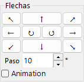

Rota por el ángulo **Paso** (por defecto 10°). ↺ / ↻ rotan en torno a la normal de la pantalla. Active **Animation** para una rotación continua; **Paso** pasa entonces a ser una velocidad en °/s.

### Ver según

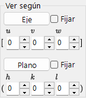

Alinea un eje de zona [*uvw*] o un plano cristalino (*hkl*) perpendicular a la pantalla.

- **Fijar**: cuando está marcada, todas las rotaciones posteriores (flechas, arrastre con el ratón) se realizan en torno al eje de zona o la normal del plano especificados, de modo que esa dirección permanece fija. Solo puede estar activa una de las dos casillas **Fijar**, y no se puede marcar mientras el índice sea 0 0 0.
- **Eje**: coloca el eje de zona introducido \([uvw]\) perpendicular a la pantalla. Si además se establece **Plano** y el eje está contenido en ese plano ($uh+vk+wl=0$), la normal del plano apunta hacia arriba en la pantalla; en caso contrario, la dirección hacia arriba se elige automáticamente.
- **Plano**: coloca la normal del plano cristalino introducido \((hkl)\) perpendicular a la pantalla. Si además se establece **Eje** y está contenido en el plano ($uh+vk+wl=0$), ese eje apunta hacia arriba en la pantalla; en caso contrario, la dirección hacia arriba se elige automáticamente.

### Formas básicas de establecer la orientación

| Método | Usar cuando | Dónde |
|--------|----------|-------|
| Arrastrar con el ratón | Desea rotar libremente mientras observa los ejes del cristal. | Panel **Orientación actual** |
| Botones de flecha | Desea rotaciones pequeñas y repetibles. | Panel **Flechas** |
| Eje de zona | Conoce la dirección de visualización, como \([001]\) o \([110]\). | **Ver según** / entrada de eje de zona |
| Normal del plano | Desea un plano cristalino \((hkl)\) normal a la pantalla. | **Ver según** / entrada de plano |
| Ángulos de Euler | Necesita una orientación numérica reproducible. | **Ángulos de Euler (Z-X-Z)** |

Consulte [Geometría de rotación](4-rotation-geometry.md) y [Apéndice A1. Sistemas de coordenadas](appendix/a1-coordinate-system/1-orientation.md) para las matrices de rotación y las convenciones de coordenadas.

---

## Lista de cristales

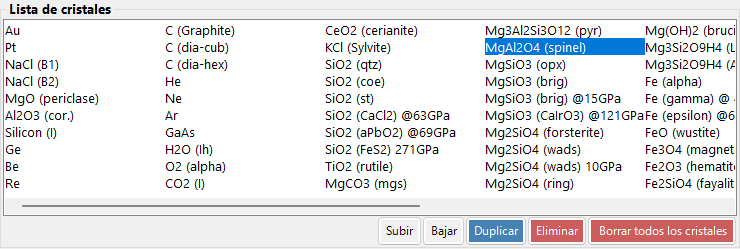

66 cristales en la instalación predeterminada. Seleccione uno para ver sus detalles y establecerlo para los cálculos. **Haga clic derecho sobre un cristal** en la Lista de cristales para un menú contextual: *Cambiar nombre*, *Exportar como CIF*, *Duplicar*, *Eliminar*.

| Botón | Acción |
|--------|--------|
| Subir / Bajar | Reordenar |
| Duplicar | Copiar el cristal seleccionado |
| Eliminar / Borrar todos los cristales | Eliminar el cristal seleccionado / todos los cristales |
| Añadir / Reemplazar | Añadir a la lista o reemplazar la entrada seleccionada |

---

## Información del cristal

Edite los parámetros de red, la simetría y los átomos; arrastre y suelte archivos CIF/AMC para cargar una estructura. Este control es compartido por ReciPro, PDIndexer y CSManager, pero las pestañas y funciones mostradas difieren según la aplicación. ReciPro muestra las pestañas **Info. básica**, **Info. átomos** y **Ref.** (las pestañas EOS, Elasticity y otras son para las demás aplicaciones y no se muestran en ReciPro).

> **Importante**: Pulse **Añadir** o **Reemplazar** para guardar los cambios.

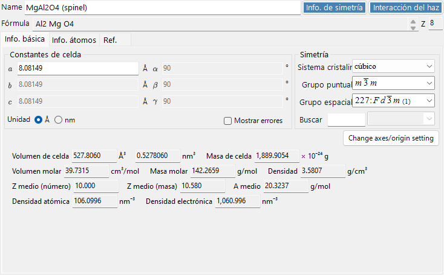

La parte superior del panel siempre muestra **Name** (nombre del cristal), **Fórmula** (fórmula química, calculada a partir de la lista de átomos), **Z** (número de unidades fórmula por celda elemental) y **Color** (el color de visualización del cristal, usado en la vista 3D de la estructura y en las curvas de perfiles de difracción). Los botones **Info. de simetría** e **Interacción del haz** abren las ventanas [Información de simetría](2-symmetry-information.md) e [Interacción del haz](3-beam-interaction.md). Para el % en peso, el % atómico y la conversión a óxidos, haga clic derecho y elija [Detalles de la composición química](#chemical-composition).

### Pestaña Info. básica {#basic-info-tab}

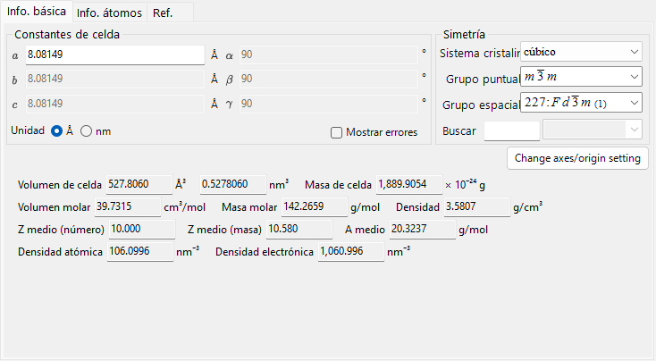

Parámetros de red, simetría y magnitudes derivadas de ellos.

| Elemento | Descripción |
|------|------|
| Constantes de celda | Parámetros de red a, b, c (**Unidad**: Å = 10⁻¹⁰ m o nm; la unidad se conserva para el próximo inicio) y α, β, γ. La elección de una simetría los restringe automáticamente (p. ej., a=b=c, α=β=γ=90° para cúbico). |
| Simetría | Elija el **Sistema cristalino**, el **Grupo puntual** y el **Grupo espacial**. Escriba en el cuadro **Buscar** para listar los candidatos coincidentes (distingue mayúsculas y minúsculas). |
| Volumen de celda / Masa de celda | Volumen y masa de la celda elemental. El volumen se muestra en ų / nm³ según la selección de **Unidad**; la masa, en 10⁻²⁴ g. |
| Volumen molar / Masa molar / Densidad | Volumen molar (cm³/mol, por unidad fórmula), masa molar (g/mol) y densidad (g/cm³). Se muestran **solo cuando se han introducido átomos**. |
| Z medio (número) / Z medio (masa) / A medio | Número atómico medio ponderado por número y por masa, y peso atómico medio por átomo (g/mol). Se tienen en cuenta las ocupaciones. |
| Mostrar errores | Muestra los campos de error (±) de las constantes de celda. |
| Change axes/origin setting | Igual que el elemento **Cambiar la configuración de ejes/origen** del menú contextual: convierte a otra configuración de ejes/origen del mismo grupo espacial. |
| Densidad atómica / Densidad electrónica | Número de átomos y de electrones por volumen de celda, mostrados en Å⁻³ / nm⁻³ según la selección de **Unidad**. |

### Pestaña Info. átomos {#atom-tab}

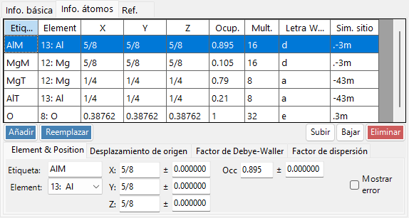

Establezca la especie, posición, factor de temperatura y factor de dispersión de cada átomo. Edite la lista de átomos con **Añadir**, **Reemplazar** (reemplazar la fila seleccionada), **Subir/Bajar** (reordenar) y **Eliminar**. La lista de átomos muestra también, para cada sitio, su multiplicidad (**Mult.**), la letra de Wyckoff (**Letra Wyck.**) y la simetría del sitio (**Sim. sitio**). Cada átomo tiene:

| Elemento | Descripción |
|------|------|
| Etiqueta | Etiqueta del átomo (cualquier identificador). |
| Element | Elemento (incluida la valencia iónica). |
| X, Y, Z | Coordenadas fraccionarias (0–1). Pueden introducirse fracciones como 1/2 o 2/3. |
| Occ | Ocupación (0–1). |

Haga clic con el botón derecho en una fila de átomo y elija **Mostrar posiciones atómicas equivalentes** para abrir una pequeña ventana que enumera todas las posiciones generadas por las operaciones de simetría del grupo espacial; su botón **Copiar** copia la lista como texto separado por tabulaciones (p. ej. para pegarla en una hoja de cálculo).

**Desplazamiento de origen**: desplaza el origen de todas las coordenadas atómicas. Elija el signo con **+** / **−** y pulse uno de los vectores predefinidos — (⅛ ⅛ ⅛), (¼ ¼ ¼), (0 ¼ ⅛), (¼ 0 ¼), (0 ¼ ¼), (¼ ¼ 0), (¼ −¼ 0), (¼ −¼ ¼), (0 ¼ −⅛) — o use **Apply custom shift** para una cantidad arbitraria.

**Desplazamiento (B)** (factor de Debye–Waller / de temperatura):

| Elemento | Descripción |
|------|------|
| Notation | Usar la notación U o B. Al cambiar, los valores mostrados se convierten ($B = 8\pi^2 U$). |
| Modelo | Isótropo (**Isotropía**) o anisótropo (**Anisotropía**). |
| U##, β## | Para el caso anisótropo, introduzca cada componente: $U_{ij}$ en Ų, o en la notación B las $\beta_{ij} = 2\pi^2 a^*_i a^*_j U_{ij}$ adimensionales (igual que B(i,j) en los archivos de AMCSD). |

**Factor de dispersión**: elija el factor de dispersión utilizado para cada átomo.

| Radiación | Fuente / ajuste |
|-----------|------|
| Rayos X | Factores de dispersión incluida la valencia iónica (International Tables for Crystallography, Vol. C). |
| Electrones | Factores de dispersión de electrones: átomos neutros según Peng, Ren, Dudarev & Whelan (1996), *Acta Cryst.* **A52**, 257–276; iones según Peng (1998), *Acta Cryst.* **A54**, 481–485. |
| Neutrones | Longitudes de dispersión de neutrones. Elija **Natural isotope abundance** o **Custom isotope abundance** (una composición isotópica arbitraria). |

### Pestaña Ref. {#reference-tab}

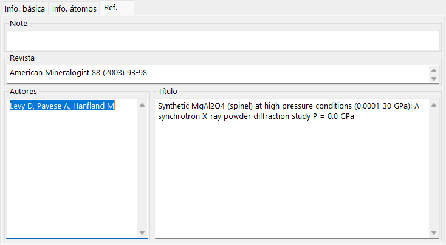

Registre la fuente de la estructura: **Note**, **Autores**, **Revista** y **Título**.

### Menú contextual (clic derecho)

Haga clic derecho en un área vacía del control para estas acciones principales:

| Elemento del menú | Acción |
|-----------|------|
| Detalles de la composición química | Abre la ventana [Detalles de la composición química](#chemical-composition) (% en peso, % atómico, número de átomos normalizado, conversión a óxidos). |
| Interacción del haz | Abre la ventana [Interacción del haz](3-beam-interaction.md). |
| Información de simetría | Abre la ventana [Información de simetría](2-symmetry-information.md). |
| Importar desde CIF o AMC... | Carga un cristal desde un archivo CIF / AMC. |
| Exportar a CIF | Exporta el cristal actual como CIF. |
| Revertir constantes de celda | Restaura las constantes de celda a los valores cargados inicialmente. |
| Convertir al grupo espacial P1 | Expande la estructura al grupo espacial P1. |
| Convertir en una superestructura | Convierte en una superestructura con múltiplos enteros de a, b, c (diálogo de tamaño). |
| Cambiar la configuración de ejes/origen | Convierte en un grupo espacial equivalente (una configuración de ejes diferente). |

#### Detalles de la composición química {#chemical-composition}

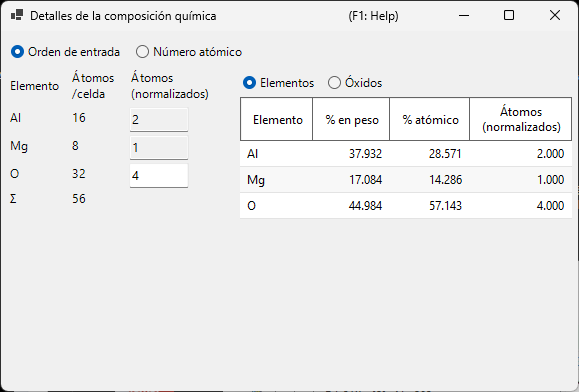

Muestra la composición del cristal actual, calculada a partir de la lista de átomos (el número de átomos de cada elemento es la suma de multiplicidad × ocupación en sus sitios). La ventana sigue al cristal seleccionado en la ventana principal.

- La tabla de la derecha muestra **% en peso**, **% atómico** y **Átomos (normalizados)** de cada elemento; la tabla de la izquierda muestra los átomos por celda. Haga clic en una casilla de la columna normalizada de la tabla izquierda para tomar ese elemento como referencia y escriba su número de átomos (p. ej., O = 24). Por defecto la referencia es O (o el primer elemento) y la columna normalizada muestra la fórmula química.
- **Óxidos**, **Haluros** y **Sulfuros** (solo se muestran los aplicables al cristal) convierten formalmente la composición en componentes usando la **Valencia** de cada elemento. Las valencias se pueden editar (se admiten fracciones como 8/3). Si no se introducen, Fe vale 2, los demás elementos toman la valencia del ion elegido para el factor de dispersión de rayos X o, si no, un estado de oxidación habitual. **Σ=0** pone la valencia que anula la carga total y **Restablecer** borra las valencias introducidas. Las valencias introducidas se guardan con el cristal y en las listas de cristales XML.
- **Orden de entrada** / **Número atómico** cambian el orden de los elementos.

---

## Panel de funciones {#functions}

La tira vertical de botones de la derecha inicia las ventanas de análisis y simulación que se enumeran a continuación.

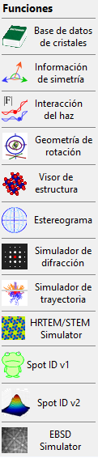

| Botón | Descripción | Detalles |
|--------|-------------|---------|
| Base de datos de cristales | Buscar e importar cristales desde las bases de datos integradas / en línea | [1. Base de datos de cristales](1-crystal-database.md) |
| Información de simetría | Información del grupo espacial y diagramas de simetría de las *International Tables* Vol. A | [2. Información de simetría](2-symmetry-information.md) |
| Interacción del haz | Interacción haz-cristal: reflexiones, atenuación, factores de dispersión, fluorescencia | [3. Interacción del haz](3-beam-interaction.md) |
| Geometría de rotación | Matriz de rotación 3D / ángulos del goniómetro | [4. Geometría de rotación](4-rotation-geometry.md) |
| Visor de estructura | Estructura cristalina 3D | [5. Visor de estructura](5-structure-viewer.md) |
| Estereograma | Proyección estereográfica | [6. Estereograma](6-stereonet.md) |
| Simulador de difracción | Difracción de rayos X / electrones de monocristal | [7. Simulador de difracción](7-diffraction-simulator/index.md) |
| Simulador de trayectoria | Simulación Monte-Carlo de trayectorias electrónicas | [8. Trayectorias electrónicas](8-electron-trajectory.md) |
| Simulador HRTEM/STEM | Simulación de imágenes HRTEM / STEM | [9. Simulador HRTEM/STEM](9-hrtem-stem-simulator/index.md) |
| Spot ID v1 | Indexación de patrones SAED (antes "TEM ID") | [10. Spot ID v1](10-spot-id.md) |
| Spot ID v2 | Detección e indexación de reflexiones | [11. Spot ID v2](11-spot-id-v2.md) |
| Simulador EBSD | Simulación de patrones EBSD | [12. Simulación EBSD](12-ebsd-simulation.md) |
| Difracción de polvo | Difracción policristalina (de polvo) — habilítela mediante **Opciones ▸ Función de difracción de polvo (en desarrollo)** | - |

---

## Véase también

- [Base de datos de cristales](1-crystal-database.md)
- [Geometría de rotación](4-rotation-geometry.md)
- [Visor de estructura](5-structure-viewer.md)
- [Simulador de difracción](7-diffraction-simulator/index.md)
- [Atajos de teclado y ratón](21-shortcuts.md)
- [Sistema de coordenadas básico y orientación del cristal](appendix/a1-coordinate-system/1-orientation.md)
