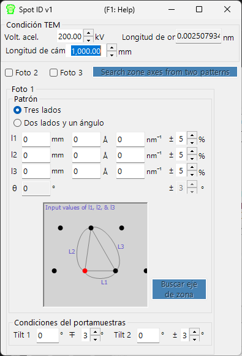

# Spot ID v1

**Spot ID v1** (el antiguo **TEM ID**) busca ejes de zona candidatos a partir de la geometría de reflexiones, introducida numéricamente, de uno a tres patrones de difracción. La detección, el ajuste y la indexación de reflexiones sobre una imagen se realizan en [Spot ID v2](11-spot-id-v2.md).

---

## Atajos de teclado y ratón

Spot ID v1 toma la geometría de las reflexiones como **entrada numérica** (el antiguo flujo de trabajo *TEM ID*); no tiene vista de imagen (la carga de imágenes, el zoom con el ratón, la detección de reflexiones y la selección manual de reflexiones pertenecen a [Spot ID v2](11-spot-id-v2.md)). El único atajo se encuentra en la ventana de resultados:

| Atajo | Acción |
|----------|--------|
| <kbd>F1</kbd> | Abrir esta página del manual en línea |
| Doble clic en una fila de la lista de resultados | Seleccionar ese cristal y rotarlo al eje de zona correspondiente |

→ Consulte **[21. Atajos de teclado y ratón](21-shortcuts.md)** para ver de un vistazo todas las ventanas.

---

## Búsqueda de eje de zona a partir de la geometría de reflexiones (antiguo TEM ID)

Cuando no dispone de una imagen para cargar, todavía puede buscar ejes de zona candidatos introduciendo a mano la geometría de un patrón de difracción de electrones de área seleccionada (SAED). Introduzca las condiciones de observación TEM y la geometría de las reflexiones, y luego pulse **Buscar eje de zona** de una foto (o **Search zone axes from two/three patterns** para usar varias fotos a la vez) para encontrar orientaciones cristalinas candidatas.

### Condición TEM

Introduzca **Volt. acel.** (kV, por defecto 200) y **Longitud de cámara** (mm, por defecto 1000). La **Longitud de onda** (nm) se calcula a partir del voltaje y se muestra como solo lectura.

### Foto 1, 2, 3

Introduzca la geometría de las reflexiones de difracción.

- Para introducir la distancia entre reflexiones en el detector, use la casilla **mm**.
- Si conoce el valor *d*, introdúzcalo en unidades **Å** o **nm⁻¹**.

**Modo Tres lados** : Introduzca las longitudes de los tres lados de un triángulo cuyo vértice es el direct spot.

**Modo Dos lados y un ángulo** : Introduzca las longitudes de dos lados (incluyendo el direct spot) y el ángulo entre ellos.

- Tolerancias (las casillas **±**) : cada longitud tiene una tolerancia en % (0–50, por defecto 5) y θ, en grados (0–30, por defecto 3). El valor que no se introduce (θ en el modo de tres lados, l3 en el modo de dos lados) se calcula y se muestra, y junto a las entradas se dibuja un esquema del patrón resultante.
- **Condiciones del portamuestras** : **Tilt 1** / **Tilt 2** (°) del portamuestras goniométrico con los que se tomó la foto, cada uno con una tolerancia (0–10°, por defecto 3°). Se calculan y muestran los ángulos entre los ajustes del portamuestras de las distintas fotos.
- **Foto 2** / **Foto 3** : habilitan la segunda y la tercera foto. Las casillas situadas entre las fotos tratan l1 (o l2) de dos fotos como la misma reflexión y copian su longitud.
- **Buscar eje de zona** busca en una sola foto; **Search zone axes from two patterns** / **from three patterns** busca combinaciones coherentes con todas las fotos habilitadas y con los ángulos de inclinación del portamuestras entre ellas. La búsqueda recorre todos los cristales seleccionados en la lista de la ventana principal (la selección múltiple está habilitada mientras Spot ID v1 está abierto). Si se encuentran más de 1000 candidatos, no se lista nada y se le pide que restrinja las condiciones; en caso contrario se abre la ventana de resultados. Haga doble clic en una fila para seleccionar el cristal y rotarlo a esa orientación.

---

## Véase también

- [Spot ID v2](11-spot-id-v2.md)
- [Simulador de difracción](7-diffraction-simulator/index.md)
- [Ventana principal](0-main-window.md)
- [Base de datos de cristales](1-crystal-database.md)
- [Simulación EBSD](12-ebsd-simulation.md)
