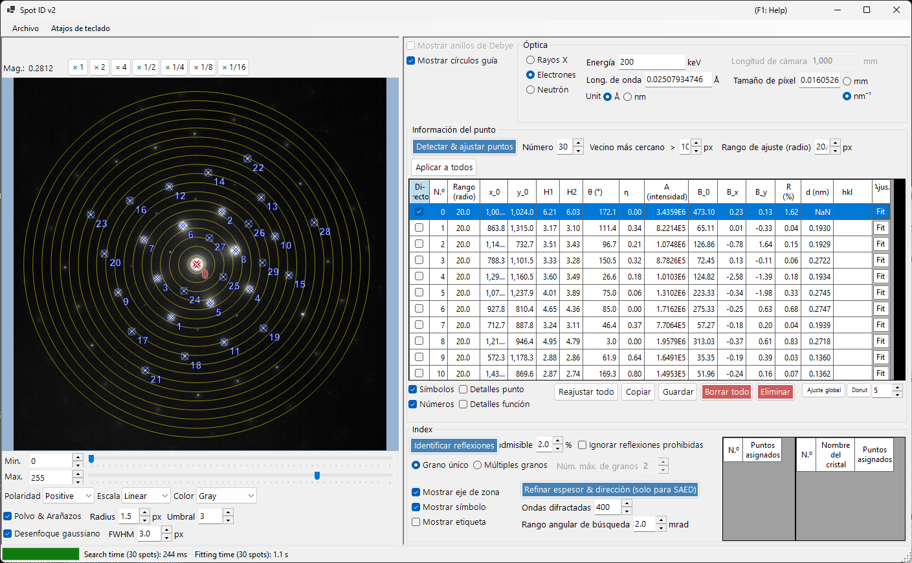
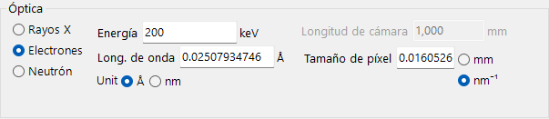
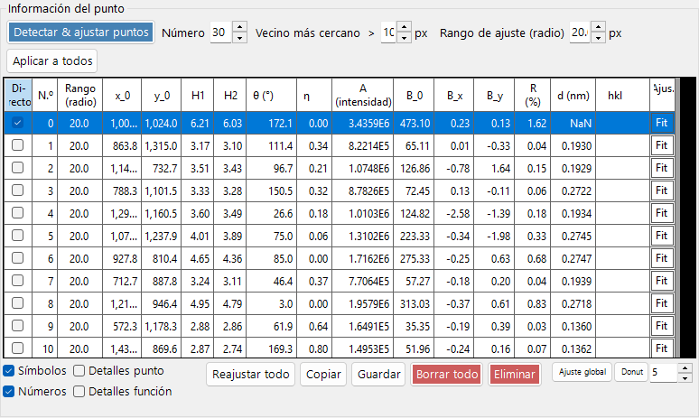
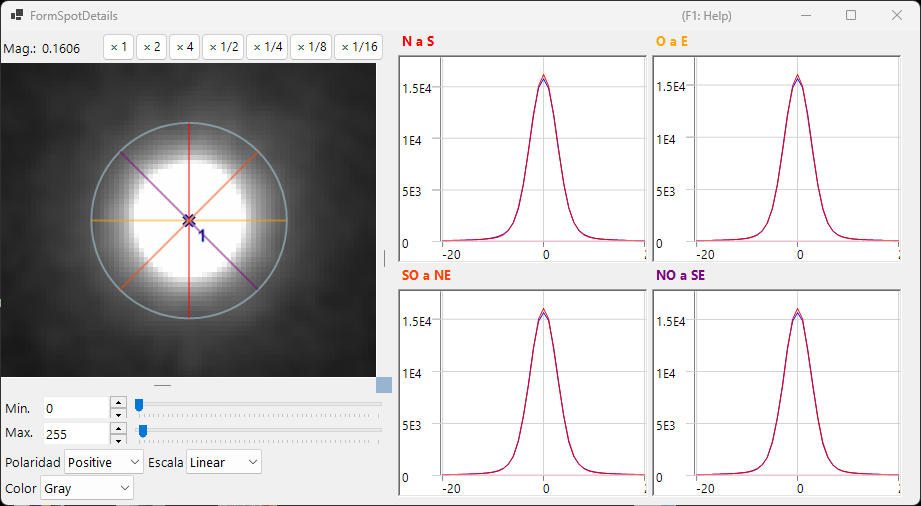
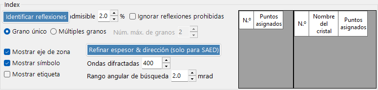

# Spot ID v2

**Spot ID v2** detecta, ajusta e indexa reflexiones de difracción sobre una imagen experimental de difracción. [Spot ID v1](10-spot-id.md) (el antiguo TEM ID), en cambio, toma la geometría de las reflexiones como entrada numérica.

---

## Atajos de teclado y ratón

La lista de reflexiones se construye directamente sobre la imagen cargada. El panel de imagen utiliza la [navegación de vista de imagen](21-shortcuts.md) estándar de ReciPro para desplazar/hacer zoom; para la edición de reflexiones se añaden las combinaciones siguientes.

| Atajo | Acción |
|----------|--------|
| <kbd>F1</kbd> | Abrir esta página del manual en línea |
| Doble clic izquierdo sobre la imagen | Añadir una reflexión en ese punto (con ajuste de pico) |
| <kbd>CTRL</kbd> + doble clic izquierdo | Añadir una reflexión y marcarla como el haz directo (000) |
| Clic izquierdo sobre una reflexión | Seleccionar la reflexión más cercana |
| <kbd>CTRL</kbd> + clic derecho sobre una reflexión | Eliminar la reflexión más cercana |
| <kbd>CTRL</kbd> + teclas de flecha | Desplazar la reflexión seleccionada un píxel |
| Arrastrar con izquierdo / con central (área vacía) | Desplazar la imagen |
| Rueda del ratón | Acercar/alejar el zoom en el cursor |
| Arrastrar con derecho un recuadro | Acercar el zoom a la región seleccionada |
| Doble clic derecho | Alejar el zoom |
| Doble clic en el encabezado de fila de una reflexión (tabla) | Hacer zoom a esa reflexión (×2) |

→ Consulte **[21. Atajos de teclado y ratón](21-shortcuts.md)** para ver todas las ventanas de un vistazo.

---

## Menú Archivo

Abrir una imagen de difracción; **Guardar** / **Copiar** escriben la imagen mostrada como Metafile (EMF) o como imagen (PNG). Las imágenes también pueden cargarse arrastrando y soltando. En el caso de un archivo DM3/DM4 de Gatan calibrado en nm⁻¹, la radiación se establece en electrones y el voltaje de aceleración y el tamaño de píxel (nm⁻¹) se leen del archivo (en ese caso no se necesita la longitud de cámara).

**Guardar ▸ Candidate list (CSV)...** exporta los candidatos de orientación hallados por la indexación y **Copiar ▸ Candidate list (TSV)** coloca la misma tabla en el portapapeles: una fila por candidato × grano, con el rango, el índice del grano, el nombre del cristal, los ángulos de Euler ZXZ (°), los nueve elementos de la matriz de rotación, el residuo cuadrático medio (nm⁻²), el número de puntos asignados y las asignaciones punto → (hkl). El CSV usa siempre el punto como separador decimal; el TSV se pega directamente en una hoja de cálculo.

---

## Óptica

### Fuente incidente

Seleccione el tipo de radiación (rayos X / electrones / neutrones) y ajuste la energía o la longitud de onda.

### Longitud de cámara / Tamaño de píxel

La longitud de cámara (mm) y el tamaño de píxel del detector (mm o nm⁻¹). Cuando se carga un archivo DM de Gatan calibrado en nm⁻¹, el tamaño de píxel (nm⁻¹) se lee del encabezado del archivo y la longitud de cámara no se utiliza.

**Mostrar anillos de Debye** (desactivado por defecto) y **Mostrar círculos guía** (activado por defecto) dibujan sobre el patrón los anillos de Debye del cristal y círculos guía.

---

## Información de la reflexión

- **Detectar & ajustar puntos**: Detección automática de reflexiones mediante máximos locales y sustracción del fondo.
- **Número**: El número máximo de reflexiones que se detectarán.
- **Vecino más cercano**: La separación mínima (px) permitida entre reflexiones detectadas. Los picos más cercanos que este valor se fusionan, evitando la doble detección de la misma reflexión.
- **Rango de ajuste (radio)**: El radio (px) de la región circular utilizada para ajustar el pico de cada reflexión. Los píxeles dentro de este círculo se ajustan con una función pseudo-Voigt.
- **Aplicar a todos**: Establece el radio de ajuste de todas las reflexiones al valor actual de **Rango de ajuste (radio)**.
- **Eliminar / Borrar todo**: Eliminar la reflexión seleccionada o todas las reflexiones detectadas.
- **Guardar** / **Copiar**: Guardar la tabla de reflexiones en un archivo o copiarla al portapapeles.
- **Reajustar todo**: Vuelve a ajustar las posiciones e intensidades de todas las reflexiones detectadas.
- **Símbolos** / **Números**: Muestran símbolos / números sobre las reflexiones observadas (ambos activados por defecto).
- **Ajuste global**: Realiza a la vez un ajuste global de las posiciones de todas las reflexiones (experimental).
- **Donut**: Aplica una sustracción de fondo en forma de anillo (experimental); el cuadro contiguo establece la anchura (px) del anillo alrededor de cada reflexión cuyo promedio se resta como fondo local.
- **Detalles punto**: Cuando está activado, se abre una ventana que muestra información detallada sobre la reflexión seleccionada actualmente.
- **Detalles función** (desactivado al abrir la ventana): Muestra una figura de la función pseudo-Voigt bidimensional y sus parámetros (x_0, y_0, H1, H2, θ, η, A, B_0, B_x, B_y) utilizados en la tabla de reflexiones.

---

## Index

- **Identificar reflexiones**: Ejecuta el algoritmo de indexación para encontrar el cristal y el eje de zona que mejor coinciden.
- **Error admisible**: Tolerancia relativa del espaciado interplanar, en % (0.1–10, por defecto 2). La tolerancia angular entre reflexiones se deriva de ella como asin(tolerancia)/2.
- **Ignorar reflexiones prohibidas** (desactivado por defecto; solo difracción de electrones): Cuando está activado, todas las reflexiones sistemáticamente ausentes, incluidas las prohibidas por ejes helicoidales y planos de deslizamiento, se excluyen de las reflexiones candidatas. Cuando está desactivado, solo se excluyen las ausencias debidas al centrado de la red (I, F, A, B, C, R), de modo que las reflexiones prohibidas por ejes helicoidales o planos de deslizamiento que pueden aparecer por difracción múltiple siguen siendo candidatas. Para rayos X siempre se excluyen todas las reflexiones ausentes.
- **Grano único / Múltiples granos**: Buscar una única orientación (monocristal) o varias orientaciones (una región policristalina / multigrano). Para varios granos, **Núm. máx. de granos** establece el límite superior del número de granos que se buscarán.
- **Mostrar eje de zona** / **Mostrar símbolo** / **Mostrar etiqueta**: Superponen el eje de zona y los símbolos / etiquetas de índices de las reflexiones calculadas.
- **Refinar espesor & dirección (solo para SAED)**: Refina el espesor de la muestra (nm) y la dirección del haz del grano seleccionado comparando las intensidades observadas de las reflexiones con cálculos dinámicos (ondas de Bloch). **Ondas difractadas** (1–2048, por defecto 400) es el número de haces, y **Rango angular de búsqueda** (mrad, 1–10, por defecto 2) es el semirrango angular de las direcciones de incidencia exploradas. **Detener** interrumpe el cálculo.
- **Results**: Las mejores coincidencias se muestran con el nombre del cristal, el eje de zona [uvw] y los índices individuales de las reflexiones (hkl).

---

## Véase también

- [Spot ID v1](10-spot-id.md)
- [Simulador de difracción](7-diffraction-simulator/index.md)
- [Ventana principal](0-main-window.md)
- [Atajos de teclado y ratón](21-shortcuts.md)
