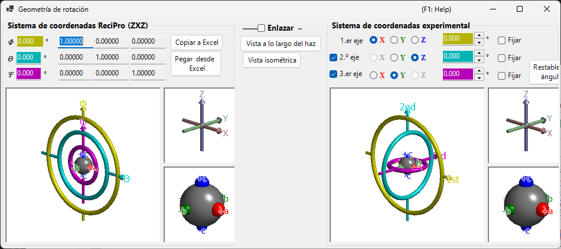

# Geometría de rotación

Esta ventana representa el estado de rotación de un cristal como una matriz 3×3 y convierte entre distintos sistemas de coordenadas eulerianos.

ReciPro utiliza tres ángulos de Euler — **Ψ**, **Θ** y **Φ** — aplicados en el orden **Z–X–Z**. Sin embargo, esta convención no coincide necesariamente con los ejes del goniómetro de su instrumento real. La ventana **Geometría de rotación** le permite convertir los ángulos de Euler de ReciPro a un sistema de coordenadas definido arbitrariamente, lo que facilita el ajuste del goniómetro en el laboratorio. <!-- 261105Cl 監査: 画面の欄の見出し・ツールチップ (Φ, Θ, Ψ) に合わせ θ → Θ に統一 -->

---

## Atajos de teclado y ratón

Las seis vistas 3D (los paneles de ReciPro y del goniómetro experimental / los ejes / los objetos) están **vinculadas** — al rotar cualquiera de ellas, las seis rotan juntas. Comparten la [navegación de vistas OpenGL](21-shortcuts.md) estándar de ReciPro.

| Atajo | Acción |
|----------|--------|
| <kbd>F1</kbd> | Abrir esta página del manual en línea |
| Arrastrar con el botón izquierdo en una vista | Rotar el modelo (las seis vistas rotan juntas) |
| Rueda del ratón, o arrastrar con el botón derecho arriba/abajo | Zoom (las vistas grandes del goniómetro) |
| <kbd>CTRL</kbd> + arrastrar con el botón derecho arriba/abajo | Cambiar la distancia de la cámara (solo en modo perspectiva) |
| <kbd>CTRL</kbd> + doble clic con el botón derecho | Alternar entre proyección ortográfica y perspectiva |

Las vistas pequeñas *Axes* y *Objects* tienen el zoom y el desplazamiento desactivados. No hay atajos de teclado aparte de <kbd>F1</kbd>.

---

## Sistema de coordenadas de ReciPro (ZXZ)

La mitad superior de la ventana muestra el estado de rotación en el "sistema de coordenadas de ReciPro".

- **Φ, Θ, Ψ** son casillas de solo lectura que muestran la orientación actual (los ángulos de Euler de la Ventana principal). Las rotaciones hechas mientras esta ventana está cerrada se muestran al volver a abrirla. <!-- 261105Cl 監査: 読み取り専用の表示・開き直したときの反映 (FormRotation.cs) -->
- **Matriz de rotación** muestra la matriz 3×3 que corresponde al estado de rotación actual.

### Φ, Θ, Ψ (ángulos de Euler Z–X–Z)

La orientación del cristal se parametriza mediante tres rotaciones. Descritas en el sistema de referencia **solidario al cuerpo (intrínseco)**, se aplican en este orden:

1. **Φ** — primera rotación alrededor del eje **Z**.
2. **Θ** — rotación alrededor del eje **X** del sistema de referencia girado una vez.
3. **Ψ** — segunda rotación alrededor del eje **Z** del sistema de referencia girado dos veces.

La misma rotación vista en el sistema de referencia **fijo del laboratorio** corresponde a la secuencia inversa —Ψ alrededor de $Z$, luego Θ alrededor de $X$ y después Φ alrededor de $Z$—, que es la descripción utilizada en el [Apéndice A1.1](appendix/a1-coordinate-system/1-orientation.md). Ambas dan exactamente la misma matriz $R$ que se muestra más abajo; Φ es simplemente el eje más externo (como en un goniómetro) y Ψ el más interno.

Las casillas Φ, Θ, Ψ y las nueve casillas de la matriz son indicadores de **solo lectura**. Para cambiar la orientación, rote el cristal en la Ventana principal, use **Pegar desde Excel** o (con **Enlazar** activado) edite más abajo los ángulos de los ejes experimentales; cada cambio se propaga a la Ventana principal y a todos los simuladores vinculados.

### Rotation matrix

La matriz 3 × 3 generada a partir de los valores actuales (Φ, Θ, Ψ). Use **Copiar a Excel** / **Pegar desde Excel** para transferir la matriz de ida y vuelta a través de una hoja de cálculo.

La matriz sigue una única convención en todos los lugares donde aparece en ReciPro:

$$
\mathbf{v}_{\mathrm{rot}} = R\,\mathbf{v}_{0}
$$

- \(R\) es la rotación **activa** del cristal, expresada en el sistema de laboratorio fijo al monitor (\(X\) a la derecha, \(Y\) hacia arriba, \(Z\) hacia el observador — véase el [Apéndice A1.1](appendix/a1-coordinate-system/1-orientation.md)).
- \(\mathbf{v}_{0}\) : coordenadas cartesianas (vector columna) de una dirección fija al cristal en la **orientación inicial** (\(c \parallel Z\), \(b\) en el plano \(YZ\)).
- \(\mathbf{v}_{\mathrm{rot}}\) : coordenadas de la misma dirección tras la rotación, todavía en el sistema de laboratorio.
- En \(\Phi=\Theta=\Psi=0\), \(R\) es la matriz identidad. \(R\) es ortonormal con determinante +1, por lo que la transformación inversa es simplemente la traspuesta: \(R^{-1}=R^{\mathsf T}\).

En términos de los ángulos de Euler, \(R = R_Z(\Phi)\,R_X(\Theta)\,R_Z(\Psi)\) (rotaciones dextrógiras en torno a los ejes fijos; \(\Psi\) actúa primero sobre el vector):

$$
R=\begin{pmatrix}
\cos\Phi\cos\Psi-\cos\Theta\,\sin\Phi\sin\Psi & -\cos\Phi\sin\Psi-\cos\Theta\,\sin\Phi\cos\Psi & \sin\Theta\,\sin\Phi\\
\sin\Phi\cos\Psi+\cos\Theta\,\cos\Phi\sin\Psi & -\sin\Phi\sin\Psi+\cos\Theta\,\cos\Phi\cos\Psi & -\sin\Theta\,\cos\Phi\\
\sin\Theta\,\sin\Psi & \sin\Theta\,\cos\Psi & \cos\Theta
\end{pmatrix}
$$

Para aplicarla a índices cristalográficos, conviértalos primero a coordenadas cartesianas de la orientación inicial: una dirección \([uvw]\) se convierte en \(\mathbf{v}_0 = u\mathbf{a}+v\mathbf{b}+w\mathbf{c}\), y una normal de plano \((hkl)\) en \(\mathbf{v}_0 = h\mathbf{a}^{*}+k\mathbf{b}^{*}+l\mathbf{c}^{*}\) (ejes recíprocos).

La misma matriz (\(R_{ij}\) = fila \(i\), columna \(j\)) aparece en:

- **Copiar a Excel** / **Pegar desde Excel** en esta ventana (3 × 3, separada por tabuladores, filas de arriba abajo);
- `Dir.GetRotationMatrix()` / `Dir.SetRotationMatrix()` y `Dir.GetEuler()` en la [API de macros](20-macro/1-built-in-functions.md) (nueve elementos en orden de filas \(R_{11}, R_{12}, R_{13}, R_{21}, \ldots, R_{33}\));
- las columnas **R11**–**R33** de la lista de candidatos guardada por [Spot ID v2](11-spot-id-v2.md).

### Ventanas OpenGL

La vista 3D muestra la rotación actual mediante tres toros de colores (con forma de rosquilla):

| Color | Ángulo de Euler | Nivel del goniómetro |
|--------|------------|-----------------|
| **Amarillo** | Φ | 1.er eje (superior) |
| **Azul claro** | Θ | 2.º eje (medio) |
| **Rosa** | Ψ | 3.er eje (inferior) |

Las flechas **roja**, **verde** y **azul** representan los ejes X, Y, Z en coordenadas cartesianas del espacio real. Estos *no* son los mismos que los ejes cristalinos mostrados en la Ventana principal.

La esfera gris del centro representa la muestra. Las pequeñas esferas roja / verde / azul (rotuladas **+a/−a**, **+b/−b**, **+c/−c**) marcan las direcciones de los ejes *a*, *b*, *c* normalizados del cristal tras la rotación (esfera mayor = extremo +). En Φ = Θ = Ψ = 0 muestran la orientación inicial del cristal (*c* ∥ +Z, *b* en el plano YZ), de modo que *a* y *b* coinciden con +X y +Y solo en las celdas ortogonales.

> **Nota**: Arrastrar en la ventana OpenGL cambia solo la *dirección de proyección* de esta vista, no la orientación del cristal en sí. Para rotar el cristal, use la Ventana principal.

### Botones

| Botón | Acción |
|--------|--------|
| Copiar a Excel | Copiar la matriz de rotación 3×3 como texto separado por tabulaciones, una fila por línea; puede volver a pegarse con **Pegar desde Excel** |
| Pegar desde Excel | Definir la matriz de rotación a partir del portapapeles (3×3, separada por tabulaciones). Los valores que no forman una matriz de rotación (filas y columnas ortonormales, determinante +1) se rechazan con un mensaje; las pequeñas desviaciones, como el redondeo de una hoja de cálculo (hasta 10⁻³), se corrigen a la matriz de rotación más cercana <!-- 261105Cl 監査: FormRotation.cs の Paste の検査 (RᵀR − I ≤ 1e-3, det > 0) と Copy の改行 (\r\n) --> |
| Vista a lo largo del haz | Ajustar a la proyección de la Ventana principal (eje Z perpendicular a la pantalla) |
| Vista isométrica | Cambiar a proyección isométrica |

---

## Sistema de coordenadas experimental

La mitad inferior define los ángulos de Euler sobre un conjunto arbitrario de ejes de rotación y lee/establece el estado del goniómetro. Esto se denomina **sistema de coordenadas experimental**.

### Ejes 1.º, 2.º, 3.º

Seleccione el eje de rotación de cada nivel del goniómetro (1.º = superior, 2.º = medio, 3.º = inferior) entre **X**, **Y** o **Z** (solo las direcciones positivas del sistema de laboratorio). El 2.º eje no puede ser igual al 1.º, ni el 3.º igual al 2.º (el botón de opción en conflicto se desactiva). El valor por defecto es **X – Z – Y**. La gráfica se actualiza en consecuencia.

El ángulo de cada eje se muestra en la casilla de color correspondiente (amarillo, azul claro, rosa) y puede introducirse directamente (en grados; los valores fuera de −180…180° se reducen a ese intervalo). La rotación experimental se compone del mismo modo que la propia matriz de ReciPro, con el 1.er eje como el más externo:

$$
R_{\mathrm{exp}} = R_{\mathbf{e}_1}(\omega_1)\,R_{\mathbf{e}_2}(\omega_2)\,R_{\mathbf{e}_3}(\omega_3)
$$

(rotaciones dextrógiras en torno a los ejes fijos de laboratorio $\mathbf{e}_i$).

| Control | Acción |
|---------|--------|
| **2.º eje** / **3.er eje** | Activa o desactiva ese nivel (un goniómetro con solo uno o dos ejes). Al desactivarlo, su ángulo se pone a 0. Desactivar el 2.º eje desactiva también el 3.º. |
| **Fijar** | Mantiene ese ángulo en su valor actual mientras **Enlazar** descompone una nueva orientación en ángulos del goniómetro (véase más abajo). |
| **Reinic. ángulos** | Pone a 0 los tres ángulos experimentales. |

---

## Enlazar

Cuando **Enlazar** está activado, el sistema de coordenadas de ReciPro y el sistema de coordenadas experimental quedan acoplados: sus ángulos de Euler se ajustan de modo que la orientación del objeto sea coherente entre ambos sistemas.

En el momento en que se activa **Enlazar**, se guarda el desfase $R_{\mathrm{base}} = R_{\mathrm{exp}}^{-1} R$ entre ambos sistemas y, a partir de entonces, $R = R_{\mathrm{exp}}\,R_{\mathrm{base}}$. Mientras están enlazados:

- editar un ángulo experimental rota el cristal en todas las ventanas;
- una rotación incremental (botones de flecha, CTRL+SHIFT+flechas, o arrastrar en la Ventana principal u otras ventanas) se descompone numéricamente en los ángulos del goniómetro activados y no fijados (**Fijar**), y el cristal se lleva a la **orientación más cercana que el goniómetro puede alcanzar**; así, con ejes fijados o desactivados, el cristal sigue las restricciones del goniómetro en lugar de seguir exactamente al ratón;
- las casillas **Fijar** de la Ventana principal siguen aplicándose: con una de ellas activada, la rotación incremental se hace en torno a ese eje de zona o normal de plano antes de descomponerse; <!-- 261105Cl 監査: Link 中も主窓の Fix が効く (FormMain.cs, bc75fdc4) -->
- establecer una orientación absoluta —escribir en las casillas **Ángulos de Euler** de la Ventana principal (las casillas Φ, Θ, Ψ de esta ventana son de solo lectura), **Restablecer rotación**, **Ver según** ▸ **Eje** / **Plano**, **Pegar desde Excel** en esta ventana, seleccionar en la lista de cristales un cristal con otra orientación, o fijar la orientación desde otra ventana (por ejemplo, al aplicar un resultado de indexación) o desde una macro— la aplica exactamente y **desactiva Enlazar**; la barra de estado de la Ventana principal lo indica. Se conservan los ángulos del goniómetro, los ajustes **Fijar** y los ejes activados. Vuelva a marcar **Enlazar** para enlazar en la nueva orientación. Las operaciones que no cambian la orientación (por ejemplo, editar el cristal) mantienen Enlazar activado. <!-- 261106Cl 作者の決定 G-13: FormRotation.cs SetRotation(bool) -->

Si el cristal se rota mientras esta ventana está cerrada con **Enlazar** activado, al volver a abrirla el enlace se rebasa en la orientación actual (como si se volviera a marcar **Enlazar**), de modo que ni la orientación del cristal ni los ángulos del goniómetro saltan. <!-- 261105Cl 監査: 開き直したときの Link の扱い (FormRotation.cs, ecdcec9a) -->

### Flujo de trabajo de ejemplo

1. En el laboratorio, ajuste un goniómetro de modo que el eje *a* de un cristal quede alineado con la dirección de incidencia de los rayos X y el eje *b* quede horizontal.
2. Introduzca los ángulos de Euler del goniómetro del laboratorio en el sistema de coordenadas experimental.
3. En la Ventana principal, rote el cristal de modo que el eje *a* apunte hacia la normal de la pantalla y el eje *b* quede horizontal.
4. Active **Enlazar** — ahora, cada vez que oriente el cristal hacia una orientación distinta en la Ventana principal, se mostrarán automáticamente los ángulos del goniómetro necesarios.

---

## Véase también

- [Ventana principal](0-main-window.md)
- [Estereograma](6-stereonet.md)
- [Sistema de coordenadas básico y orientación del cristal](appendix/a1-coordinate-system/1-orientation.md)
- [Atajos de teclado y ratón](21-shortcuts.md)
