# Visor de estructura

El **Visor de estructura** dibuja la estructura del cristal seleccionado como una imagen tridimensional usando OpenGL.

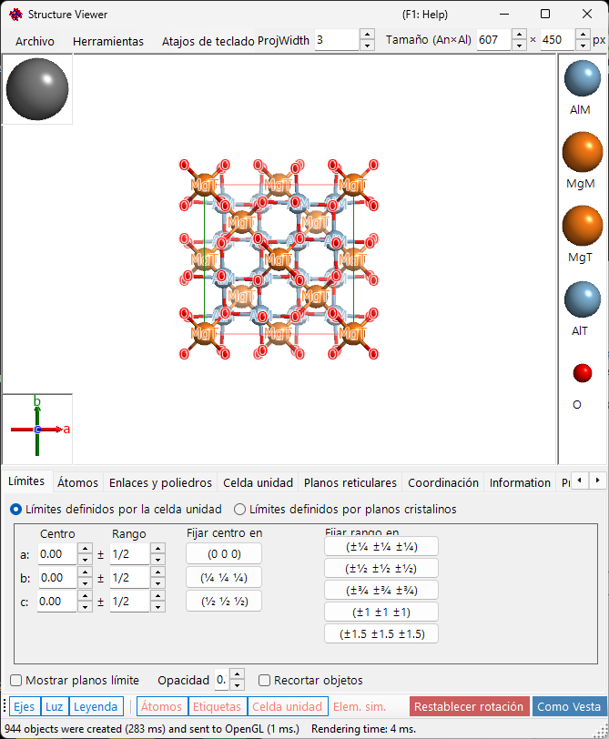

---

## Atajos de teclado y ratón

La ventana tiene una vista 3D principal más dos pequeños gizmos — la caja de **ejes cristalinos** (abajo a la izquierda) y la caja de **dirección de la luz** (arriba a la izquierda) — y cada uno responde de forma diferente a un arrastre con el botón izquierdo. La vista principal usa la [navegación de vista OpenGL](21-shortcuts.md) estándar de ReciPro.

| Atajo | Acción |
|----------|--------|
| <kbd>F1</kbd> | Abrir esta página del manual en línea |
| <kbd>CTRL</kbd>+<kbd>SHIFT</kbd>+<kbd>C</kbd> | Copiar la imagen renderizada al portapapeles |
| Arrastrar con el botón izquierdo en la vista principal | Rotar el modelo |
| Doble clic izquierdo sobre un átomo | Mostrar sus coordenadas, distancias a los vecinos más próximos y ángulos de enlace |
| Arrastrar con el botón derecho arriba/abajo, o rueda del ratón | Zoom |
| Arrastrar con el botón central | Desplazamiento |
| <kbd>CTRL</kbd> + arrastrar con el botón derecho arriba/abajo | Cambiar la distancia de la cámara (solo en modo perspectiva) |
| <kbd>CTRL</kbd> + doble clic derecho | Alternar entre proyección ortográfica y perspectiva |
| Arrastrar con el botón izquierdo el gizmo de **ejes cristalinos** | Rotar el modelo (sin giro en el plano) |
| Arrastrar con el botón izquierdo el gizmo de **luz** | Cambiar la dirección de iluminación |

Los atajos <kbd>CTRL</kbd>+<kbd>SHIFT</kbd> de toda la aplicación de la [ventana principal](0-main-window.md#keyboard-mouse-shortcuts) también funcionan mientras esta ventana tiene el foco.

→ Consulte **[21. Atajos de teclado y ratón](21-shortcuts.md)** para ver todas las ventanas de un vistazo.

---

## Área principal

La estructura cristalina en 3D, dibujada junto con el indicador de dirección de la luz, el indicador de ejes cristalinos y la leyenda de átomos.
> La caja **Tamaño (An×Al)** en la parte superior derecha de la ventana establece el tamaño en píxeles de la vista 3D (la ventana se redimensiona en consecuencia); las imágenes guardadas y copiadas tienen ese tamaño.
> La caja **ProjWidth** situada a su lado muestra el ancho de la vista proyectada en nm. Edite el valor para hacer zoom numéricamente — permanece sincronizado con el zoom por arrastre con el botón derecho / rueda del ratón sobre la vista.

---

## Barra de menús

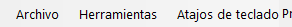

### Menú Archivo

| Elemento de menú | Descripción |
|------------------|-------------|
| Guardar imagen ▸ Imagen principal / Leyenda / Ejes cristalinos / Dirección de la luz | Guardar como PNG la vista principal, la leyenda de átomos o uno de los indicadores |
| Copiar imagen principal al portapapeles ▸ Imagen principal / Leyenda / Ejes cristalinos / Dirección de la luz | Copiar la imagen (Ctrl+Shift+C copia la vista principal) |
| Guardar vídeo ▸ Imagen principal / Ejes cristalinos | Guardar como MP4 un vídeo de rotación/traslación de la vista principal o del indicador de ejes cristalinos (velocidad, duración, fps, calidad, etc.) |
| Export 3D Model (3MF/STL) | Exportar la estructura mostrada como modelo sólido para impresión 3D |

Menú **Herramientas**: **Me gusta VESTA** (igual que el botón *Como Vesta* de la barra de herramientas) y **Enable DDP** (muestra/oculta la entrada *Dual Depth Peeling* del [Modo de transparencia](#modo-de-transparencia)).

**Atajos de teclado** (un menú de nivel superior aparte) enumera los atajos de teclado.

**Guardar vídeo** abre el cuadro de diálogo de configuración de película que se muestra a continuación. Una película puede rotar la vista, trasladar el centro de proyección o hacer ambas cosas a la vez — marque **Rotation** y/o **Translation**:

- **Rotation**: rota la vista a la velocidad **Speed** (°/s; los valores negativos invierten el sentido) alrededor del eje elegido debajo — **Proyección actual** (dirección de inclinación elegida con los botones de flecha), un **Índice de dirección** [uvw], o la normal de un **Plano reticular** (hkl).
- **Translation**: mueve el centro de proyección a lo largo del índice de dirección [uvw] a la velocidad **Speed** (periodos de red por segundo). Esta opción solo aparece cuando el cuadro de diálogo se abre desde el Visor de estructura y, mientras está habilitada, **Índice de dirección** es el único modo de dirección disponible.

Establezca la duración de la película (**Duration**), la frecuencia de fotogramas (**FPS**, 1–120) y la calidad del codificador (**Quality**, 1–100; los valores más altos usan una tasa de bits mayor y producen un archivo más grande), elija el códec (**H264** / **H265**) y pulse **OK** para generar un archivo MP4. **Include final frame** añade un fotograma adicional en t = Duration para que la película termine exactamente en la orientación/posición final. (La lista de velocidad de codificación solo etiqueta la indicación de progreso y ya no afecta a la codificación real.)

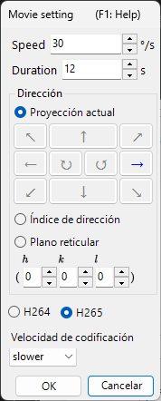

#### Export 3D Model (3MF/STL)

**Export 3D Model (3MF/STL)** exporta el modelo de estructura dibujado en pantalla como un modelo sólido para impresión 3D. Solo pueden exportarse sólidos cerrados: átomos (esferas y elipsoides), enlaces (cilindros) y poliedros de coordinación. Las etiquetas de los átomos, los planos de límite y los planos reticulares no pueden imprimirse y se ignoran. El armazón de la celda elemental está formado por segmentos, así que solo se sustituye por cilindros (con esferas en los vértices) si activas la opción correspondiente.

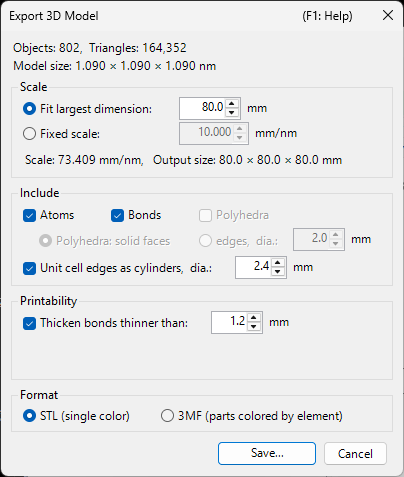

En la parte superior del cuadro de diálogo se indican el número de objetos y triángulos implicados y el tamaño real del modelo (**Model size**, nm).

**Escala** : cómo se decide el tamaño de salida

- **Dimensión máxima** : escala el modelo automáticamente para que su arista más larga alcance la longitud indicada (5–500 mm, 80 mm de forma predeterminada).
- **Escala fija** : indica la escala (mm/nm) directamente. Sirve para construir varios cristales a la misma escala y poder colocarlos uno al lado del otro. Al cambiar a esta opción se parte de la escala que estaba en vigor justo antes.
- La línea inferior muestra la escala resultante y las dimensiones impresas (**Output size**, mm).

**Incluir** : qué elementos entran en la impresión

- **Átomos** / **Enlaces** / **Poliedros** : solo pueden seleccionarse los tipos que se muestran en ese momento; al desmarcar uno, permanece en pantalla pero queda fuera de la impresión.
- **Poliedros: caras** / **aristas, Ø** : exporta los poliedros de coordinación como cuerpos macizos con caras o como un armazón de aristas (cilindros más esferas en los vértices, 2.0 mm de forma predeterminada). El armazón deja visibles los átomos del interior.
- **rejilla calada: Ø barra / paso** : el armazón de aristas más una rejilla de barras finas en cada cara (diámetro de barra 0.8–5.0 mm, 1.2 mm de forma predeterminada; paso 1.5–20 mm, 5.0 mm de forma predeterminada). Vistas de lejos, las caras parecen llenas, pero el interior sigue siendo visible.
- **Aristas de celda (cil.), Ø** : incluye el armazón de la celda elemental, sustituido por cilindros del diámetro indicado (2.4 mm de forma predeterminada). Esta casilla está marcada por defecto siempre que se muestra el armazón de la celda.

**Imprimibilidad** : idoneidad para la impresión

- **Engrosar enlaces bajo** : los enlaces cuyo diámetro impreso quedaría por debajo del valor indicado (1.2 mm de forma predeterminada) se reconstruyen con ese diámetro a partir de la primitiva original, de modo que los enlaces finos no se rompan. Si lo dejas desactivado y algún enlace es demasiado fino, aparece una advertencia en rojo.

**Formato** : formato de archivo

- **STL (un color)** : un STL binario de un solo color.
- **3MF (coloreado por elemento)** : 3MF con las piezas coloreadas por elemento; los nombres de color llevan los nombres de los elementos.

**Guardar...** pide el nombre del archivo. Cuando termina la exportación, el número de triángulos, las dimensiones impresas y la escala se registran en el cuadro de información de la parte inferior izquierda.

---

## Menú de pestañas

### Límites definidos por la celda

Especifica el intervalo de dibujo del cristal. Hay dos modos, que se cambian con los botones de opción de la parte superior.

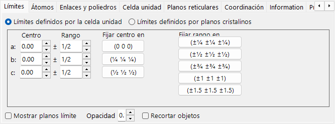

En este modo, los ejes *a*, *b*, *c* de la celda elemental son la unidad del intervalo de dibujo.

- **Center**: coordenada fraccionaria central del volumen de dibujo.
- **Range**: límite superior/inferior para cada uno de los ejes *a*, *b*, *c*.
- Los **botones de preajuste** de la derecha proporcionan valores de uso frecuente (p. ej. celda 1×1×1, celda 2×2×2).

### Límites definidos por planos cristalinos

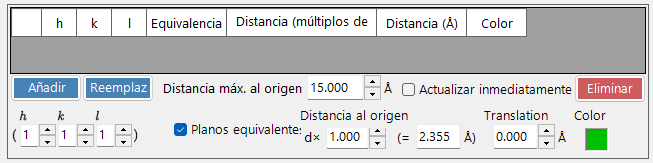

En este modo, el área de dibujo está delimitada por un conjunto de planos cristalinos. Si los planos no definen una región espacialmente cerrada, ReciPro añade un poliedro casi esférico de radio **Distancia máx. al origen** (Å) para cerrarla.

#### Lista de límites

Todos los planos límite registrados para el cristal actual. Use **Add / Replace / Delete** para manipular la lista; la casilla situada más a la izquierda desactiva temporalmente un plano sin eliminarlo.

> Para guardar los cambios de forma permanente, también debe pulsar **Add** o **Replace** en la **Ventana principal**. De lo contrario, los cambios se pierden la próxima vez que cambie la selección en la lista principal de cristales.

#### Índices H k l

Establece el plano límite mediante su índice de Miller. La casilla incluye los planos cristalográficamente equivalentes generados a partir del (*hkl*) seleccionado.

#### Distancia desde el origen

La distancia desde el origen hasta el plano límite, introducida como múltiplo de la distancia interplanar *d* del (*hkl*) seleccionado (casilla **d×**) o en Å (la casilla entre paréntesis). Las dos casillas están vinculadas: al cambiar una se actualiza la otra.

- **Translation** (Å): solo tiene efecto cuando **Planos equivalentes** está marcado y se generan exactamente dos planos equivalentes (normalmente (*hkl*) y su opuesto). En ese caso, el primer plano se aleja del origen y el segundo se acerca a él en esa cantidad, es decir, la lámina se desplaza a lo largo de la normal. En todos los demás casos el valor se ignora.
- **Distancia máx. al origen** (Å): radio del poliedro de cierre usado cuando los planos no encierran una región (véase arriba).
- **Actualizar inmediatamente**: aplica las modificaciones del plano seleccionado sin pulsar **Reemplazar**.

#### Mostrar planos límite / Opacidad

Muestra u oculta los propios planos límite. Cuando se muestran, **Opacidad** establece la transparencia (0 = transparente, 1 = opaco).

#### Recortar objetos por los planos límite

Si está marcado, solo se renderiza la región interior definida por los límites; los átomos, enlaces y poliedros que cortan los límites se recortan.

#### Ocultación de los átomos

La pestaña Límites no tiene ninguna casilla para esto. Desactive en su lugar el botón **Átomos** de la barra de herramientas: no se genera ningún átomo, de modo que también desaparecen los enlaces y los poliedros — útil cuando solo es necesario visualizar la celda o los planos reticulares.

### Átomos

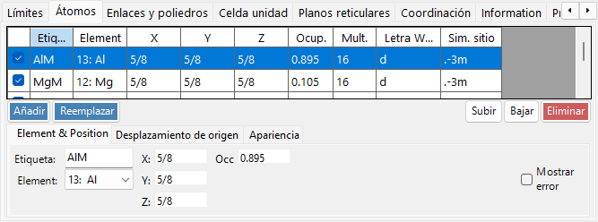

Establece la especie, la posición y la ocupación de cada átomo, y cómo se dibuja cada uno (radio, color, material).

#### Lista de átomos

La lista de átomos del cristal. Use **Add / Replace / Delete** para manipular la lista; la casilla situada más a la izquierda oculta temporalmente un átomo.

> Para guardar los cambios de forma permanente, haga clic también en **Add** o **Replace** en la **Ventana principal**.

#### Elemento y posición

- **Label**: etiqueta de texto libre para el átomo (se usa en leyendas y descripciones emergentes).
- **Element**: elemento químico / estado de ionización.
- **X, Y, Z**: coordenadas fraccionarias. Números reales entre 0 y 1, o fracciones como `1/2` o `2/3`.
- **Occ**: ocupación, un número real entre 0 y 1.

#### Desplazamiento del origen

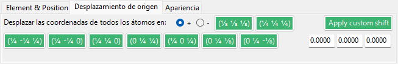

Desplaza cada átomo en el mismo desplazamiento fraccionario. Pulse un botón de preajuste (por ejemplo, para alternar entre la elección de origen 1 / 2 del mismo grupo espacial), o introduzca un (Δx, Δy, Δz) personalizado y pulse **Apply custom shift**.

#### Apariencia

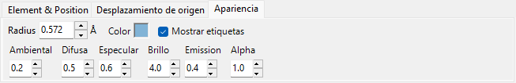

Radio, color y material por átomo.

- **Radius**: radio atómico dibujado.
- **Atom color**: color de la superficie.
- **Material**: propiedades de textura / material utilizadas por el shader de OpenGL.
- **Apply to same elements**: aplica el radio y el color actuales a todos los átomos de la misma especie elemental.

### Enlaces y poliedros

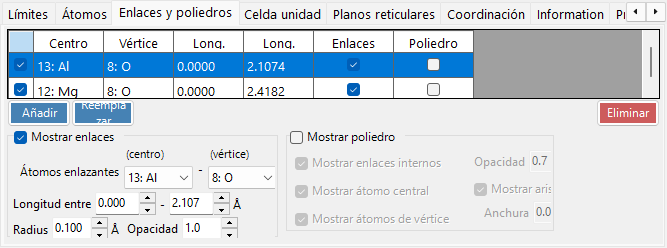

Define qué pares de átomos están enlazados (por especie y rango de distancias) y cómo se dibujan los enlaces y los poliedros de coordinación resultantes.

#### Lista de enlaces

Todas las reglas de enlace/poliedro registradas para el cristal. Use **Add / Replace / Delete**; la casilla situada más a la izquierda desactiva temporalmente una entrada. Como con los átomos y los límites, se requiere **Add** / **Replace** en la **Ventana principal** para hacer permanente el cambio.

#### Propiedad del enlace

- **Bonding Atom (center)**: especie elemental usada como átomo central del enlace / poliedro.
- **Bonding Atom (vertex)**: especie elemental usada como vértice (el otro extremo).
- **Length between … and …**: umbrales de distancia inferior y superior. Los pares de átomos fuera de este intervalo no se dibujan.
- **Bond Radius**: grosor dibujado del enlace (radio del cilindro).
- **Alpha**: transparencia del enlace (0 = transparente, 1 = opaco).

#### Propiedad del poliedro

- **Show Polyhedron**: cuando está marcado, se dibuja el poliedro definido por el enlace actual (solo si el conjunto centro/vértice es geométricamente válido).
- **Inner Bonds**: muestra/oculta los enlaces dentro del poliedro.
- **Center Atom**: muestra/oculta el átomo central.
- **Vertex Atoms**: muestra/oculta los átomos de los vértices.
- **Color** / **Alpha**: color de cara y transparencia.
- **Mostrar aristas**: dibuja las aristas que conectan los vértices.
- **Edge Color** / **Width**: color y ancho de línea de las aristas.

### Celda elemental

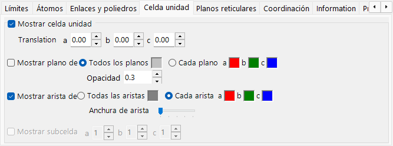

Establece la posición de la celda unidad dibujada y si se muestran sus caras y aristas.

#### Traslación

Cada grupo espacial tiene un origen predeterminado. Para alejar el centro de la celda elemental dibujada de ese origen, establezca la traslación a lo largo de *a*, *b*, *c*.

La traslación está ligada al [Centro de proyección](#centro-de-proyección): fijar el centro de proyección en $(x, y, z)$ fija la traslación en $(0.5-x,\ 0.5-y,\ 0.5-z)$.

#### Mostrar plano de la celda

Si se dibujan o no las seis caras que delimitan la celda elemental. Cuando está habilitado, puede establecer el color de cara y la transparencia.

#### Mostrar aristas

Si se dibujan o no las aristas de la celda elemental. El color de las aristas es configurable.

La casilla principal **Mostrar celda unidad** (= el botón *Celda unidad* de la barra de herramientas) activa o desactiva toda la celda. Los colores de caras y aristas pueden fijarse para **Todos los planos** / **Todas las aristas** a la vez o para **Cada plano** / **Cada arista** (*a*, *b*, *c* por separado); **Anchura de arista** fija el ancho de línea y **Opacidad**, la transparencia de las caras.

### Planos reticulares

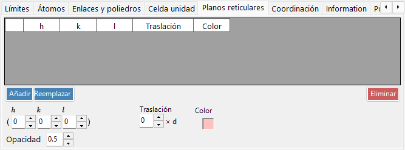

Dibuja planos reticulares dados por su índice de Miller, incluyendo opcionalmente los planos cristalográficamente equivalentes.

#### Índices H k l

Especifica el plano reticular mediante su índice de Miller. La casilla incluye opcionalmente los planos cristalográficamente equivalentes generados a partir de (*hkl*).

#### Traslación

Traslada el plano reticular dibujado en un múltiplo entero de su distancia interplanar *d* — útil para visualizar planos sucesivos de la misma familia.

### Coordinación

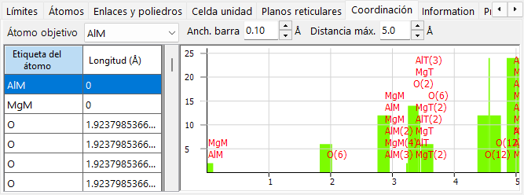

Enumera y representa gráficamente los átomos que coordinan un átomo objetivo elegido.

#### Tabla (lado izquierdo)

Enumera qué átomos rodean al átomo objetivo seleccionado y a qué distancia. El átomo objetivo se selecciona en el menú desplegable situado sobre la tabla.

#### Gráfico (lado derecho)

Histograma del número de vecinos en función de la distancia, derivado de los mismos datos que la tabla. Ajuste **Bar Width** hasta que las barras separen limpiamente las capas de coordinación — esto da una estimación visual del número de coordinación.

### Información

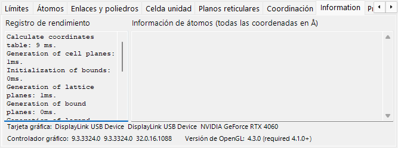

Registro de renderizado (tiempo de fotograma, información de la GPU) e información básica sobre el átomo seleccionado. En construcción — los campos pueden ampliarse con el tiempo.

### Proyección

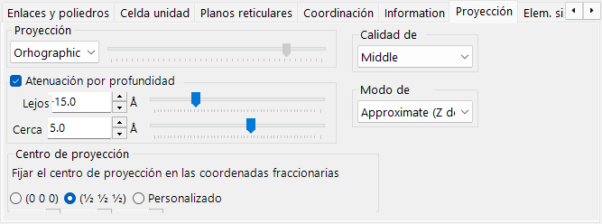

Establece el modo de proyección (ortográfica / perspectiva), la atenuación por profundidad, el centro de proyección, la calidad de renderizado y el algoritmo de transparencia.

#### Proyección

- **Orthographic**: proyección paralela perfecta (punto de vista en el infinito).
- **Perspective**: proyección en perspectiva desde la distancia de punto de vista establecida con el control deslizante.

#### Atenuación por profundidad

Atenúa los objetos lejanos en la dirección de profundidad (**Atenuación por profundidad**). El color se mezcla linealmente hacia el **color de fondo**: los objetos más cercanos que **Cerca** conservan su propio color, los más lejanos que **Lejos** toman el color de fondo y los intermedios se interpolan. (La opacidad en sí no cambia.) **Cerca** y **Lejos** se expresan en Å.

#### Centro de proyección

Establece el centro de proyección en las coordenadas especificadas. Active **Personalizado** para introducir coordenadas arbitrarias. Cada coordenada se pliega al intervalo de −0.5 a +0.5 (un periodo de red). Una película de **Translation** (véase el [Menú Archivo](#menú-archivo)) controla estos valores automáticamente.

#### Calidad de renderizado

Calidad de dibujo (subdivisión de malla, antialiasing). Una calidad mayor es más lenta — elija el ajuste que se adapte a su GPU.

#### Modo de transparencia

Algoritmo usado para átomos y poliedros translúcidos.

- **Approximate (Z depth sorting, OpenGL 4.1+)**: rápido, pero puede ser impreciso cuando se solapan muchos objetos translúcidos.
- **High quality (Dual Depth Peeling, OpenGL 4.1+)**: transparencia independiente del orden mediante pelado de profundidad (depth peeling). Solo se muestra cuando **Herramientas ▸ Enable DDP** está activado (activado por defecto cuando PPLL no está disponible). El número de pasadas de pelado sigue el ajuste de [Calidad de renderizado](#calidad-de-renderizado).
- **High quality (Per-Pixel Linked List, OpenGL 4.3+)**: transparencia exacta independiente del orden; solo se muestra cuando la GPU admite OpenGL 4.3. Precisa pero lenta; requiere en la práctica una GPU dedicada.

### Elementos de simetría

La pestaña **Elem. sim.** dibuja los operadores de simetría del grupo espacial directamente sobre el modelo 3D (se alterna con el botón **Elem. sim.** de la barra de herramientas). Cada clase de elemento se puede mostrar/ocultar de forma independiente:

- **Ejes de simetría**: **Rotaciones**, **Helicoidales**, **Rotoinversiones**
- **Planos**: **Espejos**, **Deslizamientos**
- **Centros de inversión**

El interruptor general es **Mostrar elementos de simetría**. Para cada grupo puede ajustar el tamaño del símbolo (%) y el color y, para los ejes y los planos, también el ancho de línea.

### Misceláneos

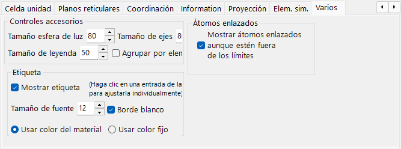

- **Controles accesorios**: establece los tamaños de visualización (esfera de luz, ejes, leyenda). **Agrupar por elemento** alterna la visualización de la leyenda.
- **Átomos enlazados**: **Mostrar átomos enlazados aunque estén fuera de los límites** sigue dibujando los átomos enlazados a átomos dentro del intervalo de dibujo, incluso cuando quedan fuera de él.
- **Etiqueta**: **Mostrar etiqueta**, **Tamaño de fuente**, **Borde blanco** y el color de las etiquetas (**Usar color del material** o **Usar color fijo**). Al hacer clic en una entrada de la leyenda de átomos se activan o desactivan individualmente las etiquetas de ese átomo (o de ese elemento, con **Agrupar por elemento**).

---

## Barra de herramientas

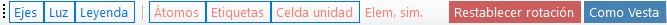

| Botón | Descripción |
|--------|-------------|
| Ejes | Mostrar la orientación de los ejes (tamaño = constante de red) |
| Luz | Establecer la dirección de la luz |
| Leyenda | Leyenda de átomos |
| Átomos | Alternar los objetos de átomos |
| Etiquetas | Alternar las etiquetas de los átomos |
| Celda unidad | Alternar las aristas de la celda elemental |
| Elem. sim. | Alternar la superposición de elementos de simetría (ver arriba) |
| Restablecer rotación | Volver a la orientación inicial |
| Como Vesta | Cambia a una apariencia al estilo de VESTA: se restablecen los colores y radios de los átomos y la lista de enlaces se **sustituye** por los enlaces predeterminados |

---

## Véase también

- [Ventana principal](0-main-window.md)
- [Base de datos de cristales](1-crystal-database.md)
- [Información de simetría](2-symmetry-information.md)
- [Simulador de difracción](7-diffraction-simulator/index.md)
- [Atajos de teclado y ratón](21-shortcuts.md)
