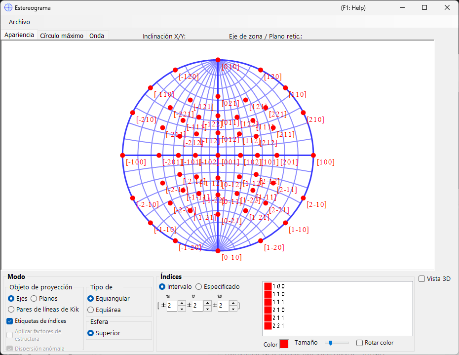
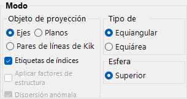
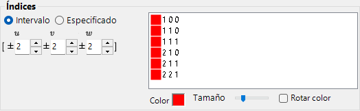
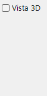
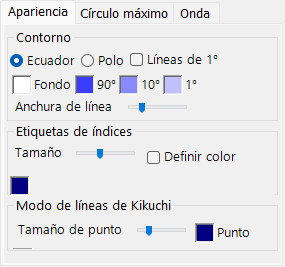
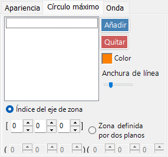
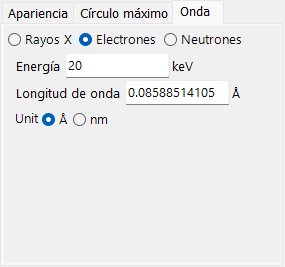

# Estereograma

El **Estereograma** muestra las direcciones de los planos cristalinos y de los ejes mediante proyección estereográfica.

---

## Atajos de teclado y ratón

El estereograma en sí es una proyección 2-D; opcionalmente se puede mostrar una esfera 3-D con **Vista 3D**.

| Atajo | Acción |
|----------|--------|
| <kbd>F1</kbd> | Abrir esta página del manual en línea |
| Arrastrar con el botón izquierdo cerca del centro | Inclinar el cristal |
| Arrastrar con el botón izquierdo en la zona exterior | Girar el cristal alrededor del eje de visión |
| Doble clic izquierdo | Alternar entre la proyección de **Planos** y de **Ejes** |
| Clic derecho | Alejar el zoom |
| Arrastrar un recuadro con el botón derecho | Acercar el zoom a la región seleccionada |
| Arrastrar con el botón central | Desplazar |
| Mover el ratón (sin botón) | Leer los índices (hkl)/[uvw] bajo el cursor — útil para indexar un reflejo medido |

Arrastrar sobre la red rota el **cristal**; el estado de rotación se comparte entre todas las ventanas.

El renderizado 3-D utiliza la [navegación de vista OpenGL](21-shortcuts.md) estándar de ReciPro (arrastrar con el botón izquierdo para rotar, arrastrar con el botón derecho / rueda para hacer zoom, <kbd>CTRL</kbd> + doble clic derecho alterna la proyección) y rota únicamente la vista 3-D, no el cristal en sí.

Los atajos <kbd>CTRL</kbd>+<kbd>SHIFT</kbd> de toda la aplicación procedentes de la [ventana principal](0-main-window.md#keyboard-mouse-shortcuts) también funcionan mientras esta ventana tiene el foco.

→ Consulte **[21. Atajos de teclado y ratón](21-shortcuts.md)** para ver todas las ventanas de un vistazo.

---

## Área principal

Aquí se muestra la proyección en estereograma de los planos cristalinos, los índices de dirección y las líneas de Kikuchi del cristal seleccionado.

---

## Menú Archivo

Guardar como imagen ráster (PNG), o copiar como imagen ráster o como metarchivo vectorial (EMF). Un metarchivo pegado permite editar las fuentes y los grosores de línea en PowerPoint u otros editores vectoriales.

| Elemento de menú | Descripción |
|-----------|-------------|
| Guardar imagen ▸ como imagen (formato PNG) / como metarchivo (EMF) | Guardar el estereograma como archivo PNG (el elemento *como metarchivo (EMF)* está desactivado actualmente; para una salida vectorial use **Copiar al portapapeles ▸ como metarchivo (EMF)**) |
| Copiar al portapapeles ▸ Como imagen / como metarchivo (EMF) | Copiar el estereograma |
| Guardar vídeo ▸ Estereograma / 3D | Guardar un vídeo de rotación (MP4) del estereograma o de la vista 3-D, con el mismo cuadro de diálogo de configuración de vídeo que el [Visor de estructura](5-structure-viewer.md#menú-archivo) (solo rotación) |
| Configurar página / Vista previa de impresión / Imprimir | Imprimir el estereograma |

---

## Modo {#mode}

### Objeto de proyección

Seleccione qué se proyecta sobre la red.

- **Ejes** — proyecta los índices de dirección \([uvw]\).
- **Planos** — proyecta las normales a los planos cristalinos \((hkl)\).
- **Pares de Kikuchi** — proyecta los pares de líneas de Kikuchi.

### Tipo de proyección

| Método | Descripción |
|--------|-------------|
| **Wulff** (**Equiangular** / estereográfica) | Conserva la relación angular entre los elementos proyectados, pero no el ángulo sólido. La emplean los cristalógrafos clásicos al leer ángulos entre ejes o entre planos. |
| **Schmidt** (**Equiárea** / Lambert) | Conserva el ángulo sólido (el área) de cada región, pero distorsiona los ángulos. Preferida para figuras de polos estadísticas en las que importa la densidad relativa. |

### Hemisferio

Elija el hemisferio **Superior** o **Inferior** (cuadro **Esfera**) como fuente de proyección — esto alterna si la cara visible de la esfera es la más cercana o la más alejada del observador.
Superior = el lado $+Z$ (hacia el observador, véase el [Apéndice A1.1](appendix/a1-coordinate-system/1-orientation.md)); con **Inferior** se invierte la componente $Z$ de cada dirección antes de la proyección, y los puntos se dibujan como **círculos vacíos** en lugar de rellenos.

### Opciones de visualización

- **Etiquetas de índices**: muestra las etiquetas de índices.
- **Factores de estructura en la intensidad**: cuando se selecciona **Planos** o **Pares de Kikuchi**, pondera cada elemento con su factor de estructura (establezca la fuente de onda y la longitud de onda en la [pestaña Onda](#wave)). El peso es $I_{\mathrm{rel}} = |F_{hkl}|^2 / \max|F|^2$ sobre el conjunto mostrado: en el modo **Planos**, el radio del punto se multiplica por $\sqrt{I_{\mathrm{rel}}}$ (es decir, $\propto |F_{hkl}|$); en el modo **Pares de Kikuchi**, la opacidad de la línea es $I_{\mathrm{rel}}$.
- **Dispersión anómala**: incluye en los factores de estructura los términos de dispersión anómala de rayos X $f'$, $f''$. Solo está habilitada para rayos X y en los modos **Planos** / **Pares de Kikuchi**.

> Para cristales trigonales/hexagonales, la notación de Miller–Bravais (4 índices) puede activarse desde **Opciones ▸ Usar índices de Miller-Bravais (hkil)** en la ventana principal.

---

## Índices {#indices}

Establece qué planos cristalinos / ejes se dibujan.

### Modo Intervalo

Especifique un intervalo de índices \([uvw]\) o \((hkl)\). ReciPro enumera cada índice dentro de los límites y proyecta cada uno de ellos.

En el modo **Intervalo**, los límites son $\pm$ los valores introducidos; solo se toman índices irreducibles, agrupados en conjuntos de índices cristalográficamente equivalentes (cada conjunto recibe un color).

### Modo Factor de estructura

Solo disponible para **Planos** y **Pares de Kikuchi**. Proyecta los planos con mayor $|F_{hkl}|^2$ para la fuente de onda actual. **Máx.** fija el número de planos que se dibujan (los planos equivalentes se cuentan individualmente; en el modo **Planos** se omite una reflexión paralela a otra más intensa —un orden superior o inferior de ella, p. ej. 222 cuando 111 es más intensa—).

### Modo Especificado

Especifica ejes o planos concretos de forma individual. Escriba un índice, pulse **Añadir** para registrarlo o **Quitar** para eliminarlo. Cuando **Incluir índices equivalentes** está marcado, también se dibujan todos los índices cristalográficamente equivalentes.

### Color / Tamaño

Establezca el **Color** y el **Tamaño** de los puntos representados. Marque **Rotar color** para codificar por color de forma diferente cada conjunto de ejes/planos equivalentes — útil para distinguir familias en una representación de múltiples índices.

---

## Opciones 3D

Se muestran cuando **Vista 3D** está marcado; la esfera 3-D aparece en un panel a la derecha de la red.

- **Restablecer**: devuelve la vista 3-D a la dirección y el zoom predeterminados.
- **Etiqueta**: dibuja las etiquetas de índices en 3-D.
- **Hemisferio**: dibuja solo los polos del hemisferio superior ($Z>0$).
- **Estereograma**: dibuja en 3-D el plano de proyección (la red), con los puntos proyectados de los polos del hemisferio superior.
- **Contorno de esfera**: dibuja la malla de latitud/longitud de la esfera.
- **Líneas de proyección** (con **Estereograma** activado): dibuja las líneas auxiliares de proyección de cada polo del hemisferio superior — una recta desde el polo sur $(0,0,-1)$ hasta el polo para Wulff, un arco para Schmidt.
- **Atenuación por profundidad**: intensidad de la atenuación por profundidad de la vista 3-D.

---

## Menú de pestañas

### Apariencia

#### Contorno

Cómo se dibuja el contorno del estereograma — el círculo delimitador y la malla opcional de círculos máximos de latitud/longitud. Elija **Ecuador** o **Polo**, active **Líneas de 1°** y el relleno **Fondo**, establezca los colores de malla **90° / 10° / 1°** y ajuste la **Anchura de línea** con la barra deslizante.

#### Etiquetas de índices

- **Tamaño** — tamaño de las etiquetas de índices.
- **Color** — utiliza un único color fijo para todas las etiquetas de índices en lugar del color de cada punto; útil cuando los puntos están codificados por color pero usted desea todas las etiquetas en un solo color para mejorar la legibilidad.
- **Separ.** — carácter que se coloca entre los índices de cada etiqueta: **Nada** (p. ej. 100), **Espacio** (1 0 0) o **Coma** (1,0,0).

#### Modo de líneas de Kikuchi

- **Tamaño de punto** — tamaño de los puntos representados.
- **Punto** / **Etiqueta** — colores de los puntos y de sus etiquetas.

### Círculo máximo

Dibuje círculos máximos (los círculos menores no están disponibles). Especifíquelos mediante el **Índice del eje de zona** \([uvw]\) (el círculo máximo formado por la zona de ese eje) o mediante **Zona definida por dos planos** (el eje de zona es su producto vectorial). Use **Añadir** / **Quitar** para editar la lista; al desmarcar una entrada se oculta ese círculo. El color y el grosor de línea de los círculos también se pueden configurar.

### Onda {#wave}

Solo se usa cuando se selecciona **Planos** o **Pares de Kikuchi** como objeto de proyección (en el modo **Pares de Kikuchi** la longitud de onda fija además el ángulo de Bragg, es decir, la separación de cada par de líneas). Establece la fuente de onda (X-ray / electron / neutron) y la longitud de onda o energía necesarias para calcular los factores de estructura cristalina que usa **Factores de estructura en la intensidad** en [Modo](#mode).

---

## Véase también

- [Ventana principal](0-main-window.md)
- [Geometría de rotación](4-rotation-geometry.md)
- [Visor de estructura](5-structure-viewer.md)
- [Simulador de difracción](7-diffraction-simulator/index.md)
- [Sistema de coordenadas básico y orientación del cristal](appendix/a1-coordinate-system/1-orientation.md)
