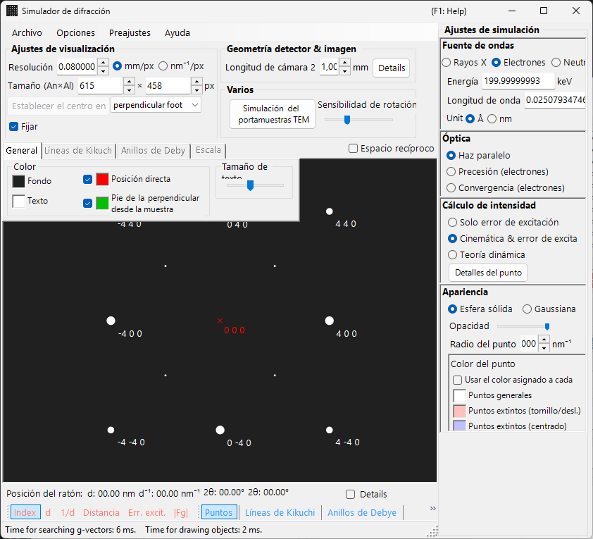
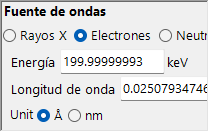
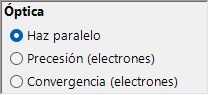
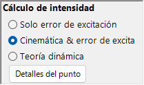
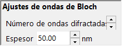
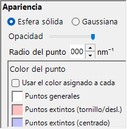

# Simulación SAED (Selected Area Electron Diffraction)

La simulación **SAED (Selected Area Electron Diffraction)** calcula los patrones de difracción de electrones de monocristal producidos por un haz de electrones paralelo. Este es el modo predeterminado del [simulador de difracción](index.md).

> Esta página enumera cada ajuste que aparece en el panel **Ajustes de simulación** a la derecha cuando se elige **Fuente de ondas** = **Electrones** y **Óptica** = **Haz paralelo**. Para operaciones que afectan a toda la ventana, como dibujar y guardar, consulte la [página de resumen](index.md).

Condiciones de la GUI: Fuente de ondas = Electrones, Óptica = Haz paralelo, Cálculo de intensidad = Solo error de exc. / Cinemática & err. exc. / Teoría dinámica.

---

## Resumen

Simula el patrón de difracción que se produce cuando un haz de electrones paralelo atraviesa una muestra delgada. Las posiciones de los spots quedan fijadas por la relación geométrica entre la esfera de Ewald y los puntos de la red recíproca, y el brillo de cada spot se calcula según el modo de cálculo de intensidad seleccionado.

---

## Fuente de ondas {#wave-length}

Establezca la fuente de radiación en **Electrones**. Introduzca la energía (keV) o la longitud de onda (Å o nm, conmutable; por defecto Å) y se calcula la longitud de onda corregida relativísticamente. El valor inicial es 200 keV; el menú **Preajustes** fija 300 / 200 / 120 kV con un clic. Para fuentes de rayos X y de neutrones, consulte [Simulación de difracción de rayos X](5-x-ray-neutron-diffraction.md).

---

## Óptica {#incident-beam-mode}

Establezca **Óptica** (la geometría del haz incidente) en **Haz paralelo**. Esta es la geometría estándar de onda plana utilizada para SAED y para la difracción de rayos X.

> **Nota**: Para los electrones puede elegir **Haz paralelo** / **Precesión (electrones)** / **Convergencia (electrones)**. Elegir **Precesión (electrones)** produce una [simulación PED](2-ped-simulation.md) y elegir **Convergencia (electrones)** produce una [simulación CBED](3-cbed-simulation.md); en ambos casos el cálculo de intensidad cambia automáticamente a **Teoría dinámica**.

---

## Cálculo de intensidad

Selecciona cómo se calculan las intensidades de los spots.

### Solo error de excitación

La intensidad se determina únicamente a partir de la distancia geométrica entre la esfera de Ewald y el punto de la red recíproca (el error de excitación $S_g$). Es máxima en $S_g = 0$ —exactamente sobre la esfera— y decae a medida que crece $\lvert S_g\rvert$, llegando a cero cuando $\lvert S_g\rvert$ supera el **Radio del punto** indicado para el punto de la red recíproca. Como se ignora el factor de estructura del cristal, este es el modo más rápido y resulta adecuado para comprobar las posiciones de los spots de difracción.

Solo en este modo aparecen las opciones siguientes:

| Opción | Descripción |
|--------|-------------|
| **Excluir todas las reflexiones prohibidas** | Oculta todas las reflexiones prohibidas por el grupo espacial (centrado de la red, ejes helicoidales y planos de deslizamiento). Al marcarla se marca y bloquea también la opción siguiente. |
| **Excluir reflexiones prohibidas por centrado de red** | Oculta solo las reflexiones prohibidas por el centrado de la red (activada por defecto). |
| **Dibujar todos los puntos con el mismo radio** | Dibuja todos los spots excitados con el radio completo *R*, independientemente de $S_g$. |

Las reflexiones prohibidas que siguen visibles se dibujan con los colores **Puntos extintos** (véase [Apariencia de los puntos](#spot-appearance)).

### Cinemática

Además del error de excitación, el factor de estructura cinemático $\lvert F_{hkl} \rvert^2$ se incorpora a la intensidad. Las reglas de extinción se reflejan correctamente, lo que hace que este modo sea adecuado para muestras delgadas o difracción débil.

### Dinámica (método de ondas de Bloch, solo electrón)

Un cálculo dinámico riguroso mediante el método de ondas de Bloch (método de Bethe). Reproduce la dispersión múltiple y la variación de la intensidad en función del espesor, y es necesario para muestras gruesas o difracción intensa. Disponible solo cuando se selecciona **Electrones**. Para la teoría, consulte [Apéndice A3. Método de ondas de Bloch](../appendix/a3-bloch-wave/calculation.md).

> **Nota**: Cuando se selecciona **Teoría dinámica**, aparece debajo un panel **Ajustes de ondas de Bloch**.

---

## Ajustes de ondas de Bloch (teoría dinámica)

Activo solo cuando **Cálculo de intensidad** = **Teoría dinámica**.

| Parámetro | Descripción |
|-----------|-------------|
| **Número de ondas difractadas** | Número de ondas de Bloch incluidas en el problema de valores propios (8–1000, por defecto 240). Valores mayores dan intensidades más precisas pero aumentan el tiempo de cálculo como $O(N^3)$ |
| **Espesor** | Espesor de la muestra (nm) utilizado en el cálculo dinámico (0.01–10000 nm, por defecto 50 nm) |

---

## Apariencia de los puntos {#spot-appearance}

Controla cómo se representa cada spot de difracción.

- **Esfera sólida / Gaussiana** : el modelo geométrico del punto de la red recíproca (por defecto **Esfera sólida**). **Esfera sólida** dibuja la sección transversal (un círculo) entre una esfera y la esfera de Ewald: el radio de la esfera es $R\,I^{1/3}$ con **Cinemática & err. exc.** (volumen de la esfera ∝ intensidad) y $R$ con **Solo error de exc.**; con **Teoría dinámica** se dibuja un disco de radio $R\,I_\text{dyn}^{1/2}$ (área ∝ intensidad) sin el corte de la esfera de Ewald. **Gaussiana** dibuja la sección transversal (una gaussiana 2-D) de una gaussiana 3-D con $\sigma = R$, cuya integral corresponde a la intensidad de difracción.
- **Opacidad** : transparencia del spot (0 = transparente, 1 = opaco).
- **Radio del punto (R)** : radio virtual del punto de la red recíproca (nm⁻¹; 0.01–1, por defecto 0.2). El tamaño del spot queda fijado por la combinación del modo de **Apariencia** y el **Cálculo de intensidad** (véase arriba).
- **Brillo**, **Escala de color**, **Escala log.** : solo se muestran en el modo **Gaussiana**. **Brillo** escala la intensidad integrada de la gaussiana dibujada; **Escala de color** es **Gray** (spots con los colores de spot indicados abajo), **Cold-warm**, **Spectrum** o **Fire**; **Escala log.** muestra las intensidades en escala logarítmica (útil para patrones con gran contraste de intensidad).
- **Color del punto** : se muestra mientras la **Escala de color** es **Gray** (el ajuste inicial). **Puntos generales**, **Puntos extintos (tornillo/desl.)** y **Puntos extintos (centrado)** fijan los colores de las reflexiones permitidas y prohibidas.
- **Color por cristal** : cuando está marcado, los spots se dibujan con el color asignado a cada cristal (también con un solo cristal).

---

## Etiquetas de los puntos

Las etiquetas superpuestas sobre los spots se seleccionan desde la [barra de herramientas](index.md#toolbar).

| Etiqueta | Contenido |
|-------|---------|
| **Index** | índices de Miller $(hkl)$; cuatro índices $(hkil)$ cuando **Opciones ▸ Usar índices de Miller-Bravais (hkil)** de la ventana principal está activado y el cristal usa ejes hexagonales (las etiquetas de las líneas de Kikuchi, de los anillos de Debye y de la vista 3D siguen el mismo ajuste) <!-- 261105Cl 監査: C23 --> |
| **d** | distancia interplanar $d$, en Å o nm según la unidad de longitud de la ventana principal <!-- 261106Cl 作者の決定 C20 --> |
| **1/d** | inverso de la distancia interplanar $1/d$, en nm⁻¹ o Å⁻¹ según la unidad de longitud de la ventana principal <!-- 261106Cl 作者の決定 C2 --> |
| **Distancia** | distancia en el detector desde el spot hasta el haz transmitido (directo) (mm), medida entre las posiciones dibujadas, por lo que también es válida para un detector inclinado, la cámara de precesión de rayos X y Back Laue (medida desde el orificio del haz); no se muestra cuando el haz transmitido no cae en el detector <!-- 261105Cl 監査: DrawDiffractionSpotsLabel (C15)。L2 tan2θ は傾けない平板の検出器だけ --> |
| **2θ** | ángulo de dispersión $2\theta$ (misma definición que los círculos concéntricos de la escala 2θ) |
| **χ** | ángulo azimutal $\chi$, medido desde la dirección hacia arriba (las 12 en punto), positivo en sentido horario (misma definición que las líneas radiales de la escala azimutal) |
| **Err. excit.** | error de excitación $S_g$, en nm⁻¹ o Å⁻¹ según la unidad de longitud de la ventana principal |
| **Intensidad** | intensidad relativa (%) en el modo **Cinemática & err. exc.**; en el modo **Teoría dinámica**, la intensidad relativa (% del haz difractado más intenso, excluido el 000) y la amplitud compleja en la superficie de salida. No se muestra nada con **Solo error de exc.** |

---

## Operaciones comunes

La información del detector, el volteo, la visualización del espacio recíproco, las líneas de Kikuchi, los anillos de Debye, las líneas de escala, los ajustes de color, el guardado y similares son comunes a todos los modos. Consulte la [página de resumen](index.md). Los detalles por reflexión obtenidos del cálculo dinámico pueden consultarse en [información de spots de difracción](index.md#diffraction-spot-information).

---

## Véase también

- [Simulador de difracción (resumen)](index.md)
- [Cálculo SAED con haz paralelo](../appendix/a3-bloch-wave/calculation.md#parallel-beam-saed)
- [Simulación de difracción de rayos X](5-x-ray-neutron-diffraction.md)
- [Simulación de difracción de electrones por precesión (PED)](2-ped-simulation.md)
- [Definición del sistema de coordenadas](../appendix/a1-coordinate-system/1-orientation.md)
