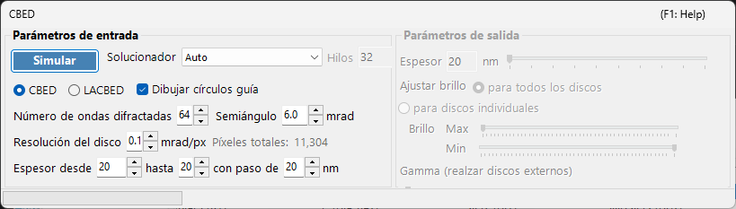
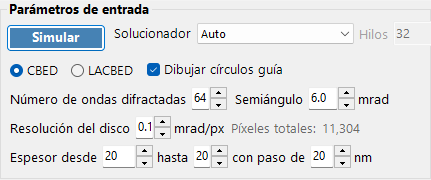
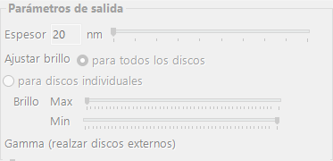

# Simulación CBED

La **simulación CBED (Convergent-Beam Electron Diffraction)** calcula y muestra patrones de difracción con haz convergente mediante el método de ondas de Bloch (Bethe). Los patrones CBED muestran discos de difracción en lugar de puntos y contienen abundante información sobre la simetría, el espesor y la estructura del cristal.

> Esta página enumera todos los ajustes de la ventana específica que se abre cuando selecciona **Wavelength = Electron** e **Incident beam = Convergence (electron)** en el [Simulador de difracción](index.md). Al cambiar el haz incidente a convergencia, **Intensity calculation** se establece automáticamente en **Dynamical** y se abre esta ventana de ajustes CBED. Los discos calculados pueden guardarse desde **Archivo > Guardar discos CBED** / **Copiar discos CBED** de la ventana principal. Para dibujar y guardar patrones de difracción, así como para otras operaciones comunes al simulador de difracción, consulte la [página de descripción general](index.md).

Condiciones de la GUI: Wave Length = Electron · Incident beam = Convergence (electron) · Intensity calculation = Dynamical (automático)

---

## Parámetros de entrada

Mientras esta ventana está abierta, los paneles **Ajustes de ondas de Bloch** y **Apariencia** de la ventana principal quedan desactivados; el número de ondas y los espesores se toman de aquí.

| Parámetro | Descripción | Predeterminado / Típico |
|-----------|-------------|-------------------|
| **Mode** | **CBED**: patrón estándar con haz convergente en el que cada disco corresponde a una reflexión, con el disco transmitido (000) en el centro. **LACBED** (Large-Angle CBED): patrón con haz convergente de gran ángulo en el que se solapan los discos de distintas reflexiones. Útil para observar las líneas HOLZ (higher-order Laue zone) y la simetría | CBED |
| **Semiángulo (mrad)** | Semiángulo del cono del haz convergente (0–2000 mrad). Determina el tamaño de cada disco de difracción (el diámetro del disco en el espacio recíproco corresponde a $2\alpha$) | por defecto 6 mrad; típicamente 5–30 mrad |
| **Resolución del disco (mrad/px)** | Resolución angular dentro de cada disco. El disco se muestrea en una rejilla $N\times N$ con $N = \lceil 2\alpha / \text{resolución} \rceil$, y solo se calculan los puntos situados dentro del círculo. Valores más pequeños dan mayor resolución, pero el número de direcciones del haz crece con el cuadrado, por lo que el tiempo de cálculo también aumenta cuadráticamente. El número resultante (= número total de direcciones del haz) se muestra como **Píxeles totales** | por defecto 0.1 mrad/px |
| **Número de ondas difractadas** | Número máximo de haces incluidos en el cálculo de ondas de Bloch para cada dirección del haz incidente (1–2048). Más haces dan mayor precisión, pero el coste del problema de valores propios crece como $O(N^3)$ | por defecto 64; típicamente 100–500 |
| **Espesor desde / hasta / con paso de** | Valores inicial, final y de paso del espesor de la muestra (nm, cada uno 1–1000). Varios espesores se calculan conjuntamente y se conmutan con el control deslizante de espesor en el lado de salida | por defecto de 20 a 200 nm, paso 20 nm |
| **Solver** | Motor de cálculo. **Auto**; **Eigenproblem with Eigen lib.** / **Eigenproblem with MKL lib.** (diagonalización); **Matrix exp. with Eigen lib.** / **Matrix exp. with MKL lib.** (método de la exponencial de matrices, v4.794). **Auto** usa el método de la exponencial de matrices con Eigen y todos los procesadores lógicos cuando Eigen está disponible y, en caso contrario, el problema de valores propios con MKL. La vía de la exponencial de matrices requiere espesores equiespaciados; si no lo están, se recurre al problema de valores propios. Las entradas MKL no se ofrecen en ARM64, y las entradas Eigen se ocultan cuando la biblioteca nativa Eigen no está disponible | Auto |
| **Hilos** | Número de hilos paralelos (1–128). Desactivado con **Auto**; al seleccionar un solver se fija en el número de procesadores lógicos (¼ de él para MKL) | — |
| **Dibujar círculos guía** | Cuando está marcado, dibuja sobre el patrón principal círculos amarillos que indican el borde de cada disco de difracción (en LACBED, un círculo para 000 y cruces para las demás reflexiones) | activado |

---

## Run / Stop

- **Simular** : inicia la simulación CBED con los parámetros de entrada actuales.
- **Detener** : cancela el cálculo en curso.

---

## Parámetros de salida

Una vez completado el cálculo, los parámetros de salida quedan disponibles. Todos ellos cambian únicamente la visualización sin recalcular.

| Parámetro | Descripción |
|-----------|-------------|
| **Espesor** | Selecciona, mediante un control deslizante, el espesor de la muestra que se va a mostrar dentro del rango de espesores de los parámetros de entrada (la tabla de [información de los reflejos de difracción](index.md#diffraction-spot-information) lo sigue) |
| **Ajustar brillo** | **para todos los discos**: una única escala de brillo, normalizada al máximo de todos los discos. **para discos individuales**: cada disco se normaliza a su propio máximo (γ se pone a 0 y se desactiva) |
| **Brillo (Max / Min)** | Límites superior e inferior de la intensidad mostrada, como fracciones del máximo (la posición del deslizador se aplica a la cuarta potencia). Ajústelos cuando desee resaltar características débiles |
| **Gamma (realzar discos externos)** | Multiplica cada píxel por $\exp(\gamma\,r)$, donde $r$ es su distancia al centro del patrón, para hacer más visibles los oscuros discos exteriores de gran ángulo en relación con el disco transmitido central. Solo activo con **para todos los discos** |
| **Gradiente** | Selecciona la gradación de intensidad entre **Positive** / **Negative** (blanco y negro invertido) |
| **Color** | Mapa de colores usado para la visualización: **Gray**, **Cold-Warm**, **Spectrum** o **Fire** |

---

## Fundamento físico

En CBED, el haz incidente se considera como un cono de ondas planas con diferentes direcciones. Para cada dirección (cada punto dentro del diafragma de convergencia = una onda plana incidente parcial), el método de ondas de Bloch resuelve la ecuación de Schrödinger del electrón en el interior del cristal y los resultados se reordenan como discos de difracción. Las líneas HOLZ (higher-order Laue zone) aparecen como finas líneas oscuras/claras dentro de los discos y surgen de reflexiones en las zonas de Laue superiores. Son sensibles al parámetro de red a lo largo del eje $c$ y resultan útiles para el análisis estructural tridimensional.

Para los detalles teóricos, consulte [Cálculo CBED](../appendix/a3-bloch-wave/cbed.md).

---

## Véase también

- [Simulador de difracción (descripción general)](index.md)
- [Simulación SAED](1-saed-simulation.md)
- [Simulación PED](2-ped-simulation.md)
- [Cálculo CBED](../appendix/a3-bloch-wave/cbed.md)
