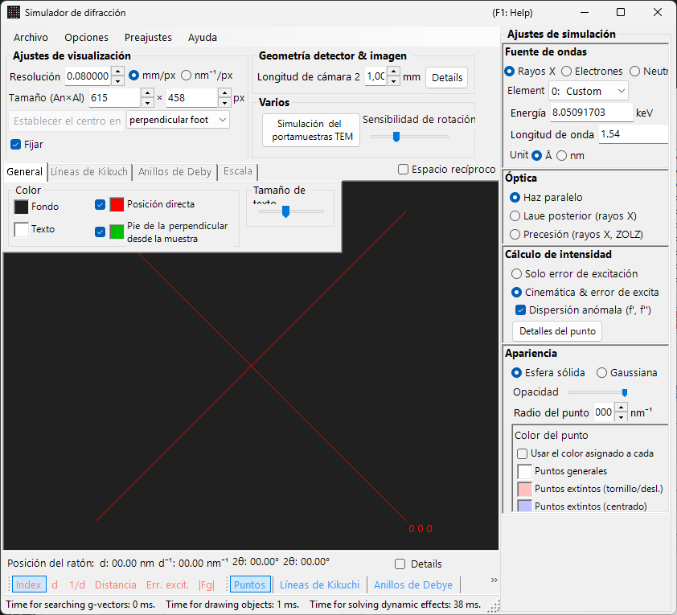
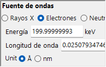
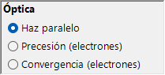
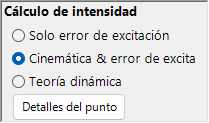
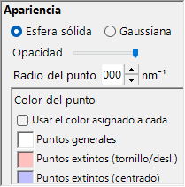
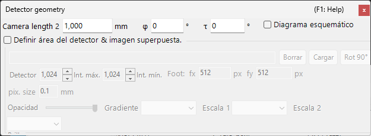

# Simulación de difracción de rayos X / neutrones

La **simulación de difracción de rayos X / neutrones** calcula patrones de difracción de monocristal para rayos X y neutrones. Es uno de los modos principales del [simulador de difracción](index.md).

> Esta página enumera cada ajuste que aparece en el lado derecho cuando selecciona **Fuente de ondas** = **Rayos X** (o **Neutrón**). Para operaciones que afectan a toda la ventana, como dibujar y guardar, consulte la [página de descripción general](index.md).

Condiciones de la GUI: Fuente de ondas = Rayos X / Neutrón · Óptica = Haz paralelo / Precesión (rayos X, ZOLZ) / Laue posterior (rayos X) · Cálculo de intensidad = Solo error de exc. / Cinemática & err. exc.

---

## Descripción general

Los rayos X tienen una longitud de onda mayor que los electrones (Cu Kα: 0.15406 nm = 1.5406 Å), por lo que la esfera de Ewald está más fuertemente curvada. Como resultado, menos puntos de la red recíproca satisfacen simultáneamente la condición de difracción que en el caso de los electrones. Dado que el poder de dispersión atómico es pequeño y la dispersión múltiple es débil, la teoría cinemática de la difracción ofrece una precisión suficiente para las intensidades (el cálculo dinámico solo se admite para electrones).

---

## Fuente de ondas {#wave-length}

Seleccione **Rayos X** como **Fuente de ondas**. Los rayos X pueden especificarse de dos maneras: rayos X característicos y radiación de sincrotrón.

### Rayos X característicos

Elegir un **elemento** y una **transición** fija la longitud de onda de los rayos X característicos. La transición se especifica en notación de Siegbahn (Kα₁ / Kα₂ / Kβ, etc.). Longitudes de onda Kα₁ de elementos representativos:

| Elemento | Línea | Longitud de onda (Å) | Energía (keV) |
|---------|------|-----------------|--------------|
| Cu | Kα₁ | 1.5406 | 8.048 |
| Mo | Kα₁ | 0.7093 | 17.479 |
| Co | Kα₁ | 1.7890 | 6.930 |
| Cr | Kα₁ | 2.2897 | 5.415 |

### Radiación de sincrotrón

Establezca **Element** en **0: Custom** e introduzca directamente la energía (keV) o la longitud de onda (Å). Puede utilizarse cualquier longitud de onda.

---

## Óptica {#incident-beam-mode}

Selecciona la geometría del haz incidente. Hay tres modos disponibles para los rayos X.

### Haz paralelo {#parallel}

La onda plana estándar. Un haz incidente paralelo utilizado para SAED y difracción de rayos X de monocristal.

### Precesión (rayos X, ZOLZ) — cámara de precesión {#precession-x-ray--precession-camera}

Simula una cámara de precesión de rayos X. Se trata de una fotografía de precesión que captura una sola capa de la red recíproca. Los anillos de Debye se dibujan como círculos de radio $2L_2\sin\theta$ ($L_2$ = longitud de cámara 2), igual que los círculos de la escala 2θ. <!-- 261105Cl 監査: DrawDebyeRing (C6) -->

### Laue posterior (rayos X) — Laue de retrorreflexión {#back-laue-back-reflection-laue}

Simula un patrón de Laue de retrorreflexión con rayos X blancos (policromáticos). En esta geometría de retrorreflexión, el detector se coloca en el lado de la fuente; las casillas de energía / longitud de onda y el selector de elemento del control **Fuente de ondas** se ocultan y en su lugar se muestra **Flat white**. Los puntos se proyectan sobre un detector plano **perpendicular al haz**, situado a la longitud de cámara en el lado de la fuente; la inclinación del detector **Tau / Phi** de [Geometría del detector](index.md#detector-geometry) no se usa en esta proyección.

- El espectro blanco se corta en **50 keV**: se recogen reflexiones hasta $d = \lambda(50\ \text{keV})/2$, y no se aplica ninguna ponderación espectral.
- Los armónicos $n\mathbf{g}$ situados sobre la misma recta que pasa por el origen caen en el mismo punto; sus $\lvert F\rvert^2$ se suman sobre la reflexión de orden más bajo y las intensidades de los puntos se normalizan al punto más intenso.
- **Dispersión anómala (f', f'')** está desactivada (la energía no tiene un valor único), y **Radio del punto** no tiene unidad en este modo.
- 2θ (posición del ratón, etiquetas de los puntos y escala 2θ) es el ángulo de dispersión: 180° en el orificio del haz, en el centro, y decrece hacia fuera. <!-- 261105Cl 監査: Back Laue の 2θ (C13) -->
- Se dibujan todos los cristales seleccionados; con más de un cristal (o con **Color por cristal** activado), los puntos de cada cristal toman el color de ese cristal. <!-- 261105Cl 監査: Back Laue の複数結晶 -->

> **Nota**: Las opciones de **Óptica** dependen de la fuente de ondas. **Precesión (electrones)** y **Convergencia (electrones)** aparecen solo cuando se selecciona **Electrones**, mientras que las opciones **Precesión (rayos X, ZOLZ)** y **Laue posterior (rayos X)** anteriores aparecen solo cuando se selecciona **Rayos X**. Para los neutrones, solo está disponible **Haz paralelo**. Según el estado en el momento de la captura, la captura de pantalla puede no mostrar las opciones específicas de rayos X.

---

## Cálculo de la intensidad

Selecciona el método utilizado para calcular las intensidades de los puntos. Hay dos modos disponibles para los rayos X.

### Solo error de exc.

La intensidad se determina únicamente por la distancia geométrica entre la esfera de Ewald y el punto de la red recíproca (el error de excitación $S_g$). Es máxima en $S_g = 0$ —exactamente sobre la esfera— y decae a medida que crece $\lvert S_g\rvert$, llegando a cero cuando $\lvert S_g\rvert$ supera el **Radio del punto** indicado para el punto de la red recíproca. El factor de estructura se ignora.

Solo en este modo aparecen las opciones siguientes:

- **Excluir todas las reflexiones prohibidas** / **Excluir reflexiones prohibidas por centrado de red** (por defecto: solo centrado de red) : ocultan las reflexiones prohibidas por el grupo espacial. Las reflexiones que no se ocultan se dibujan con los colores independientes fijados en **Color del punto** (prohibidas por ejes helicoidales/planos de deslizamiento y prohibidas por la red).
- **Dibujar todos los puntos con el mismo radio** : dibuja todos los puntos con el tamaño correspondiente a $S_g = 0$, independientemente de su error de excitación.

### Cinemática & err. exc.

Además del error de excitación, el factor de estructura cinemático $\lvert F_{hkl} \rvert^2$ se incorpora a la intensidad. Las reglas de extinción se obedecen estrictamente. Los factores de Lorentz y de polarización no se incluyen (se trata de una simulación del patrón geométrico).

- **Dispersión anómala (f', f'')** (solo rayos X, activada por defecto) : añade al factor de estructura (también a los anillos de Debye) los términos de dispersión anómala f′, f″ a la energía de rayos X actual. En una estructura no centrosimétrica que contenga dispersores anómalos químicamente distintos, la ley de Friedel deja entonces de cumplirse y las intensidades de $hkl$ / $\bar h\bar k\bar l$ difieren (pares de Bijvoet); el efecto es máximo cerca de un borde de absorción. Desactivada en Laue posterior. Consulte [Factor de estructura](../appendix/a2-beam-interaction/structure-factor.md).

> **Nota**: La **teoría dinámica** está deshabilitada para los rayos X (disponible solo cuando se selecciona radiación de electrones).

---

## Apariencia de los puntos

Controla cómo se renderiza cada punto de difracción.

- **Esfera sólida / Gaussiana** : modelo geométrico del punto de la red recíproca. **Esfera sólida** dibuja la sección transversal entre una esfera y la esfera de Ewald; con **Cinemática & err. exc.** el radio de la esfera es $R \times I_\text{rel}^{1/3}$ (de modo que el *volumen* de la esfera es proporcional a la intensidad relativa), y con **Solo error de exc.** es el propio *R*. **Gaussiana** utiliza la sección transversal entre una gaussiana 3D con σ = *R* y la esfera de Ewald (la integral de la gaussiana 2D corresponde a la intensidad de difracción); los puntos con $\lvert S_g\rvert \ge 3R$ no se dibujan.
- **Opacidad** : transparencia del punto (0 = transparente, 1 = opaco).
- **Radio del punto (R)** : radio del punto de la red recíproca. El tamaño renderizado del punto se determina por la combinación de **Apariencia** y **Cálculo de intensidad**.
- **Brillo** : activo solo en el modo **Gaussiana**. Establece la intensidad integrada de la gaussiana renderizada.
- **Escala de color** (solo Gaussiana) : **Gray**, **Cold-warm**, **Spectrum** o **Fire**.
- **Escala log.** (solo Gaussiana) : muestra las intensidades en una escala logarítmica.
- **Color del punto** : colores de los puntos usados con la escala de color **Gray** (este grupo se oculta con las demás escalas de color).
- **Color por cristal** : cuando está marcada, dibuja los puntos con el color asignado a cada cristal.

---

## Anillos de Debye (policristalino)

Pueden mostrarse los anillos de Debye de una muestra policristalina. Active **Anillos de Debye** en la barra de herramientas (consulte [Barra de herramientas](index.md#toolbar)).

- **Ignorar la intensidad de difracción** : dibuja todos los anillos con el mismo color e intensidad (se utiliza para una comparación puramente geométrica que ignora el factor de estructura).
- **Mostrar etiquetas de índice** : muestra los índices {*hkl*} cerca de cada anillo (cuatro índices {*hkil*} con **Opciones ▸ Usar índices de Miller-Bravais (hkil)** activado para ejes hexagonales). <!-- 261105Cl 監査: DrawDebyeRing (C23) -->

Los ajustes detallados se encuentran en la pestaña Anillos de Debye del [menú de pestañas](index.md#drawing-overlay-tabs).

---

## Difracción de neutrones

Seleccionar **Neutrón** en **Fuente de ondas** calcula un patrón de difracción de neutrones. Introduzca la energía (meV) o la longitud de onda (Å o nm, conmutable; por defecto Å). **Óptica** solo puede ser **Haz paralelo**. El cálculo de la intensidad puede ser **Solo error de exc.** o **Cinemática & err. exc.** (**Teoría dinámica** no está disponible). La intensidad cinemática utiliza la longitud de dispersión de neutrones en lugar del factor de dispersión atómico.

---

## Diferencias entre la difracción de rayos X y de electrones

| Característica | Difracción de rayos X | Difracción de electrones |
|---------|-------------------|----------------------|
| Longitud de onda | Larga (0.5–2.5 Å) | Corta (0.02–0.04 Å) |
| Curvatura de la esfera de Ewald | Grande | Pequeña (casi plana) |
| Reflexiones simultáneas | Pocas | Muchas |
| Factor de dispersión | Factor de dispersión atómico $f(s)$ | Factor de dispersión de electrones $f_e(s)$ |
| Efectos dinámicos | Generalmente pequeños | Grandes |
| Reglas de extinción | Estrictamente obedecidas | Pueden ser violadas por la dispersión múltiple |

---

## Operaciones comunes

Para operaciones que afectan a toda la ventana, como la longitud de cámara, la geometría del detector, el guardado de patrones y los ajustes de color, consulte la [página de descripción general](index.md). La geometría detallada del detector se configura en la ventana de geometría que se muestra a continuación.

---

## Véase también

- [Simulador de difracción (descripción general)](index.md)
- [Simulación SAED](1-saed-simulation.md)
- [Simulación de difracción de electrones por precesión (PED)](2-ped-simulation.md)
- [Simulación de difracción de electrones de haz convergente (CBED)](3-cbed-simulation.md)
- [Sistema de coordenadas — orientación del cristal](../appendix/a1-coordinate-system/1-orientation.md)
