# Crystal Diffraction (Simulador de difracción)

**Crystal Diffraction (Simulador de difracción)** simula patrones de difracción de rayos X, neutrones y electrones de monocristal.

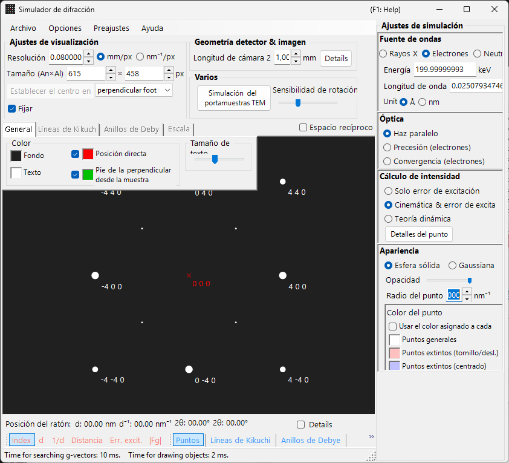

La ventana tiene un área de dibujo del patrón de difracción a la **izquierda** y, a la **derecha**, el panel **Ajustes de simulación** (fuente de ondas, óptica, cálculo de intensidad, apariencia, etc.). La combinación de fuente de ondas y óptica determina el modo de adquisición (difracción de rayos X, SAED, PED, CBED), y los paneles de la derecha se reconfiguran en consecuencia.

---

## Cómo se reparten el trabajo esta página y las páginas de cada modo

- **Esta página (centro)**: reúne las operaciones comunes a todos los modos (atajos, menús, barra de herramientas, información de pantalla/detector, pestañas de superposición, información de reflejos, geometría del detector, compresión dinámica).
- **Cada página de modo**: cubre **todos los ajustes que aparecen a la derecha** cuando ese modo está seleccionado (longitud de onda, haz incidente, cálculo de intensidad, apariencia, ajustes de ondas de Bloch, ajustes de precesión, etc.), de modo que cada página es autónoma (existe cierto solapamiento entre los modos).

| Modo | Contenido | Página |
|------|----------|------|
| **Difracción de rayos X (y de neutrones)** | Patrón de difracción de rayos X / neutrones de monocristal (paralelo, rayos X de precesión, Back Laue) | [Simulación de difracción de rayos X](5-x-ray-neutron-diffraction.md) |
| **SAED** | Difracción de electrones con haz paralelo (selected-area electron diffraction) | [Simulación SAED](1-saed-simulation.md) |
| **PED** | Difracción de electrones por precesión | [Simulación PED](2-ped-simulation.md) |
| **CBED** | Difracción de electrones por haz convergente | [Simulación CBED](3-cbed-simulation.md) |

> **ALCHEMI no es un modo.** A diferencia de rayos X / SAED / PED / CBED, que se determinan por la combinación de longitud de onda y haz incidente, el simulador ALCHEMI es una **ventana secundaria** que se abre desde el menú **Opciones**, por lo que aquí se indica por separado.

| Ventana secundaria | Contenido | Página |
|------|------|------|
| **Simulador ALCHEMI** | Curvas de rocking de ionización resueltas por sitio (microanálisis realzado por canalización) | [Simulación ALCHEMI](4-alchemi-simulation.md) |

Al ocultar el Simulador de difracción se ocultan también todas sus ventanas secundarias (información de los reflejos, geometría del detector, CBED, compresión dinámica, simulación del portamuestras TEM y el simulador ALCHEMI). Cuando el simulador vuelve a mostrarse, solo la ventana CBED (en modo de convergencia) se reabre por sí sola. <!-- 261105Cl 監査: FormElectronDiffraction_VisibleChanged (f98bc0d) -->

---

## Referencia rápida de modos

Busque la página que necesita a partir de la combinación de **Fuente de ondas** y **Óptica** (haz incidente).

| Fuente de ondas | Óptica | Modo | Página |
|------------|--------------------|------|------|
| Electrones | Haz paralelo | SAED | [Simulación SAED](1-saed-simulation.md) |
| Electrones | Precesión (electrones) | PED | [Simulación PED](2-ped-simulation.md) |
| Electrones | Convergencia (electrones) | CBED | [Simulación CBED](3-cbed-simulation.md) |
| Rayos X | Haz paralelo | Difracción de rayos X | [Simulación de difracción de rayos X](5-x-ray-neutron-diffraction.md) |
| Rayos X | Precesión (rayos X, ZOLZ) | Rayos X de precesión (cámara de precesión) | [Simulación de difracción de rayos X](5-x-ray-neutron-diffraction.md) |
| Rayos X | Laue posterior (rayos X) | Laue de retrorreflexión | [Simulación de difracción de rayos X](5-x-ray-neutron-diffraction.md) |
| Neutrones | Haz paralelo | Difracción de neutrones | [sección de neutrones de la Simulación de difracción de rayos X](5-x-ray-neutron-diffraction.md) |

> **Nota**: Las opciones de haz incidente (**Óptica**) cambian con la longitud de onda. Para electrones: **Haz paralelo, Precesión (electrones), Convergencia (electrones)**; para rayos X: **Haz paralelo, Precesión (rayos X, ZOLZ), Laue posterior (rayos X)**; para neutrones: solo **Haz paralelo**. Al cambiar la fuente de ondas, la óptica vuelve siempre a **Haz paralelo**. Al seleccionar **Precesión (electrones)** o **Convergencia (electrones)** se cambia automáticamente el cálculo de intensidad a **Teoría dinámica**; **Teoría dinámica** solo se ofrece para electrones (al seleccionar rayos X o neutrones se vuelve a **Cinemática & err. exc.**). Back Laue usa un haz blanco (policromático).

---

## Atajos de teclado y ratón

Estos se aplican a la ventana del patrón de difracción compartida por las simulaciones de rayos X, SAED y PED. Arrastrar sobre el patrón rota el **cristal**. Haga zoom con la rueda del ratón o con clic derecho / arrastre con el botón derecho.

| Atajo | Acción |
|----------|--------|
| <kbd>F1</kbd> | Abrir esta página del manual en línea |
| Arrastre con el botón izquierdo cerca del centro | Inclinar el cristal |
| Arrastre con el botón izquierdo en la zona exterior | Girar el cristal en torno al eje del haz |
| Doble clic izquierdo en un reflejo | Mostrar los detalles del reflejo (índice, *d*, factor de estructura, error de excitación) |
| Arrastre con el botón central | Desplazar el patrón |
| <kbd>CTRL</kbd> + arrastre con el botón central | Mover el centro del detector (cuando se muestra el área del detector) |
| Rueda del ratón | Acercar / alejar el zoom ×2 por cada paso de la rueda; el punto bajo el cursor pasa al centro de la vista (con **Fijar** marcado, se conserva en cambio el centro fijo) |
| Clic derecho | Alejar el zoom (×1/1.2) |
| Arrastre de un recuadro con el botón derecho | Acercar el zoom a la región seleccionada |
| Doble clic derecho en la barra de estado | Copiar un resumen de texto de los ajustes actuales: cristal y ángulos de Euler, fuente, energía, longitud de onda, óptica, forma de los puntos, cálculo de intensidad (con **Teoría dinámica**, también el espesor, el número de ondas difractadas y, para PED, el ángulo de precesión) y la geometría del detector <!-- 261105Cl 監査: statusStrip1_MouseDown (C24) --> |
| Doble clic derecho en un botón de capa activa (Puntos / Líneas de Kikuchi / Anillos de Debye / Escala) | Hacer parpadear esa capa para activarla y desactivarla |

Las ventanas auxiliares que se abren desde aquí añaden algunos más:

| Atajo | Acción |
|----------|--------|
| Doble clic izquierdo en el estereograma — **Simulación de portamuestras TEM** | Fijar la inclinación del portamuestras en ese punto |
| Teclas de flecha — **Simulación de portamuestras TEM** | Cambiar la inclinación del portamuestras paso a paso (marque antes **Activar teclas de flecha**; solo mientras la ventana del portamuestras está activa) <!-- 261106Cl 作者の決定 D25 --> |
| Soltar un archivo `.prm` o una imagen — **Geometría del detector** | Cargar la geometría del detector / imagen de superposición |
| Soltar un perfil `.txt` — **Compresión dinámica** | Cargar perfiles de posición/tiempo/presión (elija el tiempo con el deslizador **Tiempo**; arrastre las líneas verticales del gráfico para fijar el frente y la parte posterior) |

Los atajos <kbd>CTRL</kbd>+<kbd>SHIFT</kbd> de toda la aplicación de la ventana principal también funcionan mientras esta ventana tiene el foco (consulte la [ventana principal](../0-main-window.md)).

→ Consulte **[21. Atajos de teclado y ratón](../21-shortcuts.md)** para ver todas las ventanas de un vistazo.

---

## Rutas rápidas por objetivo

| Objetivo | Empezar desde | Referencia |
|------|------------|-----------|
| Producir difracción de electrones con haz paralelo (SAED) | Poner **Óptica** en **Haz paralelo** y **Fuente de ondas** en **Electrones** | [Simulación SAED](1-saed-simulation.md), [cálculo SAED de haz paralelo](../appendix/a3-bloch-wave/calculation.md) |
| Producir difracción de rayos X de monocristal | Cambiar **Fuente de ondas** a **Rayos X** (para radiación de sincrotrón, ponga **Element** en **0: Custom**) | [Simulación de difracción de rayos X](5-x-ray-neutron-diffraction.md) |
| Producir difracción de electrones por precesión (PED) | Poner **Óptica** en **Precesión (electrones)** y luego fijar el ángulo de precesión y el paso | [Simulación PED](2-ped-simulation.md) |
| Producir difracción de electrones por haz convergente (CBED) | Poner **Óptica** en **Convergencia (electrones)** y fijar las condiciones en la ventana CBED | [Simulación CBED](3-cbed-simulation.md), [cálculo CBED](../appendix/a3-bloch-wave/cbed.md) |
| Inspeccionar la lista de reflejos del cálculo dinámico | Seleccionar **Teoría dinámica** y pulsar **Detalles del punto** | [Cálculo dinámico (núcleo compartido)](../appendix/a3-bloch-wave/calculation.md) |
| Comparar la geometría del detector con una imagen experimental | Abrir los ajustes de geometría del detector desde **Detalles** en **Geometría detector & imagen superpuesta** y usar la imagen de superposición | [Sistema de coordenadas del detector](../appendix/a1-coordinate-system/2-diffraction.md) |

---

## Área principal

El patrón de difracción se simula en el centro de la pantalla.

### Manejo con el ratón

Consulte "Atajos de teclado y ratón" al principio de esta página.

### Posición del ratón

La línea **Posición del ratón:** situada sobre el patrón muestra, para la posición del cursor, *d* y *d*⁻¹ (en nm y nm⁻¹ o en Å y Å⁻¹, según la unidad de longitud de la ventana principal) y 2θ <!-- 261106Cl 作者の決定 C2 --> (en grados y en rad, o en mrad por debajo de 0.1 rad). Marcar **Details** añade tres lecturas de coordenadas: las coordenadas del detector (mm, origen = pie de la perpendicular desde la muestra), las coordenadas del espacio real (mm, origen = cristal) y las coordenadas del espacio recíproco (nm⁻¹). En modo Back Laue, los valores de *d* y del espacio recíproco se muestran como "-", y 2θ es el ángulo de dispersión, es decir, 180° menos el ángulo respecto al eje del haz (180° en el orificio del haz, en el centro). <!-- 261105Cl 監査: Back Laue の 2θ (C13) -->

---

## Menú Archivo

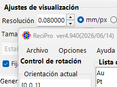

| Elemento de menú | Descripción |
|-----------|-------------|
| **Guardar imagen** | Guardar el patrón de difracción mostrado, **como imagen (formato PNG)** o **como metarchivo (EMF)**. |
| **Guardar área del detector** | Guardar solo el recorte del área del detector (PNG / EMF) sobre la rejilla de píxeles del detector. Solo aparece mientras se muestra el área del detector. Solo se pregunta si se incluye la imagen superpuesta cuando hay una cargada. <!-- 261105Cl 監査: SaveOrCopyDetector (C18) --> |
| **Guardar discos CBED** | Solo en modo CBED: guardar los discos calculados **como imágenes individuales (formato PNG / TIFF)** o **como imagen colectiva (formato PNG / TIFF)**. Siempre son los discos CBED, también mientras se muestra el área del detector. |
| **Copiar** | Copiar la imagen mostrada al portapapeles (**como imagen** / **como metarchivo (EMF)**). |
| **Copiar área del detector** | Copiar solo el recorte del área del detector sobre la rejilla de píxeles del detector. Solo aparece mientras se muestra el área del detector. Solo se pregunta si se incluye la imagen superpuesta cuando hay una cargada. |
| **Copiar discos CBED** | Solo en modo CBED: copiar los discos **como imagen colectiva** (siempre los discos CBED, también mientras se muestra el área del detector). |
| **Guardar vídeo** | Grabar un vídeo del **Patrón de difracción** o de la vista **Espacio recíproco**. |
| **Configurar página / Vista previa de impresión / Imprimir** | Imprimir el patrón mostrado. |

### Preajustes

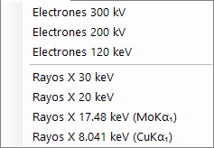

Preajustes fijos de fuente de ondas que solo establecen la radiación y su energía: **Electrones 300 kV**, **Electrones 200 kV**, **Electrones 120 kV**, **Rayos X 30 keV**, **Rayos X 20 keV**, **Rayos X 17.48 keV (MoKα₁)** y **Rayos X 8.041 keV (CuKα₁)** (los dos últimos seleccionan la línea característica Kα₁ de Mo / Cu). Los demás ajustes (geometría del detector, pestañas, propiedades de los reflejos) no se guardan ni se modifican.

### Menús Opciones y Ayuda

| Elemento de menú | Descripción |
|-----------|-------------|
| **Opciones > Compresión dinámica** | Abre la ventana [Compresión dinámica](#compresión-dinámica) (junto con la ventana de geometría del detector). |
| **Opciones > Simulador ALCHEMI...** | Abre el [simulador ALCHEMI](4-alchemi-simulation.md). |
| **Ayuda > Concepto básico del método de Bethe** | Abre en el navegador el [apéndice de ondas de Bloch](../appendix/a3-bloch-wave/index.md) del manual en línea. |

---

## Barra de herramientas {#toolbar}

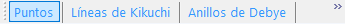

| Botón | Descripción |
|--------|-------------|
| Puntos | Mostrar / ocultar la capa de reflejos de difracción |
| Líneas de Kikuchi | Mostrar / ocultar la capa de líneas de Kikuchi |
| Anillos de Debye | Mostrar / ocultar la capa de anillos de Debye |
| Escala | Mostrar / ocultar la capa de líneas de escala |
| Index / d / 1/d / Distancia / 2θ / χ / Err. excit. / Intensidad <!-- 261106Cl 作者の決定 C11, C1 --> | Elección de la etiqueta asociada a cada reflejo |

---

## Información de pantalla y detector

### Pantalla

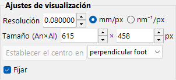

| Elemento | Descripción |
|------|-------------|
| **Resolución** | El tamaño de un píxel de pantalla, en **mm/px** (en el plano del detector) o en **nm⁻¹/px** (seleccionable; por defecto 0.08 mm/px). No tiene por qué coincidir con el tamaño real de píxel del detector; se trata como una escala de visualización y se actualiza automáticamente cuando hace zoom con el ratón. |
| **Tamaño (An×Al)** | Ancho y alto en píxeles del área de dibujo. Según la resolución de su pantalla, es posible que no se puedan establecer valores muy grandes. |
| **Establecer el centro en / Fijar** | Sitúa el centro del área de dibujo en el pie de la perpendicular (**perpendicular foot**), en el haz directo (**direct spot**) o en el centro del detector (**detector**; este último solo cuando hay un área de detector definida). Con **Fijar** marcado (por defecto), el centro permanece allí: el desplazamiento con el ratón queda desactivado y el zoom conserva ese centro. |
| **Voltear horizontal / Voltear vertical / Imagen negativa** | Inversiones geométricas (horizontal / vertical) e inversión de color del patrón: **Imagen negativa** invierte el fondo, los puntos, las etiquetas, las líneas de Kikuchi, las reflexiones prohibidas, el haz directo, el pie de la perpendicular, los anillos de Debye y las líneas de escala (no se invierten los colores de los cristales, las escalas de color de la visualización gaussiana, la vista 3D ni una imagen superpuesta). <!-- 261105Cl 監査: checkBoxNegativeImage_CheckedChanged (C21) --> Úselas para igualar la orientación o el contraste de una imagen experimental. |
| **Espacio recíproco** | Abre, junto al patrón, una vista 3D de la esfera de Ewald y de los puntos de la red recíproca, visualizando qué reflejos están excitados. Su panel **Opciones** fija los colores (puntos cerca / lejos de la esfera de Ewald, esfera de Ewald, origen, guía de dirección), el radio 3D de los puntos (nm⁻¹), el umbral de intensidad relativa (%), la transparencia de los puntos lejos de la esfera de Ewald, las etiquetas y la dirección de vista (botones de flecha con un **Paso** angular, **Restab. vista**). |

### Detector (longitud de cámara)

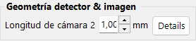

- **Long. cámara 2** : Distancia (mm) desde la muestra hasta el pie de la perpendicular trazada sobre el plano del detector (por defecto 1000 mm). Coincide con la longitud de cámara habitual cuando el detector no está inclinado (τ = 0).
- **Detalles** : Abre la ventana de ajustes de geometría del detector (consulte [Geometría del detector](#detector-geometry) más abajo).

### Varios {#misc}

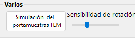

- **Sensibilidad de rotación** : Cantidad de rotación del cristal por píxel de arrastre del ratón.
- **Simulación del portamuestras TEM** : Abre la ventana de simulación vinculada al portamuestras (consulte más abajo).

---

## Simulación del portamuestras TEM

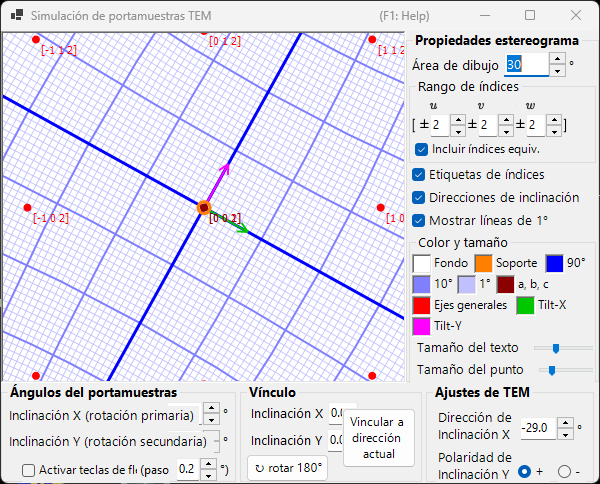

Abre una ventana que vincula el patrón de difracción a un **TEM holder** de doble inclinación (**Inclinación X** = rotación primaria, **Inclinación Y** = rotación secundaria). Establecer los ángulos de inclinación del portamuestras actualiza el patrón y la orientación del cristal, y las orientaciones alcanzables pueden mostrarse en un estereograma (añadido en v4.914). **Vincular a dirección actual** toma la orientación actual del cristal como referencia del portamuestras (con la Inclinación X / Inclinación Y indicadas); **Ajustes de TEM** dan la dirección del eje de Inclinación X en la pantalla (por defecto −29°) y la polaridad de la Inclinación Y, y **↻ rotar 180°** gira el cristal 180° en torno al haz (siempre en torno al eje del haz, aunque haya un eje o un plano fijado en la ventana principal). El doble clic izquierdo en el estereograma fija la inclinación del portamuestras en ese punto, y al marcar **Activar teclas de flecha**, ←/→ cambian la Inclinación X y ↑/↓ la Inclinación Y paso a paso (paso 0.1–2°, por defecto 0.2°). Las teclas de flecha inclinan el portamuestras solo mientras esta ventana está activa. <!-- 261106Cl 作者の決定 D25 --> Cuando la ventana vuelve a mostrarse tras haberse ocultado (con el simulador), o cuando se cambia la Inclinación X / Inclinación Y, una rotación o un cambio de cristal hecho entretanto se toma como nueva referencia: la orientación actual se considera la orientación a la inclinación presente, y la lista de ejes de zona se reconstruye para el cristal actual. <!-- 261105Cl 監査: FormDiffractionSimulatorHolder.cs OnVisibleChanged / numericBoxTilt_ValueChanged (54e23f0) -->

---

## Pestañas de superposición del dibujo {#drawing-overlay-tabs}

### General

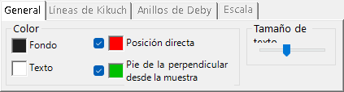

Establece el **Tamaño texto** de las etiquetas y los colores del **Texto** de las etiquetas, del marcador **Pie de la perpendicular desde la muestra**, del marcador **Posición directa** y del **Fondo** (cada uno de los dos marcadores puede desactivarse). Los colores de los reflejos se fijan en **Apariencia** (véanse las páginas de cada modo); los de las líneas de Kikuchi, los anillos de Debye y las líneas de escala, en sus propias pestañas. Los ajustes de aquí se aplican a todos los modos de representación.

### Líneas de Kikuchi

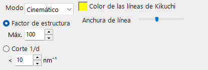

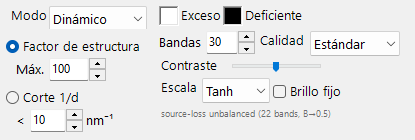

Activa cuando las líneas de Kikuchi están habilitadas en la barra de herramientas.

- **Reflection selection** : Elige qué reflejos generan las líneas de Kikuchi. Bien por **Factor de estructura** (los *N* reflejos principales según $\lvert F_{hkl}\rvert$, fijados con **Máx.**; 1–1000, 100 por defecto) o por **Corte 1/d** (todos los reflejos cuyo 1/d está por debajo del umbral; 0–100 nm⁻¹, 10 por defecto).
- **Modo** : Cómo se dibujan las líneas de Kikuchi (por defecto **Cinemático**). Los ajustes bajo el cuadro combinado cambian con el modo.
    - **Geométrico** : todas las líneas seleccionadas en un color fijo.
    - **Cinemático** : la oscuridad de la línea sigue la intensidad relativa cinemática de cada reflexión.
    - **Dinámico** : perfiles de banda exceso/deficiente dinámicos de dos haces alimentados por dispersión térmica difusa, calculados en segundo plano. Las bandas de exceso aparecen en el lado de ángulos altos y los rasgos deficientes hacia el haz directo; el espesor de la muestra se comparte con los ajustes de intensidad. Mientras dura el cálculo se dibujan las líneas geométricas. Las bandas dinámicas solo se calculan para un haz de **Electrones**; para rayos X y neutrones las líneas se dibujan como líneas geométricas y el aviso indica *Solo electrones: como líneas*. <!-- 261105Cl 監査: DrawKikuchiLine / UpdateKikuchiNotice -->
- **Ajustes Geométrico / Cinemático** : **Color de las líneas de Kikuchi** y **Anchura de línea**.
- **Ajustes Dinámico** :
    - **Exceso** / **Deficiente** : colores del lado claro (contraste positivo) y oscuro (contraste negativo) de las bandas.
    - **Bandas** : Número de bandas dibujadas con perfiles dinámicos (las *N* mejores por contraste dinámico; 1–50, 30 por defecto).
    - **Calidad** : Puntos de muestreo a través de cada banda (Rápido 65 / Estándar 129 / Alta 257; por defecto Estándar).
    - **Contraste** : Ganancia de visualización aplicada al contraste de banda antes de la compresión.
    - **Escala** : Curva de compresión de brillo (Linear / Log / Tanh; por defecto Tanh). Son transformaciones de visualización, no respuestas físicas de cámara.
    - **Brillo fijo** : Congela la normalización de brillo, p. ej. para comparar orientaciones o espesores distintos.
    - La línea de aviso gris indica la marca de desequilibrio fuente/pérdida, el número de bandas dibujadas y diagnósticos (p. ej. factor *B* por defecto sustituido en átomos con *B* = 0).
- (El antiguo parámetro independiente de umbral ya no existe; los reflejos se limitan únicamente mediante la selección anterior.)

### Anillos de Debye

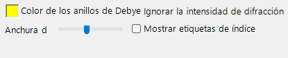

Activa cuando los anillos de Debye están habilitados en la barra de herramientas.

- **Ignorar la intensidad de difracción** : Si está marcada, todos los anillos de Debye se dibujan con el mismo color e intensidad (ignorando el factor de estructura del cristal). Úsela para una comparación puramente geométrica.
- **Mostrar etiquetas de índice** : Si está marcada, los índices {*hkl*} aparecen cerca de cada anillo (cuatro índices {*hkil*} cuando **Opciones ▸ Usar índices de Miller-Bravais (hkil)** de la ventana principal está activado y el cristal usa ejes hexagonales). <!-- 261105Cl 監査: DrawDebyeRing (C23)。ラベルは波かっこ -->

### Escala

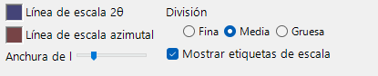

Activa cuando las líneas de escala están habilitadas en la barra de herramientas.

- **Línea de escala 2θ / Línea de escala azimutal** : **2θ** representa un ángulo de dispersión constante (círculos concéntricos), **Azimuth** representa un ángulo azimutal constante (líneas radiales desde el centro). Los colores se configuran de forma independiente. En modo Back Laue, las etiquetas de 2θ son ángulos de dispersión, por lo que el centro es 180°.
- **Anchura de línea** : Grosor de las líneas de escala.
- **División** : Densidad de las líneas de escala, **Fina** / **Media** (por defecto) / **Gruesa**.
- **Mostrar etiquetas de escala** : Si se dibujan etiquetas numéricas sobre las líneas de escala.

(No existe una pestaña *Misc* independiente; la **Sensibilidad de rotación** del ratón está en el grupo **Varios** del panel derecho, véase [Varios](#misc) más arriba.)

---

## Información de los reflejos de difracción {#diffraction-spot-information}

Lista los detalles por reflejo calculados con el método de ondas de Bloch (cálculo dinámico). Ábrala con el botón **Detalles del punto** del panel de cálculo de intensidad. En el modo **Solo error de exc.** / cinemático, el botón lista los reflejos dibujados en ese momento con sus potenciales electrónicos y $P_g$, $Q_g$ (sin amplitudes dinámicas); en modo CBED, la tabla sigue el espesor seleccionado en la ventana CBED. Para rayos X y neutrones, $S_g$, $P_g$ y $Q_g$ se calculan con la longitud de onda real (sin corrección por refracción), se ocultan las columnas de potencial y el selector de unidad de potencial, y el voltaje de aceleración, $m/m_0$ y $v/c$ se muestran como "-". <!-- 261105Cl 監査: FormDiffractionSpotInfo.cs SetTable (C 組) -->

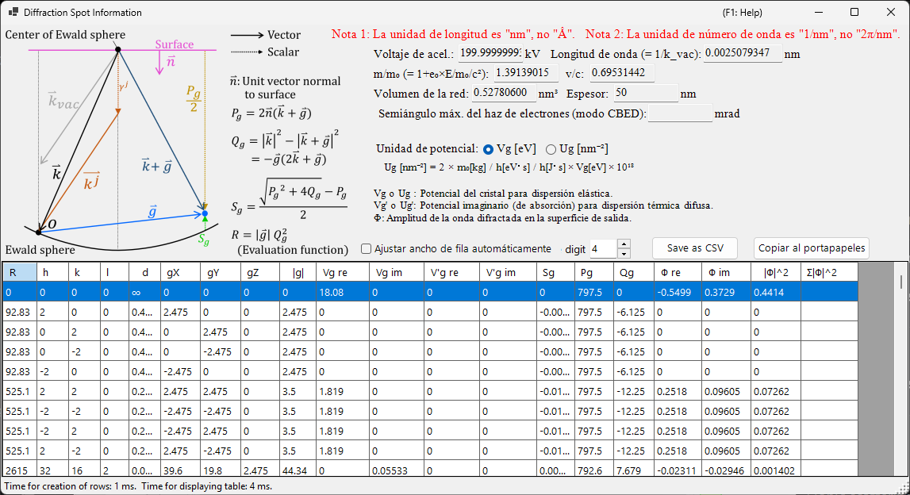

### Esquema y definiciones

El esquema (arriba a la izquierda) muestra los vectores sobre la esfera de Ewald y define las magnitudes empleadas en la tabla ($\hat{\mathbf{n}}$ es el vector unitario normal a la superficie de la muestra, $\mathbf{k}$ es el vector de onda incidente, $\mathbf{g}$ es el vector de la red recíproca).

- $P_g = 2\,\hat{\mathbf{n}} \cdot (\mathbf{k} + \mathbf{g})$
- $Q_g = |\mathbf{k}|^2 - |\mathbf{k} + \mathbf{g}|^2 = -\mathbf{g} \cdot (2\mathbf{k} + \mathbf{g})$
- **Error de excitación:** $S_g = \dfrac{\sqrt{P_g^2 + 4 Q_g} - P_g}{2}$
- **Función de evaluación:** $R = |\mathbf{g}|\, Q_g^2$ — ordena los reflejos según la intensidad con que están excitados (menor = más cerca de la esfera de Ewald = más fuertemente excitado; el haz transmitido $g=0$ tiene $R=0$ y aparece primero). La tabla está ordenada por $R$ ascendente.

### Columnas de la tabla

| Columna | Significado |
|--------|---------|
| **R** | función de evaluación $R = \lvert\mathbf{g}\rvert\, Q_g^2$ (arriba; usada para seleccionar / ordenar los reflejos) |
| **h, k, (i,) l** | índices de Miller (*i* es el índice hexagonal redundante, mostrado solo para cristales hexagonales) |
| **d** | distancia interplanar (nm) |
| **gX, gY, gZ** | componentes del vector de la red recíproca *g* (1/nm) |
| **\|g\|** | módulo de *g* (1/nm) |
| **Vg re / Vg im** | coeficiente de Fourier del potencial cristalino para la dispersión elástica, $V_g$ (real / imaginario) |
| **V'g re / V'g im** | potencial imaginario (de absorción) para la dispersión térmica difusa (TDS), $V'_g$ (real / imaginario) |
| **Sg** | error de excitación $S_g$ (arriba; 1/nm) |
| **Pg** | magnitud auxiliar $P_g = 2\,\hat{\mathbf{n}}\cdot(\mathbf{k}+\mathbf{g})$ (arriba) |
| **Qg** | magnitud auxiliar $Q_g = -\mathbf{g}\cdot(2\mathbf{k}+\mathbf{g})$ (arriba) |
| **Φ re / Φ im** | amplitud compleja $\Phi$ de la onda difractada dinámica en la superficie de salida (real / imaginaria) |
| **\|Φ\|^2** | intensidad difractada $\lvert\Phi\rvert^2$ de ese reflejo |
| **Σ\|Φ\|^2** | suma acumulada de $\lvert\Phi\rvert^2$ (total sobre los reflejos; útil como comprobación de la conservación de la intensidad) |

### Unidades de potencial y otros controles

- **Unidad de potencial** : Cambia el potencial mostrado entre **Vg [eV]** (potencial electrostático, eV) y **Ug [nm⁻²]** (la magnitud escalada $U_g = (2 m_0/h^2)\, V_g$ que entra en las ecuaciones de ondas de Bloch). Los encabezados de columna cambian en consecuencia entre *Vg / V'g* y *Ug / U'g*. Solo se muestra para electrones. <!-- 261106Cl 作者の決定 C5 -->
- Sobre la tabla se muestran el voltaje de aceleración, la longitud de onda ($\lambda = 1/k_\text{vac}$), la relación de masa relativista $m/m_0$, la relación de velocidad $v/c$, el volumen de la red, el espesor de la muestra y (en modo CBED) el semiángulo de convergencia α. El espesor solo aparece en un cálculo con **Teoría dinámica** (en modo CBED, el espesor de la ventana CBED) y el semiángulo solo en modo CBED; en los demás casos se muestran como "-".
- **Nota 1:** la unidad de longitud es **nm**, no Å. **Nota 2:** la unidad de número de onda es **1/nm**, no 2π/nm.
- **Dígito efectivo** : número de cifras significativas mostradas en la tabla (1–16, por defecto 4). **Ajustar ancho de fila automáticamente** : ajustar automáticamente el ancho de las columnas. **Copiar al portapapeles** : exporta la tabla como texto que puede pegarse en una hoja de cálculo. **Guardar como CSV** : escribe la misma tabla (las columnas visibles) en un archivo CSV; el separador decimal es siempre el punto, por lo que el archivo sigue siendo válido en configuraciones regionales con coma decimal. **Copiar al portapapeles** y **Guardar como CSV** funcionan aunque la tabla tenga una sola fila. Ambos empiezan con líneas `# key: value` que indican las condiciones (fuente, voltaje de aceleración o energía, longitud de onda, espesor, semiángulo de convergencia en CBED, cristal, ángulos de Euler, modo de cálculo), y los encabezados de columna llevan unidades, p. ej. `d (nm)`, `Sg (nm⁻¹)`, `Qg (nm⁻²)`. <!-- 261106Cl 作者の決定 C22 -->

---

## Geometría del detector {#detector-geometry}

Una ventana para la configuración detallada de la geometría del detector (longitud de cámara, inclinación, rotación) y la superposición de una imagen experimental. Ábrala desde **Detalles** en el panel **Geometría detector & imagen superpuesta**.

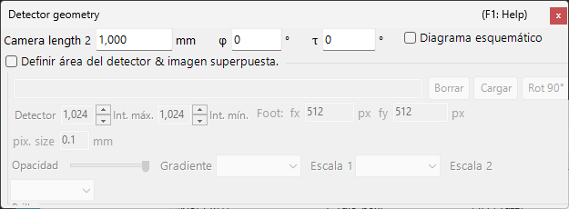

### Ajustes de geometría del detector

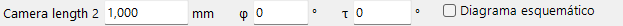

Especifique la geometría de reflexión: **Longitud de cámara 2** (mm, 1–10000, por defecto 1000) y la inclinación del detector **τ** (−200 a 200°) en torno a un eje contenido en el plano de azimut **φ**. Para Back Laue (Laue de retrorreflexión) solo se usa **Longitud de cámara 2**: el patrón se proyecta siempre sobre un detector perpendicular al haz en el lado de la fuente, y τ / φ no se aplican a esa proyección. Al soltar un archivo `.prm` se cargan los elementos que contiene —la fuente (elemento y línea de rayos X, electrones o neutrones) con su longitud de onda, la longitud de cámara 2, τ, φ, la posición del pie, el tamaño de píxel y el tamaño del detector— y se activa el área del detector; los elementos que no están en el archivo no se modifican. <!-- 261105Cl 監査: FormDiffractionSimulatorGeometry_DragDrop (952b457)。以前の「常に X 線・任意波長」は誤り -->

### Área del detector e imagen superpuesta

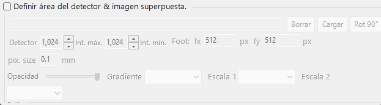

Marque **Definir área del detector & imagen superpuesta.** para especificar el detector: tamaño en píxeles (por defecto 1024 × 1024), **Tamaño de píxel** (mm, por defecto 0.1) y la posición del pie **fx, fy** (**Pie**; px, por defecto 512, 512): el pie de la perpendicular trazada desde la muestra al plano del detector, que solo coincide con la posición del haz directo cuando el detector no está inclinado (τ = 0). <!-- 261105Cl 監査: numericBoxFootX/Y.ToolTip, convertDetectorToReal --> Puede cargarse una imagen experimental (**Cargar** o soltándola) y superponerse con **Opacidad**, **Gradiente** (película positiva/negativa), **Escala 1** (log/lineal), **Escala 2** (Gray / Cold-warm / Spectrum / Fire), **Int. máx./Int. mín.**, **Rot 90°** y **Borrar**. Al cargar una imagen `.ipa` se pone τ = 0 (el archivo no lleva inclinación), el pie en el centro de la imagen y la longitud de cámara 2 en la distancia de la película. Un archivo que no puede leerse como archivo `.prm` ni como imagen se indica con un mensaje. <!-- 261105Cl 監査: ReadImage / showCannotRead (4dc847a) --> **Diagrama esquemático** muestra un esquema de la geometría. Use esto para superponer el patrón simulado y una imagen experimental y ajustar con precisión la geometría del detector.

Consulte también el [sistema de coordenadas del detector](../appendix/a1-coordinate-system/2-diffraction.md) para las definiciones del sistema de coordenadas.

---

## Compresión dinámica

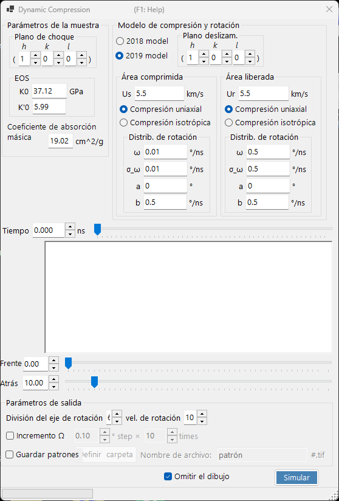

Una ventana para simular la difracción de una muestra comprimida por choque (compresión dinámica). Suelte un archivo `.txt` separado por tabulaciones con tres columnas (profundidad en µm, tiempo en ns, presión en MBar) para cargar los perfiles de presión de cada tiempo; el eje horizontal del gráfico es la profundidad (µm); el deslizador **Tiempo** (ns) selecciona el perfil que se muestra en el gráfico. Las dos líneas verticales del gráfico (**Frente** / **Atrás**) pueden arrastrarse para fijar el frente y la parte posterior de la compresión. La ventana contiene además el modelo de compresión (**2018 / 2019 model**), las velocidades de choque (**Us**, **Ur**, km/s), la **EOS** (K0, K'0), el **Plano de choque** / **Plano deslizam.**, las distribuciones de rotación de las áreas comprimida y liberada, el coeficiente de absorción másico, el incremento de Ω y **Guardar patrones** (`#.tif`), y se ejecuta con **Simular**. Una anchura de rotación σ de 0 (o un número de divisiones 0 del ángulo de rotación) se trata como una única orientación. Tanto si la ejecución termina bien como si falla, el cristal y su orientación se restauran después. <!-- 261105Cl 監査: FormDiffractionSimulatorDynamicCompression.cs execute / buttonSimulate_Click (fb26838, 4a21154, 8461e90) -->

---

## Simulador ALCHEMI

Abre una ventana secundaria que calcula **curvas de rocking de ionización resueltas por sitio**: el rendimiento de un canal de ionización elegido mientras el cristal se inclina a través de las condiciones de Bragg de una fila sistemática, separado por sitio atómico. Se abre desde el menú **Opciones**. A diferencia de la ventana CBED, tiene su propia área de salida y no dibuja en el lienzo de la ventana principal.

→ Consulte **[Simulación ALCHEMI](4-alchemi-simulation.md)** para todos los ajustes y para el alcance y las limitaciones conocidas.

---

## Temas relacionados

- [Simulación de difracción de rayos X](5-x-ray-neutron-diffraction.md)
- [Simulación SAED](1-saed-simulation.md)
- [Simulación PED](2-ped-simulation.md)
- [Simulación CBED](3-cbed-simulation.md)
- [Simulación ALCHEMI](4-alchemi-simulation.md)
- [Cálculo dinámico (núcleo compartido)](../appendix/a3-bloch-wave/calculation.md)
- [Sistema de coordenadas del detector](../appendix/a1-coordinate-system/2-diffraction.md)
