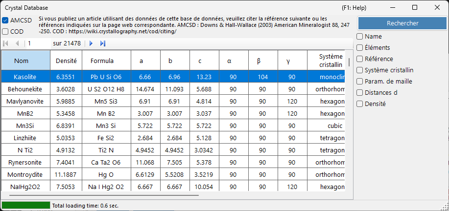
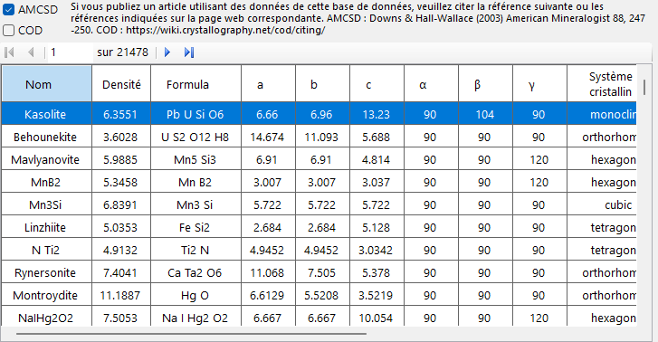
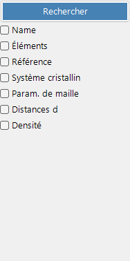

# Base de données de cristaux

La **Base de données de cristaux** offre des fonctions pour rechercher et importer des structures cristallines à partir de deux sources, sélectionnables au moyen des cases à cocher **AMCSD** et **COD** :

- **AMCSD** : la [American Mineralogist Crystal Structure Database](https://www.rruff.net/) fournie avec le logiciel (plus de 20 000 structures).
- **COD** : la [Crystallography Open Database](https://www.crystallography.net/cod/). Comme le fichier est volumineux, il n'est pas fourni avec le programme d'installation ; le fichier de la base de données est téléchargé automatiquement lors de la première utilisation. Lorsque le fichier est mis à jour sur le serveur, il vous est demandé de le télécharger à nouveau.

Veuillez citer les références suivantes lorsque vous utilisez ces bases de données.

Lors de l'utilisation de **AMCSD** :

> Downs, R.T. and Hall-Wallace, M. (2003) The American Mineralogist Crystal Structure Database. *American Mineralogist* **88**, 247-250.

Lors de l'utilisation de **COD** :

> Gražulis, S. et al. (2009) Crystallography Open Database – an open-access collection of crystal structures. *Journal of Applied Crystallography* **42**, 726-729.
>
> Gražulis, S. et al. (2012) Crystallography Open Database (COD): an open-access collection of crystal structures and platform for world-wide collaboration. *Nucleic Acids Research* **40**, D420-D427.

---

## Raccourcis clavier et souris

Cette fenêtre n'a pas de combinaisons avec des touches de modification ; elle se pilote par des clics ordinaires. Les seules entrées non évidentes sont :

| Raccourci | Action |
|----------|--------|
| <kbd>F1</kbd> | Ouvrir cette page du manuel en ligne |
| <kbd>ENTER</kbd> dans n'importe quel champ de recherche | Lancer la recherche dans la base de données (équivaut au bouton **Rechercher**) |
| Cliquer sur une ligne du tableau des résultats | Charger ce cristal dans la fenêtre principale |
| Cliquer sur un élément dans la fenêtre contextuelle **Tableau périodique** | Faire défiler son filtre : *peut inclure ou non* → *doit inclure* → *doit exclure* |

→ Voir **[21. Raccourcis clavier et souris](21-shortcuts.md)** pour un aperçu de chaque fenêtre.

---

## Tableau

Affiche les cristaux correspondant aux critères de recherche. Sélectionnez un cristal pour le transférer vers les Informations sur le cristal de la fenêtre principale. Appuyez sur **Ajouter** ou **Remplacer** pour l'ajouter à la Liste des cristaux.

---

## Options de recherche

Saisissez ci-dessous les critères de recherche et appuyez sur le bouton **Rechercher** ou sur la touche **Enter**.

| Critère | Description |
|-----------|-------------|
| **Name** | Nom du cristal |
| **Éléments** | Sélecteur du tableau périodique (peut/doit/ne doit pas contenir) |
| **Référence** | Titre, revue, auteur |
| **Système cristallin** | Sélectionner le système cristallin |
| **Param. de maille** | Constantes du réseau et erreur |
| **Distances d** | Valeurs d des réflexions fortes et erreur |
| **Densité** | Densité et erreur |

### Name

Correspondance en texte libre avec le nom du cristal. Les correspondances partielles sont autorisées ; la casse est ignorée. Seuls les critères dont la case est cochée sont appliqués, et ils sont combinés par ET.

### Éléments {#element}

Appuyez sur le bouton **Tableau périodique** pour ouvrir le sélecteur d'éléments. Chaque bouton d'élément parcourt trois états :

- **peut inclure ou non** (par défaut – jaune)
- **doit inclure** (bleu)
- **doit exclure** (rouge)

Un cristal doit contenir tous les éléments *doit inclure* et aucun des éléments *doit exclure* ; tant que le critère **Éléments** est actif, les entrées sans données atomiques sont exclues.

Les trois boutons en haut de la fenêtre réinitialisent chaque élément à l'un des trois états en un seul clic.

### Référence

Correspondance en texte libre (partielle, insensible à la casse) avec les métadonnées de la publication : titre de l'article, nom de la revue et liste des auteurs.

### Système cristallin

Restreint la recherche à un système cristallin spécifique (cubic, tetragonal, orthorhombic, hexagonal, trigonal, monoclinic, triclinic). Le premier élément, *Unknown*, n'applique aucune restriction.

### Recherche par paramètres de maille

Saisissez les constantes du réseau cibles *a*, *b*, *c* (Å) et *α*, *β*, *γ* (°) ainsi que les erreurs acceptables : une tolérance relative (±%) commune à *a*, *b*, *c*, et une tolérance absolue (±°) commune aux angles. Une valeur de 0 signifie que le paramètre est ignoré.

### Distances d

Saisissez jusqu'à trois distances *d* (Å ; cochez chacune pour l'utiliser), chacune avec une tolérance relative (±%). Un cristal correspond lorsque chaque valeur saisie concorde avec l'une de ses réflexions les plus fortes enregistrées dans la base de données (jusqu'à 16, classées par intensité de diffraction X sur poudre à λ = 1.54 Å). Lorsque **Ignorer le facteur de diffusion** est coché, les valeurs sont comparées à toutes les distances *d* géométriquement possibles calculées à partir de la maille (y compris les réflexions systématiquement éteintes). Utile lorsque seules les positions des pics de diffraction sont connues à partir d'une expérience.

### Densité

Filtre par masse volumique (g/cm³) avec une tolérance relative (±%).

---

## Voir aussi

- [Fenêtre principale](0-main-window.md)
- [Informations de symétrie](2-symmetry-information.md)
- [Interaction du faisceau](3-beam-interaction.md)
- [Visualiseur de structure](5-structure-viewer.md)
