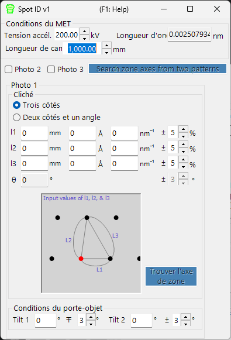

# Spot ID v1

**Spot ID v1** (l'ancien **TEM ID**) recherche des axes de zone candidats à partir d'une géométrie de taches saisie numériquement, pour un à trois clichés de diffraction. La détection, l'ajustement et l'indexation des taches sur une image s'effectuent dans [Spot ID v2](11-spot-id-v2.md).

---

## Raccourcis clavier et souris

Spot ID v1 prend la géométrie des taches comme **entrée numérique** (l'ancien flux de travail *TEM ID*) ; il n'a pas de vue d'image (le chargement d'images, le zoom à la souris, la détection des taches et la sélection manuelle des taches relèvent de [Spot ID v2](11-spot-id-v2.md)). Le seul raccourci se trouve dans la fenêtre des résultats :

| Raccourci | Action |
|----------|--------|
| <kbd>F1</kbd> | Ouvrir cette page du manuel en ligne |
| Double-clic sur une ligne de la liste des résultats | Sélectionner ce cristal et le faire pivoter vers l'axe de zone correspondant |

→ Voir **[21. Raccourcis clavier et souris](21-shortcuts.md)** pour un aperçu de toutes les fenêtres.

---

## Recherche d'axe de zone à partir de la géométrie des taches (ancien TEM ID)

Lorsque vous n'avez pas d'image à charger, vous pouvez tout de même rechercher des axes de zone candidats en saisissant à la main la géométrie d'un cliché de diffraction électronique en aire sélectionnée (SAED). Saisissez les conditions d'observation MET et la géométrie des taches, puis appuyez sur **Trouver l'axe de zone** d'une photo (ou sur **Trouver les axes de zone à partir de deux/trois clichés** pour utiliser plusieurs photos ensemble) afin de trouver des orientations cristallines candidates.

### Conditions du MET

Saisissez **Tension accél.** (kV, 200 par défaut) et **Longueur de caméra** (mm, 1000 par défaut). La **Longueur d'onde** (nm) est calculée à partir de la tension et affichée en lecture seule.

### Photo 1, 2, 3

Saisissez la géométrie des taches de diffraction.

- Pour saisir la distance entre deux taches sur le détecteur, utilisez le champ **mm**.
- Si vous connaissez la valeur *d*, saisissez-la dans les unités **Å** ou **nm⁻¹**.

**Mode Trois côtés** : Saisissez les longueurs des trois côtés d'un triangle dont l'un des sommets est le direct spot.

**Mode Deux côtés et un angle** : Saisissez les longueurs de deux côtés (y compris le direct spot) ainsi que l'angle entre eux.

- Tolérances (les champs **±**) : chaque longueur a une tolérance en % (0–50, 5 par défaut) et θ une tolérance en degrés (0–30, 3 par défaut). La valeur non saisie (θ en mode trois côtés, l3 en mode deux côtés) est calculée et affichée, et un croquis du cliché obtenu est dessiné à côté des champs de saisie.
- **Conditions du porte-objet** : **Tilt 1** / **Tilt 2** (°) du porte-objet goniométrique auxquels la photo a été prise, chacun avec une tolérance (0–10°, 3° par défaut). Les angles entre les réglages du porte-objet des différentes photos sont calculés et affichés.
- **Photo 2** / **Photo 3** : activent la deuxième et la troisième photo. Les cases à cocher placées entre les photos traitent l1 (ou l2) de deux photos comme la même réflexion et en recopient la longueur.
- **Trouver l'axe de zone** recherche pour une seule photo ; **Trouver les axes de zone à partir de deux clichés** / **de trois clichés** recherche les combinaisons compatibles avec les photos et avec les angles d'inclinaison du porte-objet entre elles ; la photo 3 n'est utilisée que si **Photo 3** est cochée et que toutes ses valeurs sont saisies, sinon deux photos sont utilisées. Dans le tableau de résultats d'une seule photo (**Trouver l'axe de zone**), g1, d1, g2 et d2 sont toujours affichés, ainsi que g3 et d3 en mode trois côtés ou θ en mode deux côtés et un angle. <!-- 261105Cl 監査: buttonSearchAll_Click (afd65e0)、FormSpotIDv1Results.SetDataSet (46d91db) --> La recherche porte sur tous les cristaux sélectionnés dans la liste de la fenêtre principale (la sélection multiple est activée tant que Spot ID v1 est ouvert). Si plus de 1000 candidats sont trouvés, rien n'est listé et il vous est demandé de restreindre les conditions ; sinon, la fenêtre des résultats s'ouvre. Double-cliquez sur une ligne pour sélectionner le cristal et le faire pivoter vers cette orientation. Le signe de chaque axe de zone candidat suit la convention des manuels **g**₁ × **g**₂ ; il est donc inversé par rapport aux versions antérieures à 2026-11 (l'orientation est la même). <!-- 261106Cl 作者の決定 B16 -->

---

## Voir aussi

- [Spot ID v2](11-spot-id-v2.md)
- [Simulateur de diffraction](7-diffraction-simulator/index.md)
- [Fenêtre principale](0-main-window.md)
- [Base de données de cristaux](1-crystal-database.md)
- [Simulation EBSD](12-ebsd-simulation.md)
