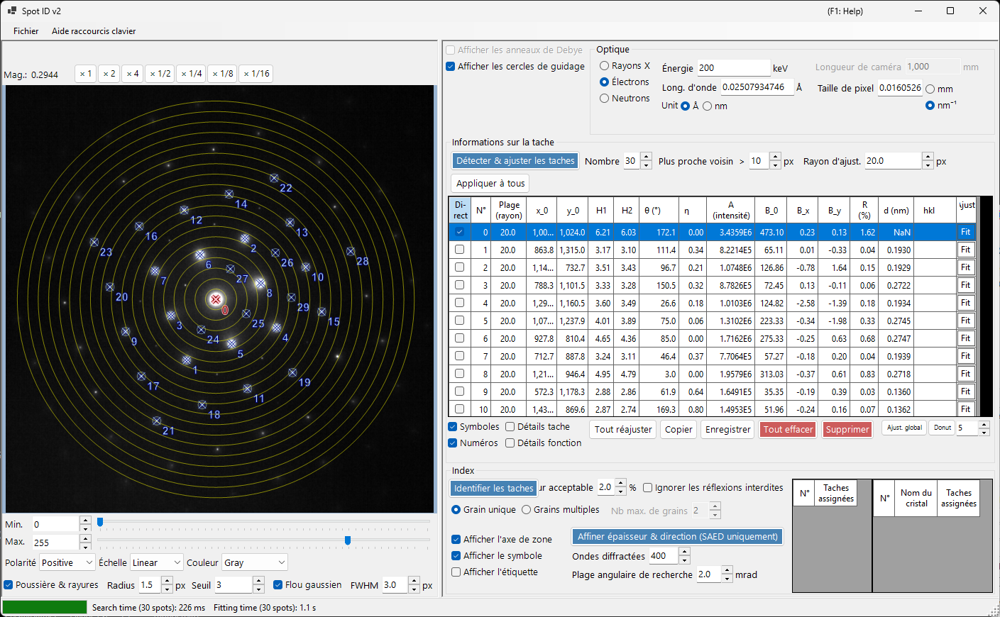
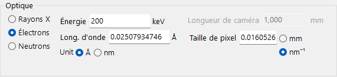
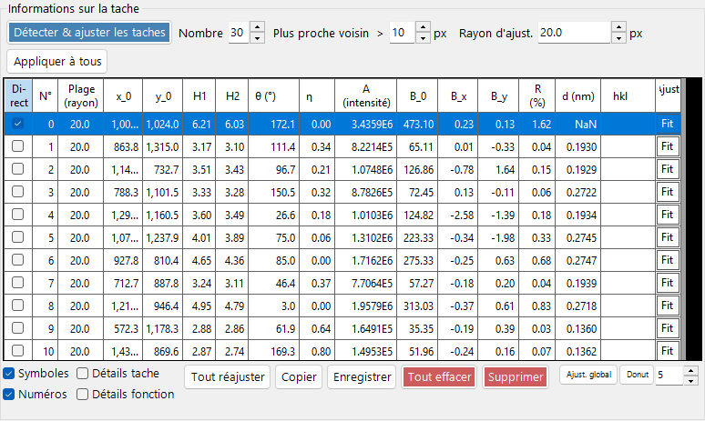
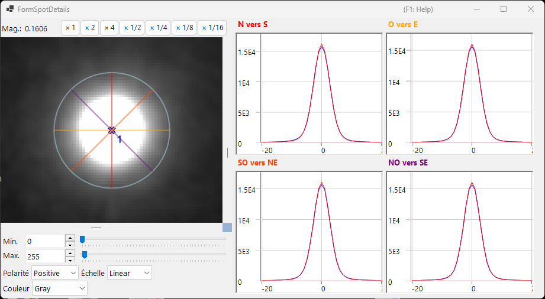
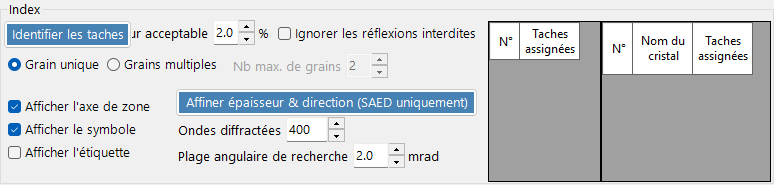

# Spot ID v2

**Spot ID v2** détecte, ajuste et indexe les taches de diffraction sur une image de diffraction expérimentale. [Spot ID v1](10-spot-id.md) (l'ancien TEM ID) prend au contraire la géométrie des taches en saisie numérique.

---

## Raccourcis clavier et souris

Vous construisez la liste des taches directement sur l'image chargée. Le volet d'image utilise la [navigation standard de la vue d'image](21-shortcuts.md) de ReciPro pour le déplacement/zoom ; l'édition des taches ajoute les combinaisons ci-dessous.

| Raccourci | Action |
|----------|--------|
| <kbd>F1</kbd> | Ouvrir cette page du manuel en ligne |
| Double-clic gauche sur l'image | Ajouter une tache à ce point (ajustée par pic) |
| <kbd>CTRL</kbd> + double-clic gauche | Ajouter une tache et la marquer comme faisceau direct (000) |
| Clic gauche sur une tache | Sélectionner la tache la plus proche |
| <kbd>CTRL</kbd> + clic droit sur une tache | Supprimer la tache la plus proche |
| <kbd>CTRL</kbd> + touches fléchées | Déplacer la tache sélectionnée d'un pixel |
| Glisser gauche / Glisser milieu (zone vide) | Déplacer l'image |
| Molette de la souris | Zoomer / dézoomer au curseur |
| Glisser droit d'un cadre | Zoomer sur la région sélectionnée |
| Double-clic droit | Dézoomer |
| Double-clic sur l'en-tête de ligne d'une tache (tableau) | Zoomer sur cette tache (×2) |

→ Voir **[21. Raccourcis clavier et souris](21-shortcuts.md)** pour un aperçu de chaque fenêtre.

---

## Menu Fichier

Ouvrir une image de diffraction ; **Enregistrer** / **Copier** écrivent l'image affichée en métafichier (EMF) ou en image (PNG). Les images peuvent aussi être chargées par glisser-déposer. Pour un fichier Gatan DM3/DM4 étalonné en nm⁻¹, le rayonnement est réglé sur les électrons, et la tension d'accélération ainsi que la taille de pixel (nm⁻¹) sont lues dans le fichier (la longueur de caméra n'est alors pas nécessaire).

**Enregistrer ▸ Candidate list (CSV)...** exporte les orientations candidates trouvées par l'indexation, et **Copier ▸ Candidate list (TSV)** place le même tableau dans le presse-papiers : une ligne par candidat × grain, avec le rang, l'indice de grain, le nom du cristal, les angles d'Euler ZXZ (°), les neuf éléments de la matrice de rotation, le résidu quadratique moyen (nm⁻²), le nombre de taches attribuées et les attributions tache → (hkl). Le CSV utilise toujours le point comme séparateur décimal ; le TSV se colle directement dans un tableur.

---

## Optique

### Source incidente

Sélectionnez le type de rayonnement (rayons X / électron / neutron) et réglez l'énergie ou la longueur d'onde.

### Longueur de caméra / Taille de pixel

La longueur de caméra (mm) et la taille de pixel du détecteur (mm ou nm⁻¹). Lorsqu'un fichier Gatan DM étalonné en nm⁻¹ est chargé, la taille de pixel (nm⁻¹) est lue dans l'en-tête du fichier et la longueur de caméra n'est pas utilisée (le champ de longueur de caméra est désactivé tant que l'unité est nm⁻¹). Changer la longueur d'onde, la longueur de caméra ou l'unité de la taille de pixel conserve les positions des taches (pixels) et recalcule leurs distances *d* avec le nouvel étalonnage.

La position de la fenêtre et l'étalonnage (source, énergie, longueur de caméra, ainsi que l'unité et la valeur de la taille de pixel) sont conservés pour le prochain démarrage ; l'ouverture d'un fichier image qui contient un étalonnage les remplace. <!-- 261105Cl 監査: NumericBoxPixelSize_ValueChanged (8860d40)、FormMain.cs の保存・復元 (dc42de3) -->

**Afficher les anneaux de Debye** (désactivé par défaut) dessine les anneaux de Debye de chaque cristal sélectionné dans la fenêtre principale — chaque cristal dans sa propre couleur lorsque plusieurs sont sélectionnés —, centrés sur la tache directe et avec l'étalonnage actuel (longueur d'onde, longueur de caméra, taille de pixel) ; les anneaux des réflexions interdites par les règles d'extinction ne sont pas dessinés. **Afficher les cercles de guidage** (activé par défaut) dessine des cercles de guidage sur le cliché. <!-- 261106Cl 作者の決定 I10 -->

---

## Informations sur la tache

- **Détecter & ajuster les taches** : Détection automatique des taches à l'aide des maxima locaux et de la soustraction du fond.
- **Nombre** : Le nombre maximal de taches à détecter.
- **Plus proche voisin** : La séparation minimale (px) autorisée entre les taches détectées. Les pics plus proches que cette valeur sont fusionnés, évitant la double détection d'une même tache.
- **Rayon d'ajust.** : Le rayon (px) de la région circulaire utilisée pour ajuster le pic de chaque tache. Les pixels à l'intérieur de ce cercle sont ajustés par une fonction pseudo-Voigt.
- **Appliquer à tous** : Fixe le rayon d'ajustement de chaque tache à la valeur actuelle de **Rayon d'ajust.**.
- **Supprimer / Tout effacer** : Supprimer la tache sélectionnée, ou toutes les taches détectées.
- **Enregistrer** / **Copier** : Enregistrer le tableau des taches dans un fichier CSV, ou le copier dans le presse-papiers sous forme de texte séparé par des tabulations. Les deux fonctionnent même avec une seule tache. Le CSV utilise toujours le point comme séparateur décimal et peut être relu avec **Fichier ▸ Charger** (une image doit d'abord être chargée ; les taches s'ajoutent à celles déjà listées). <!-- 261105Cl 監査: GetSpotListText / readCSV (7f65908) -->
- **Tout réajuster** : Réajuster les positions et les intensités de toutes les taches détectées.
- **Symboles** / **Numéros** : Afficher des symboles / des numéros sur les taches observées (tous deux activés par défaut).
- **Ajust. global** : Effectuer un ajustement global de toutes les positions des taches en une seule fois (expérimental).
- **Donut** : Appliquer une soustraction de fond en forme d'anneau (expérimental) ; la case adjacente fixe la largeur (px) de l'anneau entourant chaque tache, dont la moyenne est soustraite comme fond local.
- **Détails tache** : Lorsque cette option est cochée, une fenêtre s'ouvre affichant des informations détaillées sur la tache actuellement sélectionnée.
- **Détails fonction** (désactivé à l'ouverture de la fenêtre) : Afficher une figure de la fonction pseudo-Voigt bidimensionnelle et de ses paramètres (x_0, y_0, H1, H2, θ, η, A, B_0, B_x, B_y) utilisés dans le tableau des taches.

---

## Index

- **Identifier les taches** : Exécute l'algorithme d'indexation pour trouver le cristal et l'axe de zone qui correspondent le mieux. Pendant l'exécution, un bouton **Arrêter** prend sa place et interrompt la recherche. Il faut une image chargée, au moins deux taches et au moins un cristal sélectionné dans la liste des cristaux de la fenêtre principale ; sinon, un message indique ce qui manque. Tant que Spot ID v2 est ouvert, la liste des cristaux de la fenêtre principale permet la sélection multiple. <!-- 261105Cl 監査: buttonIdentifySpots_Click (494ef52)、FormMain.cs の複数選択 (4020433) -->
- **Erreur acceptable** : Tolérance relative sur la distance interréticulaire en % (0.1–10, 2 par défaut). La tolérance angulaire entre taches en est déduite sous la forme asin(tolérance)/2.
- **Ignorer les réflexions interdites** (désactivé par défaut ; diffraction électronique uniquement) : Lorsque cette option est cochée, toutes les réflexions systématiquement éteintes, y compris celles interdites par les axes hélicoïdaux et les plans de glissement, sont exclues des réflexions candidates. Lorsqu'elle est décochée, seules les extinctions dues au centrage du réseau (I, F, A, B, C, R) sont exclues, de sorte que les réflexions interdites par hélice/glissement qui peuvent apparaître par diffraction multiple restent candidates. Pour les rayons X et les neutrons, toutes les réflexions éteintes sont toujours exclues (traitement cinématique) ; la case est alors affichée cochée et grisée, et revient à son état précédent lorsque la source repasse aux électrons. <!-- 261106Cl 作者の決定 I4 -->
- **Grain unique / Grains multiples** : Recherche d'une orientation unique (monocristal), ou de plusieurs orientations (une région polycristalline / à grains multiples). Pour plusieurs grains, **Nb max. de grains** définit la limite supérieure du nombre de grains à rechercher.
- **Afficher l'axe de zone** / **Afficher le symbole** / **Afficher l'étiquette** : Superposer l'axe de zone ainsi que les symboles / étiquettes d'indices des taches calculées.
- **Affiner épaisseur & direction (SAED uniquement)** : Ne fonctionne qu'avec **Électrons** comme source (sinon, la barre d'état l'indique et rien n'est calculé). <!-- 261105Cl 監査: ButtonRefineThicknessAndDirection_Click / Bethe_CbedCompleted (ed018ca) --> Affiner l'épaisseur de l'échantillon (nm) et la direction du faisceau du grain sélectionné en ajustant les intensités observées des taches à des calculs dynamiques (ondes de Bloch). **Ondes diffractées** (1–2048, 400 par défaut) est le nombre de faisceaux, et **Plage angulaire de recherche** (mrad, 1–10, 2 par défaut) la demi-plage angulaire des directions incidentes explorées. L'affinement ne peut pas être interrompu (le bouton **Arrêter** appartient uniquement à **Identifier les taches**) ; la fenêtre reste désactivée jusqu'à la fin du calcul. Des épaisseurs de 50 à 549 nm (pas de 1 nm) et des directions incidentes sur une grille carrée autour de l'orientation actuelle du grain (pas = 1/15 de la plage de recherche) sont essayées, et le couple qui minimise Σ (Iobs − a·Icalc)² sur les taches indexées (a : meilleur facteur d'échelle) est retenu. La meilleure épaisseur est transmise au simulateur de diffraction, et l'orientation du grain (appliquée aussi à la fenêtre principale, sauf si le cristal y a été changé pendant le calcul) est inclinée de sorte que la meilleure direction devienne la direction du faisceau ; la rotation dans le plan est conservée. Le résultat (épaisseur, inclinaison en mrad, axe de zone, résidu) s'affiche dans la barre d'état. Si la meilleure direction se trouve au bord de la plage de recherche, la barre d'état le signale, car l'optimum peut se trouver en dehors : appuyez de nouveau sur le bouton (la recherche est alors centrée sur l'orientation affinée) ou élargissez la plage. <!-- 261105Cl 方位の精密化の実装に合わせて追記 (根拠: FormSpotIDV2.cs: ButtonRefineThicknessAndDirection_Click / Bethe_CbedCompleted) -->
- **Résultats** : Les meilleures correspondances sont affichées avec le nom du cristal, l'axe de zone [uvw] et les indices individuels des taches (hkl). La sélection d'une seule ligne de grain sélectionne aussi son cristal dans la fenêtre principale et y applique cette orientation. <!-- 261105Cl 監査: bindingSourceGrains_CurrentChanged (I11) -->

---

## Voir aussi

- [Spot ID v1](10-spot-id.md)
- [Simulateur de diffraction](7-diffraction-simulator/index.md)
- [Fenêtre principale](0-main-window.md)
- [Raccourcis clavier et souris](21-shortcuts.md)
