# Simulation EBSD

Le **Simulateur EBSD** simule les figures de diffraction d'électrons rétrodiffusés (EBSD) — figures de Kikuchi — obtenues dans un microscope électronique à balayage (MEB), à l'aide de calculs de théorie dynamique. Il calcule la distribution angulaire/en énergie/en profondeur des électrons rétrodiffusés (BSE) au moyen d'une simulation Monte-Carlo, construit un **master pattern** dynamique (ondes de Bloch) du cristal et le projette sur le détecteur pour l'orientation actuelle du cristal. Une image EBSD expérimentale peut également être chargée et **indexée** : l'orientation qui l'explique le mieux est recherchée automatiquement ([Image expérimentale](#image-expérimentale)).

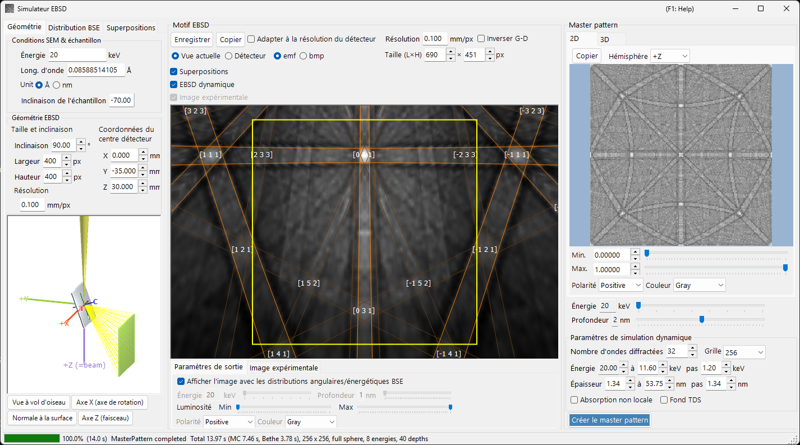

La fenêtre comporte trois colonnes.

- **À gauche** : conditions de simulation. Les onglets sélectionnent **Géométrie** (géométrie échantillon/détecteur et une vue 3D), **Distribution BSE** (distributions des électrons rétrodiffusés) et **Superpositions** (lignes de Kikuchi et autres annotations).
- **Au centre** : la figure EBSD (de Kikuchi) pour l'orientation actuelle du cristal. En dessous, les onglets sélectionnent **Image simulée** et **Image expérimentale**.
- **À droite** : le master pattern indépendant de l'orientation, dans les onglets **2D** et **3D**.

La barre d'état en bas affiche l'avancement du calcul en cours et un résumé de son résultat. Si la fenêtre est étroite, un long message est tronqué au bord droit ; survolez-le avec la souris pour afficher le message complet.

---

## Raccourcis clavier et souris

La vue centrale de la figure EBSD (de Kikuchi) et les vues du master pattern situées à droite réagissent à différentes actions de la souris.

| Raccourci | Action |
|----------|--------|
| <kbd>F1</kbd> | Ouvrir cette page du manuel en ligne |
| Glisser-gauche la figure près du centre | Incliner le cristal |
| Glisser-gauche dans la zone extérieure de la figure | Faire tourner le cristal |
| Double-clic sur la figure | Sélectionner la sous-cellule du détecteur sous le curseur et afficher ses statistiques (tant que la sélection **Zone axis** est activée : ajouter un axe de zone ; voir [Sélection des axes de zone](#zone-axis-picking)) |
| Déposer un fichier image sur la fenêtre | Le charger comme image EBSD expérimentale |
| Glisser-gauche dans une vue 3D (géométrie / sphère du master) | La faire pivoter |
| Glisser-droit, ou molette de la souris, sur une vue 3D | Zoomer |
| <kbd>CTRL</kbd> + double-clic droit sur une vue 3D | Basculer entre orthographique / perspective |
| Glisser / molette sur le master pattern 2D | Déplacer / zoomer l'image |

Les vues 3D utilisent la [navigation de vue](21-shortcuts.md) standard de ReciPro (déplacement désactivé).

→ Voir **[21. Raccourcis clavier et souris](21-shortcuts.md)** pour un aperçu de chaque fenêtre.

---

## Déroulement

Appuyer sur **Créer le master pattern** exécute les étapes suivantes dans l'ordre.

1. **Simulation Monte-Carlo des BSE** : à partir de la composition, de la densité, de la tension d'accélération et de l'inclinaison de l'échantillon actuelles du cristal, 10 millions d'électrons incidents sont suivis à l'intérieur de l'échantillon (diffusion élastique : sections efficaces de Mott/NIST ; diffusion inélastique : modèle de réponse diélectrique). Cela donne la distribution conjointe *profondeur de pénétration × direction de sortie × énergie de sortie* des électrons rétrodiffusés.
2. **Sélection automatique des plages** : à partir de cette distribution, la plage d'énergie (de l'énergie incidente jusqu'à environ le 95e centile de la perte d'énergie) et la plage de profondeur utilisées dans le calcul dynamique sont déterminées automatiquement. La profondeur est ici l'épaisseur du master pattern, c'est-à-dire la longueur de trajet mesurée le long de la direction de sortie (profondeur de la source ÷ cos χ, où χ est l'angle entre la direction de sortie et la normale à la surface de l'échantillon). La plage de profondeur s'étend jusqu'au 99,9e centile de cette longueur de trajet pour les électrons qui atteignent le détecteur (arrondi par excès à deux chiffres significatifs) et est divisée en 40 pas inégaux, plus fins près de la surface.
3. **Construction du master pattern** : pour chaque énergie et profondeur, le problème de diffraction dynamique (ondes de Bloch) est résolu et intégré sur la sphère des directions, pondéré par la distribution Monte-Carlo, afin de fournir l'intensité de diffraction rétrodiffusée dans chaque direction. Le résultat est stocké sur une grille équiaire (Roşca–Lambert).
4. **Projection sur le détecteur, avec pondération** : pour l'orientation actuelle du cristal, l'intensité correspondant à la direction sous-tendue par chaque pixel du détecteur est recherchée dans le master pattern et dessinée sous forme de figure de Kikuchi, éventuellement pondérée par la distribution angulaire/en énergie des BSE.

Les plages d'énergie et de profondeur sont déterminées automatiquement aux étapes 1–2 tant que **Plages d'énergie et de profondeur automatiques (MC)** est cochée (par défaut ; les champs des plages sont alors en lecture seule). Décochez-la pour construire avec des plages saisies à la main : le Monte-Carlo ne touche alors plus aux champs, et les plages saisies à la main sont enregistrées et restaurées au prochain démarrage. <!-- 261106Cl 作者の決定 C11 --> Les plages inutilisables — une borne inférieure qui n'est pas inférieure à la borne supérieure, une énergie supérieure à la tension d'accélération (vérifiée avant le lancement du Monte-Carlo) ou une plage entièrement hors de la distribution Monte-Carlo — ne sont pas construites ; un message en donne la raison et les valeurs. <!-- 261106Cl 作者の決定 F5/F15 -->

---

## Géométrie

### Conditions SEM & échantillon

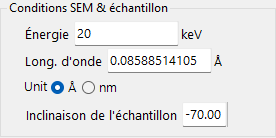

- **Énergie** : tension d'accélération du faisceau incident (keV).
- **Long. d'onde** : longueur d'onde des électrons, liée à **Énergie**. **Unit** sélectionne Å ou nm.
- **Inclinaison de l'échantillon** : angle d'inclinaison de l'échantillon (typiquement −70°). La forte inclinaison en EBSD augmente le rendement en électrons rétrodiffusés. Sa modification efface les résultats Monte-Carlo (les distributions BSE et leurs poids ; relancez **Simuler**) ; le master pattern ne dépend pas de l'inclinaison et est conservé. <!-- 261106Cl 作者の決定 F17 -->

### Géométrie EBSD

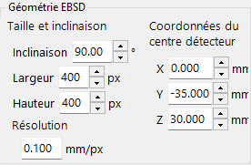

Le détecteur (écran phosphorescent) est un rectangle défini par un nombre de pixels et une taille de pixel.

- **Taille et inclinaison** : **Inclinaison** est l'inclinaison de l'écran du détecteur (°), mesurée depuis le plan horizontal (perpendiculaire au faisceau) : 0° = écran horizontal, 90° = écran vertical (valeur par défaut). **Largeur** et **Hauteur** sont le nombre de pixels du détecteur. <!-- 261105Cl 監査: numericBoxDetTilt.ToolTip (EbsdDetectorGeometry の法線 (0, sin d, −cos d)) -->
- **Résolution** : la taille physique d'un pixel du détecteur (mm/px). La taille physique du détecteur vaut donc Largeur × Résolution par Hauteur × Résolution.
- **Coordonnées du centre du détecteur** : position **X**, **Y**, **Z** du centre du détecteur par rapport au point d'impact du faisceau (mm), dans le repère du microscope (laboratoire). **Y** est le décalage horizontal perpendiculaire à la fois au faisceau (Z) et à l'axe d'inclinaison de l'échantillon (X), et non une direction dans la surface inclinée de l'échantillon. <!-- 261105Cl 監査: numericBoxDetY.ToolTip --> Y et Z, avec l'inclinaison, déterminent la longueur de caméra ; X est le décalage gauche-droite.

Le chargement d'une image expérimentale met **Largeur** et **Hauteur** à la taille de l'image, de sorte qu'un pixel du détecteur corresponde à un pixel de l'image (la **Résolution** reste inchangée).

La géométrie peut être inspectée dans la vue 3D de l'onglet **Géométrie**.

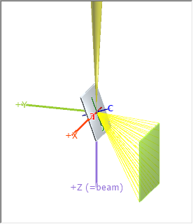

La plaque grise est l'échantillon, la plaque rectangulaire verte est le détecteur, et le **+Z (=beam)** violet est le faisceau incident. Les axes cristallins **a / b / c** (fixés à l'échantillon) sont également affichés. Les boutons **Vue à vol d'oiseau**, **Normale à la surface**, **Axe X (axe de rotation)** et **Axe Z (faisceau)** alignent la vue sur des directions standard. Voir [Annexe A1. Systèmes de coordonnées](appendix/a1-coordinate-system/2-diffraction.md) pour les définitions des systèmes de coordonnées.

---

## Distribution BSE

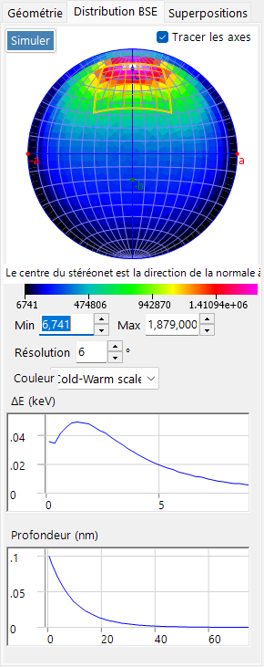

L'onglet **Distribution BSE** affiche les distributions Monte-Carlo des électrons rétrodiffusés. Utilisez **Simuler** pour les recalculer. Un seul Monte-Carlo tourne à la fois : pendant qu'il tourne (lancé par **Simuler** ou par la première étape de **Créer le master pattern**), **Simuler** n'en lance pas un autre, et la barre d'état vous demande d'attendre ou d'appuyer sur **Arrêter**. <!-- 261105Cl 監査: FormEBSD.cs buttonBSE_Click (monteCarloCts) -->

- **Stereonet** : distribution angulaire (histogramme des directions de sortie) des électrons rétrodiffusés. Le centre est la direction de la normale à la surface, et le contour jaune marque la région rectangulaire sous-tendue par le détecteur. **Tracer les axes** superpose les axes cristallins, et l'échelle de couleurs (**Min** / **Max**, **Resolution**, **Couleur**) est réglable.
- **ΔE (keV)** : distribution de la perte d'énergie des électrons rétrodiffusés.
- **Profondeur (nm)** : distribution de la profondeur de source des électrons rétrodiffusés détectés, telle que définie par **Profondeur de la source (MC)** (par défaut : le dernier événement de diffusion inélastique) — la même définition de profondeur que celle qui pondère le master pattern.

Ces distributions sont calculées par le même moteur Monte-Carlo que [Trajectoires électroniques](8-electron-trajectory.md) et servent à pondérer le master pattern. Changer de cristal ou de tension d'accélération efface ces résultats ainsi que le master pattern (un changement effectué pendant que la fenêtre est fermée prend effet à sa réouverture) ; la barre d'état indique ce qui a été effacé. Double-cliquez sur le graphe **ΔE** ou **Profondeur** pour copier ses valeurs dans le presse-papiers sous forme de texte (x et y, séparés par des tabulations). <!-- 261106Cl 作者の決定 F23 --> <!-- 261105Cl 監査: FormEBSD.cs SetCrystal / 電圧の変更 / 開き直し (4bc81f06) -->

---

## Superpositions

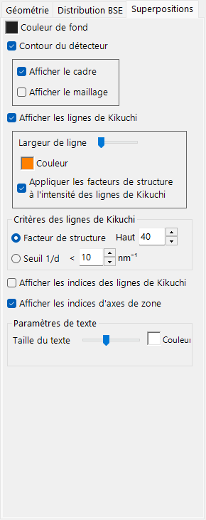

L'onglet **Superpositions** configure les annotations dessinées sur la figure EBSD.

- **Couleur de fond** : couleur de fond.
- **Contour du détecteur** : le contour du détecteur. **Afficher le cadre** (le rectangle jaune au bord du détecteur) / **Afficher le maillage** (grille de division).
- **Afficher les lignes de Kikuchi** : dessiner les lignes de Kikuchi. **Largeur de ligne** / **Couleur**, et **Appliquer les facteurs de structure à l'intensité des lignes de Kikuchi** (chaque ligne se fond dans le fond proportionnellement à son facteur de structure).
- **Critères des lignes de Kikuchi** : quelles lignes de Kikuchi dessiner : **Facteur de structure** (les *N* premières par facteur de structure, champ **Max.**) ou **Seuil 1/d** (celles dont 1/d est inférieur à un seuil, nm⁻¹). Le passage de l'un à l'autre redessine aussitôt les lignes. <!-- 261105Cl 監査: 1/d Cutoff 側にもハンドラを配線 (d88da429) -->
- **Afficher les indices des lignes de Kikuchi** : afficher les indices des lignes de Kikuchi (bandes).
- **Afficher les indices d'axes de zone** : afficher les indices des axes de zone.
- **Paramètres de texte** : **Taille du texte** / **Couleur** des étiquettes d'indices.

---

## Master pattern

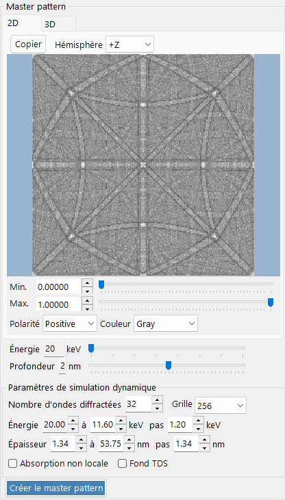

Le master pattern est l'intensité de diffraction rétrodiffusée sur toutes les directions, calculée à l'avance par la théorie dynamique avec **Créer le master pattern** (**Arrêter** interrompt le calcul en cours).

Si un site atomique n'a pas de paramètre de déplacement atomique (B = 0), une boîte de dialogue s'affiche quand on clique sur **Créer le master pattern**. Les sites avec B = 0 ne produisent aucune absorption, et si tous les sites ont B = 0, le master pattern avec **Source non locale** est vide. **OK** attribue à ces sites un B isotrope de 0,5 Ų et lance le calcul (la valeur peut être modifiée ensuite dans la fenêtre principale) ; **Annuler** s'arrête sans calculer. Les sites dotés de paramètres anisotropes (Bij) restent inchangés.

- Onglet **2D** : projection équiaire (de Lambert) d'un hémisphère. **Hémisphère** sélectionne l'hémisphère projeté (+Z / −Z).
- Onglet **3D** : une sphère sur laquelle l'intensité est mappée. Elle peut être pivotée à la souris, et un encart en haut à gauche montre les axes cristallins synchronisés (a/b/c). **Étiquettes d'axes** / **Flèches d'axes** activent/désactivent les étiquettes/flèches, et **Vue selon** regarde le long de l'axe de zone [u v w] saisi à côté.
- Curseurs **Énergie** / **Profondeur** : sélectionnent la tranche d'énergie/de profondeur à prévisualiser.
- L'une ou l'autre vue peut être envoyée dans le presse-papiers avec **Copier**.
- **Enregistrer la vidéo** (onglet **3D**) : enregistre une vidéo (MP4) du master pattern sphérique en rotation. La direction de rotation, la vitesse, la durée, les fps et la qualité se règlent dans la même boîte de dialogue « Movie setting » que dans le [Visualiseur de structure](5-structure-viewer.md). Seule cette vue 3D tourne ; l'orientation du cristal (les angles d'Euler de la fenêtre principale) n'est pas modifiée.

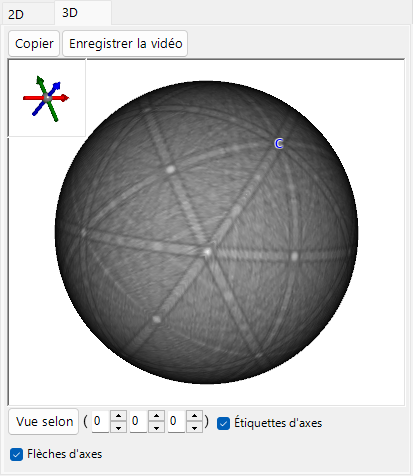

### Paramètres de simulation dynamique

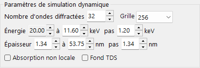

- **Nombre d'ondes diffractées** : nombre de faisceaux diffractés (ondes) inclus dans le calcul des ondes de Bloch. Plus d'ondes sont plus précises mais plus lentes.
- **Grille** : résolution de la grille du master pattern (pixels par côté, 64–8192 ; par défaut 256). 4096 et 8192 exigent une quantité de mémoire énorme pour les données intermédiaires (avec les 16 énergies × 40 profondeurs par défaut, environ 344 Go à 4096 et 1374 Go à 8192 ; déjà environ 86 Go à 2048) ; il faut donc réduire fortement le nombre de pas en énergie et en profondeur pour qu'elles deviennent utilisables. Si la mémoire est insuffisante, le calcul se termine par « MasterPattern failed » (ReciPro lui-même continue de fonctionner).
- **Plages d'énergie et de profondeur automatiques (MC)** (activé par défaut) : tant qu'elle est cochée, le Monte-Carlo fixe les deux plages ci-dessous et leurs champs sont en lecture seule ; décochée, le master pattern est construit avec les plages saisies dans les champs (voir [Déroulement](#déroulement)), et ces plages sont conservées pour le prochain démarrage. Le réglage est conservé pour le prochain démarrage. <!-- 261106Cl 作者の決定 F5/F15 -->
- **Énergie … à … pas …** : plage d'énergie et pas intégrés (keV) ; déterminés automatiquement à partir du résultat Monte-Carlo tant que la case ci-dessus est cochée.
- **Profondeur … à … pas …** : plage de profondeur et pas intégrés (nm), mesurés comme la longueur de trajet le long de la direction de sortie ; déterminés également automatiquement. Les profondeurs automatiques ne sont pas équidistantes : les cases affichent donc, à titre indicatif, le point le moins profond, la borne supérieure et le premier intervalle ; modifier une case à la main fait passer à des profondeurs équidistantes avec ces valeurs.
- **Absorption non locale** : utiliser la forme d'absorption non locale.
- **Source non locale** (active par défaut) : remplace la source de rétrodiffusion localisée aux sites atomiques par la forme non locale du potentiel absorbant (U'_back intégré sur l'hémisphère arrière). Les deux utilisent la même section efficace physique : c'est un changement de modèle, pas un fond additif.
- **Profondeur de la source (MC)** : quel événement Monte-Carlo définit la profondeur de la source cohérente de rétrodiffusion utilisée pour la pondération (énergie × profondeur) : le dernier événement inélastique (défaut), le dernier événement de transport de tout type, ou la dernière décohérence. Dans ce dernier cas, un événement ne réinitialise la source que s'il est assez localisé pour laisser dans l'échantillon l'information « quel atome » : les élastiques avec la probabilité thermique diffuse 1 − exp(−2B s²) du facteur de Debye–Waller (la diffusion de Bragg cohérente non), les inélastiques toujours pour les excitations de cœur ou à forte perte et, pour les excitations de valence, seulement avec la fraction dont le transfert d'impulsion dépasse la coupure plasmon q_c = ω_p/v_F (plasmons et paires électron–trou délocalisées conservent l'état de Bloch). Une source plus superficielle porte une modulation de Kikuchi plus faible : la dernière option fixe le fond diffus par le seul transport, sans paramètre libre. Le changement ne fait que re-classer les électrons enregistrés, sans relancer le Monte-Carlo.
- **Le contraste décroît avec la perte d'énergie** (activé par défaut ; conservé pour le prochain démarrage, E_c ne l'est pas ; E_c = 0,8 keV avec gaussienne asymétrique et 0,9 keV avec histogramme + A par électron) : multiplie le contraste de Kikuchi de chaque tranche d'énergie par A(E) = exp(−(E0 − E)/E_c), où E0 est l'énergie du faisceau et E l'énergie de sortie, et reporte la part perdue dans un piédestal plat moyenné sur les directions, de sorte que la luminosité hors contraste de bande est inchangée. Les poids Monte-Carlo comptent chaque électron rétrodiffusé, mais les électrons ayant beaucoup perdu d'énergie ne portent guère de contraste de Kikuchi net ; sans cette correction, chaque tranche porte le contraste complet et les bandes sortent environ 12 % plus larges que pour des électrons monochromatiques à E0 (Si, 20 kV). E_c est un paramètre effectif et non une constante du matériau ; une valeur plus petite donne une atténuation plus forte. La valeur par défaut de 0.8 keV s'appuie sur une calibration, dans les conditions de calcul d'origine, sur les largeurs de bande d'un pattern mesuré de Si à 20 kV (jeu de données Si004 ; rapport de longueur d'onde effective α ≈ 1.017). Les valeurs calibrées dépendent du matériau et des réflexions utilisées ; pour la botallackite, on a obtenu environ 0.43–0.71 keV selon le choix des réflexions. Pour des comparaisons quantitatives de largeurs de bande, recalibrez E_c lorsque la grille énergie/profondeur, la méthode de synthèse ou la mesure d'évaluation change. La modifier ne fait que repondérer les tranches existantes, sans recalculer le master pattern ni le Monte-Carlo.
- **Couche amorphe de surface** : épaisseur (nm) d'une couche de surface non cristalline (oxyde natif, contamination, dommages de polissage ou d'amincissement ionique). Les électrons dont la source cohérente de rétrodiffusion se trouve dans la couche ne portent aucune modulation de Kikuchi et sont ajoutés comme contribution uniforme moyennée en direction, avec la même intensité par électron ; les sources sous la couche sont mesurées depuis la surface du cristal. Le transport est calculé avec la composition et la densité du cristal, ce qui suffit pour quelques nm. 0 désactive ; le changement ne fait que re-classer les électrons enregistrés, sans relancer le Monte-Carlo.
- **Pondérer par la réponse du phosphore** (actif par défaut, E_dead = 2 keV) : pondère chaque électron Monte-Carlo par le rendement lumineux d'un écran phosphore, φ(E) = max(0, E − E_dead), au lieu de compter chaque électron une fois. Les électrons de plus haute énergie quittent l'échantillon incliné plutôt vers l'avant ; la pondération réduit donc le gradient d'intensité de haut en bas du cliché (pour Si à 20 kV d'environ 2,5 à 1,7 sur le détecteur) et atténue légèrement les axes de zone. Elle s'applique au binning dans le plan du détecteur et à la distribution d'énergie par bin ; un changement re-binne les électrons mémorisés sans relancer le Monte-Carlo. À désactiver pour un détecteur direct comptant les électrons. E_dead est l'énergie de couche morte (seuil) du phosphore ; valeurs typiques 0–3 keV pour un écran P43 revêtu d'aluminium.
- **Energy filter E >** (keV ; 0 par défaut = désactivé) : un filtre en énergie passe-haut idéal placé devant le détecteur. Les électrons dont l'énergie de sortie est inférieure ou égale à cette valeur ne contribuent pas à la figure. Un changement re-binne les électrons mémorisés sans relancer le Monte-Carlo ni reconstruire le master pattern.
- **Distribution d'énergie par histogramme MC** (désactivé par défaut) : construit la distribution d'énergie de sortie de chaque classe de direction à partir de l'histogramme Monte-Carlo brut (pondéré par φ, réparti linéairement entre les deux tranches d'énergie voisines du master pattern) au lieu d'une gaussienne asymétrique ajustée à la moyenne et aux dispersions de chaque côté. La gaussienne sous-estime le pic près de l'énergie du faisceau d'un facteur 2–3, ce qui fait paraître les bandes plus larges. Une fois activé, l'A(E) de **Le contraste décroît avec la perte d'énergie** est lui aussi appliqué à chaque électron à sa propre énergie de sortie avant sa répartition entre les tranches d'énergie, au lieu d'être évalué aux énergies des tranches. En mode histogramme + A par électron, tant que E_c n'est pas modifié, il passe à la valeur provisoire de 0,9 keV issue de la médiane des largeurs de 18 bandes fixes de Si004 à 20 kV ; d'autres mesures (par exemple la corrélation de l'image entière) donnent d'autres valeurs. Après modification de E_c, la valeur saisie est conservée lors du changement de distribution. Un changement regroupe les électrons stockés sans relancer le Monte-Carlo.

---

## Figure EBSD

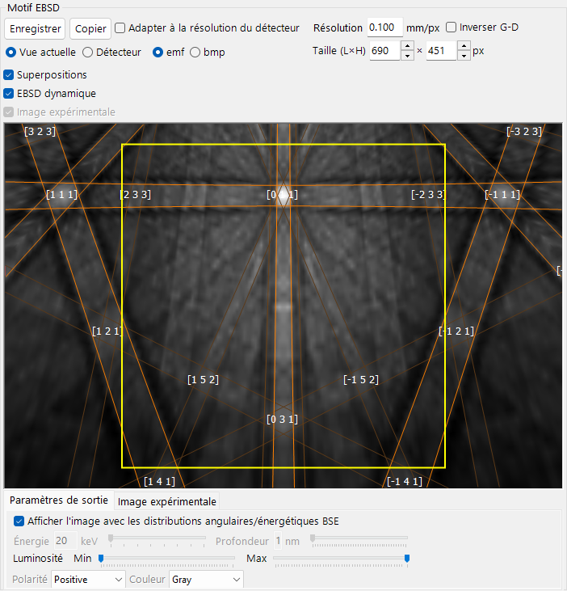

Le panneau central affiche la figure EBSD (à bandes de Kikuchi) pour l'orientation actuelle du cristal. La barre au-dessus de la figure contrôle ce qui est dessiné et la manière dont la figure est copiée.

- **EBSD dynamique** : projette le master pattern construit sur le détecteur ; décoché, seul le fond subsiste.
- **Superpositions** : dessine les lignes de Kikuchi, les indices et le contour du détecteur configurés dans l'onglet **Superpositions**.
- **Image expérimentale** : superpose l'image expérimentale chargée (voir ci-dessous).
- **Inverser G-D** : effectue une symétrie gauche-droite de la figure et de toutes ses superpositions. Décoché (par défaut), il s'agit de la vue depuis le détecteur vers l'échantillon, c'est-à-dire la figure telle qu'une caméra EBSD l'enregistre ; ne le cochez que si votre image expérimentale a la chiralité opposée.
- **Résolution** (mm/px) et **Taille (L×H)** (px) : résolution et taille de la vue affichée.
- **Enregistrer** : enregistre la figure dans un fichier, selon la plage et la résolution sélectionnées à côté. Le format (PNG / TIFF / EMF) se choisit dans la boîte de dialogue d'enregistrement.
  - **Pattern values (\*.csv)** écrit, au lieu d'une image, les intensités brutes sur la grille de pixels du détecteur. Ses lignes d'en-tête `#` consignent les conditions (cristal, trame et taille de pixel du détecteur, tension, inclinaisons du détecteur et de l'échantillon en degrés, X/Y/Z du détecteur, …) ainsi que le minimum et le maximum. <!-- 261105Cl 監査: 傾斜角は度で書く (FormEBSD.cs, 5f7484d1) -->
  - Un TIFF est écrit en niveaux de gris 16 bits (sans quantification sur 256 niveaux) lorsque la plage est **Détecteur**, que **EBSD dynamique** est affiché et qu'aucune image expérimentale n'est superposée (aucune n'est chargée, ou **Image expérimentale** est décochée). <!-- 261105Cl 監査: 16 bit の条件 (FormEBSD.cs, 5f7484d1) --> Dans ce cas, les **Superpositions** sont omises quelle que soit leur case à cocher, et les valeurs des pixels correspondent à la figure ramenée linéairement de son propre minimum–maximum à 0–65535 (le minimum et le maximum utilisés sont indiqués dans la barre d'état ; utilisez l'export csv si des valeurs absolues sont nécessaires).
- **Copier** : copie la figure dans le presse-papiers, selon la plage et le format sélectionnés à côté.
  - **Vue actuelle** copie la zone actuellement affichée (avec son déplacement et son zoom) ; **Détecteur** copie uniquement la zone du détecteur, auquel cas le cadre jaune est omis afin que l'image s'arrête exactement au bord du détecteur.
  - **emf** copie un métafichier amélioré (Enhanced Metafile) en conservant les lignes de Kikuchi et les étiquettes d'indices sous forme vectorielle ; **bmp** rastérise l'ensemble.
  - **Adapter à la résolution du détecteur** copie à raison d'un pixel d'image par pixel de détecteur (le côté le plus long est limité à 4096 px). Décoché, la résolution à l'écran est utilisée.

### Image simulée

Avant la construction du premier master pattern, seules les lignes d'affichage ci-dessous (distributions et tranche BSE, luminosité et contraste, couleur) sont désactivées ; les réglages Monte-Carlo (**Profondeur de la source (MC)**, **Le contraste décroît avec la perte d'énergie**, **Couche amorphe de surface**, **Pondérer par la réponse du phosphore**, **Energy filter E >**, **Distribution d'énergie par histogramme MC**) peuvent être modifiés dès le début. <!-- 261106Cl 作者の決定 F16 -->

- **Avec les distributions angulaires/énergétiques BSE** (activé par défaut) : lorsque cette option est cochée, la figure est composée par pondération avec la distribution des BSE (énergie, profondeur, direction) plutôt qu'avec une seule tranche.
- **Énergie** / **Profondeur** : lorsque l'option ci-dessus est désactivée, sélectionne la tranche d'énergie/de profondeur à afficher.
- **Luminosité** (**Min** / **Max**), **Contraste**, **Polarité**, **Couleur** : points noir et blanc de la figure simulée, exprimés en pourcentage de la plage d'affichage (curseurs linéaires), largeur de cette plage, sa polarité et l'échelle de couleurs. Un contraste de 0 fait coïncider la plage d'affichage avec la plage d'intensité de la figure elle-même ; −1 l'élargit dix fois (contraste dix fois plus faible) et +1 la réduit au dixième, le centre restant fixe.
- **Aplanir le fond** (**FWHM**, px ; inactif par défaut, 100 px) : soustrait au cliché simulé une copie floutée par une gaussienne, retirant la distribution de luminosité lentement variable pour comparer bandes et axes de zone à un cliché expérimental corrigé du fond. La largeur à mi-hauteur est donnée en pixels du détecteur et ne dépend pas du zoom. Agit sur l'image affichée et l'export PNG/TIFF ; l'export CSV garde les valeurs brutes.

### Image expérimentale

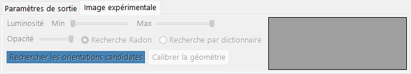

Déposez un fichier image EBSD (TIFF, PNG, BMP ou JPEG ; les TIFF 16 bits sont lus en pleine profondeur) n'importe où sur la fenêtre pour le charger comme figure expérimentale. Il est dessiné sur la zone du détecteur — au-dessus de la figure simulée et sous les superpositions de lignes de Kikuchi — de sorte que la simulation peut être comparée directement à la mesure. Le chargement met aussi **Largeur** et **Hauteur** du détecteur à la taille de l'image.

- **Luminosité** (**Min** / **Max**), **Contraste** : points noir et blanc de l'image superposée, exprimés en pourcentage de sa plage d'affichage, et largeur de cette plage (curseurs linéaires, même convention que pour la figure simulée). Ils n'agissent que sur l'image expérimentale.
- **Aplanir le fond** (**FWHM**, px ; désactivé par défaut, 100 px) : soustrait de l'image expérimentale une copie d'elle-même floutée par un filtre gaussien, ce qui supprime sa distribution de luminosité lentement variable. Les curseurs d'intensité agissent alors sur les valeurs aplanies.
- **Ajuster à l'image** : règle **Min**, **Max** et **Contraste** de la figure simulée de sorte que ses niveaux d'intensité à 2 % et 98 % s'affichent au même gris que ceux de l'image expérimentale. L'ajustement utilise des percentiles : il ne dépend donc pas de la solution d'orientation et est insensible à un piédestal ou à quelques pixels brillants d'axes de zone. La polarité, la couleur et les deux réglages **Aplanir le fond** ne sont pas modifiés ; aplanissez donc les deux côtés, ou aucun, avant d'appuyer sur ce bouton.
- **Opacité** : opacité de l'image superposée, de 0 (invisible) à 100 % (opaque). Réduisez-la pour voir la figure simulée en dessous.

L'orientation qui explique l'image est ensuite recherchée par l'un des deux moteurs.

- **Recherche Radon** : compare des modèles cinématiques de bandes de Kikuchi à la carte de Radon (détection de droites) de l'image expérimentale. Elle fonctionne sans master pattern ; s'il en existe un, les candidats sont reclassés par une ZNCC robuste (corrélation croisée normalisée à moyenne nulle) avec la figure simulée.
- **Recherche par dictionnaire** : engendre à partir du master pattern dynamique des figures de dictionnaire pour toutes les orientations et les compare toutes par ZNCC robuste. Elle exige le master pattern et prend quelques secondes, mais elle est plus fiable que la recherche Radon.

**Rechercher les orientations candidates** exécute le moteur sélectionné et liste jusqu'à 10 candidats, du meilleur au moins bon ; si un master pattern est disponible, le meilleur candidat est affiné à ±0,25°. Les colonnes sont :

| Colonne | Signification |
|---------|---------------|
| **#** | Rang (0 = le meilleur) |
| **Score** | Valeur *z* de l'évidence de bandes Radon |
| **Bands** | Bandes appariées / bandes prédites dans le champ de vision |
| **ZNCC** | Corrélation avec la figure simulée |
| **Strong bands (hkl)** | Indices des bandes appariées (recherche Radon uniquement) |

**Cliquer sur une ligne applique cette orientation à tout le programme** : la figure simulée est redessinée par-dessus l'image expérimentale et l'orientation du cristal de toutes les autres fenêtres suit.

### Sélection des axes de zone {#zone-axis-picking}

Au lieu d'apparier l'image entière, l'orientation peut aussi être trouvée à partir d'intersections de bandes (axes de zone) pointées à la main sur l'image expérimentale.

- **Zone axis** : active la sélection. Tant qu'elle est active, un double-clic gauche sur la figure ajoute un point, <kbd>CTRL</kbd> + double-clic gauche supprime le point situé à moins de 5 pixels écran, et <kbd>SHIFT</kbd> + double-clic gauche sélectionne un point (dessiné en jaune ; les autres sont en cyan, numérotés). Lorsqu'elle est désactivée, le double-clic sélectionne une cellule du détecteur comme d'habitude.
- **[u v w]** : l'indice d'axe de zone du point sélectionné. Laissez 0 0 0 pour que la recherche l'attribue ; saisir un indice contraint la recherche (utile pour les cristaux de basse symétrie et les axes d'indices élevés).
- **+ geometry** : optimise aussi le centre du détecteur (X, Y, Z, mm) en même temps que l'orientation, en minimisant le résidu en pixels entre les positions prédites et pointées des axes de zone. Il faut au moins 4 points attribués ; la sélection d'un candidat applique alors aussi la géométrie affinée.
- **Find** : recherche les orientations qui expliquent les axes de zone pointés (au moins 2 points ; trois suffisent généralement, deux sont ambigus). La tolérance angulaire est de 2°, puis de 5° si rien n'est trouvé. Jusqu'à 10 candidats sont écrits dans le même tableau de candidats, et cliquer sur une ligne les applique comme ci-dessus.
- **Clear** : supprime tous les points pointés, les indices saisis et les candidats de la dernière recherche par axes de zone (sans annulation). Le chargement d'une nouvelle image expérimentale a le même effet.

**Calibrer la géométrie** affine la géométrie du détecteur — centre de la figure (PC) et distance du détecteur (DD) — en alternance avec l'orientation, en maximisant la ZNCC entre les figures simulée et expérimentale. Cette fonction exige le master pattern, maintient l'inclinaison du détecteur fixe et réécrit le résultat dans les champs **Coordonnées du centre du détecteur** X/Y/Z, en gardant le détecteur du côté (+Y ou −Y) où il a été placé. <!-- 261105Cl 監査: +Y 側の検出器も側を保つ (e1d645d5) --> Comme le balayage du faisceau d'un MEB ne déplace le centre de la figure que d'une fraction de millimètre, une seule calibration au début d'une expérience suffit généralement pour toute une série d'images.

---

## Voir aussi

- [Trajectoires électroniques](8-electron-trajectory.md) — simulation Monte-Carlo de trajectoires électroniques / BSE utilisée pour la pondération angulaire/en énergie/en profondeur.
- [Simulateur de diffraction](7-diffraction-simulator/index.md) — diffraction électronique dynamique (ondes de Bloch).
- [Annexe A1. Systèmes de coordonnées](appendix/a1-coordinate-system/2-diffraction.md) — définitions des systèmes de coordonnées échantillon/détecteur.
