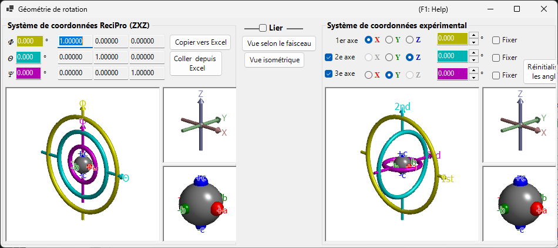

# Géométrie de rotation

Cette fenêtre représente l'état de rotation d'un cristal sous la forme d'une matrice 3×3 et effectue la conversion entre différents systèmes de coordonnées eulériens.

ReciPro utilise trois angles d'Euler — **Ψ**, **Θ** et **Φ** — appliqués dans l'ordre **Z–X–Z**. Cependant, cette convention ne correspond pas nécessairement aux axes du goniomètre de votre instrument réel. La fenêtre **Géométrie de rotation** vous permet de convertir les angles d'Euler de ReciPro vers un système de coordonnées défini arbitrairement, ce qui facilite le réglage du goniomètre en laboratoire. <!-- 261105Cl 監査: 画面の欄の見出し・ツールチップ (Φ, Θ, Ψ) に合わせ θ → Θ に統一 -->

---

## Raccourcis clavier et souris

Les six vues 3D (les panneaux pour ReciPro et pour le goniomètre expérimental / les axes / les objets) sont **liées** — faire pivoter l'une d'elles les fait toutes pivoter ensemble. Elles partagent la [navigation de vue OpenGL](21-shortcuts.md) standard de ReciPro.

| Raccourci | Action |
|----------|--------|
| <kbd>F1</kbd> | Ouvrir cette page du manuel en ligne |
| Glisser-gauche dans une vue | Faire pivoter le modèle (les six vues pivotent ensemble) |
| Molette de la souris, ou glisser-droit vers le haut/bas | Zoomer (les grandes vues du goniomètre) |
| <kbd>CTRL</kbd> + glisser-droit vers le haut/bas | Modifier la distance de la caméra (mode perspective uniquement) |
| <kbd>CTRL</kbd> + double-clic droit | Basculer entre projection orthographique et perspective |

Dans les petites vues *Axes* et *Objects*, le zoom et le déplacement sont désactivés. Il n'y a pas d'autres raccourcis clavier que <kbd>F1</kbd>.

---

## Système de coordonnées ReciPro (ZXZ)

La moitié supérieure de la fenêtre affiche l'état de rotation dans le « système de coordonnées ReciPro ».

- **Φ, Θ, Ψ** sont des champs en lecture seule qui affichent l'orientation actuelle (les angles d'Euler de la Fenêtre principale). Les rotations effectuées pendant que cette fenêtre est fermée sont affichées à sa réouverture. <!-- 261105Cl 監査: 読み取り専用の表示・開き直したときの反映 (FormRotation.cs) -->
- **Rotation matrix** affiche la matrice 3×3 correspondant à l'état de rotation actuel.

### Φ, Θ, Ψ (angles d'Euler Z–X–Z)

L'orientation du cristal est paramétrée par trois rotations. Décrites dans le repère **lié au corps (intrinsèque)**, elles sont appliquées dans cet ordre :

1. **Φ** — première rotation autour de l'axe **Z**.
2. **Θ** — rotation autour de l'axe **X** du repère tourné une fois.
3. **Ψ** — seconde rotation autour de l'axe **Z** du repère tourné deux fois.

La même rotation vue dans le repère **fixe du laboratoire** correspond à la séquence inverse — Ψ autour de $Z$, puis Θ autour de $X$, puis Φ autour de $Z$ — qui est la description utilisée dans l'[Annexe A1.1](appendix/a1-coordinate-system/1-orientation.md). Les deux donnent la même matrice $R$ ci-dessous ; Φ est simplement l'axe le plus externe (de type goniomètre) et Ψ le plus interne.

Les champs Φ, Θ, Ψ et les neuf champs de la matrice sont des affichages en **lecture seule**. Pour modifier l'orientation, faites pivoter le cristal dans la Fenêtre principale, utilisez **Coller depuis Excel**, ou (avec **Lier** activé) modifiez les angles des axes expérimentaux ci-dessous ; chaque modification est propagée à la Fenêtre principale et à tous les simulateurs liés.

### Rotation matrix

La matrice 3 × 3 produite à partir des (Φ, Θ, Ψ) actuels. Utilisez **Copier vers Excel** / **Coller depuis Excel** pour transférer la matrice vers un tableur et inversement.

La matrice suit une seule et même convention partout où elle apparaît dans ReciPro :

$$
\mathbf{v}_{\mathrm{rot}} = R\,\mathbf{v}_{0}
$$

- \(R\) est la rotation **active** du cristal, exprimée dans le repère de laboratoire fixé au moniteur (\(X\) vers la droite, \(Y\) vers le haut, \(Z\) vers l'observateur — voir l'[Annexe A1.1](appendix/a1-coordinate-system/1-orientation.md)).
- \(\mathbf{v}_{0}\) : coordonnées cartésiennes (vecteur colonne) d'une direction liée au cristal dans l'**orientation initiale** (\(c \parallel Z\), \(b\) dans le plan \(YZ\)).
- \(\mathbf{v}_{\mathrm{rot}}\) : coordonnées de la même direction après la rotation, toujours dans le repère du laboratoire.
- À \(\Phi=\Theta=\Psi=0\), \(R\) est la matrice identité. \(R\) est orthonormée de déterminant +1 ; la transformation inverse est donc simplement la transposée : \(R^{-1}=R^{\mathsf T}\).

En termes des angles d'Euler, \(R = R_Z(\Phi)\,R_X(\Theta)\,R_Z(\Psi)\) (rotations directes autour des axes fixes ; \(\Psi\) agit en premier sur le vecteur) :

$$
R=\begin{pmatrix}
\cos\Phi\cos\Psi-\cos\Theta\,\sin\Phi\sin\Psi & -\cos\Phi\sin\Psi-\cos\Theta\,\sin\Phi\cos\Psi & \sin\Theta\,\sin\Phi\\
\sin\Phi\cos\Psi+\cos\Theta\,\cos\Phi\sin\Psi & -\sin\Phi\sin\Psi+\cos\Theta\,\cos\Phi\cos\Psi & -\sin\Theta\,\cos\Phi\\
\sin\Theta\,\sin\Psi & \sin\Theta\,\cos\Psi & \cos\Theta
\end{pmatrix}
$$

Pour l'appliquer à des indices cristallographiques, convertissez-les d'abord en coordonnées cartésiennes de l'orientation initiale : une direction \([uvw]\) devient \(\mathbf{v}_0 = u\mathbf{a}+v\mathbf{b}+w\mathbf{c}\), et une normale de plan \((hkl)\) devient \(\mathbf{v}_0 = h\mathbf{a}^{*}+k\mathbf{b}^{*}+l\mathbf{c}^{*}\) (axes réciproques).

La même matrice (\(R_{ij}\) = ligne \(i\), colonne \(j\)) apparaît dans :

- **Copier vers Excel** / **Coller depuis Excel** dans cette fenêtre (3 × 3, séparée par tabulations, lignes de haut en bas) ;
- `Dir.GetRotationMatrix()` / `Dir.SetRotationMatrix()` et `Dir.GetEuler()` dans l'[API de macros](20-macro/1-built-in-functions.md) (neuf éléments dans l'ordre des lignes \(R_{11}, R_{12}, R_{13}, R_{21}, \ldots, R_{33}\)) ;
- les colonnes **R11**–**R33** de la liste de candidats enregistrée par [Spot ID v2](11-spot-id-v2.md).

### Fenêtres OpenGL

La vue 3D montre la rotation actuelle à l'aide de trois tores colorés (anneaux) :

| Couleur | Angle d'Euler | Niveau du goniomètre |
|--------|------------|-----------------|
| **Jaune** | Φ | 1er axe (supérieur) |
| **Bleu clair** | Θ | 2e axe (médian) |
| **Rose** | Ψ | 3e axe (inférieur) |

Les flèches **rouge**, **verte** et **bleue** représentent les axes X, Y, Z en coordonnées cartésiennes de l'espace réel. Ceux-ci ne sont *pas* identiques aux axes cristallins affichés dans la Fenêtre principale.

La sphère grise au centre représente l'échantillon. Les petites sphères rouge / verte / bleue (étiquetées **+a/−a**, **+b/−b**, **+c/−c**) marquent les directions des axes *a*, *b*, *c* normalisés du cristal après la rotation (la plus grande sphère = extrémité +). À Φ = Θ = Ψ = 0, elles montrent l'orientation initiale du cristal (*c* ∥ +Z, *b* dans le plan YZ) ; *a* et *b* ne coïncident donc avec +X et +Y que pour les mailles orthogonales.

> **Note** : Faire glisser dans la fenêtre OpenGL ne modifie que la *direction de projection* de cette vue, et non l'orientation du cristal elle-même. Pour faire pivoter le cristal, utilisez la Fenêtre principale.

### Boutons

| Bouton | Action |
|--------|--------|
| Copier vers Excel | Copier la matrice de rotation 3×3 sous forme de texte séparé par des tabulations, une ligne par rangée ; elle peut être recollée avec **Coller depuis Excel** |
| Coller depuis Excel | Définir la matrice de rotation à partir du presse-papiers (3×3, séparée par des tabulations). Les valeurs qui ne forment pas une matrice de rotation (lignes et colonnes orthonormées, déterminant +1) sont refusées avec un message ; les petits écarts tels que les arrondis d'un tableur (jusqu'à 10⁻³) sont corrigés vers la matrice de rotation la plus proche <!-- 261105Cl 監査: FormRotation.cs の Paste の検査 (RᵀR − I ≤ 1e-3, det > 0) と Copy の改行 (\r\n) --> |
| Vue selon le faisceau | Faire correspondre à la projection de la Fenêtre principale (axe Z perpendiculaire à l'écran) |
| Vue isométrique | Basculer vers la projection isométrique |

---

## Système de coordonnées expérimental

La moitié inférieure définit les angles d'Euler sur un ensemble arbitraire d'axes de rotation et lit ou définit l'état du goniomètre. C'est ce qu'on appelle le **système de coordonnées expérimental**.

### 1er, 2e, 3e axes

Sélectionnez l'axe de rotation de chaque niveau du goniomètre (1er = supérieur, 2e = médian, 3e = inférieur) parmi **X**, **Y** ou **Z** (directions positives du repère du laboratoire uniquement). Le 2e axe ne peut pas être identique au 1er, ni le 3e identique au 2e (le bouton radio en conflit est désactivé). La valeur par défaut est **X – Z – Y**. La représentation graphique se met à jour en conséquence.

L'angle de chaque axe est affiché dans le champ coloré correspondant (jaune, bleu clair, rose) et peut être saisi directement (en degrés ; les valeurs hors de −180…180° sont ramenées dans cet intervalle). La rotation expérimentale est composée de la même manière que la matrice propre à ReciPro, le 1er axe étant le plus externe :

$$
R_{\mathrm{exp}} = R_{\mathbf{e}_1}(\omega_1)\,R_{\mathbf{e}_2}(\omega_2)\,R_{\mathbf{e}_3}(\omega_3)
$$

(rotations directes autour des axes fixes du laboratoire $\mathbf{e}_i$).

| Commande | Action |
|---------|--------|
| **2e axe** / **3e axe** | Activer ou désactiver ce niveau (goniomètre à un ou deux axes seulement). La désactivation met son angle à 0. Désactiver le 2e axe désactive aussi le 3e. |
| **Fixer** | Maintenir cet angle à sa valeur actuelle pendant que Lier décompose une nouvelle orientation en angles du goniomètre (voir ci-dessous). |
| **Réinit. angles** | Mettre les trois angles expérimentaux à 0. |

---

## Lier {#link}

Lorsque **Lier** est coché, le système de coordonnées ReciPro et le système de coordonnées expérimental sont couplés : leurs angles d'Euler sont ajustés de sorte que l'orientation de l'objet reste cohérente entre les deux systèmes.

Au moment où **Lier** est coché, le décalage $R_{\mathrm{base}} = R_{\mathrm{exp}}^{-1} R$ entre les deux systèmes est mémorisé, et dès lors $R = R_{\mathrm{exp}}\,R_{\mathrm{base}}$. Tant que la liaison est active :

- modifier un angle expérimental fait pivoter le cristal dans toutes les fenêtres ;
- une rotation incrémentale (boutons fléchés, CTRL+SHIFT+flèches, ou glisser dans la Fenêtre principale ou d'autres fenêtres) est décomposée numériquement en angles des axes du goniomètre activés dont la case **Fixer** n'est pas cochée, et le cristal est placé dans l'**orientation la plus proche que le goniomètre peut atteindre** — avec des axes fixés ou désactivés, le cristal suit donc les contraintes du goniomètre plutôt que la souris exactement ;
- les cases **Fixer** de la Fenêtre principale continuent de s'appliquer : si l'une d'elles est cochée, la rotation incrémentale est effectuée autour de cet axe de zone ou de cette normale au plan avant d'être décomposée ; <!-- 261105Cl 監査: Link 中も主窓の Fix が効く (FormMain.cs, bc75fdc4) -->
- définir une orientation absolue — saisie dans les champs **Angles d'Euler** de la Fenêtre principale (les champs Φ, Θ, Ψ de cette fenêtre sont en lecture seule), **Réinit. la rotation**, **Vue selon** ▸ **Axe** / **Plan**, **Coller depuis Excel** dans cette fenêtre, sélection dans la liste des cristaux d'un cristal ayant une autre orientation, ou orientation définie depuis une autre fenêtre (par exemple en appliquant un résultat d'indexation) ou depuis une macro — l'applique exactement et **désactive Lier** ; la barre d'état de la Fenêtre principale l'indique. Les angles du goniomètre, les réglages **Fixer** et les axes activés sont conservés. Cochez de nouveau **Lier** pour lier à la nouvelle orientation. Les opérations qui ne changent pas l'orientation (par exemple la modification du cristal) laissent Lier activé. <!-- 261106Cl 作者の決定 G-13: FormRotation.cs SetRotation(bool) -->

Si le cristal est tourné pendant que cette fenêtre est fermée avec **Lier** coché, la réouverture de la fenêtre recale la liaison sur l'orientation actuelle (comme si **Lier** était coché de nouveau), de sorte que ni l'orientation du cristal ni les angles du goniomètre ne sautent. <!-- 261105Cl 監査: 開き直したときの Link の扱い (FormRotation.cs, ecdcec9a) -->

### Exemple de procédure

1. En laboratoire, réglez un goniomètre de sorte que l'axe *a* d'un cristal soit aligné avec la direction d'incidence des rayons X et que l'axe *b* soit horizontal.
2. Saisissez les angles d'Euler du goniomètre de laboratoire dans le système de coordonnées expérimental.
3. Dans la Fenêtre principale, faites pivoter le cristal de sorte que l'axe *a* pointe vers la normale à l'écran et que l'axe *b* soit horizontal.
4. Cochez **Lier** — désormais, chaque fois que vous orientez le cristal vers une orientation différente dans la Fenêtre principale, les angles de goniomètre requis sont automatiquement affichés.

---

## Voir aussi

- [Fenêtre principale](0-main-window.md)
- [Stéréonet](6-stereonet.md)
- [Système de coordonnées de base et orientation du cristal](appendix/a1-coordinate-system/1-orientation.md)
- [Raccourcis clavier et souris](21-shortcuts.md)
