# Visualiseur de structure

Le **Visualiseur de structure** dessine la structure du cristal sélectionné sous forme d'image tridimensionnelle à l'aide d'OpenGL.

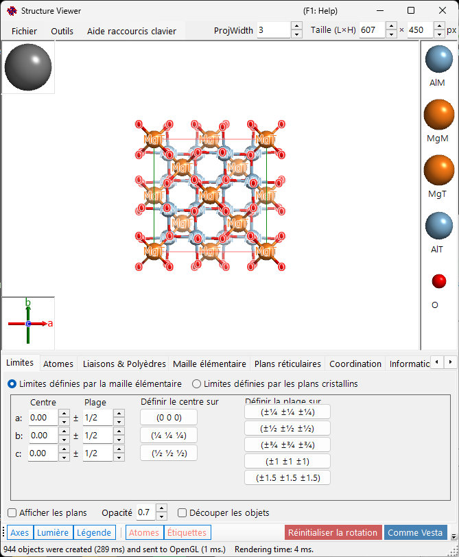

---

## Raccourcis clavier et souris

La fenêtre comporte une grande vue 3D ainsi que deux petits gizmos — la boîte des **axes cristallins** (en bas à gauche) et la boîte de **direction de la lumière** (en haut à gauche) — et chacun réagit différemment à un glisser avec le bouton gauche. La vue principale utilise la [navigation de vue OpenGL](21-shortcuts.md) standard de ReciPro.

| Raccourci | Action |
|----------|--------|
| <kbd>F1</kbd> | Ouvrir cette page du manuel en ligne |
| <kbd>CTRL</kbd>+<kbd>SHIFT</kbd>+<kbd>C</kbd> | Copier l'image rendue dans le presse-papiers |
| Glisser-gauche dans la vue principale | Faire pivoter le modèle |
| Double-clic gauche sur un atome | Afficher les coordonnées de l'atome cliqué ainsi que les distances et les angles de liaison des voisins qui l'entourent (seuls les atomes affichés peuvent être sélectionnés) <!-- 261105Cl 監査: 近接原子はクリックした位置の周り (ca87b772, 8cc95680) --> |
| Glisser-droite vers le haut/bas, ou molette de la souris | Zoomer |
| Glisser-milieu | Déplacer |
| <kbd>CTRL</kbd> + glisser-droite vers le haut/bas | Modifier la distance de la caméra (mode perspective uniquement) |
| <kbd>CTRL</kbd> + double-clic droit | Basculer entre la projection orthographique et perspective |
| Glisser-gauche sur le gizmo des **axes cristallins** | Faire pivoter le modèle (sans rotation dans le plan) |
| Glisser-gauche sur le gizmo de **lumière** | Modifier la direction de l'éclairage |

Les raccourcis <kbd>CTRL</kbd>+<kbd>SHIFT</kbd> valables dans toute l'application, issus de la [fenêtre principale](0-main-window.md#keyboard-mouse-shortcuts), fonctionnent également lorsque cette fenêtre a le focus.

→ Consultez **[21. Raccourcis clavier et souris](21-shortcuts.md)** pour un aperçu de toutes les fenêtres.

---

## Zone principale

La structure cristalline en 3D, dessinée avec le gizmo de direction de la lumière, le gizmo des axes cristallins et la légende des atomes. La position et la taille de la fenêtre sont conservées pour le prochain démarrage. <!-- 261106Cl 作者の決定 H6 -->
> La boîte **Taille (L×H)** en haut à droite de la fenêtre définit la taille en pixels de la vue 3D (la fenêtre est redimensionnée en conséquence) ; les images enregistrées et copiées ont cette taille.
> La boîte **ProjWidth** juste à côté affiche la largeur de la vue projetée en nm. Modifiez la valeur pour zoomer numériquement — elle reste synchronisée avec le zoom par glisser-droite / molette dans la vue.

---

## Barre de menus

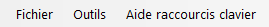

### Menu Fichier

| Élément de menu | Description |
|-----------------|-------------|
| Enregistrer l'image ▸ Image principale / Légende / Axes cristallins / Direction de la lumière | Enregistrer la vue principale, la légende des atomes ou l'un des gizmos en PNG |
| Copier l'image dans le presse-papiers ▸ Image principale / Légende / Axes cristallins / Direction de la lumière <!-- 261105Cl 監査: copyToClipboardToolStripMenuItem.Text --> | Copier l'image (Ctrl+Shift+C copie la vue principale) |
| Enregistrer la vidéo ▸ Image principale / Axes cristallins | Enregistrer en MP4 une vidéo de rotation/translation de la vue principale ou du gizmo des axes cristallins (vitesse, durée, fps, qualité, etc.) |
| Export 3D model (3MF/STL) | Exporter la structure affichée sous forme de modèle solide pour l'impression 3D |

Menu **Outils** : **J'aime VESTA** (identique au bouton *Comme Vesta* de la barre d'outils) et **Enable DDP** (affiche/masque l'entrée *Dual Depth Peeling* du [Mode de transparence](#mode-de-transparence)).

**Aide raccourcis clavier** (un menu de premier niveau distinct) liste les raccourcis clavier.

**Enregistrer la vidéo** ouvre la boîte de dialogue de réglage du film ci-dessous. Un film peut faire pivoter la vue, translater le centre de projection, ou faire les deux à la fois — cochez **Rotation** et/ou **Translation** :

- **Rotation** : fait pivoter la vue à la vitesse **Vitesse** (°/s ; les valeurs négatives inversent le sens) autour de l'axe choisi en dessous — **Projection actuelle** (direction d'inclinaison choisie avec les boutons fléchés), un **Indice de direction** [uvw], ou la normale d'un **Plan réticulaire** (hkl). L'axe est déterminé à partir de l'orientation du cristal au moment où l'on appuie sur **OK**. Avec les indices de Miller–Bravais activés, quatre indices ne sont affichés que pour **Plan réticulaire** ; un **Indice de direction** est toujours le [uvw] à trois indices. <!-- 261105Cl 監査: FormMovie.cs (OK の時点で回転軸を求め直す、4 指数は格子面だけ, 35fa72fc) -->
- **Translation** : déplace le centre de projection le long de l'indice de direction [uvw] à la vitesse **Vitesse** (périodes du réseau par seconde). Cette option n'apparaît que lorsque la boîte de dialogue est ouverte depuis le Visualiseur de structure, et tant qu'elle est activée, **Indice de direction** est le seul mode de direction disponible.

Réglez la longueur du film (**Durée**), la fréquence d'images (**FPS**, 1–120) et la qualité d'encodage (**Qualité**, 1–100 ; des valeurs plus élevées utilisent un débit plus élevé et donnent un fichier plus volumineux), choisissez le codec (**H264** / **H265**), puis appuyez sur **OK** pour générer un fichier MP4. **Inclure l'image finale** ajoute une image supplémentaire à t = **Durée** afin que le film se termine exactement à l'orientation/position finale. (La liste de vitesse d'encodage ne sert plus qu'à étiqueter l'affichage de la progression et n'affecte plus l'encodage réel.)

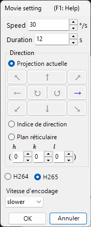

#### Export 3D model (3MF/STL)

**Export 3D model (3MF/STL)** exporte le modèle de structure actuellement dessiné à l'écran sous forme de modèle solide pour l'impression 3D. Seuls les solides fermés peuvent être exportés : atomes (sphères et ellipsoïdes), liaisons (cylindres) et polyèdres de coordination. Les étiquettes d'atomes, les plans de délimitation, les plans réticulaires et les symboles des éléments de symétrie ne sont pas exportés. <!-- 261105Cl 監査: 配位多面体を出力し、対称要素は出さない (6c31fc0d) --> Le cadre de la maille est constitué de segments : il n'est remplacé par des cylindres (avec des sphères aux sommets) que si vous cochez l'option correspondante. **Découper les objets aux plans limites** n'est pas appliqué à la sortie : les objets qui traversent les plans limites sont exportés entiers (la boîte de dialogue le signale). <!-- 261106Cl 作者の決定 H10 -->

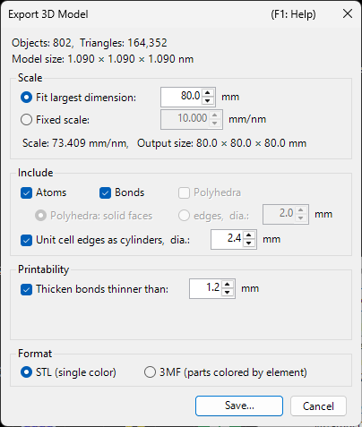

Le haut de la boîte de dialogue indique le nombre d'objets et de triangles concernés ainsi que la taille réelle du modèle (**Taille du modèle**, nm).

**Échelle** : comment la taille de sortie est déterminée

- **Plus grande dim.** : met le modèle à l'échelle automatiquement pour que sa plus grande arête atteigne la longueur indiquée (5–500 mm, 80 mm par défaut). L'épaisseur des cylindres qui remplacent le cadre de la maille et les armatures d'arêtes des polyèdres est prise en compte. <!-- 261105Cl 監査: 円柱の太さを含めて合わせる (82e50b62) -->
- **Échelle fixe** : donne l'échelle (mm/nm) directement. Utile pour construire plusieurs cristaux à la même échelle et les placer côte à côte. En basculant sur cette option, l'échelle en vigueur juste avant sert de valeur de départ.
- La ligne du dessous affiche l'échelle obtenue et les dimensions imprimées (**Taille de sortie**, mm), épaisseur de ces cylindres comprise.

**Inclure** : les éléments inclus dans l'impression

- **Atomes** / **Liaisons** / **Polyèdres** : seuls les types actuellement affichés peuvent être sélectionnés ; décocher l'un d'eux le laisse à l'écran mais l'exclut de l'impression.
- **Polyèdres : faces** / **arêtes, Ø** : exporte les polyèdres de coordination soit comme des corps pleins avec faces, soit comme une armature d'arêtes (cylindres plus sphères aux sommets, 2.0 mm par défaut). L'armature laisse voir les atomes à l'intérieur.
- **grille ajourée : Ø barreau / pas** : l'armature d'arêtes plus une grille de barreaux fins sur chaque face (diamètre des barreaux 0.8–5.0 mm, 1.2 mm par défaut ; pas 1.5–20 mm, 5.0 mm par défaut). De loin, les faces paraissent pleines, mais l'intérieur reste visible.
- **Arêtes de maille (cyl.), Ø** : inclut le cadre de la maille, remplacé par des cylindres du diamètre indiqué (2.4 mm par défaut). Cette case est cochée par défaut dès que le cadre de la maille est affiché.

**Imprimabilité** : aptitude à l'impression

- **Épaissir liaisons sous** : les liaisons dont le diamètre imprimé tomberait sous la valeur indiquée (1.2 mm par défaut) sont reconstruites à ce diamètre à partir de la primitive d'origine, ce qui évite que les liaisons fines ne cassent. Si vous laissez l'option désactivée alors qu'une liaison est trop fine, un avertissement s'affiche en rouge.

**Format** : format de fichier

- **STL (monocouleur)** : un STL binaire monochrome.
- **3MF (coloré par élément)** : 3MF dont les pièces sont colorées par élément ; les noms de couleur reprennent les noms des éléments.

**Enregistrer...** demande le nom du fichier. Une fois l'export terminé, le nombre de triangles, les dimensions imprimées et l'échelle sont consignés dans la zone d'informations en bas à gauche.

---

## Menu des onglets

### Limites définies par la maille

Spécifie la plage de dessin du cristal. Il existe deux modes, commutés à l'aide des boutons radio en haut.

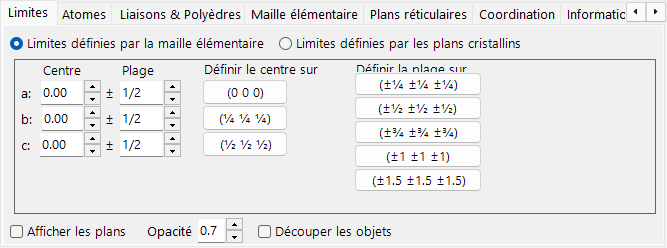

Dans ce mode, les axes *a*, *b*, *c* de la maille sont l'unité de la plage de dessin.

- **Centre** : décalage du centre de la plage de dessin par rapport au [Centre de projection](#centre-de-projection), en coordonnées fractionnaires (les valeurs positives le déplacent vers +*a*, +*b*, +*c*). La plage dessinée est (centre de projection + Centre) ± Plage. <!-- 261106Cl 作者の決定 H3/H18, C4 -->
- **Plage** : limite supérieure/inférieure pour chacun des axes *a*, *b*, *c*.
- Les **boutons prédéfinis** à droite fournissent des valeurs fréquemment utilisées (par exemple, maille 1×1×1, maille 2×2×2).

### Limites définies par les plans cristallins

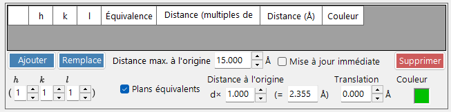

Dans ce mode, la zone de dessin est délimitée par un ensemble de plans cristallins. Si les plans ne définissent pas une région spatialement fermée, ReciPro ajoute, pour la fermer, un polyèdre quasi sphérique de rayon **Dist. max (centre proj.)** (Å, mesurée depuis le [centre de projection](#centre-de-projection)). <!-- 261106Cl 作者の決定 C4 -->

#### Liste des limites

Tous les plans limites enregistrés pour le cristal actuel. Utilisez **Ajouter / Remplacer / Supprimer** pour manipuler la liste ; la case à cocher la plus à gauche désactive temporairement un plan sans le supprimer.

> Pour enregistrer les modifications de façon permanente, vous devez également appuyer sur **Ajouter** ou **Remplacer** dans la **Fenêtre principale**. Sinon, les modifications sont perdues la prochaine fois que vous changez la sélection dans la liste principale des cristaux.

#### Indices H k l

Définit le plan limite par son indice de Miller. La case à cocher inclut les plans cristallographiquement équivalents générés à partir du (*hkl*) sélectionné.

#### Distance au centre de proj.

La distance du [centre de projection](#centre-de-projection) (et non de l'origine de la maille) au plan limite, saisie soit <!-- 261106Cl 作者の決定 C4 --> comme multiple de la distance interréticulaire *d* du (*hkl*) sélectionné (champ **d×**), soit en Å (le champ entre parenthèses). Les deux champs sont liés : modifier l'un met l'autre à jour. Chaque plan est placé du côté +**g** du centre de projection (dans le sens de sa normale (*hkl*)), et c'est le côté contenant le centre qui est dessiné ; avec un seul plan, la région est le demi-espace situé du côté du centre. <!-- 261106Cl 仕上げ R3 D5: Boundary.cs Bound.Reset (面は nᵢ·r ≤ D) -->

- **Translation** (Å) : déplace toute la région délimitée par les plans de cette valeur le long de la normale du (*hkl*) spécifié ; les valeurs positives la déplacent vers +**g**, c'est-à-dire dans le sens de la normale du (*hkl*). Fonctionne quel que soit le nombre de plans, y compris un plan unique sans **Plans équivalents**. <!-- 261106Cl 作者の決定 B11, C5 -->
- **Dist. max (centre proj.)** (Å) : rayon du polyèdre de fermeture utilisé lorsque les plans n'enferment pas de région (voir ci-dessus).
- **Mise à jour immédiate** : applique les modifications du plan sélectionné sans appuyer sur **Remplacer**.

#### Afficher les plans / Opacité

Affiche ou masque les plans limites eux-mêmes. Lorsqu'ils sont affichés, **Opacité** définit la transparence (0 = transparent, 1 = opaque).

#### Découper les objets aux plans limites

Si cette option est cochée, seule la région intérieure définie par les limites est rendue ; les atomes, liaisons et polyèdres qui coupent les limites sont découpés.

#### Masquage des atomes

L'onglet Limites ne comporte pas de case à cocher pour cela. Désactivez plutôt le bouton **Atomes** de la barre d'outils : aucun atome n'est généré, de sorte que les liaisons et les polyèdres disparaissent également — utile lorsque seuls la maille ou les plans réticulaires doivent être visualisés.

### Atomes

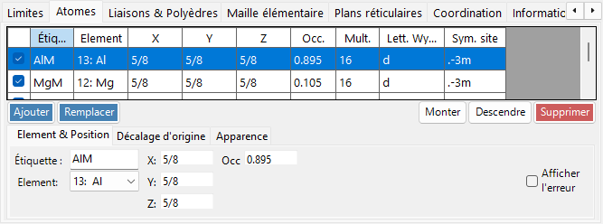

Définit l'espèce, la position et le taux d'occupation de chaque atome, ainsi que la manière dont chacun est dessiné (rayon, couleur, matériau).

#### Liste des atomes

La liste des atomes du cristal. Utilisez **Ajouter / Remplacer / Supprimer** pour manipuler la liste ; la case à cocher la plus à gauche masque temporairement un atome.

> Pour enregistrer les modifications de façon permanente, cliquez également sur **Ajouter** ou **Remplacer** dans la **Fenêtre principale**.

#### Élément et position

- **Étiquette** : étiquette en texte libre pour l'atome (utilisée dans les légendes et les info-bulles).
- **Element** : élément chimique / état d'ionisation.
- **X, Y, Z** : coordonnées fractionnaires. Nombres réels entre 0 et 1, ou fractions telles que `1/2` ou `2/3`.
- **Occ** : taux d'occupation, un nombre réel entre 0 et 1.

#### Décalage d'origine

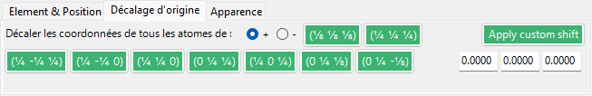

Décale chaque atome du même décalage fractionnaire. Appuyez sur un bouton prédéfini (par exemple, pour échanger le choix d'origine 1 / 2 pour le même groupe d'espace), ou saisissez un décalage personnalisé (Δx, Δy, Δz) et appuyez sur **Apply custom shift**.

#### Apparence

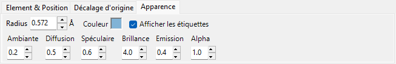

Rayon, couleur et matériau par atome.

- **Radius** : rayon atomique dessiné.
- **Atom color** : couleur de surface.
- **Material** : propriétés de texture / matériau utilisées par le shader OpenGL.
- **Appliquer au même élément** : applique le rayon et la couleur actuels à tous les atomes de la même espèce d'élément.

### Liaisons et polyèdres

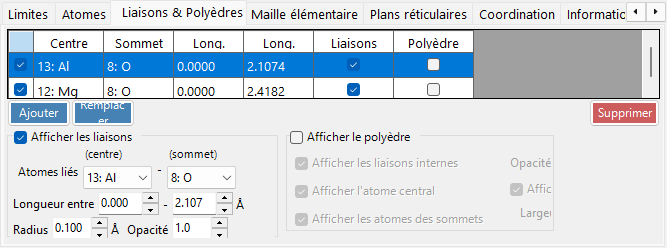

Définit quelles paires d'atomes sont liées (par espèce et intervalle de distances) et comment les liaisons et les polyèdres de coordination qui en résultent sont dessinés.

#### Liste des liaisons

Toutes les règles de liaison/polyèdre enregistrées pour le cristal. Utilisez **Ajouter / Remplacer / Supprimer** ; la case à cocher la plus à gauche désactive temporairement une entrée. Comme pour les atomes et les limites, **Ajouter** / **Remplacer** dans la **Fenêtre principale** est requis pour rendre la modification permanente.

#### Propriété de liaison

- **Afficher les liaisons** : dessine les liaisons de cette règle (la case au-dessus des réglages de liaison).
- **Atomes liés** **(centre)** - **(sommet)** : espèces d'éléments utilisées comme atome central de la liaison / du polyèdre et comme sommet (l'autre extrémité).
- **Longueur entre** … **-** … (Å) : seuils de distance inférieur et supérieur. Les paires d'atomes en dehors de cette plage ne sont pas dessinées.
- **Radius** (Å) : épaisseur de liaison dessinée (rayon du cylindre).
- **Opacité** : opacité de la liaison (0 = transparent, 1 = opaque).

#### Propriété de polyèdre

- **Afficher le polyèdre** : lorsqu'elle est cochée, le polyèdre défini par la liaison actuelle est dessiné (uniquement si l'ensemble centre/sommet est géométriquement valide).
- **Afficher les liaisons internes** : avec **Afficher le polyèdre** activé, dessine les liaisons du centre vers les sommets (il faut aussi **Afficher les liaisons**).
- **Afficher l'atome central** : affiche/masque l'atome central.
- **Afficher les atomes des sommets** : affiche/masque les atomes sommets. Un atome central ou sommet masqué est tout de même dessiné lorsqu'un autre polyèdre affiché le montre, ou lorsqu'il termine une liaison d'une définition sans polyèdre. <!-- 261105Cl 監査: 3 つのチェックが描画に効くようになった (7e198f9d) -->
- **Opacité** : opacité des faces (0 = transparent, 1 = opaque).
- **Afficher les arêtes** : dessine les arêtes reliant les sommets.
- **Largeur** : épaisseur de ligne des arêtes en pixels (1–5). Les valeurs inférieures à 1 enregistrées par des versions antérieures sont dessinées à 1 px. <!-- 261106Cl 作者の決定 H4 -->
- Cet onglet n'a pas de cases de couleur : les liaisons prennent les couleurs des atomes à leurs deux extrémités, et les polyèdres la couleur de leur atome central (les couleurs des atomes se règlent dans l'onglet [Atomes](#atomes)). <!-- 261105Cl 監査: BondControl の colorControlPolyhedron/Bond/Edges は Visible=False。色は原子の材質から (FormStructureViewer.cs) -->

### Maille

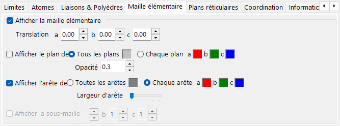

Définit la position de la maille dessinée et l'affichage ou non de ses faces et de ses arêtes.

#### Translation

Chaque groupe d'espace possède une origine par défaut. Pour éloigner le centre de la maille dessinée de cette origine, réglez la translation le long de *a*, *b*, *c*.

La translation est liée au [Centre de projection](#centre-de-projection) : régler le centre de projection sur $(x, y, z)$ règle la translation sur $(x-0.5,\ y-0.5,\ z-0.5)$. Une translation positive déplace la maille dessinée vers +*a*, +*b*, +*c*. <!-- 261106Cl 作者の決定 H3/H18 -->

#### Afficher le plan de maille

Indique si les six faces qui délimitent la maille sont dessinées. Lorsque cette option est activée, vous pouvez régler la couleur des faces et leur transparence.

#### Afficher l'arête de maille

Indique si les arêtes de la maille sont dessinées. La couleur des arêtes est configurable.

La case maîtresse **Afficher la maille élémentaire** (= le bouton *Maille élémentaire* de la barre d'outils) active/désactive toute la maille. Les couleurs des faces et des arêtes se règlent soit pour **Tous les plans** / **Toutes les arêtes** à la fois, soit pour **Chaque plan** / **Chaque arête** (*a*, *b*, *c* séparément) ; **Largeur d'arête** définit l'épaisseur de ligne et **Opacité** la transparence des faces.

#### Afficher la sous-maille

**Afficher la sous-maille** dessine des lignes de grille qui divisent la maille en autant de parties que l'indiquent les champs **a**, **b**, **c** (1–10 chacun ; ces champs ne sont utilisables que lorsque la case est cochée), sur les faces et à l'intérieur de la maille. Les lignes qui coïncident avec les arêtes de la maille ne sont pas dessinées. Les lignes prennent la couleur des arêtes (**Toutes les arêtes** / **Chaque arête**), la moitié de la largeur d'arête (au moins 1 px) et une opacité de 0.5, et s'affichent indépendamment de **Afficher l'arête de maille**. Elles ne sont pas incluses dans l'export du modèle 3D. <!-- 261106Cl 作者の決定 H5 -->

### Plans réticulaires

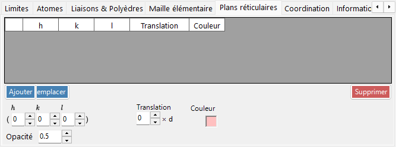

Dessine des plans réticulaires donnés par leur indice de Miller, en incluant éventuellement les plans cristallographiquement équivalents.

#### Indices H k l

Spécifie le plan réticulaire par son indice de Miller. La case à cocher inclut éventuellement les plans cristallographiquement équivalents générés à partir de (*hkl*).

#### Translation

Décale les plans réticulaires dessinés le long de leur normale d'une fraction de la distance interréticulaire *d* (**× d**, −0.5 à 0.5) ; les valeurs positives les déplacent vers +**g** (les plans se trouvent en **g**·**r** = (*m* + T)*d*). Les valeurs enregistrées dans les listes de cristaux par des versions antérieures sont donc dessinées du côté opposé (0 et ±0.5 donnent le même résultat). <!-- 261106Cl 作者の決定 C5 --> Tous les plans de la famille qui traversent la plage de dessin sont dessinés, un par *d*. Les plans sont fixés au réseau cristallin : à 0, ils passent par les nœuds du réseau, et ils se déplacent avec la structure lorsque le [Centre de projection](#centre-de-projection) change. <!-- 261105Cl 監査: LatticePlaneControl numericBoxDistance (−0.5〜0.5, × d)、FormStructureViewer.cs:SetLatticePlanes (4fd9e8c3)。「d の整数倍」は誤り -->

### Coordination

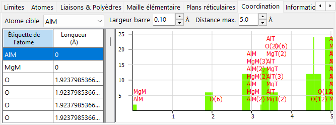

Liste et représente graphiquement les atomes qui coordonnent un atome cible choisi.

#### Tableau (côté gauche)

Liste les atomes qui entourent l'atome cible sélectionné et à quelle distance. L'atome cible est sélectionné dans la liste déroulante au-dessus du tableau.

#### Graphe (côté droit)

Histogramme du nombre de voisins en fonction de la distance, dérivé des mêmes données que le tableau. Ajustez **Demi-largeur** (la demi-largeur *w* de chaque barre, qui couvre *d* ± *w*) jusqu'à ce que les barres séparent nettement les sphères de coordination <!-- 261106Cl 作者の決定 B18 --> — cela donne une estimation visuelle du nombre de coordination.

### Information

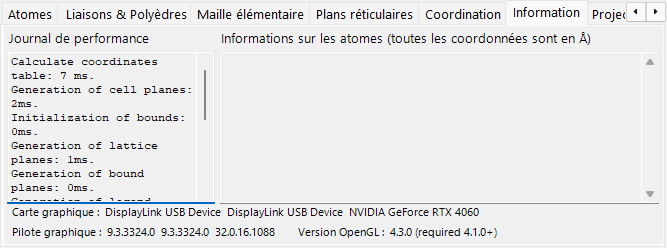

Journal de rendu (temps d'image, informations GPU) et informations de base sur l'atome sélectionné. En cours de construction — les champs peuvent s'enrichir au fil du temps.

### Projection

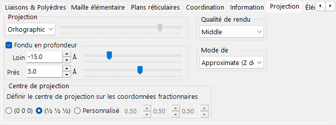

Définit le mode de projection (orthographique / perspective), l'atténuation en profondeur, le centre de projection, la qualité de rendu et l'algorithme de transparence.

#### Projection

- **Orthographic** : projection parallèle parfaite (point de vue à l'infini).
- **Perspective** : projection perspective depuis la distance du point de vue définie par le curseur.

#### Atténuation en profondeur

Atténue les objets éloignés dans la direction de la profondeur (**Fondu en profondeur**). La couleur est mélangée linéairement vers la **couleur de fond** : les objets plus proches que **Près** gardent leur propre couleur, les objets plus éloignés que **Loin** prennent la couleur de fond, et les objets intermédiaires sont interpolés. (L'opacité elle-même n'est pas modifiée.) **Près** et **Loin** sont exprimés en Å.

#### Centre de projection

Définit le centre de projection sur les coordonnées spécifiées. Activez **Personnalisé** pour saisir des coordonnées arbitraires. Les valeurs saisies (−1 à 1) sont utilisées telles quelles. Un film **Translation** (voir le [menu Fichier](#menu-fichier)) pilote ces valeurs automatiquement et replie chaque coordonnée dans l'intervalle −0.5 à +0.5 (une période du réseau) au fil du déplacement. <!-- 261105Cl 監査: 折り畳むのは SetProjectionCenter (動画の経路) だけ。マクロに投影中心の関数は無い -->

#### Qualité de rendu

Qualité de dessin (subdivision du maillage, anticrénelage). Une qualité supérieure est plus lente — choisissez le réglage adapté à votre GPU.

#### Mode de transparence

Algorithme utilisé pour les atomes et polyèdres translucides.

- **Approximate (Z depth sorting, OpenGL 4.1+)** : rapide mais peut être imprécis lorsque de nombreux objets translucides se chevauchent.
- **High quality (dual depth peeling, OpenGL 4.1+)** : transparence indépendante de l'ordre par pelage en profondeur (depth peeling). Affiché seulement lorsque **Outils ▸ Enable DDP** est activé (activé par défaut lorsque PPLL n'est pas disponible). Le nombre de passes de pelage suit le réglage [Qualité de rendu](#qualité-de-rendu).
- **High quality (per-pixel linked list, OpenGL 4.3+)** : transparence exacte indépendante de l'ordre ; affiché seulement lorsque le GPU prend en charge OpenGL 4.3. Précis mais lent ; nécessite en pratique un GPU dédié.

### Éléments de symétrie

L'onglet **Élém. sym.** dessine les opérateurs de symétrie du groupe d'espace directement sur le modèle 3D (à basculer avec le bouton **Élém. sym.** de la barre d'outils). Chaque classe d'éléments peut être affichée/masquée indépendamment :

- **Axes de symétrie** : **Rotations**, **Hélices**, **Rotoinversions**
- **Plans** : **Miroirs**, **Glissements**
- **Centres d'inversion**

L'interrupteur principal est **Afficher les éléments de symétrie**. Pour chaque groupe, vous pouvez ajuster la taille du symbole (%) et la couleur, et pour les axes et les plans également l'épaisseur de ligne.

### Divers

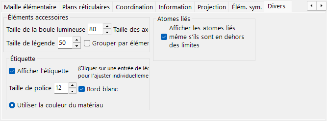

- **Éléments accessoires** : définit les tailles d'affichage (boule de lumière, axes, légende). **Grouper par élément** active/désactive l'affichage de la légende.
- **Atomes liés** : **Afficher les atomes liés même s'ils sont en dehors des limites** continue de dessiner les atomes liés à des atomes situés à l'intérieur de la plage de dessin, même lorsqu'ils tombent en dehors de celle-ci.
- **Étiquette** : réglages des étiquettes d'atomes dans la vue 3D (pas la légende) — **Afficher l'étiquette**, **Taille de police**, **Bord blanc** et la couleur des étiquettes (**Utiliser la couleur du matériau** ou **Utiliser une couleur fixe**). Cliquer sur une entrée de la légende des atomes active/désactive individuellement les étiquettes de cet atome (ou de cet élément, avec **Grouper par élément**).

---

## Barre d'outils

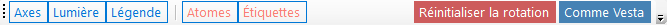

| Bouton | Description |
|--------|-------------|
| Axes | Afficher l'orientation des axes (taille = constante de réseau) |
| Lumière | Régler la direction de la lumière |
| Légende | Légende des atomes |
| Atomes | Afficher/masquer les atomes ; les liaisons, polyèdres et étiquettes étant construits sur les atomes, ils sont également masqués <!-- 261105Cl 監査: toolStripButtonAtomObjects.ToolTipText (2028c4a1) --> |
| Étiquettes | Basculer les étiquettes des atomes |
| Maille élémentaire | Basculer les arêtes de la maille |
| Élém. sym. | Basculer la superposition des éléments de symétrie (voir ci-dessus) |
| Réinitialiser la rotation | Revenir à l'orientation initiale |
| Comme Vesta | Passer à une apparence de style VESTA : les couleurs et rayons des atomes sont réinitialisés, et la liste des liaisons est **remplacée** par les liaisons par défaut |

---

## Voir aussi

- [Fenêtre principale](0-main-window.md)
- [Base de données de cristaux](1-crystal-database.md)
- [Informations de symétrie](2-symmetry-information.md)
- [Simulateur de diffraction](7-diffraction-simulator/index.md)
- [Raccourcis clavier et souris](21-shortcuts.md)
