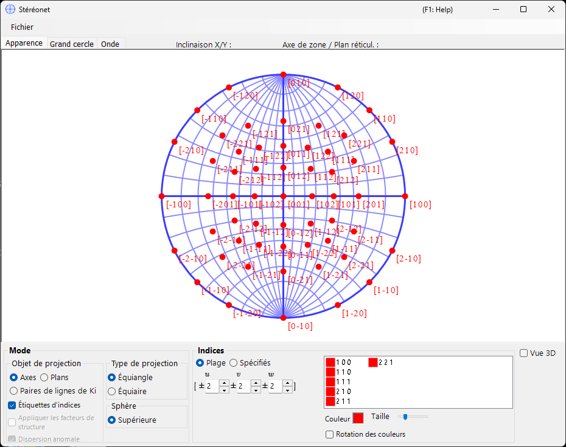
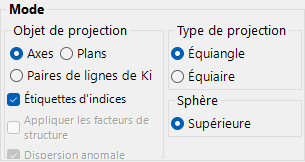
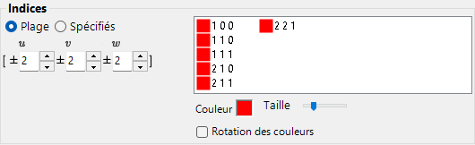
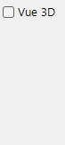
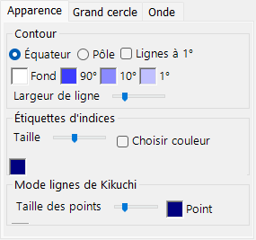
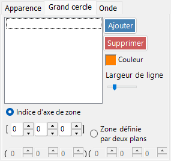
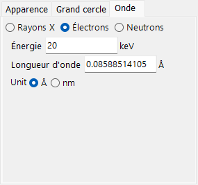

# Stéréonet

Le **Stéréonet** affiche les plans cristallins et les directions des axes à l'aide de la projection stéréographique.

---

## Raccourcis clavier et souris

Le stéréonet lui-même est une projection 2-D ; une sphère 3-D facultative peut être affichée avec **Vue 3D**.

| Raccourci | Action |
|----------|--------|
| <kbd>F1</kbd> | Ouvrir cette page du manuel en ligne |
| Glisser-gauche près du centre | Incliner le cristal |
| Glisser-gauche dans la zone extérieure | Faire tourner le cristal autour de l'axe de visée |
| Double-clic gauche | Basculer entre la projection **Plans** et **Axes** |
| Clic droit | Dézoomer |
| Glisser-droit d'un cadre | Zoomer sur la région sélectionnée |
| Glisser-milieu | Déplacer |
| Déplacer la souris (sans bouton) | Lire les (hkl)/[uvw] sous le curseur — utile pour indexer une tache mesurée (aussi dans l'hémisphère inférieur) <!-- 261105Cl 監査: 下半球の読み取り (268779a1) --> |

Le glissement sur le net fait tourner le **cristal** ; l'état de rotation est partagé entre toutes les fenêtres.

Le rendu 3-D utilise la [navigation de vue OpenGL](21-shortcuts.md) standard de ReciPro (glisser-gauche pour tourner, glisser-droit / molette pour zoomer, <kbd>CTRL</kbd> + double-clic droit bascule la projection) et ne fait tourner que la vue 3-D, pas le cristal lui-même.

Les raccourcis <kbd>CTRL</kbd>+<kbd>SHIFT</kbd> valables dans toute l'application, issus de la [fenêtre principale](0-main-window.md#keyboard-mouse-shortcuts), fonctionnent également lorsque cette fenêtre a le focus.

→ Voir **[21. Raccourcis clavier et souris](21-shortcuts.md)** pour un aperçu de chaque fenêtre.

---

## Zone principale

La projection stéréonet des plans cristallins, des indices de direction et des lignes de Kikuchi du cristal sélectionné est affichée.

---

## Menu Fichier

Enregistrer ou copier en image matricielle (PNG) ou en métafichier vectoriel (EMF). Un métafichier collé permet d'éditer les polices et l'épaisseur des traits dans PowerPoint ou d'autres éditeurs vectoriels.

| Élément de menu | Description |
|-----------------|-------------|
| Enregistrer l'image ▸ comme image (format PNG) / comme métafichier (EMF) | Enregistrer le stéréonet dans un fichier PNG ou dans un fichier vectoriel EMF <!-- 261105Cl 監査: as Metafile (EMF) の保存を配線 (FormStereonet.cs, 268779a1) --> |
| Copier dans le presse-papiers ▸ Comme image / comme métafichier (EMF) | Copier le stéréonet |
| Enregistrer la vidéo ▸ Stéréonet / 3D | Enregistrer une vidéo de rotation (MP4) du stéréonet ou de la vue 3-D, avec la même boîte de dialogue de réglage du film que le [Visualiseur de structure](5-structure-viewer.md#menu-fichier) (rotation uniquement) |
| Mise en page / Aperçu avant impression / Imprimer | Imprimer le stéréonet |

---

## Mode

### Cible de projection

Sélectionnez ce qui doit être projeté sur le net.

- **Axes** — projette les indices de direction \([uvw]\).
- **Plans** — projette les normales aux plans cristallins \((hkl)\).
- **Paires de Kikuchi** — projette les paires de lignes de Kikuchi.

### Méthode de projection

| Méthode | Description |
|--------|-------------|
| **Équiangle** (Wulff / stéréographique) | Conserve la relation angulaire entre les éléments projetés, mais pas l'angle solide. Utilisée par les cristallographes classiques pour lire les angles entre axes ou entre plans. |
| **Équiaire** (Schmidt / à aires égales / Lambert) | Conserve l'angle solide (l'aire) de chaque région, mais déforme les angles. Préférée pour les figures de pôles statistiques où la densité relative importe. |

### Hémisphère

Choisissez l'hémisphère **Supérieure** ou **Inférieure** comme source de projection — cela détermine si la face visible de la sphère est celle la plus proche ou la plus éloignée de l'observateur.
Supérieure = le côté $+Z$ (vers l'observateur, voir l'[Annexe A1.1](appendix/a1-coordinate-system/1-orientation.md)) ; avec **Inférieure**, la composante $Z$ de chaque direction est inversée avant la projection, et les points sont dessinés en **cercles vides** au lieu de cercles pleins.

### Options d'affichage

- **Étiquettes d'indices** : afficher les étiquettes d'indices.
- **Facteurs de structure sur l’intensité** : lorsque **Plans** ou **Paires de Kikuchi** est sélectionné, pondérer chaque élément par son facteur de structure (définir la source d'onde et la longueur d'onde dans l'[onglet Onde](#wave)). Le poids est $I_{\mathrm{rel}} = |F_{hkl}|^2 / \max|F|^2$ sur l'ensemble affiché : en mode **Plans**, le rayon des points est multiplié par $\sqrt{I_{\mathrm{rel}}}$ (c.-à-d. $\propto |F_{hkl}|$) ; en mode **Paires de Kikuchi**, l'opacité des lignes vaut $I_{\mathrm{rel}}$.
- **Dispersion anomale** : inclure les termes de dispersion anomale des rayons X $f'$, $f''$ dans les facteurs de structure. Disponible uniquement pour les rayons X et en mode **Plans** / **Paires de Kikuchi**.

> Pour les cristaux trigonaux/hexagonaux, la notation Miller–Bravais (4 indices) peut être activée via **Options ▸ Utiliser l'indice de Miller-Bravais (hkil)** dans la fenêtre principale.

---

## Indices

Définit quels plans cristallins / axes sont tracés.

### Mode plage

Spécifiez une plage d'indices \([uvw]\) ou \((hkl)\). ReciPro énumère chaque indice à l'intérieur des limites et projette chacun d'eux.

En mode **Plage**, les limites sont $\pm$ les valeurs saisies ; seuls les indices irréductibles sont retenus, regroupés en ensembles d'indices cristallographiquement équivalents (chaque ensemble reçoit une couleur).

### Mode facteur de structure

Disponible uniquement pour **Plans** et **Paires de Kikuchi**. Projette les plans ayant les plus grands $|F_{hkl}|^2$ pour la source d'onde actuelle. **Max.** fixe le nombre de plans à tracer (les plans équivalents sont comptés individuellement ; en mode **Plans**, une réflexion parallèle à une réflexion plus forte — un ordre supérieur ou inférieur de celle-ci, p. ex. 222 lorsque 111 est plus forte — est ignorée).

### Mode spécifié

Spécifie individuellement des axes ou des plans particuliers. Saisissez un indice, appuyez sur **Ajouter** pour l'enregistrer, ou sur **Supprimer** pour le supprimer. Lorsque **Inclure les indices équivalents** est coché, tous les indices cristallographiquement équivalents sont également tracés.

### Couleur / Taille

Définissez la **Couleur** et la **Taille** des points tracés. Cochez **Rotation des couleurs** pour coder par couleur différemment chaque ensemble d'axes/plans équivalents — utile pour distinguer les familles sur un tracé multi-indices.

---

## Options 3D {#3d-options}

Affichées lorsque **Vue 3D** est coché ; la sphère 3-D apparaît dans un panneau à droite du net.

- **Réinit. la vue** : ramène la vue 3-D à la direction et au zoom par défaut.
- **Étiquette** : dessine les étiquettes d'indices en 3-D. Les directions sont étiquetées [uvw] ; la forme à quatre indices (avec **Utiliser l'indice de Miller-Bravais (hkil)** activé) n'est utilisée que pour les plans et les lignes de Kikuchi. <!-- 261105Cl 監査: 3D のラベル (FormStereonet.cs, 268779a1) -->
- **Hémisphère** : ne dessine que les pôles de l'hémisphère supérieur ($Z>0$).
- **Stéréonet** : dessine le plan de projection (le net) en 3-D, avec les points projetés des pôles de l'hémisphère supérieur.
- **Contour de la sphère** : dessine la grille de latitude/longitude de la sphère.
- **Lignes de projection** (avec **Stéréonet** activé) : dessine les lignes de projection auxiliaires de chaque pôle de l'hémisphère supérieur — une droite du pôle sud $(0,0,-1)$ au pôle pour Wulff, un arc pour Schmidt.
- **Fondu en profondeur** : intensité de l'atténuation en profondeur de la vue 3-D.

---

## Menu des onglets

### Apparence

#### Contour

Manière dont le contour du stéréonet est tracé — le cercle de délimitation et la grille facultative latitude/longitude en grands cercles. Choisissez **Équateur** ou **Pôle**, activez **Lignes à 1°** et le remplissage **Fond**, définissez les couleurs de grille **90° / 10° / 1°** et ajustez la **Largeur de ligne** avec le curseur.

#### Étiquettes d'indices

- **Taille** — taille des étiquettes d'indices.
- **Couleur** (case à cocher) — utilise une seule couleur fixe pour toutes les étiquettes d'indices au lieu de la couleur propre à chaque point ; utile lorsque les points sont codés par couleur mais que vous souhaitez toutes les étiquettes dans une même couleur pour une meilleure lisibilité.
- **Sépar.** — caractère placé entre les indices de chaque étiquette : **Aucun** (p. ex. 100), **Espace** (1 0 0) ou **Virgule** (1,0,0).

#### Mode lignes de Kikuchi

- **Taille des points** — taille des points tracés.
- **Point** / **Étiquette** — couleurs des points et de leurs étiquettes.

### Grand cercle

Tracez des grands cercles (les petits cercles ne sont pas pris en charge). Spécifiez-les soit par **Indice d'axe de zone** \([uvw]\) (le grand cercle formé par la zone de cet axe), soit par **Zone définie par deux plans** (l'axe de zone est leur produit vectoriel). Utilisez **Ajouter** / **Supprimer** pour modifier la liste ; décocher une entrée masque ce cercle. La couleur et l'épaisseur des traits des cercles sont également configurables. Les cercles suivent la méthode de projection et l'hémisphère choisis dans [Mode](#mode) (Wulff ou Schmidt, supérieur ou inférieur). <!-- 261105Cl 監査: Schmidt・下半球の大円 (268779a1) -->

### Onde {#wave}

Utilisé uniquement lorsque **Plans** ou **Paires de Kikuchi** est sélectionné comme cible de projection (en mode **Paires de Kikuchi**, la longueur d'onde fixe aussi l'angle de Bragg, c.-à-d. l'écartement de chaque paire de lignes). Définit la source d'onde (rayons X / électrons / neutrons) ainsi que la longueur d'onde ou l'énergie nécessaires au calcul des facteurs de structure cristalline utilisés par **Facteurs de structure sur l’intensité** dans [Mode](#mode).

---

## Voir aussi

- [Fenêtre principale](0-main-window.md)
- [Géométrie de rotation](4-rotation-geometry.md)
- [Visualiseur de structure](5-structure-viewer.md)
- [Simulateur de diffraction](7-diffraction-simulator/index.md)
- [Système de coordonnées de base et orientation du cristal](appendix/a1-coordinate-system/1-orientation.md)
