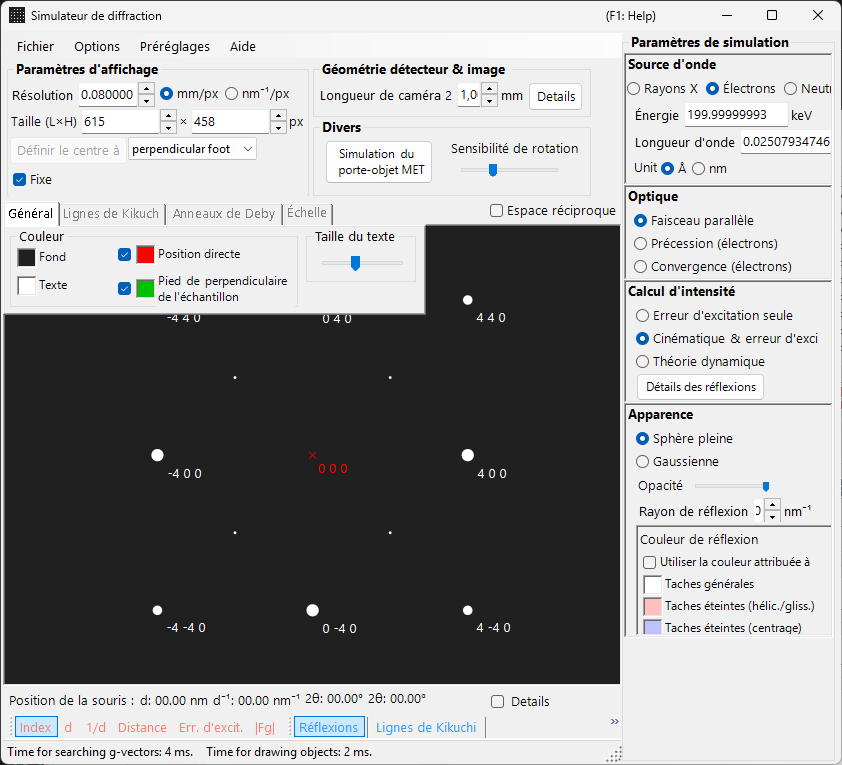
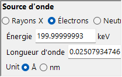
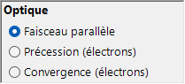
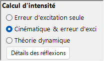
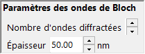
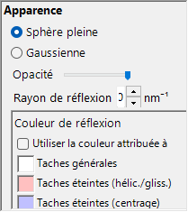

# Simulation SAED (Selected Area Electron Diffraction)

La simulation **SAED (Selected Area Electron Diffraction)** calcule les diagrammes de diffraction électronique de monocristal produits par un faisceau d'électrons parallèle. Il s'agit du mode par défaut du [simulateur de diffraction](index.md).

> Cette page répertorie chaque réglage qui apparaît dans le panneau **Paramètres de simulation** à droite lorsque vous choisissez **Source d'onde = Électrons** et **Optique = Faisceau parallèle**. Pour les opérations à l'échelle de la fenêtre, telles que le dessin et l'enregistrement, voir la [page de vue d'ensemble](index.md).

Conditions de l'interface : Source d'onde = Électrons, Optique = Faisceau parallèle, Calcul d'intensité = Erreur d'excitation / Cinématique & err. exc. / Théorie dynamique.

---

## Vue d'ensemble

Simule le diagramme de diffraction produit lorsqu'un faisceau d'électrons parallèle traverse un échantillon mince. Les positions des taches sont fixées par la relation géométrique entre la sphère d'Ewald et les points du réseau réciproque, et la brillance de chaque tache est calculée selon le mode de calcul d'intensité sélectionné.

---

## Source d'onde {#wave-length}

Réglez la source de rayonnement sur **Électrons**. Saisissez l'énergie (keV) ou la longueur d'onde (Å ou nm, au choix ; Å par défaut), et la longueur d'onde corrigée relativistement est calculée. La valeur initiale est 200 keV ; le menu **Préréglages** règle 300 / 200 / 120 kV en un clic. Pour les sources de rayons X et de neutrons, voir [Simulation de diffraction des rayons X](5-x-ray-neutron-diffraction.md).

---

## Optique {#incident-beam-mode}

Réglez **Optique** (la géométrie du faisceau incident) sur **Faisceau parallèle**. Il s'agit de la géométrie d'onde plane standard utilisée pour la SAED et la diffraction des rayons X.

> **Note** : Pour les électrons, vous pouvez choisir **Faisceau parallèle** / **Précession (électrons)** / **Convergence (électrons)**. Le choix de **Précession (électrons)** donne une [simulation PED](2-ped-simulation.md), et le choix de **Convergence (électrons)** donne une [simulation CBED](3-cbed-simulation.md) ; dans les deux cas, le calcul d'intensité passe automatiquement à **Théorie dynamique**.

---

## Intensity calculation

Détermine la manière dont les intensités des taches sont calculées.

### Erreur d'excitation seule

L'intensité est déterminée uniquement à partir de la distance géométrique entre la sphère d'Ewald et le point du réseau réciproque (l'erreur d'excitation $S_g$). Elle est maximale à $S_g = 0$ — exactement sur la sphère — et décroît lorsque $\lvert S_g\rvert$ augmente, jusqu'à s'annuler dès que $\lvert S_g\rvert$ dépasse le **Rayon de tache** indiqué pour le point du réseau réciproque. Comme le facteur de structure du cristal est ignoré, c'est le mode le plus rapide et il convient pour vérifier les positions des taches de diffraction.

Dans ce mode uniquement, les options suivantes apparaissent :

| Option | Description |
|--------|-------------|
| **Exclure toutes les réflexions interdites** | Masquer toutes les réflexions interdites par le groupe d'espace (centrage du réseau, axes hélicoïdaux et plans de glissement). La cocher coche et verrouille aussi l'option suivante. |
| **Exclure les réflexions interdites par le centrage du réseau** | Masquer uniquement les réflexions interdites par le centrage du réseau (activée par défaut). |
| **Dessiner toutes les taches avec le même rayon** | Dessiner chaque tache excitée avec le rayon complet *R*, quel que soit $S_g$. |

Les réflexions interdites qui restent visibles sont dessinées dans les couleurs **Taches éteintes** (voir [Spot appearance](#spot-appearance)).

### Cinématique

En plus de l'erreur d'excitation, le facteur de structure cinématique $\lvert F_{hkl} \rvert^2$ est intégré dans l'intensité. Les règles d'extinction sont correctement reflétées, ce qui rend ce mode adapté aux échantillons minces ou à la diffraction faible.

### Dynamique (méthode des ondes de Bloch, électron uniquement)

Un calcul dynamique rigoureux par la méthode des ondes de Bloch (méthode de Bethe). Il reproduit la diffusion multiple et la variation de l'intensité dépendante de l'épaisseur, et il est requis pour les échantillons épais ou la diffraction forte. Disponible uniquement lorsque **Électrons** est sélectionné. Pour la théorie, voir [Annexe A3. Méthode des ondes de Bloch](../appendix/a3-bloch-wave/calculation.md).

> **Note** : Lorsque **Théorie dynamique** est sélectionné, un panneau **Paramètres des ondes de Bloch** apparaît en dessous.

---

## Bloch wave settings (théorie dynamique)

Actif uniquement lorsque **Calcul d'intensité = Théorie dynamique**.

| Paramètre | Description |
|-----------|-------------|
| **Nombre d'ondes diffractées** | Nombre d'ondes de Bloch incluses dans le problème aux valeurs propres (8–1000, 240 par défaut). Des valeurs plus grandes donnent des intensités plus précises mais augmentent le temps de calcul en $O(N^3)$ |
| **Épaisseur** | Épaisseur de l'échantillon (nm) utilisée dans le calcul dynamique (0.01–10000 nm, 50 nm par défaut) |

---

## Spot appearance

Contrôle la manière dont chaque tache de diffraction est rendue.

- **Sphère pleine / Gaussienne** : le modèle géométrique du point du réseau réciproque (**Sphère pleine** par défaut). **Sphère pleine** dessine la section transversale (un cercle) entre une sphère et la sphère d'Ewald : le rayon de la sphère vaut $R\,I^{1/3}$ pour **Cinématique & err. exc.** (volume de la sphère ∝ intensité) et $R$ pour **Erreur d'excitation** ; pour **Théorie dynamique**, un disque de rayon $R\,I_\text{dyn}^{1/2}$ (aire ∝ intensité) est dessiné sans découpe par la sphère d'Ewald. **Gaussienne** dessine la section transversale (une gaussienne 2-D) d'une gaussienne 3-D avec $\sigma = R$, dont l'intégrale correspond à l'intensité de diffraction.
- **Opacité** : transparence de la tache (0 = transparente, 1 = opaque).
- **Rayon de tache (R)** : rayon virtuel du point du réseau réciproque (nm⁻¹ ; 0.01–1, 0.2 par défaut). La taille de la tache est fixée par la combinaison du mode **Apparence** et du **Calcul d'intensité** (voir ci-dessus).
- **Luminosité**, **Échelle de couleurs**, **Échelle log** : affichés uniquement en mode **Gaussienne**. **Luminosité** met à l'échelle l'intensité intégrée de la gaussienne rendue ; **Échelle de couleurs** vaut **Gray** (taches dans les couleurs de taches ci-dessous), **Cold-warm**, **Spectrum** ou **Fire** ; **Échelle log** affiche les intensités sur une échelle logarithmique (utile pour les diagrammes présentant un grand contraste d'intensité).
- **Couleur de tache** : affiché tant que l'**Échelle de couleurs** est **Gray** (réglage initial). **Taches générales**, **Taches éteintes (hélic./gliss.)** et **Taches éteintes (centrage)** définissent les couleurs des réflexions autorisées et interdites.
- **Couleur par cristal** : lorsque cette option est cochée, les taches sont dessinées dans la couleur attribuée à chaque cristal (y compris pour un seul cristal).

---

## Spot labels

Les étiquettes superposées aux taches sont sélectionnées dans la [barre d'outils](index.md#toolbar).

| Label | Contenu |
|-------|---------|
| **Index** | indices de Miller $(hkl)$ ; quatre indices $(hkil)$ lorsque **Options ▸ Utiliser l'indice de Miller-Bravais (hkil)** est activé dans la fenêtre principale et que le cristal utilise des axes hexagonaux (les étiquettes des lignes de Kikuchi, des anneaux de Debye et de la vue 3-D suivent le même réglage) <!-- 261105Cl 監査: C23 --> |
| **d** | distance interréticulaire $d$, en Å ou en nm selon l'unité de longueur de la fenêtre principale <!-- 261106Cl 作者の決定 C20 --> |
| **1/d** | inverse de la distance interréticulaire $1/d$, en nm⁻¹ ou en Å⁻¹ selon l'unité de longueur de la fenêtre principale <!-- 261106Cl 作者の決定 C2 --> |
| **Distance** | distance sur le détecteur entre la tache et la tache transmise (directe) (mm), mesurée entre les positions dessinées ; elle reste donc valable pour un détecteur incliné, la chambre de précession des rayons X et le Back Laue (mesurée depuis le trou du faisceau) ; non affichée lorsque le faisceau transmis manque le détecteur <!-- 261105Cl 監査: DrawDiffractionSpotsLabel (C15)。L2 tan2θ は傾けない平板の検出器だけ --> |
| **2θ** | angle de diffusion $2\theta$ (même définition que les cercles concentriques de l'échelle 2θ) |
| **χ** | angle azimutal $\chi$, mesuré depuis la direction vers le haut (12 heures), positif dans le sens horaire (même définition que les lignes radiales de l'échelle azimutale) |
| **Err. d'excit.** | erreur d'excitation $S_g$, en nm⁻¹ ou en Å⁻¹ selon l'unité de longueur de la fenêtre principale |
| **Intensité** | intensité relative (%) en mode **Cinématique & err. exc.** ; en mode **Théorie dynamique**, l'intensité relative (% du faisceau diffracté le plus intense, 000 exclu) et l'amplitude complexe sur la surface de sortie. Rien n'est affiché en mode **Erreur d'excitation** |

---

## Opérations communes

Les informations sur le détecteur, le retournement, l'affichage de l'espace réciproque, les lignes de Kikuchi, les anneaux de Debye, les lignes d'échelle, les réglages de couleur, l'enregistrement, et autres sont communs à tous les modes. Voir la [page de vue d'ensemble](index.md). Les détails par réflexion obtenus à partir du calcul dynamique peuvent être consultés dans les [informations sur les taches de diffraction](index.md#diffraction-spot-information).

---

## Voir aussi

- [Simulateur de diffraction (vue d'ensemble)](index.md)
- [Calcul SAED en faisceau parallèle](../appendix/a3-bloch-wave/calculation.md#parallel-beam-saed)
- [Simulation de diffraction des rayons X](5-x-ray-neutron-diffraction.md)
- [Simulation de diffraction électronique en précession (PED)](2-ped-simulation.md)
- [Définition du système de coordonnées](../appendix/a1-coordinate-system/1-orientation.md)
