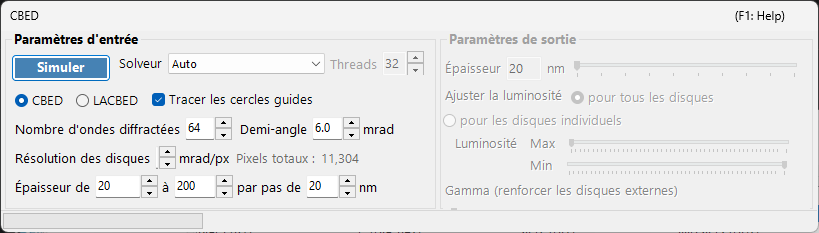
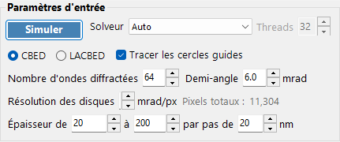
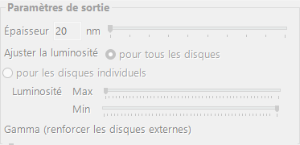

# Simulation CBED

La **simulation CBED (Convergent-Beam Electron Diffraction)** calcule et affiche des clichés de diffraction à faisceau convergent à l'aide de la méthode des ondes de Bloch (Bethe). Les clichés CBED montrent des disques de diffraction au lieu de taches et contiennent de riches informations sur la symétrie, l'épaisseur et la structure du cristal.

> Cette page liste tous les paramètres de la fenêtre dédiée qui s'ouvre lorsque vous sélectionnez **Source d'onde = Électrons** et **Optique = Convergence (électrons)** dans le [Simulateur de diffraction](index.md). Le passage du faisceau incident à la convergence bascule automatiquement **Calcul d'intensité** sur **Théorie dynamique**, et cette fenêtre de paramètres CBED s'ouvre. Les disques calculés peuvent être enregistrés via **Fichier > Enregistrer les disques CBED** / **Copier les disques CBED** de la fenêtre principale du simulateur. Pour le tracé et l'enregistrement des clichés de diffraction ainsi que pour les autres opérations communes au simulateur de diffraction, voir la [page d'aperçu](index.md).

Conditions GUI : Source d'onde = Électrons · Optique = Convergence (électrons) · Calcul d'intensité = Théorie dynamique (automatique)

---

## Paramètres d'entrée

Tant que cette fenêtre est ouverte, les panneaux **Paramètres des ondes de Bloch** et **Apparence** de la fenêtre principale sont désactivés ; le nombre d'ondes et les épaisseurs sont pris ici.

| Paramètre | Description | Par défaut / Typique |
|-----------|-------------|-------------------|
| **Mode** | **CBED** : cliché standard à faisceau convergent où chaque disque correspond à une réflexion, avec le disque transmis (000) au centre. **LACBED** (Large-Angle CBED) : cliché à faisceau convergent à grand angle où les disques de réflexions différentes se recouvrent. Utile pour observer les lignes HOLZ (higher-order Laue zone) et la symétrie | CBED |
| **Demi-angle (mrad)** | Demi-angle du cône du faisceau convergent (0–2000 mrad). Détermine la taille de chaque disque de diffraction (le diamètre du disque dans l'espace réciproque correspond à $2\alpha$) | 6 mrad par défaut ; typiquement 5–30 mrad |
| **Résolution des disques (mrad/px)** | Résolution angulaire à l'intérieur de chaque disque. Le disque est échantillonné sur une grille $N\times N$ avec $N = \lceil 2\alpha / \text{resolution} \rceil$, et seuls les points à l'intérieur du cercle sont calculés. Des valeurs plus petites donnent une résolution plus élevée, mais le nombre de directions de faisceau croît comme le carré, de sorte que le temps de calcul augmente lui aussi de manière quadratique. Le nombre résultant (= nombre total de directions de faisceau) est affiché sous **Pixels totaux** | 0.1 mrad/px par défaut |
| **Nombre d'ondes diffractées** | Nombre maximal de faisceaux inclus dans le calcul des ondes de Bloch pour chaque direction de faisceau incident (1–2048). Davantage de faisceaux donnent une meilleure précision, mais le coût du problème aux valeurs propres croît comme $O(N^3)$ | 64 par défaut ; typiquement 100–500 |
| **Épaisseur de / à / par pas de** | Valeurs de début, de fin et de pas de l'épaisseur de l'échantillon (nm, chacune 1–1000). Plusieurs épaisseurs sont calculées ensemble et commutées à l'aide du curseur d'épaisseur du côté de la sortie | 20 à 200 nm par défaut, pas de 20 nm |
| **Solveur** | Moteur de calcul. **Auto** ; **Eigenproblem with Eigen lib.** / **Eigenproblem with MKL lib.** (diagonalisation) ; **Matrix exp. with Eigen lib.** / **Matrix exp. with MKL lib.** (méthode de l'exponentielle de matrice, v4.794). **Auto** utilise la méthode de l'exponentielle de matrice avec Eigen et tous les processeurs logiques lorsque Eigen est disponible, sinon le problème aux valeurs propres MKL. La voie de l'exponentielle de matrice exige des épaisseurs régulièrement espacées et se rabat sinon sur le problème aux valeurs propres. Les entrées MKL ne sont pas proposées sur ARM64, et les entrées Eigen sont masquées lorsque la bibliothèque native Eigen n'est pas disponible | Auto |
| **Threads** | Nombre de threads parallèles (1–128). Désactivé pour **Auto** ; sélectionner un solveur le règle sur le nombre de processeurs logiques (¼ de celui-ci pour MKL) | — |
| **Tracer les cercles guides** | Lorsqu'elle est cochée, trace des cercles jaunes indiquant la limite de chaque disque de diffraction sur le cliché principal (en LACBED, un cercle pour 000 et des croix pour les autres réflexions) | activée |

---

## Run / Stop

- **Simuler** : démarre la simulation CBED avec les paramètres d'entrée actuels.
- **Arrêter** : annule le calcul en cours.

---

## Paramètres de sortie

Une fois le calcul terminé, les paramètres de sortie deviennent disponibles. Tous modifient uniquement l'affichage sans recalculer.

| Paramètre | Description |
|-----------|-------------|
| **Épaisseur** | Sélectionne l'épaisseur de l'échantillon à afficher, dans la plage d'épaisseur des paramètres d'entrée, à l'aide d'un curseur (le tableau des [informations sur les taches de diffraction](index.md#diffraction-spot-information) la suit) |
| **Ajuster la luminosité** | **pour tous les disques** : une seule échelle de luminosité, normalisée au maximum sur tous les disques. **pour les disques individuels** : chaque disque est normalisé à son propre maximum (γ est remis à 0 et désactivé) |
| **Luminosité (Max / Min)** | Limites supérieure et inférieure de l'intensité affichée, en fractions du maximum (la position du curseur est appliquée à la puissance 4). À ajuster lorsque vous souhaitez accentuer des détails faibles |
| **Gamma (renforcer les disques externes)** | Multiplie chaque pixel par $\exp(\gamma\,r)$, où $r$ est sa distance au centre du cliché, afin de rendre les disques externes sombres à grand angle plus faciles à voir par rapport au disque transmis central. Actif uniquement avec **pour tous les disques** |
| **Dégradé** | Sélectionne la gradation d'intensité parmi **Positive** / **Negative** (noir et blanc inversés) |
| **Couleur** | Carte de couleurs utilisée pour l'affichage : **Gray**, **Cold-Warm**, **Spectrum** ou **Fire** |

---

## Contexte physique

En CBED, le faisceau incident est considéré comme un cône d'ondes planes de directions différentes. Pour chaque direction (chaque point à l'intérieur du diaphragme de convergence = une onde plane incidente partielle), la méthode des ondes de Bloch résout l'équation de Schrödinger des électrons à l'intérieur du cristal, et les résultats sont réorganisés en disques de diffraction. Les lignes HOLZ (higher-order Laue zone) apparaissent sous forme de fines lignes sombres/claires à l'intérieur des disques, provenant de réflexions dans les zones de Laue supérieures. Elles sont sensibles au paramètre de maille le long de l'axe $c$ et sont utiles pour l'analyse structurale tridimensionnelle.

Pour les détails théoriques, voir [Calcul CBED](../appendix/a3-bloch-wave/cbed.md).

---

## Voir aussi

- [Simulateur de diffraction (aperçu)](index.md)
- [Simulation SAED](1-saed-simulation.md)
- [Simulation PED](2-ped-simulation.md)
- [Calcul CBED](../appendix/a3-bloch-wave/cbed.md)
