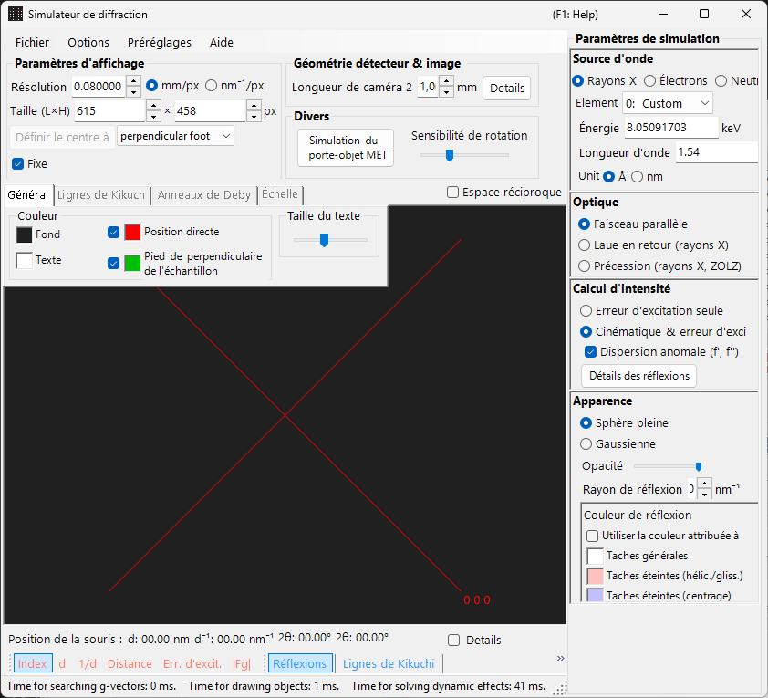
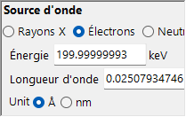
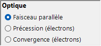
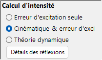
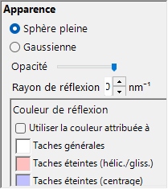
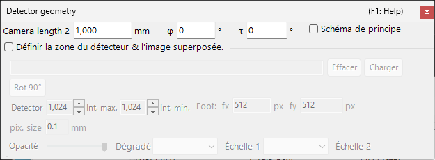

# Simulation de diffraction des rayons X / des neutrons

La **simulation de diffraction des rayons X / des neutrons** calcule les figures de diffraction des rayons X et des neutrons sur monocristal. C'est l'un des principaux modes du [simulateur de diffraction](index.md).

> Cette page répertorie chaque réglage qui apparaît à droite lorsque vous sélectionnez **Source d'onde = Rayons X** (ou neutrons). Pour les opérations à l'échelle de la fenêtre, telles que le tracé et l'enregistrement, voir la [page de présentation](index.md).

Conditions GUI : Source d'onde = Rayons X / Neutrons · Optique = Faisceau parallèle / Précession (rayons X, ZOLZ) / Laue en retour (rayons X) · Calcul d'intensité = Erreur d'excitation / Cinématique & err. exc.

---

## Présentation

Les rayons X ont une longueur d'onde plus grande que les électrons (Cu Kα : 0.15406 nm = 1.5406 Å), de sorte que la sphère d'Ewald est plus fortement courbée. Par conséquent, moins de points du réseau réciproque satisfont simultanément la condition de diffraction que pour les électrons. Comme le pouvoir de diffusion atomique est faible et que la diffusion multiple est faible, la théorie cinématique de la diffraction fournit une précision suffisante pour les intensités (le calcul dynamique n'est pris en charge que pour les électrons).

---

## Wave Length

Sélectionnez **Rayons X** comme source de rayonnement. Les rayons X peuvent être spécifiés de deux manières : rayons X caractéristiques et rayonnement synchrotron.

### Rayons X caractéristiques

Le choix d'un **élément** et d'une **transition** fixe la longueur d'onde des rayons X caractéristiques. La transition est spécifiée en notation de Siegbahn (Kα₁ / Kα₂ / Kβ, etc.). Longueurs d'onde Kα₁ d'éléments représentatifs :

| Élément | Raie | Longueur d'onde (Å) | Énergie (keV) |
|---------|------|-----------------|--------------|
| Cu | Kα₁ | 1.5406 | 8.048 |
| Mo | Kα₁ | 0.7093 | 17.479 |
| Co | Kα₁ | 1.7890 | 6.930 |
| Cr | Kα₁ | 2.2897 | 5.415 |

### Rayonnement synchrotron

Réglez **Element** sur **0: Custom** et entrez directement l'énergie (keV) ou la longueur d'onde (Å). Toute longueur d'onde peut être utilisée.

---

## Mode du faisceau incident

Sélectionne la géométrie du faisceau incident. Trois modes sont disponibles pour les rayons X.

### Parallel

L'onde plane standard. Un faisceau incident parallèle utilisé pour la SAED et la diffraction des rayons X sur monocristal.

### Precession (X-ray) — chambre de précession

Simule une chambre de précession de rayons X. Il s'agit d'un cliché de précession qui capture une seule couche du réseau réciproque.

### Back-Laue (Laue en réflexion)

Simule une figure de Laue en réflexion avec des rayons X blancs (polychromatiques). Dans cette géométrie en réflexion, le détecteur est placé du côté de la source et **Monochrome** est désactivé. Les taches sont projetées sur un détecteur plan **perpendiculaire au faisceau**, à la longueur de caméra, du côté de la source ; l'inclinaison du détecteur **Tau / Phi** de la [géométrie du détecteur](index.md#detector-geometry) n'est pas utilisée dans cette projection.

- Le spectre blanc est coupé à **50 keV** : les réflexions sont collectées jusqu'à $d = \lambda(50\ \text{keV})/2$, et aucune pondération spectrale n'est appliquée.
- Les harmoniques $n\mathbf{g}$ situées sur une même droite passant par l'origine tombent sur la même tache ; leurs $\lvert F\rvert^2$ sont additionnés sur la réflexion d'ordre le plus bas et les intensités des taches sont normalisées à la tache la plus intense.
- **Dispersion anomale (f', f'')** est désactivée (l'énergie n'est pas unique), et le **Rayon de tache** n'a pas d'unité dans ce mode.

> **Note** : Les options du faisceau incident suivent la longueur d'onde. **Précession (électrons)** et **Convergence (électrons)** n'apparaissent que lorsque le rayonnement électronique est sélectionné, tandis que les options **Précession (rayons X, ZOLZ)** et **Laue en retour (rayons X)** ci-dessus n'apparaissent que lorsque le rayonnement X est sélectionné. Pour les neutrons, seul **Faisceau parallèle** est disponible. Selon l'état au moment de la capture, la capture d'écran peut ne pas afficher les options spécifiques aux rayons X.

---

## Calcul de l'intensité

Sélectionne la méthode utilisée pour calculer les intensités des taches. Deux modes sont disponibles pour les rayons X.

### Only excitation error

L'intensité est déterminée uniquement par la distance géométrique entre la sphère d'Ewald et le point du réseau réciproque (l'erreur d'excitation $S_g$). Elle est maximale à $S_g = 0$ — exactement sur la sphère — et décroît lorsque $\lvert S_g\rvert$ augmente, jusqu'à s'annuler dès que $\lvert S_g\rvert$ dépasse le **Rayon de tache** indiqué pour le point du réseau réciproque. Le facteur de structure est ignoré.

Dans ce mode uniquement, les options suivantes apparaissent :

- **Exclure toutes les réflexions interdites** / **Exclure les réflexions interdites par le centrage du réseau** (par défaut : centrage du réseau uniquement) : masquer les réflexions interdites par le groupe d'espace. Les réflexions qui ne sont pas masquées sont dessinées dans les couleurs distinctes définies sous **Couleur de tache** (interdites par hélice/glissement et interdites par le réseau).
- **Dessiner toutes les taches avec le même rayon** : dessiner chaque tache à la taille correspondant à $S_g = 0$, quelle que soit son erreur d'excitation.

### Kinematical & excitation error

En plus de l'erreur d'excitation, le facteur de structure cinématique $\lvert F_{hkl} \rvert^2$ est intégré à l'intensité. Les règles d'extinction sont strictement respectées. Les facteurs de Lorentz et de polarisation ne sont pas inclus (il s'agit d'une simulation de la figure géométrique).

- **Dispersion anomale (f', f'')** (rayons X uniquement, activée par défaut) : ajoute au facteur de structure les termes de dispersion anomale f′, f″ à l'énergie X actuelle (aussi pour les anneaux de Debye). Dans une structure non centrosymétrique contenant des diffuseurs anomaux chimiquement distincts, la loi de Friedel est alors rompue et les intensités $hkl$ / $\bar h\bar k\bar l$ diffèrent (paires de Bijvoet) ; l'effet est le plus fort près d'un seuil d'absorption. Désactivée en Back-Laue. Voir [Facteur de structure](../appendix/a2-beam-interaction/structure-factor.md).

> **Note** : La **théorie dynamique** est désactivée pour les rayons X (disponible uniquement lorsque le rayonnement électronique est sélectionné).

---

## Apparence des taches

Contrôle la manière dont chaque tache de diffraction est rendue.

- **Sphère pleine / Gaussienne** : modèle géométrique du point du réseau réciproque. **Sphère pleine** dessine la section transversale entre une sphère et la sphère d'Ewald ; avec **Cinématique & err. exc.**, le rayon de la sphère vaut $R \times I_\text{rel}^{1/3}$ (de sorte que le *volume* de la sphère est proportionnel à l'intensité relative), avec **Erreur d'excitation**, il vaut *R* lui-même. **Gaussienne** utilise la section transversale entre une gaussienne 3D avec σ = *R* et la sphère d'Ewald (l'intégrale de la gaussienne 2D correspond à l'intensité de diffraction) ; les taches avec $\lvert S_g\rvert \ge 3R$ ne sont pas dessinées.
- **Opacité** : transparence de la tache (0 = transparent, 1 = opaque).
- **Rayon de tache (R)** : rayon du point du réseau réciproque. La taille de la tache rendue est déterminée par la combinaison de **Apparence** et de **Calcul d'intensité**.
- **Luminosité** : actif uniquement en mode **Gaussienne**. Définit l'intensité intégrée de la gaussienne rendue.
- **Échelle de couleurs** (Gaussienne uniquement) : **Gray**, **Cold-Warm**, **Spectrum** ou **Fire**.
- **Échelle log** (Gaussienne uniquement) : afficher les intensités sur une échelle logarithmique.
- **Couleur de tache** : couleurs des taches utilisées avec l'échelle de couleurs **Gray** (ce groupe est masqué pour les autres échelles de couleurs).
- **Couleur par cristal** : lorsque cette case est cochée, dessine les taches dans la couleur attribuée à chaque cristal.

---

## Anneaux de Debye (polycristallin)

Les anneaux de Debye d'un échantillon polycristallin peuvent être affichés. Activez **Anneaux de Debye** dans la barre d'outils (voir [Barre d'outils](index.md#toolbar)).

- **Ignorer l'intensité de diffraction** : dessine tous les anneaux avec la même couleur et la même intensité (utilisé pour une comparaison purement géométrique qui ignore le facteur de structure).
- **Afficher les étiquettes d'indices** : affiche l'indice (*hkl*) près de chaque anneau.

Les réglages détaillés se trouvent dans l'onglet Anneaux de Debye du [menu à onglets](index.md#drawing-overlay-tabs).

---

## Diffraction des neutrons

Sélectionner **Neutrons** dans le contrôle de longueur d'onde calcule une figure de diffraction des neutrons. Entrez l'énergie (meV) ou la longueur d'onde (Å ou nm, au choix ; Å par défaut). Le faisceau incident ne peut être que **Faisceau parallèle**. Le calcul de l'intensité peut être **Erreur d'excitation** ou **Cinématique & err. exc.** (**Théorie dynamique** n'est pas disponible). L'intensité cinématique utilise la longueur de diffusion des neutrons au lieu du facteur de diffusion atomique.

---

## Différences entre la diffraction des rayons X et des électrons

| Caractéristique | Diffraction des rayons X | Diffraction des électrons |
|---------|-------------------|----------------------|
| Longueur d'onde | Longue (0.5–2.5 Å) | Courte (0.02–0.04 Å) |
| Courbure de la sphère d'Ewald | Grande | Petite (presque plate) |
| Réflexions simultanées | Peu nombreuses | Nombreuses |
| Facteur de diffusion | Facteur de diffusion atomique $f(s)$ | Facteur de diffusion électronique $f_e(s)$ |
| Effets dynamiques | Généralement faibles | Importants |
| Règles d'extinction | Strictement respectées | Peuvent être violées par la diffusion multiple |

---

## Opérations communes

Pour les opérations à l'échelle de la fenêtre, telles que la longueur de caméra, la géométrie du détecteur, l'enregistrement des figures et les réglages de couleur, voir la [page de présentation](index.md). La géométrie détaillée du détecteur est configurée dans la fenêtre de géométrie ci-dessous.

---

## Voir aussi

- [Simulateur de diffraction (présentation)](index.md)
- [Simulation SAED](1-saed-simulation.md)
- [Simulation de diffraction électronique en précession (PED)](2-ped-simulation.md)
- [Simulation de diffraction électronique à faisceau convergent (CBED)](3-cbed-simulation.md)
- [Système de coordonnées — orientation du cristal](../appendix/a1-coordinate-system/1-orientation.md)
