# Crystal Diffraction (Simulateur de diffraction)

**Crystal Diffraction (Simulateur de diffraction)** simule les diagrammes de diffraction des rayons X, des neutrons et des électrons d'un monocristal.

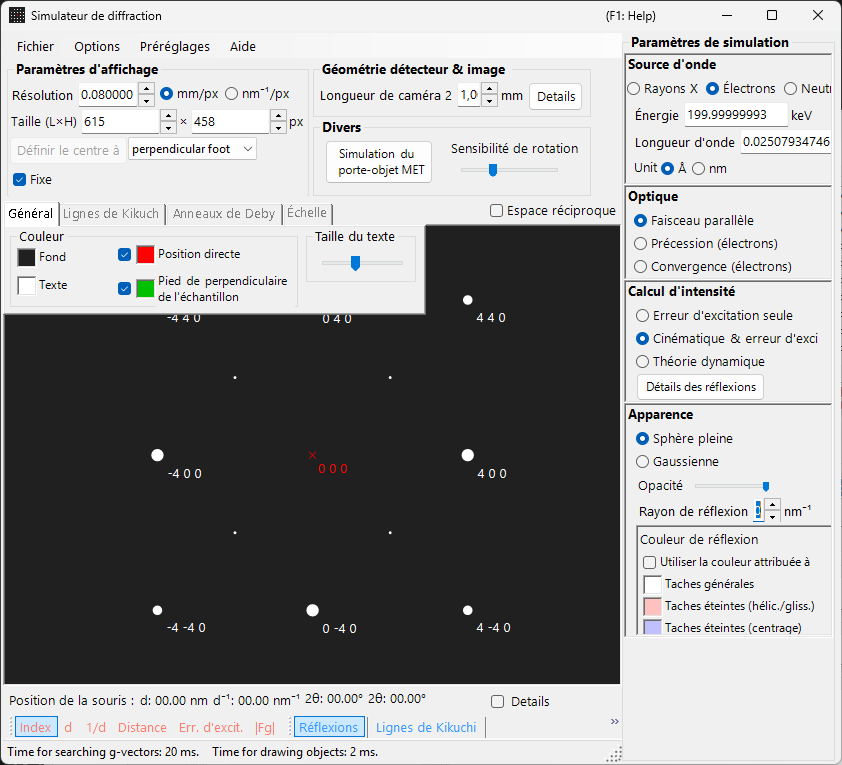

La fenêtre comporte **à gauche** une zone de tracé du diagramme de diffraction et **à droite** les panneaux de réglage des propriétés des réflexions (longueur d'onde, faisceau incident, calcul d'intensité, apparence, etc.). La combinaison de la longueur d'onde et du faisceau incident détermine le mode d'acquisition (diffraction des rayons X, SAED, PED, CBED), et les panneaux de droite se reconfigurent en conséquence.

---

## Comment cette page et les pages de mode se répartissent le travail

- **Cette page (hub)** : rassemble les opérations communes à tous les modes (raccourcis, menus, barre d'outils, informations sur l'écran/le détecteur, onglets de superposition, informations sur les réflexions, géométrie du détecteur, compression dynamique).
- **Chaque page de mode** : couvre **chaque réglage qui apparaît à droite** lorsque ce mode est sélectionné (longueur d'onde, faisceau incident, calcul d'intensité, apparence, réglages des ondes de Bloch, réglages de précession, etc.), de sorte que chaque page est autonome (il existe certains chevauchements entre les modes).

| Mode | Contenu | Page |
|------|----------|------|
| **Diffraction des rayons X (et des neutrons)** | Diagramme de diffraction des rayons X / des neutrons d'un monocristal (parallèle, précession rayons X, Back Laue) | [Simulation de diffraction des rayons X](5-x-ray-neutron-diffraction.md) |
| **SAED** | Diffraction électronique en faisceau parallèle (selected-area electron diffraction) | [Simulation SAED](1-saed-simulation.md) |
| **PED** | Diffraction électronique en précession | [Simulation PED](2-ped-simulation.md) |
| **CBED** | Diffraction électronique en faisceau convergent | [Simulation CBED](3-cbed-simulation.md) |

> **ALCHEMI n'est pas un mode.** Contrairement aux rayons X / SAED / PED / CBED, déterminés par la combinaison de la longueur d'onde et du faisceau incident, le simulateur ALCHEMI est une **fenêtre enfant** ouverte depuis le menu **Options** ; il est donc indiqué ici séparément.

| Fenêtre enfant | Contenu | Page |
|------|------|------|
| **Simulateur ALCHEMI** | Courbes d'inclinaison d'ionisation résolues par site (microanalyse renforcée par canalisation) | [Simulation ALCHEMI](4-alchemi-simulation.md) |

---

## Aperçu rapide des modes

Recherchez la page dont vous avez besoin à partir de la combinaison de la **longueur d'onde (source)** et du **faisceau incident**.

| Longueur d'onde | Faisceau incident | Mode | Page |
|------------|--------------------|------|------|
| Électron | Parallèle | SAED | [Simulation SAED](1-saed-simulation.md) |
| Électron | Précession (électron = PED) | PED | [Simulation PED](2-ped-simulation.md) |
| Électron | Convergence (CBED) | CBED | [Simulation CBED](3-cbed-simulation.md) |
| Rayons X | Parallèle | Diffraction des rayons X | [Simulation de diffraction des rayons X](5-x-ray-neutron-diffraction.md) |
| Rayons X | Précession (rayons X) | Précession rayons X (caméra de précession) | [Simulation de diffraction des rayons X](5-x-ray-neutron-diffraction.md) |
| Rayons X | Back Laue | Laue en rétroréflexion | [Simulation de diffraction des rayons X](5-x-ray-neutron-diffraction.md) |
| Neutron | Parallèle | Diffraction des neutrons | [section neutrons de la Simulation de diffraction des rayons X](5-x-ray-neutron-diffraction.md) |

> **Note** : Les choix de faisceau incident (**Optique**) changent avec la longueur d'onde. Pour les électrons : **Faisceau parallèle, Précession (électrons), Convergence (électrons)** ; pour les rayons X : **Faisceau parallèle, Précession (rayons X, ZOLZ), Laue en retour (rayons X)** ; pour les neutrons : **Faisceau parallèle** uniquement. Changer de source d'onde ramène toujours l'optique sur **Faisceau parallèle**. Sélectionner **Précession (électrons)** ou **Convergence (électrons)** bascule automatiquement le calcul d'intensité sur **Théorie dynamique** ; **Théorie dynamique** n'est proposée que pour les électrons (choisir les rayons X ou les neutrons revient à **Cinématique & err. exc.**). Le mode Laue en retour utilise un faisceau blanc (polychromatique).

---

## Raccourcis clavier et souris

Ceux-ci s'appliquent à la fenêtre du diagramme de diffraction partagée par les simulations rayons X, SAED et PED. Le glissement sur le diagramme fait tourner le **cristal**. Zoomez avec la molette de la souris ou avec le clic droit / le glissement droit.

| Raccourci | Action |
|----------|--------|
| <kbd>F1</kbd> | Ouvrir cette page du manuel en ligne |
| Glissement gauche près du centre | Incliner le cristal |
| Glissement gauche dans la zone extérieure | Faire pivoter le cristal autour de l'axe du faisceau |
| Double-clic gauche sur une réflexion | Afficher les détails de la réflexion (indice, *d*, facteur de structure, erreur d'excitation) |
| Glissement milieu | Déplacer le diagramme |
| <kbd>CTRL</kbd> + Glissement milieu | Déplacer le centre du détecteur (lorsque la zone du détecteur est affichée) |
| Molette de la souris | Zoomer / dézoomer d'un facteur ×2 par cran ; le point sous le curseur est amené au centre de la vue (avec **Fixer** coché, le centre fixe est conservé) |
| Clic droit | Dézoomer (×1/1.2) |
| Glissement droit d'un cadre | Zoomer sur la région sélectionnée |
| Double-clic droit sur la barre d'état | Copier un résumé textuel des réglages actuels |
| Double-clic droit sur un bouton de couche actif (Taches / Lignes de Kikuchi / Anneaux de Debye / Échelle) | Faire clignoter cette couche |

Les fenêtres auxiliaires ouvertes d'ici en ajoutent quelques autres :

| Raccourci | Action |
|----------|--------|
| Double-clic gauche sur le stéréonet — **Simulation du porte-objet MET** | Régler l'inclinaison du porte-objet sur ce point |
| Touches fléchées — **Simulation du porte-objet MET** | Modifier l'inclinaison du porte-objet pas à pas (cocher d'abord **Activer les touches fléchées** ; actif quelle que soit la fenêtre de ReciPro au premier plan) |
| Déposer un fichier `.prm` ou une image — **Detector geometry** | Charger la géométrie du détecteur / l'image de superposition |
| Déposer un profil `.txt` — **Dynamic Compression** | Charger des profils position/temps/pression (choisir l'instant avec le curseur **Temps** ; faire glisser les lignes verticales du graphique pour régler l'avant et l'arrière) |

Les raccourcis <kbd>CTRL</kbd>+<kbd>SHIFT</kbd> applicables à toute l'application, depuis la fenêtre principale, fonctionnent également lorsque cette fenêtre a le focus (voir [fenêtre principale](../0-main-window.md)).

→ Voir **[21. Raccourcis clavier et souris](../21-shortcuts.md)** pour toutes les fenêtres en un coup d'œil.

---

## Itinéraires rapides par objectif

| Objectif | Commencer par | Référence |
|------|------------|-----------|
| Produire une diffraction électronique en faisceau parallèle (SAED) | Régler **Optique** sur **Faisceau parallèle** et **Source d'onde** sur **Électrons** | [Simulation SAED](1-saed-simulation.md), [calcul SAED en faisceau parallèle](../appendix/a3-bloch-wave/calculation.md) |
| Produire une diffraction des rayons X d'un monocristal | Basculer **Source d'onde** sur rayons X / Synchrotron | [Simulation de diffraction des rayons X](5-x-ray-neutron-diffraction.md) |
| Produire une diffraction électronique en précession (PED) | Régler **Optique** sur **Précession (électrons)**, puis fixer le demi-angle et le pas | [Simulation PED](2-ped-simulation.md) |
| Produire une diffraction électronique en faisceau convergent (CBED) | Régler **Optique** sur **Convergence (électrons)** et définir les conditions dans la fenêtre CBED | [Simulation CBED](3-cbed-simulation.md), [calcul CBED](../appendix/a3-bloch-wave/cbed.md) |
| Examiner la liste des réflexions issue du calcul dynamique | Sélectionner **Théorie dynamique** et appuyer sur **Détails des taches** | [Calcul dynamique (cœur partagé)](../appendix/a3-bloch-wave/calculation.md) |
| Comparer la géométrie du détecteur avec une image expérimentale | Ouvrir les réglages de géométrie du détecteur via **Details** dans **Géométrie détecteur & image superposée** et utiliser l'image de superposition | [Système de coordonnées du détecteur](../appendix/a1-coordinate-system/2-diffraction.md) |

---

## Zone principale

Le diagramme de diffraction est simulé au centre de l'écran.

### Commande à la souris

Voir « Raccourcis clavier et souris » en haut de cette page.

### Position de la souris

La ligne **Position de la souris :** au-dessus du diagramme affiche, pour la position du curseur, *d* (nm), *d*⁻¹ (nm⁻¹) et 2θ (en degrés et en rad, ou en mrad en dessous de 0.1 rad). Cocher **Details** ajoute trois lectures de coordonnées : les coordonnées du détecteur (mm, origine = pied de la perpendiculaire issue de l'échantillon), les coordonnées de l'espace réel (mm, origine = cristal) et les coordonnées de l'espace réciproque (nm⁻¹). En mode Laue en retour, les valeurs de *d* et de l'espace réciproque sont affichées sous la forme « - ».

---

## Menu Fichier

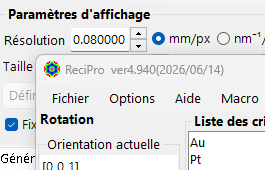

| Élément de menu | Description |
|-----------|-------------|
| **Enregistrer l'image** | Enregistrer le diagramme de diffraction affiché, **comme image (format PNG)** ou **comme métafichier (EMF)**. |
| **Enregistrer la zone du détecteur** | Enregistrer uniquement le recadrage de la zone du détecteur (PNG / EMF). Affiché uniquement lorsque la zone du détecteur est visible. |
| **Enregistrer les disques CBED** | Mode CBED uniquement : enregistrer les disques calculés **comme images individuelles (format PNG / TIFF)** ou **comme image collective (format PNG / TIFF)**. |
| **Copier** | Copier l'image affichée dans le presse-papiers (**comme image** / **comme métafichier (EMF)**). |
| **Copier la zone du détecteur** | Copier uniquement le recadrage de la zone du détecteur. Affiché uniquement lorsque la zone du détecteur est visible. |
| **Copier les disques CBED** | Mode CBED uniquement : copier les disques **comme image collective**. |
| **Enregistrer la vidéo** | Enregistrer une vidéo du **Cliché de diffraction** ou de la vue **Espace réciproque**. |
| **Mise en page / Aperçu avant impression / Imprimer** | Imprimer le diagramme affiché. |

### Préréglages

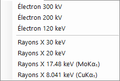

Préréglages fixes de source d'onde qui ne règlent que le rayonnement et son énergie : **Électron 300 kV**, **Électron 200 kV**, **Électron 120 keV**, **Rayons X 30 keV**, **Rayons X 20 keV**, **Rayons X 17.48 keV (MoKα₁)** et **Rayons X 8.041 keV (CuKα₁)** (les deux derniers sélectionnent la raie caractéristique Kα₁ de Mo / Cu). Les autres réglages (géométrie du détecteur, onglets, propriétés des taches) ne sont ni enregistrés ni modifiés.

### Menus Options et Aide

| Élément de menu | Description |
|-----------|-------------|
| **Options > Compression dynamique** | Ouvre la fenêtre [Compression dynamique](#compression-dynamique) (avec la fenêtre de géométrie du détecteur). |
| **Options > Simulateur ALCHEMI...** | Ouvre le [simulateur ALCHEMI](4-alchemi-simulation.md). |
| **Aide > Concept de base de la méthode de Bethe** | Ouvre l'[annexe sur les ondes de Bloch](../appendix/a3-bloch-wave/index.md) du manuel en ligne dans le navigateur. |

---

## Barre d'outils {#toolbar}

| Bouton | Description |
|--------|-------------|
| Taches | Afficher / masquer la couche des réflexions de diffraction |
| Lignes de Kikuchi | Afficher / masquer la couche des lignes de Kikuchi |
| Anneaux de Debye | Afficher / masquer la couche des anneaux de Debye |
| Échelle | Afficher / masquer la couche des lignes d'échelle |
| Index / d / 1/d / Distance / 2θ / χ / Err. d'excit. / \|Fg\| | Choix de l'étiquette attachée à chaque réflexion |

---

## Informations sur l'écran et le détecteur

### Écran

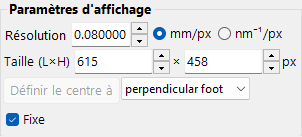

| Élément | Description |
|------|-------------|
| **Résolution** | La taille d'un pixel d'écran, en **mm/px** (sur le plan du détecteur) ou en **nm⁻¹/px** (au choix ; 0.08 mm/px par défaut). Elle n'a pas besoin de correspondre à la taille réelle des pixels du détecteur ; elle est traitée comme une échelle d'affichage et mise à jour automatiquement lorsque vous zoomez avec la souris. |
| **Taille (L×H)** | Largeur et hauteur en pixels de la zone de tracé. Selon la résolution de votre écran, de très grandes valeurs peuvent ne pas être réglables. |
| **Définir le centre à / Fixer** | Place le centre de la zone de tracé sur le **perpendicular foot** (pied de la perpendiculaire), le **direct spot** (tache directe) ou le centre du **detector** (ce dernier uniquement lorsqu'une zone de détecteur est définie). Avec **Fixer** coché (par défaut), le centre reste à cet endroit : le déplacement à la souris est désactivé et le zoom conserve ce centre. |
| **Retournement horizontal / Retournement vertical / Image négative** | Retournements géométriques (horizontal / vertical) et inversion du contraste du diagramme affiché. Utilisez-les pour faire correspondre l'orientation ou le contraste d'une image expérimentale. |
| **Espace réciproque** | Ouvre, à côté du diagramme, une vue 3-D de la sphère d'Ewald et des points du réseau réciproque, visualisant quelles réflexions sont excitées. Son panneau **Options** règle les couleurs (taches proches / éloignées de la sphère d'Ewald, sphère d'Ewald, origine, guide de direction), le rayon des taches en 3-D (nm⁻¹), le seuil d'intensité relative (%), la transparence des taches éloignées de la sphère d'Ewald, les étiquettes et la direction de vue (boutons fléchés avec un **Pas** angulaire, **Réinitialiser**). |

### Détecteur (longueur de caméra)

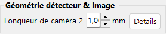

- **Longueur de caméra 2** : Distance (mm) de l'échantillon au pied de la perpendiculaire abaissée sur le plan du détecteur (1000 mm par défaut). Elle est égale à la longueur de caméra usuelle lorsque le détecteur n'est pas incliné (τ = 0).
- **Details** : Ouvre la fenêtre des réglages de géométrie du détecteur (voir [Géométrie du détecteur](#detector-geometry) ci-dessous).

### Divers {#misc}

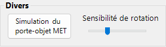

- **Sensibilité de rotation** : Amplitude de la rotation du cristal par pixel de glissement de la souris.
- **Simulation du porte-objet MET** : Ouvre la fenêtre de simulation liée au porte-objet (voir ci-dessous).

---

## Simulation du porte-objet MET

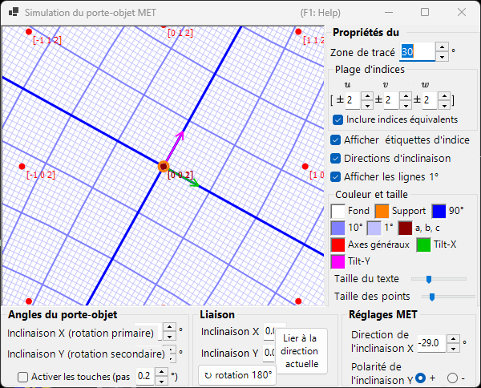

Ouvre une fenêtre qui lie le diagramme de diffraction à un **porte-objet MET** à double inclinaison (**Inclinaison X** = rotation primaire, **Inclinaison Y** = rotation secondaire). Le réglage des angles d'inclinaison du porte-objet met à jour le diagramme et l'orientation du cristal, et les orientations accessibles peuvent être affichées sur un stéréonet (ajouté dans la v4.914). **Lier à la direction actuelle** prend l'orientation actuelle du cristal comme référence du porte-objet (aux valeurs Inclinaison X / Inclinaison Y indiquées) ; **Réglages MET** donne la direction de l'axe d'inclinaison X à l'écran (−29° par défaut) et la polarité de l'inclinaison Y, et **↻ rotation 180°** fait tourner le cristal de 180° autour du faisceau. Un double-clic gauche sur le stéréonet règle l'inclinaison du porte-objet sur ce point, et cocher **Activer les touches fléchées** permet de modifier l'inclinaison X avec ←/→ et l'inclinaison Y avec ↑/↓ (pas de 0.1–2°, 0.2° par défaut). Tant que cette fenêtre est ouverte, les touches fléchées agissent quelle que soit la fenêtre de ReciPro au premier plan.

---

## Onglets de superposition du tracé {#drawing-overlay-tabs}

### Général

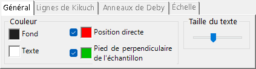

Définit la **Taille du texte** des étiquettes, ainsi que les couleurs du **Texte** des étiquettes, du repère **Pied de perpendiculaire de l'échantillon**, du repère **Position directe** et du **Fond** (les deux repères peuvent chacun être désactivés). Les couleurs des taches se règlent dans **Apparence** (voir les pages de mode) ; celles des lignes de Kikuchi, des anneaux de Debye et des lignes d'échelle dans leurs propres onglets. Les réglages effectués ici s'appliquent à tous les modes de rendu.

### Lignes de Kikuchi

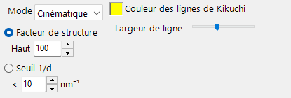

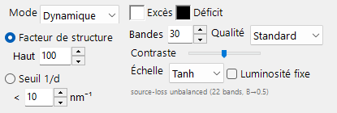

Actif lorsque les lignes de Kikuchi sont activées dans la barre d'outils.

- **Sélection des réflexions** : Choisit quelles réflexions génèrent les lignes de Kikuchi. Soit **Facteur de structure** (les *N* premières réflexions selon $\lvert F_{hkl}\rvert$, champ **Haut** ; 1–1000, 100 par défaut), soit **Seuil 1/d** (toutes les réflexions dont le 1/d est inférieur au seuil ; 0–100 nm⁻¹, 10 par défaut).
- **Mode** : Manière de tracer les lignes de Kikuchi (**Cinématique** par défaut). Les réglages sous la liste déroulante changent avec le mode.
    - **Géométrique** : toutes les lignes sélectionnées dans une couleur fixe.
    - **Cinématique** : l'obscurité des lignes suit l'intensité relative cinématique de chaque réflexion.
    - **Dynamique** : profils de bandes excès/déficit dynamiques à deux ondes alimentés par la diffusion thermique diffuse, calculés en arrière-plan. Les bandes excédentaires apparaissent du côté des grands angles et les traits déficitaires vers le faisceau direct ; l'épaisseur de l'échantillon est partagée avec les réglages d'intensité. Les lignes géométriques sont tracées en attendant la fin du calcul.
- **Réglages Géométrique / Cinématique** : **Couleur des lignes de Kikuchi** et **Largeur de ligne**.
- **Réglages Dynamique** :
    - **Excès** / **Déficit** : couleurs du côté clair (contraste positif) et sombre (contraste négatif) des bandes.
    - **Bandes** : Nombre de bandes tracées avec des profils dynamiques (les *N* meilleures par contraste dynamique ; 1–50, 30 par défaut).
    - **Qualité** : Points d'échantillonnage à travers chaque bande (Rapide 65 / Standard 129 / Élevée 257 ; Standard par défaut).
    - **Contraste** : Gain d'affichage appliqué au contraste des bandes avant compression.
    - **Échelle** : Courbe de compression de luminosité (Linear / Log / Tanh ; Tanh par défaut). Ce sont des transformations de visualisation, pas des réponses physiques de caméra.
    - **Luminosité fixe** : Fige la normalisation de luminosité, p. ex. pour comparer différentes orientations ou épaisseurs.
    - La ligne de note grise indique la mention de déséquilibre source/perte, le nombre de bandes tracées et des diagnostics (p. ex. facteur *B* par défaut substitué aux atomes avec *B* = 0).
- (L'ancien paramètre distinct **Threshold** n'existe plus ; les réflexions ne sont limitées que par la sélection ci-dessus.)

### Anneaux de Debye

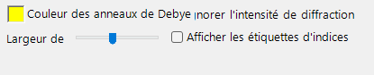

Actif lorsque les anneaux de Debye sont activés dans la barre d'outils.

- **Ignorer l'intensité de diffraction** : Si coché, tous les anneaux de Debye sont tracés avec la même couleur et la même intensité (en ignorant le facteur de structure du cristal). Utilisez-le pour une comparaison purement géométrique.
- **Afficher les étiquettes d'indices** : Si coché, le (*hkl*) apparaît à proximité de chaque anneau.

### Échelle

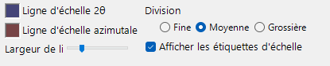

Actif lorsque les lignes d'échelle sont activées dans la barre d'outils.

- **Ligne d'échelle 2θ / Ligne d'échelle azimutale** : **2θ** représente un angle de diffusion constant (cercles concentriques), l'**azimut** représente un angle azimutal constant (lignes radiales depuis le centre). Les couleurs sont configurables indépendamment.
- **Largeur de ligne** : Épaisseur des lignes d'échelle.
- **Division** : Densité des lignes d'échelle, **Fine** / **Moyenne** (par défaut) / **Grossière**.
- **Afficher les étiquettes d'échelle** : Indique si des étiquettes numériques sont tracées sur les lignes d'échelle.

(Il n'y a pas d'onglet *Divers* distinct ; la **Sensibilité de rotation** de la souris se trouve dans le groupe **Divers** du panneau de droite, voir [Divers](#misc) ci-dessus.)

---

## Informations sur les réflexions de diffraction {#diffraction-spot-information}

Liste les détails par réflexion calculés par la méthode des ondes de Bloch (calcul Dynamical). Ouvrez-la avec le bouton **Détails des taches** du panneau de calcul d'intensité. En mode **Erreur d'excitation** / **Cinématique & err. exc.**, le bouton liste les réflexions actuellement tracées avec leurs potentiels électroniques et $P_g$, $Q_g$ (sans amplitudes dynamiques) ; en mode CBED, le tableau suit l'épaisseur sélectionnée dans la fenêtre CBED.

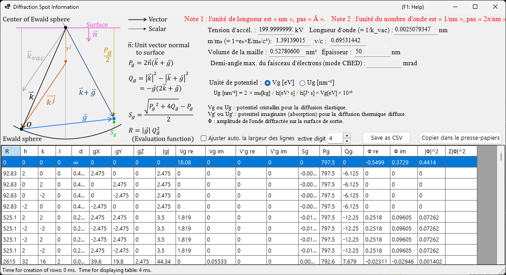

### Schéma et définitions

Le schéma (en haut à gauche) montre les vecteurs sur la sphère d'Ewald et définit les grandeurs utilisées dans le tableau ($\hat{\mathbf{n}}$ est le vecteur unitaire normal à la surface de l'échantillon, $\mathbf{k}$ est le vecteur d'onde incident, $\mathbf{g}$ est le vecteur du réseau réciproque).

- $P_g = 2\,\hat{\mathbf{n}} \cdot (\mathbf{k} + \mathbf{g})$
- $Q_g = |\mathbf{k}|^2 - |\mathbf{k} + \mathbf{g}|^2 = -\mathbf{g} \cdot (2\mathbf{k} + \mathbf{g})$
- **Erreur d'excitation :** $S_g = \dfrac{\sqrt{P_g^2 + 4 Q_g} - P_g}{2}$
- **Fonction d'évaluation :** $R = |\mathbf{g}|\, Q_g^2$ — classe les réflexions selon l'intensité de leur excitation (plus petit = plus proche de la sphère d'Ewald = plus fortement excité ; le faisceau transmis $g=0$ a $R=0$ et vient en premier). Le tableau est trié par $R$ croissant.

### Colonnes du tableau

| Colonne | Signification |
|--------|---------|
| **R** | fonction d'évaluation $R = \lvert\mathbf{g}\rvert\, Q_g^2$ (ci-dessus ; utilisée pour la sélection / l'ordonnancement des réflexions) |
| **h, k, (i,) l** | indices de Miller (*i* est l'indice hexagonal redondant, affiché uniquement pour les cristaux hexagonaux) |
| **d** | distance interréticulaire (nm) |
| **gX, gY, gZ** | composantes du vecteur du réseau réciproque *g* (1/nm) |
| **\|g\|** | norme de *g* (1/nm) |
| **Vg re / Vg im** | coefficient de Fourier du potentiel cristallin pour la diffusion élastique, $V_g$ (réel / imaginaire) |
| **V'g re / V'g im** | potentiel imaginaire (d'absorption) pour la diffusion thermique diffuse (TDS), $V'_g$ (réel / imaginaire) |
| **Sg** | erreur d'excitation $S_g$ (ci-dessus ; 1/nm) |
| **Pg** | grandeur auxiliaire $P_g = 2\,\hat{\mathbf{n}}\cdot(\mathbf{k}+\mathbf{g})$ (ci-dessus) |
| **Qg** | grandeur auxiliaire $Q_g = -\mathbf{g}\cdot(2\mathbf{k}+\mathbf{g})$ (ci-dessus) |
| **Φ re / Φ im** | amplitude complexe $\Phi$ de l'onde diffractée dynamique sur la surface de sortie (réel / imaginaire) |
| **\|Φ\|^2** | intensité diffractée $\lvert\Phi\rvert^2$ de cette réflexion |
| **Σ\|Φ\|^2** | somme cumulée de $\lvert\Phi\rvert^2$ (total sur les réflexions ; utile comme contrôle de conservation de l'intensité) |

### Unités de potentiel et autres commandes

- **Unité de potentiel** : Bascule le potentiel affiché entre **Vg [eV]** (potentiel électrostatique, eV) et **Ug [nm⁻²]** (la grandeur mise à l'échelle $U_g = (2 m_0/h^2)\, V_g$ qui entre dans les équations des ondes de Bloch). Les en-têtes de colonnes changent en conséquence entre *Vg / V'g* et *Ug / U'g*.
- Au-dessus du tableau sont affichés la tension d'accélération, la longueur d'onde ($\lambda = 1/k_\text{vac}$), le rapport de masse relativiste $m/m_0$, le rapport de vitesse $v/c$, le volume de la maille, l'épaisseur de l'échantillon et (en mode CBED) le demi-angle maximal du faisceau d'électrons.
- **Note 1 :** l'unité de longueur est le **nm**, pas l'Å. **Note 2 :** l'unité de nombre d'onde est le **1/nm**, pas le 2π/nm.
- **Chiffre significatif** : nombre de chiffres significatifs affichés dans le tableau (1–16, 4 par défaut). **Ajuster auto. la largeur des lignes** : ajustement automatique des largeurs de colonnes. **Copier dans le presse-papiers** : exporte le tableau sous forme de texte pouvant être collé dans un tableur. **Save as CSV** : écrit la même table (les colonnes visibles) dans un fichier CSV ; le séparateur décimal est toujours le point, de sorte que le fichier reste valide dans les paramètres régionaux à virgule décimale.

---

## Géométrie du détecteur {#detector-geometry}

Une fenêtre pour la configuration détaillée de la géométrie du détecteur (longueur de caméra, inclinaison, rotation) et la superposition d'une image expérimentale. Ouvrez-la via **Details** dans le panneau **Géométrie détecteur & image superposée**.

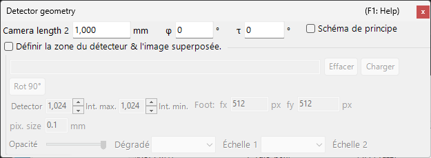

### Réglages de la géométrie du détecteur

Spécifiez la géométrie de réflexion : **Longueur de caméra 2** (mm, 1–10000, 1000 par défaut) et l'inclinaison du détecteur **τ** (−200 à 200°) autour d'un axe situé dans le plan du détecteur, à l'azimut **φ**. Pour Back Laue (Laue en rétroréflexion), seule la **Longueur de caméra 2** est utilisée : le diagramme est toujours projeté sur un détecteur perpendiculaire au faisceau du côté de la source, et τ / φ ne sont pas appliqués à cette projection. Déposer un fichier `.prm` charge la longueur d'onde, la longueur de caméra 2, τ, φ, la position du pied et la taille des pixels (la source passe aux rayons X avec une longueur d'onde personnalisée, et la zone du détecteur est activée).

### Zone du détecteur et image superposée

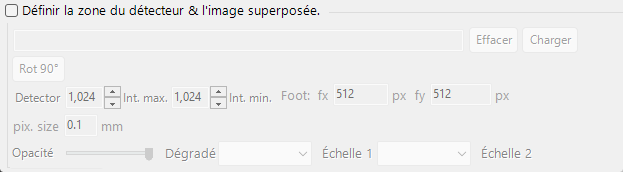

Cochez **Définir la zone du détecteur & l'image superposée.** pour spécifier le détecteur : taille en pixels (1024 × 1024 par défaut), **taille pix.** (mm, 0.1 par défaut) et la position du **Pied** **fx, fy** (px, 512, 512 par défaut). Une image expérimentale peut être chargée (**Charger** ou dépôt) et superposée avec **Opacité**, **Dégradé** (film positif/négatif), **Échelle 1** (log/linéaire), **Échelle 2** (Gray / Cold-Warm / Spectrum / Fire), **Int. max./min.**, **Rot 90°** et **Effacer**. **Schéma de principe** affiche un croquis de la géométrie. Utilisez ceci pour superposer le diagramme simulé et une image expérimentale et affiner la géométrie du détecteur.

Voir aussi [Système de coordonnées du détecteur](../appendix/a1-coordinate-system/2-diffraction.md) pour les définitions du système de coordonnées.

---

## Compression dynamique

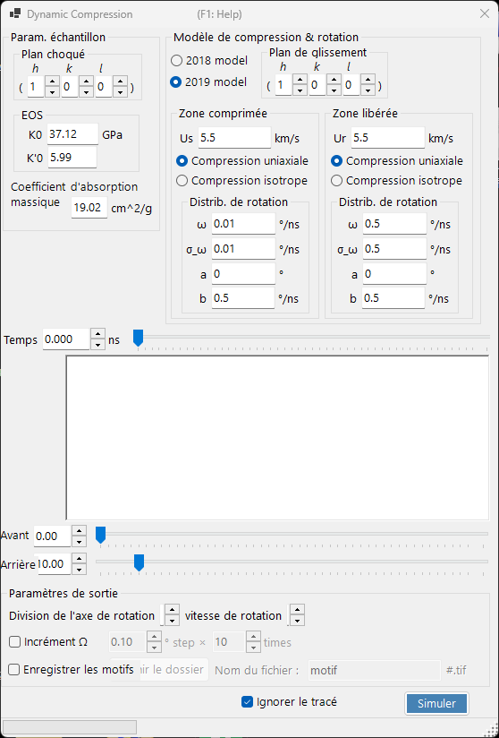

Une fenêtre pour simuler la diffraction d'un échantillon soumis à un choc (compression dynamique). Déposez un fichier `.txt` séparé par des tabulations à trois colonnes (position, temps, pression) pour charger les profils de pression à chaque instant ; le curseur **Temps** (ns) sélectionne le profil affiché dans le graphique. Les deux lignes verticales du graphique (**Avant** / **Arrière**) peuvent être glissées pour régler l'avant et l'arrière de la compression. La fenêtre contient aussi le modèle de compression (**2018 / 2019 model**), les vitesses de choc (**Us**, **Ur**, km/s), l'**EOS** (K0, K'0), le **Plan choqué** / **Plan de glissement**, les distributions de rotation des zones comprimée et libérée, le coefficient d'absorption massique, l'incrémentation de Ω et **Enregistrer les motifs** (`#.tif`), et se lance avec **Simuler**.

---

## Simulateur ALCHEMI

Ouvre une fenêtre enfant qui calcule des **courbes d'inclinaison d'ionisation résolues par site** : le rendement d'un canal d'ionisation choisi pendant que le cristal traverse les conditions de Bragg d'une rangée systématique, séparé par site atomique. Elle s'ouvre depuis le menu **Options**. Contrairement à la fenêtre CBED, elle possède sa propre zone de sortie et ne dessine pas sur le canevas de la fenêtre parente.

→ Voir **[Simulation ALCHEMI](4-alchemi-simulation.md)** pour tous les réglages ainsi que le domaine de validité et les limites connues.

---

## Sujets connexes

- [Simulation de diffraction des rayons X](5-x-ray-neutron-diffraction.md)
- [Simulation SAED](1-saed-simulation.md)
- [Simulation PED](2-ped-simulation.md)
- [Simulation CBED](3-cbed-simulation.md)
- [Simulation ALCHEMI](4-alchemi-simulation.md)
- [Calcul dynamique (cœur partagé)](../appendix/a3-bloch-wave/calculation.md)
- [Système de coordonnées du détecteur](../appendix/a1-coordinate-system/2-diffraction.md)
