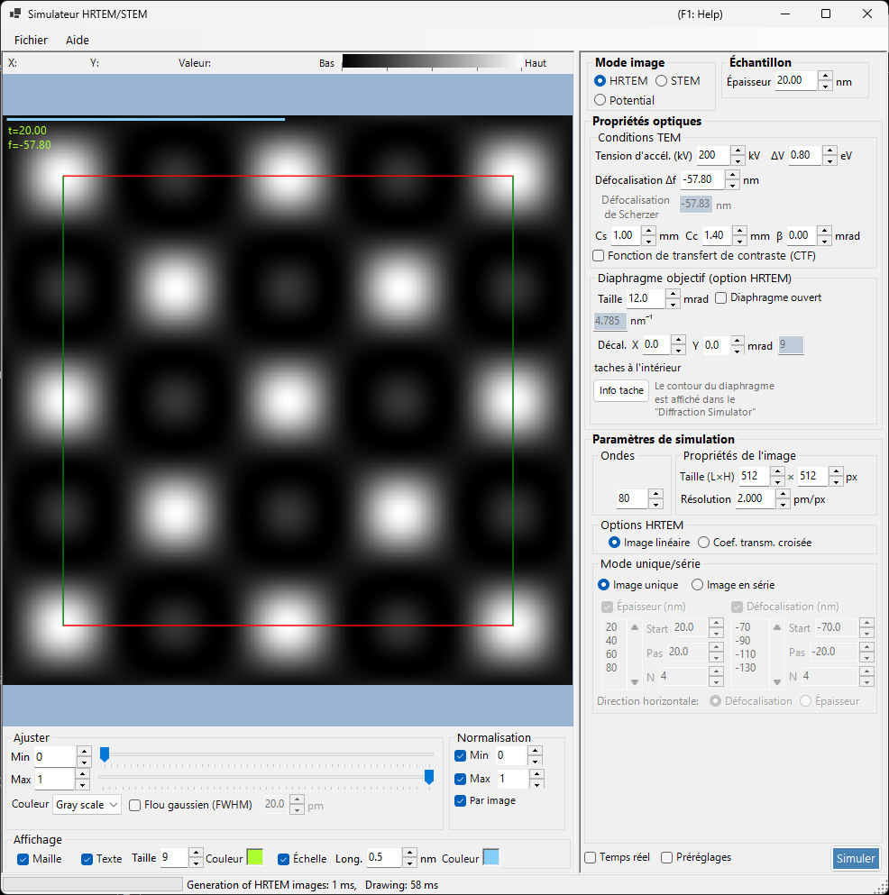
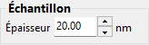
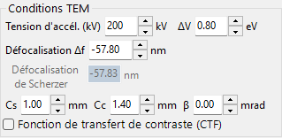
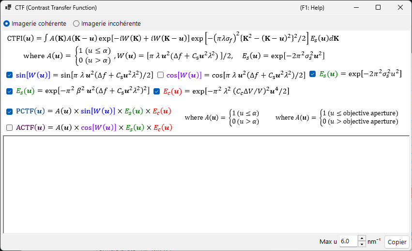
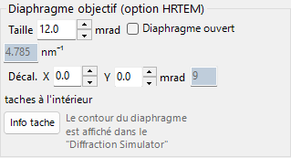
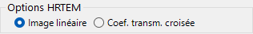
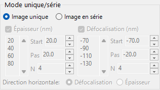
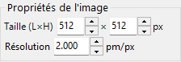
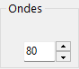

# Simulation HRTEM

La simulation **HRTEM (High-Resolution Transmission Electron Microscopy)** calcule des images de franges de réseau en MET haute résolution. C'est le mode principal du [Simulateur HRTEM/STEM](index.md).

> Cette page décrit tous les réglages qui apparaissent à droite lorsque **Mode image = HRTEM**. Pour les commandes situées à gauche — affichage du résultat et réglage de sa luminosité — voir la [page de présentation](index.md#display-settings).

---

## Présentation

Une image HRTEM se forme lorsque l'onde électronique transmise à travers l'échantillon est imagée sous l'influence des aberrations de la lentille objectif. ReciPro calcule la propagation de l'onde électronique dans l'échantillon avec la méthode des ondes de Bloch (calcul dynamique) et génère l'image HRTEM au moyen de la fonction de transfert de contraste de phase (PCTF).

### Déroulement du calcul

1. **Méthode des ondes de Bloch** : calcule la propagation de l'onde électronique dans le potentiel cristallin et obtient l'amplitude et la phase de l'onde sortante
2. **Fonction de lentille** : applique les aberrations de la lentille objectif (aberration sphérique $C_s$, défocalisation $\Delta f$)
3. **Cohérence partielle** : prend en compte la taille finie de la source (cohérence spatiale) et la fluctuation d'énergie (cohérence temporelle)
4. **Formation de l'image** : calcule la distribution d'intensité $|\psi(\mathbf{r})|^2$

Pour la théorie, voir l'[Annexe A3.2 — Formation de l'image HRTEM](../appendix/a3-bloch-wave/hrtem.md).

---

## Échantillon

- **Épaisseur** : épaisseur de l'échantillon (nm). Les images HRTEM dépendent fortement de l'épaisseur. En mode **Image en série**, cette valeur est ignorée et c'est la liste d'épaisseurs décrite plus bas qui est utilisée.

---

## Conditions TEM {#tem-conditions}

Définit les conditions d'imagerie de la lentille objectif.

| Paramètre | Description | Par défaut / typique |
|-----------|-------------|-------------------|
| **Tension d'accél.** <!-- 261105Cl 監査: 見出しから (kV) を外した (numericBoxAccVol.HeaderText)。単位は欄の右に出る --> | Tension d'accélération (kV). La longueur d'onde des électrons corrigée relativistiquement est affichée à droite | 200 kV |
| **Défocalisation Δf** | Défocalisation de la lentille objectif (nm). La valeur de référence de la **défocalisation de Scherzer** est affichée en dessous | −57.8 nm |
| **Cs** | Coefficient d'aberration sphérique (mm). Affecte la CTF et la défocalisation de Scherzer. Les valeurs négatives (−20 à 20 mm) sont acceptées | 1.0 mm (par défaut) ; 0.5–1.0 (conventionnel), < 0.01 (corrigé Cs) |
| **Cc** | Coefficient d'aberration chromatique (mm). Détermine le flou de l'image dû à la dispersion en énergie | 1.4 mm (par défaut) ; 1.0–2.0 mm |
| **β** | Demi-angle d'illumination (mrad). Représente l'effet de taille finie de la source (cohérence spatiale) | 0 mrad (par défaut) ; 0.1–1.0 mrad |
| **ΔV** | Largeur à mi-hauteur de la dispersion en énergie des électrons (eV). Avec Cc, elle détermine l'étalement de focalisation dû à l'aberration chromatique | 0.8 eV (par défaut) ; 0.5–2.0 eV |

Les valeurs par défaut ci-dessus ne s'appliquent qu'au premier démarrage ; ensuite, les dernières valeurs utilisées sont restaurées. En interne, ΔV (FWHM) est converti en écart-type $\sigma_V = \Delta V / (2\sqrt{2\ln 2})$ et l'étalement de focalisation vaut $\delta = C_c\,\sigma_V / V$. La fonction d'aberration est

$$\chi(u) = \pi\lambda\,\Delta f\,u^2 + \tfrac{\pi}{2}\,C_s\lambda^3 u^4 ,$$

et chaque onde diffractée est multipliée par $\exp[-i\chi(u)]$ ; une **Δf négative correspond donc à une sous-focalisation** (convention dans laquelle la défocalisation de Scherzer est négative).

> **Menu contextuel** : sur le panneau Conditions TEM, vous pouvez appliquer en un clic **Régler la défocalisation à 0 nm** / **Régler la défocalisation à la valeur de Scherzer** / **Conditions idéales (Cs, Cc, β, ΔV, Δf = 0)** (cette dernière met Cs, Cc, β, ΔV **et la défocalisation** à 0). <!-- 261106Cl 作者の決定 E19: 表示名を理想条件に --> Le même menu contient quatre préréglages de microscope — *300kV Cold-FEG Cs-free (Cs 0, Cc 2.8, ΔV 0.3) ARM300F*, *200kV Schottky-FEG UHR (Cs 0.5, Cc 1.1, ΔV 0.8) 2100F*, *200kV Schottky-FEG HR (Cs 1.0, Cc 1.4, ΔV 0.8) 2100F* et *200kV Lab6 HR (Cs 1.0 , Cc 1.4, ΔV 2.0) 2100* — qui règlent la tension d'accélération, Cs, Cc et ΔV comme indiqué dans l'élément, puis règlent la défocalisation à la valeur de Scherzer (β n'est pas modifié). La case **Préréglages** en bas à droite ouvre la fenêtre qui enregistre vos propres conditions (voir [Liste des préréglages](index.md#preset-list)). <!-- 261105Cl 監査: プリセット名は ΔV (FormImageSimulator.resx presets1〜4ToolStripMenuItem.Text) -->

### Défocalisation de Scherzer

La valeur de défocalisation au voisinage de laquelle le contraste de phase est optimal, calculée à partir de la longueur d'onde actuelle et de l'aberration sphérique $C_s$ (affichée pour référence). Pour un $C_s$ négatif, la valeur affichée est $+\sqrt{\tfrac{4}{3}|C_s|\lambda}$.

$$\Delta f_{\text{Scherzer}} = -\sqrt{\tfrac{4}{3}\,C_s \lambda}\quad\left(\approx -1.155\,\sqrt{C_s \lambda}\right)$$

Dans cette condition, la PCTF est négative sur une large plage de fréquences spatiales, de sorte que les positions atomiques apparaissent en contraste sombre. ReciPro adopte cette valeur de Scherzer originale (obtenue en fixant le minimum de la phase d'aberration $\chi$ à $-2\pi/3$), et la valeur affichée dans l'interface suit cette formule. Notez que certaines références utilisent plutôt la valeur de *Scherzer étendue* $-1.2\sqrt{C_s\lambda}$, qui élargit davantage la bande de transfert.

---

## Fonction de lentille / Fonction de transfert de contraste (CTF)

Cocher **Fonction de transfert de contraste (CTF)** ouvre une fenêtre qui trace la manière dont les aberrations de la lentille et la défocalisation transfèrent le contraste de l'image à chaque fréquence spatiale.

- $\sin\chi(u)$ : fonction de transfert de contraste de phase ($\chi(u)$ est la fonction d'aberration de la lentille)
- $E_\text{s}(u)$ : fonction enveloppe de cohérence spatiale ; l'amortissement dû à la taille finie de la source ($\beta$)
- $E_\text{c}(u)$ : fonction enveloppe de cohérence temporelle ; l'amortissement dû à la fluctuation d'énergie ($C_c$, $\Delta V$)

Chaque courbe a sa propre case à cocher : $\sin\chi$, $\cos\chi$, $E_\text{s}$, $E_\text{c}$, **PCTF** $=\sin\chi\,E_\text{s}E_\text{c}$ et **ACTF** $=\cos\chi\,E_\text{s}E_\text{c}$ ; PCTF et ACTF sont mises à zéro hors du diaphragme objectif. En mode HRTEM

$$E_\text{s}(u)=\exp\!\left[-\pi^2\beta^2u^2\left(\Delta f+C_s\lambda^2u^2\right)^2\right],\qquad E_\text{c}(u)=\exp\!\left[-\tfrac{1}{2}\pi^2\lambda^2\delta^2u^4\right].$$

**u max.** (nm⁻¹, 6 par défaut) fixe la limite supérieure de l'axe horizontal. **Copier** place les courbes tracées dans le presse-papiers sous forme de texte séparé par des tabulations. La fenêtre est aussi disponible en mode STEM (voir [Simulation STEM](2-stem-simulation.md#ctf-stem)) ; elle est désactivée en mode Potentiel.

---

## Diaphragme objectif (option HRTEM)

Limite les ondes diffractées qui traversent le diaphragme objectif. Le calcul des ondes de Bloch lui-même utilise toujours le nombre d'ondes défini dans **Ondes** ; le diaphragme sélectionne ensuite lesquels de ces faisceaux contribuent à l'image (un faisceau passe lorsque $|\mathbf{g}-\mathbf{c}| < 2\sin(\alpha_\text{obj}/2)/\lambda$, où $\mathbf{c}$ est le centre du diaphragme). Si moins de deux faisceaux passent, le calcul s'arrête avec un message vous invitant à agrandir le diaphragme.

- **Taille** : demi-angle du diaphragme objectif (mrad, 12 par défaut). Plus il est petit, plus les ondes diffractées aux grands angles sont coupées, et plus les détails haute résolution sont lissés. Le rayon équivalent dans l'espace réciproque $\sin\theta/\lambda$ (nm⁻¹) est affiché.
- **Décal. X** / **Y** : décalage du centre du diaphragme objectif (mrad). Utilisé pour l'imagerie en champ sombre à diaphragme décentré ; l'illumination elle-même n'est pas inclinée.
- **Diaphragme ouvert** : ouvre le diaphragme objectif (infini), de sorte que toutes les ondes diffractées contribuent à l'image.
- **taches à l'intérieur** : le nombre de faisceaux diffractés (taches) situés à l'intérieur du diaphragme (lecture seule).
- **Info tache** : ouvre un tableau listant les faisceaux diffractés à l'intérieur du diaphragme (intensité, amplitude complexe, etc.).

> La taille du diaphragme objectif est également affichée dans le **Simulateur de diffraction**.

---

## Options HRTEM (modèle de cohérence partielle)

Sélectionne la manière dont la cohérence partielle (β et l'étalement de focalisation δ) est prise en compte. L'onde de sortie est calculée pour une seule direction incidente (l'axe du faisceau) ; la divergence de l'illumination et la dispersion en énergie n'interviennent qu'à travers les fonctions enveloppes ci-dessous.

- **Image linéaire** (modèle quasi cohérent) : peu coûteux en calcul. Chaque onde diffractée $\psi_g$ de l'onde de sortie dynamique est multipliée par $\exp[-i\chi(g)]\,E_\text{s}(g)\,E_\text{c}(g)$ et les ondes sont sommées de façon cohérente : $I(\mathbf{r}) = \left|\sum_g \psi_g\,e^{-i\chi(g)}\,E_\text{s}(g)\,E_\text{c}(g)\,e^{2\pi i\,\mathbf{g}\cdot\mathbf{r}}\right|^2$. Précis lorsque l'image est dominée par l'interférence avec le faisceau transmis (échantillons minces).
- **Coef. transm. croisée** : coûteux en calcul mais plus précis. Chaque paire de faisceaux $(g,h)$ est sommée avec l'enveloppe mutuelle (le coefficient de transmission croisée complet) ; c'est le modèle à utiliser pour les diffuseurs forts qui excitent de nombreuses ondes diffractées intenses. Le coût croît comme le carré du nombre de faisceaux à l'intérieur du diaphragme.

Pour plus de détails, voir l'[Annexe A3.2 — Formation de l'image HRTEM](../appendix/a3-bloch-wave/hrtem.md).

---

## Mode unique/série

- **Image unique** : calcule une image HRTEM à l'épaisseur et à la défocalisation actuelles.
- **Image en série** : génère un ensemble d'images en faisant varier par pas l'épaisseur et la défocalisation (série en épaisseur / série focale). Utile pour trouver la condition qui correspond le mieux à une image expérimentale.

Pour une image en série, définissez les éléments suivants.

| Élément | Description |
|------|-------------|
| **Épaisseur (nm)** / **Défocalisation (nm)** | La grandeur à faire varier (les deux sont possibles) |
| **Début / Pas / N** | Valeur de départ, largeur du pas et nombre d'images. Ils sont développés dans la zone de liste ci-dessous, qui peut aussi être modifiée directement |
| **Direction horizontale:** | Lorsque l'épaisseur et la défocalisation varient toutes deux, la grandeur disposée selon la direction horizontale de la grille (**Défocalisation** ou **Épaisseur**) |

Faire varier à la fois l'épaisseur et la défocalisation produit une matrice d'images lignes × colonnes. **N** est limité à 20 pour chaque grandeur. Lorsqu'une seule grandeur varie et qu'il y a plus de deux images, la rangée est repliée en une grille presque carrée.

---

## Propriétés de l'image

- **Taille (L×H)** : nombre de pixels de l'image simulée (512×512 par défaut).
- **Résolution** : résolution d'échantillonnage (pm/px, 2 par défaut). Le champ de vue vaut Taille × Résolution ; une valeur plus petite échantillonne donc les franges plus finement sur une zone plus petite. L'image est synthétisée par une somme de Fourier directe sur les faisceaux en chaque pixel (sans FFT), de sorte que le temps de calcul dépend du nombre de pixels et du nombre de faisceaux, et non de cette valeur.

---

## Ondes

- Nombre maximal d'ondes de Bloch utilisées dans la méthode de Bethe (calcul dynamique), 80 par défaut. Un nombre plus élevé améliore la précision, mais la résolution du problème aux valeurs propres prend un temps en $O(N^3)$.

---

## Voir aussi

- [Simulateur HRTEM/STEM (présentation)](index.md)
- [Simulation STEM](2-stem-simulation.md)
- [Simulation du potentiel](3-potential-simulation.md)
- [Annexe A3.2 — Formation de l'image HRTEM](../appendix/a3-bloch-wave/hrtem.md)
