# Finestra principale

All'avvio di ReciPro compare la finestra principale. Da questa finestra si seleziona il cristallo, se ne controlla la rotazione e si richiamano le varie funzioni.

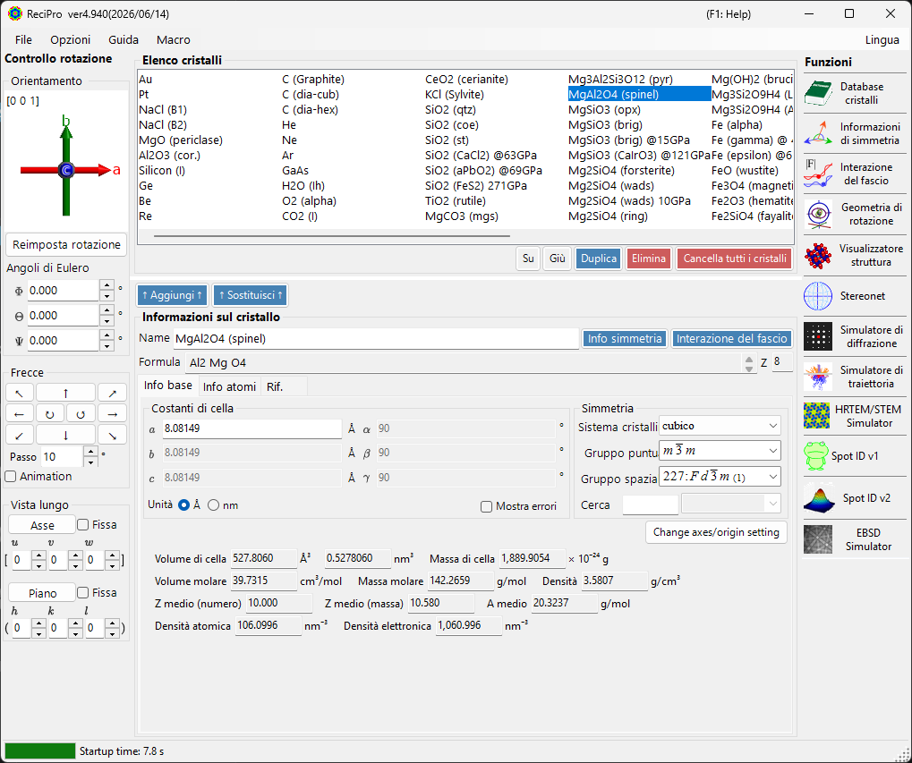

| Area | Posizione | Descrizione |
|------|----------|-------------|
| **Menu File** | In alto | Operazioni sui file, opzioni, guida |
| **Controllo rotazione** | A sinistra | Visualizzare/impostare l'orientazione del cristallo |
| **Elenco cristalli** | Centro in alto | Selezionare e gestire i cristalli |
| **Informazioni sul cristallo** | Centro in basso | Modificare parametri reticolari, simmetria, atomi |
| **Funzioni** | A destra | Avviare le finestre di simulazione/analisi |

---

## Scorciatoie da tastiera e mouse {#keyboard-mouse-shortcuts}

La finestra principale installa diverse scorciatoie **valide per l'intera applicazione**. Restano attive mentre le finestre Visualizzatore struttura, Stereogramma, Simulatore di diffrazione e Spot ID v1 hanno il focus.

| Scorciatoia | Azione |
|----------|--------|
| <kbd>F1</kbd> | Apre questa pagina del manuale online |
| <kbd>CTRL</kbd>+<kbd>SHIFT</kbd> + tasti freccia | Ruota il cristallo di un passo in quella direzione (tieni premute due frecce per una diagonale) |
| Tieni premuto <kbd>CTRL</kbd> all'avvio di ReciPro | Avvia con OpenGL disabilitato (ripristino in caso di problemi grafici; solo per questo avvio, non viene salvato) |
| Trascina con il tasto sinistro il widget di orientazione (in basso a sinistra, sotto *Orientazione attuale*) | Ruota il cristallo |
| Doppio clic destro sul widget di orientazione | Copia l'immagine del widget negli appunti |
| Clic singolo su un pulsante di funzione | Apre / chiude quella finestra (una finestra ridotta a icona viene ripristinata invece di essere chiusa) |
| Doppio clic su un pulsante di funzione | Forza la visibilità della finestra e la porta in primo piano |
| Clic destro su un cristallo nell'elenco | Menu contestuale (Rinomina / Esporta come CIF / Duplica / Elimina) |
| Doppio clic sull'etichetta dell'indice dell'asse di zona (`[u v w]`, sotto *Orientazione attuale*) | Mostra / nasconde il riquadro max-UVW |
| Trascina un file sulla finestra | Carica un elenco cristalli (`.xml`, `.out`; chiede se sostituire l'elenco o aggiungere) o un cristallo (`.cif`, `.amc`) <!-- 261105Cl 監査: .cdb2 はドロップで読めないので外した (FormMain.cs:FormMain_DragDrop) --> |
| <kbd>CTRL</kbd>+<kbd>SHIFT</kbd>+<kbd>ALT</kbd>+<kbd>C</kbd> | Apre lo strumento (sperimentale) di cattura della GUI per la finestra attiva |

→ Vedi **[21. Scorciatoie da tastiera e mouse](21-shortcuts.md)** per uno sguardo d'insieme su ogni finestra.

---

## Flusso di lavoro di base

Se è la prima volta che usi ReciPro, segui questi passaggi:

1. Seleziona il cristallo desiderato nell'**Elenco cristalli**. Per usare un file CIF/AMC, trascinalo e rilascialo nelle **Informazioni sul cristallo**.
2. Se modifichi i parametri reticolari o le posizioni degli atomi, premi **Aggiungi** o **Sostituisci** affinché le modifiche vengano riscritte nell'elenco cristalli.
3. Imposta l'orientazione del cristallo nel **Controllo rotazione** tramite un asse di zona, un piano reticolare, gli angoli di Eulero o il trascinamento con il mouse.
4. Apri lo strumento desiderato dalle **Funzioni**. Le finestre di calcolo per diffrazione, HRTEM/STEM, EBSD e altre utilizzano il cristallo e l'orientazione attualmente selezionati.

---

## Menu File

### File

| Voce di menu | Descrizione |
|-----------|-------------|
| Carica elenco cristalli (sostituisci elenco attuale) | Carica un file di elenco cristalli (`*.xml`, `*.out`) sostituendo l'elenco corrente; una finestra di dialogo permette di scegliere quali cristalli caricare |
| Carica elenco cristalli (aggiungi all'elenco attuale) | Carica un file di elenco cristalli e lo aggiunge all'elenco corrente (con la stessa finestra di selezione) |
| Ripristina l'elenco cristalli iniziale | Ricarica l'elenco cristalli fornito con ReciPro |
| Importa cristallo da file CIF o AMC | Carica un singolo cristallo da un file CIF / AMC |
| Salva elenco cristalli | Salva l'elenco cristalli corrente (una finestra di dialogo permette di scegliere quali cristalli scrivere) |
| Esporta il cristallo selezionato come file CIF | Salva il cristallo selezionato in formato CIF |
| Cancella tutti i cristalli | Rimuove tutti i cristalli dall'elenco |
| Esci | Chiude l'applicazione |

### Opzioni

| Voce di menu | Descrizione |
|-----------|-------------|
| Mostra suggerimenti | Mostra o nasconde i suggerimenti in tutte le finestre — quelli dei controlli, delle voci della barra degli strumenti e dei menu, delle celle delle tabelle e delle schede; l'impostazione viene mantenuta al prossimo avvio <!-- 261106Cl 作者の決定 C9 --> <!-- 261106Cl 作者の決定 A20 --> |
| Modalità scura | Alterna tra tema chiaro e scuro |
| Usa indici di Miller-Bravais (hkil) | Usa la notazione a 4 indici per i sistemi trigonale/esagonale in tutta l'applicazione |
| Usa fattori di diffusione ionici | Usa i fattori di diffusione elettronica ionici (Peng) per gli ioni assegnati agli atomi nei calcoli elettronici dinamici (onde di Bloch), inclusi i profili di Kikuchi; il termine di monopolo per $g \neq 0$ viene aggiunto solo ai coefficienti elastici $U_g$ (l'assorbimento TDS e la sorgente TDS di Kikuchi usano la parte ionica finita). Se non è spuntata, si usano i fattori degli atomi neutri. Se la cella elementare non è elettricamente neutra ($\Sigma q \neq 0$), il termine di monopolo viene omesso e si usa solo la parte finita (ione schermato); all'attivazione dell'opzione viene mostrato un avviso |
| Scarica libreria MKL | Scarica la libreria nativa Intel MKL (~55 MB); una volta installata viene usata automaticamente per i calcoli pesanti |
| Accetta comandi macro esterni (named pipe) | Restare in ascolto sulla named pipe `ReciPro.Macro.v1` ed eseguire le macro inviate da programmi esterni — vedi [Controllo esterno](20-macro/3-external-control.md) |
| Reimposta le impostazioni del registro all'uscita (attivo dopo il riavvio) | Reimposta le impostazioni al prossimo riavvio |
| Disabilita la libreria Crystallography.Native (richiede il riavvio) | Ricade sul codice gestito se la libreria nativa (C++) non si carica |
| Disabilita tutto il rendering OpenGL (richiede il riavvio) | Per GPU più datate / desktop remoto |
| Disabilita il rendering del testo OpenGL (richiede il riavvio) | Soluzione alternativa per problemi di resa del testo su alcune GPU |
| (sperimentale) Cattura componenti GUI... | Strumento per sviluppatori per salvare screenshot della GUI |
| Funzione di diffrazione da polveri (in sviluppo) | Abilita la finestra di diffrazione policristallina (polveri) |

### Guida

| Voce di menu | Descrizione |
|-----------|-------------|
| Controlla aggiornamenti | Verifica se è disponibile una nuova versione di ReciPro e la installa |
| Suggerimenti | Mostra suggerimenti d'uso (deprecato) |
| Cronologia delle versioni | Apre la finestra di dialogo della cronologia delle versioni |
| Licenza | Mostra la licenza MIT |
| Repository GitHub | Apre il repository di ReciPro nel browser |
| Segnala errori, richieste o commenti | Apre la pagina GitHub Issues |
| Guida (Web) | Apre il manuale online su GitHub Pages, nella pagina corrispondente alla lingua dell'interfaccia |

La lingua dell'interfaccia si cambia dal menu separato **Lingua** (richiede il riavvio).

### Lingua

Cambia la lingua dell'interfaccia. Sono disponibili undici lingue — English, 日本語, Deutsch, Français, Español, Português, Italiano, Русский, 简体中文, 繁體中文 e 한국어 — ciascuna mostrata nella propria scrittura. La modifica ha effetto dopo il riavvio di ReciPro. Il manuale online segue la stessa impostazione, quindi <kbd>F1</kbd> e **Guida ▸ Guida (Web)** aprono la pagina nella lingua scelta.

### Macro

**Editor** apre la finestra [Macro](20-macro/index.md) per automatizzare le operazioni di ReciPro con script in stile Python. Le macro registrate in quella finestra sono elencate anche sotto **Editor**; selezionandone una la si esegue direttamente. Per i flussi di lavoro ricorrenti, consulta le [funzioni integrate](20-macro/1-built-in-functions.md) e gli [esempi di macro](20-macro/2-examples.md).

---

## Controllo dell'orientazione del cristallo

Lo stato di rotazione del cristallo è condiviso dal simulatore di diffrazione, dal Visualizzatore struttura, dallo Stereogramma, dal simulatore HRTEM/STEM, dal simulatore EBSD e da altre finestre. Non è solo un'impostazione di visualizzazione: definisce la direzione del fascio incidente e la relazione tra le coordinate del cristallo utilizzata dalle simulazioni. Un breve tutorial video è disponibile nella pagina [Come usare](appendix/a0-how-to-use.md).

### Orientazione attuale {#orientazione-corrente}

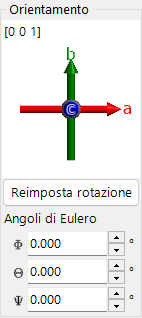

Mostra l'orientazione del cristallo. Trascina per ruotare. Assi: rosso = *a*, verde = *b*, blu = *c*.

### Reimposta rotazione
Ripristina lo stato iniziale: asse *c* perpendicolare allo schermo, asse *b* verso l'alto.

### Asse di zona
Mostra l'asse di zona [*uvw*] più vicino alla normale dello schermo. I candidati sono gli indici irriducibili (MCD = 1) con $|u|+|v|+|w| \le$ il limite indicato nella casella max-UVW (1–100, predefinito 30); fare doppio clic sull'etichetta dell'indice per mostrare o nascondere tale casella.

### Angoli di Eulero (Z-X-Z)
Imposta l'orientazione del cristallo con gli angoli di Eulero **Z–X–Z**:

- \(\Phi\): rotazione attorno all'asse Z
- \(\Theta\): rotazione attorno all'asse X
- \(\Psi\): rotazione attorno all'asse Z

Le rotazioni vengono applicate nell'ordine \(\Psi \to \Theta \to \Phi\). Vedi [Geometria di rotazione](4-rotation-geometry.md) e [Appendice A1. Sistema di coordinate](appendix/a1-coordinate-system/1-orientation.md) per i dettagli.

### Frecce

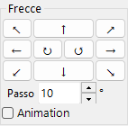

Ruota dell'angolo **Passo** (predefinito 10°). ↺ / ↻ ruotano attorno alla normale dello schermo. Spunta **Animation** per la rotazione continua; in questo caso **Passo** è una velocità in °/s.

### Vista lungo {#visualizza-lungo}

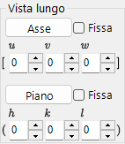

Allinea un asse di zona [*uvw*] o un piano reticolare (*hkl*) perpendicolarmente allo schermo.

- **Fissa**: quando è spuntata, tutte le rotazioni successive (frecce, trascinamento con il mouse) vengono eseguite attorno all'asse di zona o alla normale al piano specificati, così che quella direzione resti fissa. Può essere attiva una sola delle due caselle **Fissa**, e non può essere spuntata finché l'indice è 0 0 0.
- **Asse**: pone l'asse di zona immesso \([uvw]\) perpendicolare allo schermo. Se è impostato anche **Piano** e l'asse giace in quel piano ($uh+vk+wl=0$), la normale al piano viene orientata verso l'alto sullo schermo; altrimenti la direzione verso l'alto viene scelta automaticamente.
- **Piano**: pone la normale del piano reticolare immesso \((hkl)\) perpendicolare allo schermo. Se è impostato anche **Asse** e giace nel piano ($uh+vk+wl=0$), quell'asse viene orientato verso l'alto sullo schermo; altrimenti la direzione verso l'alto viene scelta automaticamente.

### Modi di base per impostare l'orientazione

| Metodo | Da usare quando | Dove |
|--------|----------|-------|
| Trascinamento con il mouse | Vuoi ruotare liberamente osservando gli assi del cristallo. | Pannello **Orientazione attuale** |
| Pulsanti freccia | Vuoi rotazioni piccole e ripetibili. | Pannello **Frecce** |
| Asse di zona | Conosci la direzione di osservazione, come \([001]\) o \([110]\). | **Vista lungo** / immissione asse di zona |
| Normale al piano | Vuoi un piano reticolare \((hkl)\) normale allo schermo. | **Vista lungo** / immissione piano |
| Angoli di Eulero | Hai bisogno di un'orientazione numerica riproducibile. | **Angoli di Eulero (Z-X-Z)** |

Vedi [Geometria di rotazione](4-rotation-geometry.md) e [Appendice A1. Sistemi di coordinate](appendix/a1-coordinate-system/1-orientation.md) per le matrici di rotazione e le convenzioni sulle coordinate.

---

## Elenco cristalli

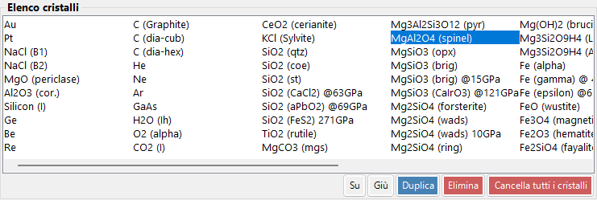

66 cristalli nell'installazione predefinita. Seleziona per visualizzare i dettagli e impostarlo per i calcoli. **Clic destro su un cristallo** nell'Elenco cristalli per un menu contestuale: *Rinomina*, *Esporta come CIF*, *Duplica*, *Elimina*.

| Pulsante | Azione |
|--------|--------|
| Su / Giù | Riordina |
| Duplica | Copia il cristallo selezionato |
| Elimina / Cancella tutti i cristalli | Rimuove il cristallo selezionato / tutti i cristalli |
| Aggiungi / Sostituisci | Aggiunge all'elenco o sostituisce la voce selezionata |

---

## Informazioni sul cristallo

Modifica i parametri reticolari, la simmetria e gli atomi; trascina e rilascia file CIF/AMC per caricare una struttura. Questo controllo è condiviso da ReciPro, PDIndexer e CSManager, ma le schede e le funzioni mostrate differiscono per ciascuna applicazione. ReciPro mostra le schede **Info base**, **Info atomi** e **Rif.** (le schede EOS, Elasticità e altre sono per le altre applicazioni e non vengono mostrate in ReciPro).

> **Importante**: Premi **Aggiungi** o **Sostituisci** per salvare le modifiche.

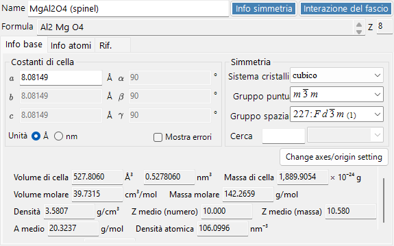

La parte superiore del pannello mostra sempre **Name** (nome del cristallo), **Formula** (formula chimica, calcolata dall'elenco degli atomi), **Z** (numero di unità di formula per cella elementare) e **Colore** (il colore di visualizzazione del cristallo, usato nella vista 3D della struttura e nelle curve dei profili di diffrazione). I pulsanti **Info simmetria** e **Interazione del fascio** aprono le finestre [Informazioni di simmetria](2-symmetry-information.md) e [Interazione del fascio](3-beam-interaction.md). Per % in peso, % atomica e conversione in ossidi, fare clic con il tasto destro e scegliere [Dettagli della composizione chimica](#chemical-composition).

### Scheda Info base {#basic-info-tab}

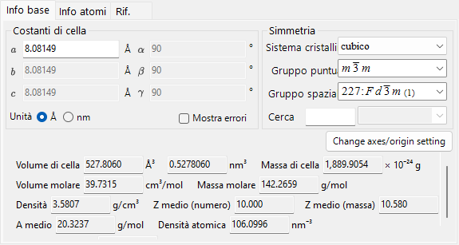

Parametri reticolari, simmetria e grandezze da essi derivate.

| Voce | Descrizione |
|------|------|
| Costanti di cella | Parametri reticolari a, b, c (**Unità**: Å = 10⁻¹⁰ m o nm; l'unità viene mantenuta al prossimo avvio) e α, β, γ. La scelta di una simmetria li vincola automaticamente (ad es. a=b=c, α=β=γ=90° per il sistema cubico). |
| Simmetria | Scegli il **Sistema cristallino**, il **Gruppo puntuale** e il **Gruppo spaziale**. Digita nel campo **Cerca** per elencare i candidati corrispondenti (sensibile a maiuscole/minuscole). |
| Volume di cella / Massa di cella | Volume e massa della cella elementare. Il volume è mostrato in ų / nm³ secondo la selezione **Unità**; la massa è in 10⁻²⁴ g. |
| Volume molare / Massa molare / Densità | Volume molare (cm³/mol, per unità di formula), massa molare (g/mol) e densità (g/cm³). Mostrati **solo quando sono stati immessi degli atomi**. |
| Z medio (numero) / Z medio (massa) / A medio | Numero atomico medio pesato sul numero o sulla massa, e peso atomico medio per atomo (g/mol). Le occupazioni sono incluse. |
| Mostra errori | Mostra i campi dell'errore (±) delle costanti di cella. |
| Change axes/origin setting | Equivale alla voce del menu contestuale **Cambia impostazione assi/origine**: converte in un'altra impostazione degli assi/dell'origine dello stesso gruppo spaziale. |
| Densità atomica / Densità elettronica | Numero di atomi e di elettroni per volume di cella, mostrati in Å⁻³ / nm⁻³ secondo la selezione **Unità**. |

### Scheda Info atomi {#atom-tab}

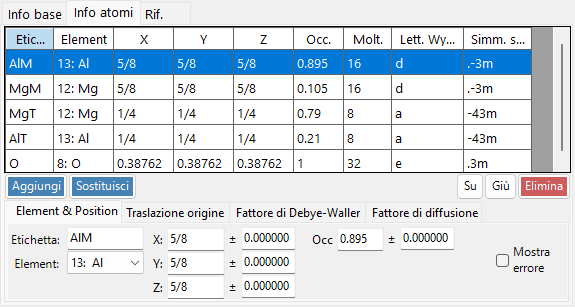

Imposta la specie, la posizione, il fattore di temperatura e il fattore di diffusione di ciascun atomo. Modifica l'elenco degli atomi con **Aggiungi**, **Sostituisci** (sostituisce la riga selezionata), **Su/Giù** (riordina) e **Elimina**. L'elenco degli atomi mostra inoltre, per ciascun sito, la molteplicità (**Molt.**), la lettera di Wyckoff (**Lett. Wyck.**) e la simmetria del sito (**Simm. sito**). Ogni atomo ha:

| Voce | Descrizione |
|------|------|
| Etichetta | Etichetta dell'atomo (identificatore qualsiasi). |
| Element | Elemento (inclusa la valenza ionica). |
| X, Y, Z | Coordinate frazionarie (0–1). Si possono immettere frazioni come 1/2 o 2/3. |
| Occ | Occupazione (0–1). |

Fai clic con il tasto destro su una riga di atomo e scegli **Mostra posizioni atomiche equivalenti** per aprire una piccola finestra che elenca tutte le posizioni generate dalle operazioni di simmetria del gruppo spaziale; il pulsante **Copy** copia l'elenco come testo separato da tabulazioni (ad esempio per incollarlo in un foglio di calcolo).

**Traslazione origine**: sposta l'origine di tutte le coordinate atomiche. Scegli il segno con **+** / **−**, poi premi uno dei vettori preimpostati — (⅛ ⅛ ⅛), (¼ ¼ ¼), (0 ¼ ⅛), (¼ 0 ¼), (0 ¼ ¼), (¼ ¼ 0), (¼ −¼ 0), (¼ −¼ ¼), (0 ¼ −⅛) — oppure usa **Apply custom shift** per un valore arbitrario.

**Spostamento (B)** (fattore di Debye–Waller / fattore di temperatura):

| Voce | Descrizione |
|------|------|
| Notation | Usa la notazione U o B. Cambiando notazione i valori mostrati vengono convertiti ($B = 8\pi^2 U$). |
| Modello | Isotropia o Anisotropia. |
| U##, β## | Per il caso anisotropico, immetti ciascuna componente: $U_{ij}$ in Ų, oppure nella notazione B i $\beta_{ij} = 2\pi^2 a^*_i a^*_j U_{ij}$ adimensionali (come B(i,j) nei file AMCSD). |

**Fattore di diffusione**: scegli il fattore di diffusione usato per ciascun atomo.

| Radiazione | Sorgente / impostazione |
|-----------|------|
| Raggi X | Fattori di diffusione inclusa la valenza ionica (International Tables for Crystallography, Vol. C). |
| Elettroni | Fattori di diffusione elettronica — atomi neutri da Peng, Ren, Dudarev & Whelan (1996), *Acta Cryst.* **A52**, 257–276; ioni da Peng (1998), *Acta Cryst.* **A54**, 481–485. |
| Neutroni | Lunghezze di diffusione neutronica. Scegli **Natural isotope abundance** o **Custom isotope abundance** (una composizione isotopica arbitraria). |

### Scheda Rif. {#reference-tab}

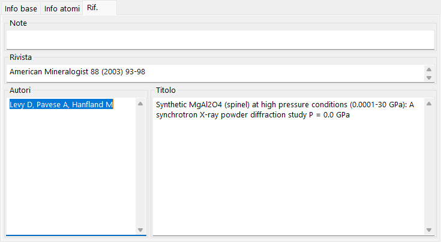

Registra la fonte della struttura: **Note**, **Autori**, **Rivista** e **Titolo**.

### Menu contestuale (clic destro)

Clic destro su un'area vuota del controllo per queste azioni principali:

| Voce di menu | Azione |
|-----------|------|
| Dettagli della composizione chimica | Apre la finestra [Dettagli della composizione chimica](#chemical-composition) (% in peso, % atomica, numero di atomi normalizzato, conversione in ossidi). |
| Interazione del fascio | Apre la finestra [Interazione del fascio](3-beam-interaction.md). |
| Informazioni di simmetria | Apre la finestra [Informazioni di simmetria](2-symmetry-information.md). |
| Importa da CIF o AMC... | Carica un cristallo da un file CIF / AMC. |
| Esporta in CIF | Esporta il cristallo corrente come CIF. |
| Ripristina le costanti di cella | Ripristina le costanti di cella ai valori caricati inizialmente. |
| Converti nel gruppo spaziale P1 | Espande la struttura al gruppo spaziale P1. |
| Converti in una superstruttura | Converte in una superstruttura con multipli interi di a, b, c (finestra di dialogo delle dimensioni). |
| Cambia impostazione assi/origine | Converte in un gruppo spaziale equivalente (una diversa scelta degli assi). |

#### Dettagli della composizione chimica {#chemical-composition}

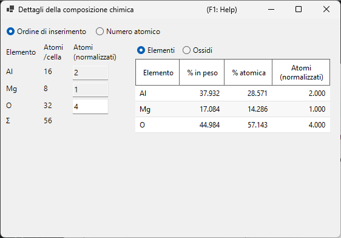

Mostra la composizione del cristallo corrente, calcolata dall'elenco degli atomi (il numero di atomi di ciascun elemento è la somma di molteplicità × occupazione sui suoi siti). La finestra segue il cristallo selezionato nella finestra principale.

- La tabella a destra riporta **% in peso**, **% atomica** e **Atomi (normalizzati)** di ciascun elemento; la tabella a sinistra riporta gli atomi per cella. Fare clic su una casella della colonna normalizzata della tabella a sinistra per prendere quell'elemento come riferimento, poi digitarne il numero di atomi (ad es. O = 24). Per impostazione predefinita il riferimento è O (o il primo elemento) e la colonna normalizzata mostra la formula chimica.
- **Ossidi**, **Alogenuri** e **Solfuri** (compaiono solo quelli applicabili al cristallo) convertono formalmente la composizione in componenti usando la **Valenza** di ciascun elemento. Le valenze sono modificabili (sono ammesse frazioni come 8/3). Se non inserite, Fe vale 2, gli altri elementi prendono la valenza dello ione scelto per il fattore di diffusione dei raggi X, altrimenti uno stato di ossidazione comune. **Σ=0** imposta la valenza che annulla la carica totale e **Ripristina predefiniti** cancella le valenze inserite. Le valenze inserite restano associate al cristallo e vengono salvate negli elenchi di cristalli XML.
- **Ordine di inserimento** / **Numero atomico** cambiano l'ordine degli elementi.

---

## Pannello Funzioni {#functions}

La barra verticale di pulsanti a destra avvia le finestre di analisi e simulazione elencate di seguito.

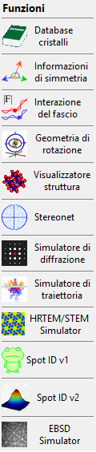

| Pulsante | Descrizione | Dettagli |
|--------|-------------|---------|
| Database cristalli | Cercare e importare cristalli dai database integrati / online | [1. Database dei cristalli](1-crystal-database.md) |
| Informazioni di simmetria | Informazioni sul gruppo spaziale e diagrammi di simmetria delle *International Tables* Vol. A | [2. Informazioni di simmetria](2-symmetry-information.md) |
| Interazione del fascio | Interazione fascio–cristallo: riflessioni, attenuazione, fattori di diffusione, fluorescenza | [3. Interazione del fascio](3-beam-interaction.md) |
| Geometria di rotazione | Matrice di rotazione 3D / angoli del goniometro | [4. Geometria di rotazione](4-rotation-geometry.md) |
| Visualizzatore struttura | Struttura cristallina 3D | [5. Visualizzatore struttura](5-structure-viewer.md) |
| Stereogramma | Proiezione stereografica | [6. Stereogramma](6-stereonet.md) |
| Simulatore di diffrazione | Diffrazione di raggi X / elettroni su singolo cristallo | [7. Simulatore di diffrazione](7-diffraction-simulator/index.md) |
| Simulatore di traiettoria | Simulazione Monte Carlo delle traiettorie elettroniche | [8. Traiettorie elettroniche](8-electron-trajectory.md) |
| Simulatore HRTEM/STEM | Simulazione di immagini HRTEM / STEM | [9. Simulatore HRTEM/STEM](9-hrtem-stem-simulator/index.md) |
| Spot ID v1 | Indicizzazione di pattern SAED (precedentemente "TEM ID") | [10. Spot ID v1](10-spot-id.md) |
| Spot ID v2 | Rilevamento e indicizzazione degli spot | [11. Spot ID v2](11-spot-id-v2.md) |
| Simulatore EBSD | Simulazione di pattern EBSD | [12. Simulazione EBSD](12-ebsd-simulation.md) |
| Diffrazione da polveri | Diffrazione policristallina (polveri) — abilitala tramite **Opzioni ▸ Funzione di diffrazione da polveri (in sviluppo)** | - |

---

## Vedi anche

- [Database dei cristalli](1-crystal-database.md)
- [Geometria di rotazione](4-rotation-geometry.md)
- [Visualizzatore struttura](5-structure-viewer.md)
- [Simulatore di diffrazione](7-diffraction-simulator/index.md)
- [Scorciatoie da tastiera e mouse](21-shortcuts.md)
- [Sistema di coordinate di base e orientazione del cristallo](appendix/a1-coordinate-system/1-orientation.md)
