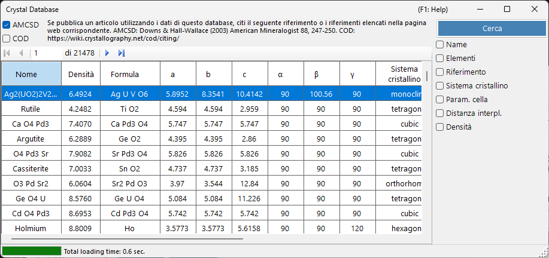
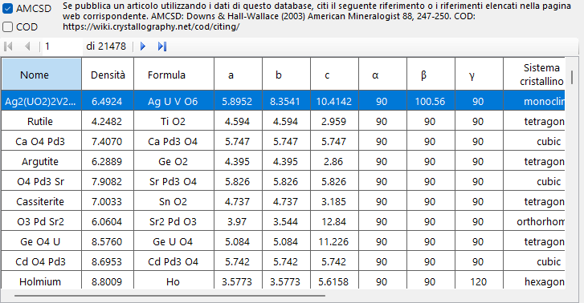
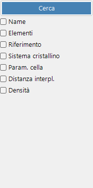

# Database dei cristalli

Il **Database dei cristalli** offre funzioni per cercare e importare strutture cristalline da due sorgenti, selezionabili tramite le caselle di controllo **AMCSD** e **COD**:

- **AMCSD** : il [American Mineralogist Crystal Structure Database](https://www.rruff.net/) incluso (più di 20.000 strutture).
- **COD** : il [Crystallography Open Database](https://www.crystallography.net/cod/). Poiché il file è di grandi dimensioni, non viene incluso nel programma di installazione; il file del database viene scaricato automaticamente al primo utilizzo. Quando il file viene aggiornato sul server, viene richiesto di scaricarlo nuovamente.

Si prega di citare i seguenti riferimenti quando si utilizzano questi database.

Quando si utilizza **AMCSD**:

> Downs, R.T. and Hall-Wallace, M. (2003) The American Mineralogist Crystal Structure Database. *American Mineralogist* **88**, 247-250.

Quando si utilizza **COD**:

> Gražulis, S. et al. (2009) Crystallography Open Database – an open-access collection of crystal structures. *Journal of Applied Crystallography* **42**, 726-729.
>
> Gražulis, S. et al. (2012) Crystallography Open Database (COD): an open-access collection of crystal structures and platform for world-wide collaboration. *Nucleic Acids Research* **40**, D420-D427.

---

## Scorciatoie da tastiera e mouse

Questa finestra non ha combinazioni con tasti modificatori; è gestita tramite clic ordinari. Gli unici input non ovvi sono:

| Scorciatoia | Azione |
|----------|--------|
| <kbd>F1</kbd> | Apre questa pagina del manuale online |
| <kbd>ENTER</kbd> in un qualsiasi campo di ricerca | Esegue la ricerca nel database (equivale al pulsante **Cerca**) |
| Clic su una riga della tabella dei risultati | Carica quel cristallo nella finestra principale |
| Clic su un elemento nel popup **Tavola periodica** | Cambia il suo filtro: *può includere o meno* → *deve includere* → *deve escludere* |

→ Vedi **[21. Scorciatoie da tastiera e mouse](21-shortcuts.md)** per una panoramica di ogni finestra.

---

## Tabella

Mostra i cristalli che corrispondono ai criteri di ricerca. Seleziona un cristallo per trasferirlo nelle Informazioni sul cristallo della Finestra principale. Premi **Aggiungi** o **Sostituisci** per aggiungerlo all'Elenco cristalli.

---

## Opzioni di ricerca

Inserisci di seguito i criteri di ricerca e premi il pulsante **Cerca** o il tasto **Enter**.

| Criterio | Descrizione |
|-----------|-------------|
| **Name** | Nome del cristallo |
| **Elementi** | Selettore del sistema periodico (può/deve/non deve includere) |
| **Riferimento** | Titolo, rivista, autore |
| **Sistema cristallino** | Seleziona il sistema cristallino |
| **Param. cella** | Costanti reticolari ed errore |
| **Distanza interpl.** | Valori d delle riflessioni intense ed errore |
| **Densità** | Densità ed errore |

### Name

Corrispondenza a testo libero rispetto al nome del cristallo. Sono ammesse corrispondenze parziali; maiuscole e minuscole non vengono distinte. Vengono applicati solo i criteri la cui casella è spuntata, combinati in AND.

### Elementi {#element}

Premi il pulsante **Tavola periodica** per aprire il selettore degli elementi. Ogni pulsante di elemento alterna tra tre stati:

- **può includere o meno** (predefinito – giallo)
- **deve includere** (blu)
- **deve escludere** (rosso)

Un cristallo deve contenere tutti gli elementi *deve includere* e nessuno degli elementi *deve escludere*; finché il criterio **Elementi** è attivo, le voci prive di dati atomici vengono escluse.

I tre pulsanti in alto nella finestra reimpostano con un clic ogni elemento su uno dei tre stati.

### Riferimento {#reference}

Corrispondenza a testo libero (parziale, senza distinzione tra maiuscole e minuscole) rispetto ai metadati della pubblicazione: titolo dell'articolo, nome della rivista ed elenco degli autori.

### Sistema cristallino {#crystal-system}

Limita la ricerca a un sistema cristallino specifico (cubic, tetragonal, orthorhombic, hexagonal, trigonal, monoclinic, triclinic). La prima voce, *Unknown*, non applica alcuna restrizione.

### Ricerca per parametri di cella

Inserisci le costanti reticolari desiderate *a*, *b*, *c* (Å) e *α*, *β*, *γ* (°) e gli errori accettabili: una tolleranza relativa (±%) comune ad *a*, *b*, *c* e una tolleranza assoluta (±°) comune agli angoli. Il valore 0 significa che quel parametro viene ignorato.

### Distanza interpl. {#d-spacing}

Inserisci fino a tre distanze interplanari *d* (Å; spunta ciascuna per usarla), ognuna con una tolleranza relativa (±%). Un cristallo corrisponde quando ogni valore immesso coincide con una delle sue riflessioni più intense memorizzate nel database (fino a 16, ordinate per intensità di diffrazione X da polveri a λ = 1.54 Å). Con **Ignora fattore di diffusione** spuntato, i valori vengono invece confrontati con tutte le distanze *d* geometricamente possibili calcolate dalla cella elementare (incluse le riflessioni sistematicamente estinte). Utile quando di un esperimento sono note solo le posizioni dei picchi di diffrazione.

### Densità {#density}

Filtra per densità di massa (g/cm³) entro una tolleranza relativa (±%).

---

## Vedi anche

- [Finestra principale](0-main-window.md)
- [Informazioni di simmetria](2-symmetry-information.md)
- [Interazione del fascio](3-beam-interaction.md)
- [Visualizzatore struttura](5-structure-viewer.md)
