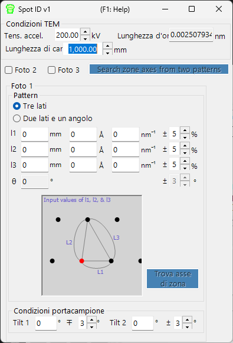

# Spot ID v1

**Spot ID v1** (il precedente **TEM ID**) cerca assi di zona candidati a partire da una geometria dei riflessi inserita numericamente, relativa a uno, due o tre pattern di diffrazione. Il rilevamento, il fit e l'indicizzazione dei riflessi su un'immagine si eseguono in [Spot ID v2](11-spot-id-v2.md).

---

## Scorciatoie da tastiera e mouse

Spot ID v1 acquisisce la geometria dei riflessi come **input numerico** (il precedente flusso di lavoro *TEM ID*); non dispone di una vista dell'immagine (il caricamento delle immagini, lo zoom con il mouse, il rilevamento dei riflessi e la selezione manuale dei riflessi appartengono a [Spot ID v2](11-spot-id-v2.md)). L'unica scorciatoia si trova nella finestra dei risultati:

| Scorciatoia | Azione |
|----------|--------|
| <kbd>F1</kbd> | Apri questa pagina del manuale online |
| Doppio clic su una riga nell'elenco dei risultati | Seleziona quel cristallo e ruotalo verso l'asse di zona corrispondente |

→ Vedi **[21. Scorciatoie da tastiera e mouse](21-shortcuts.md)** per un colpo d'occhio su ogni finestra.

---

## Ricerca dell'asse di zona dalla geometria dei riflessi (precedente TEM ID)

Quando non disponi di un'immagine da caricare, puoi comunque cercare assi di zona candidati inserendo manualmente la geometria di un pattern di diffrazione elettronica ad area selezionata (SAED). Inserisci le condizioni di osservazione TEM e la geometria dei riflessi, quindi premi **Trova asse di zona** di una foto (oppure **Search zone axes from two/three patterns** per usare più foto insieme) per trovare le orientazioni del cristallo candidate.

### Condizioni TEM

Inserisci **Tens. accel.** (kV, predefinito 200) e **Lunghezza di camera** (mm, predefinito 1000). La **Lunghezza d'onda** (nm) viene calcolata dalla tensione e mostrata in sola lettura.

### Foto 1, 2, 3

Inserisci la geometria dei riflessi di diffrazione.

- Per inserire la distanza tra due riflessi sul rivelatore, usa la casella **mm**.
- Se conosci il valore *d*, inseriscilo nelle unità **Å** o **nm⁻¹**.

Modalità **Tre lati** : Inserisci le lunghezze dei tre lati di un triangolo che ha come uno dei vertici il direct spot.

Modalità **Due lati e un angolo** : Inserisci le lunghezze di due lati (incluso il direct spot) e l'angolo tra di essi.

- Tolleranze (le caselle **±**) : ogni lunghezza ha una tolleranza in % (0–50, predefinito 5) e θ una tolleranza in gradi (0–30, predefinito 3). Il valore non inserito (θ in modalità Tre lati, l3 in modalità Due lati e un angolo) viene calcolato e mostrato, e accanto ai campi di immissione viene disegnato uno schizzo del pattern risultante.
- **Condizioni portacampione** : **Tilt 1** / **Tilt 2** (°) del portacampione goniometrico con cui è stata acquisita la foto, ciascuno con una tolleranza (0–10°, predefinito 3°). Gli angoli tra le impostazioni del portacampione delle varie foto vengono calcolati e mostrati.
- **Foto 2** / **Foto 3** : abilitano la seconda e la terza foto. Le caselle tra le foto trattano l1 (o l2) di due foto come la stessa riflessione e ne copiano la lunghezza.
- **Trova asse di zona** esegue la ricerca su una sola foto; **Search zone axes from two patterns** / **from three patterns** cerca le combinazioni compatibili con tutte le foto abilitate e con gli angoli di inclinazione del portacampione tra di esse. La ricerca viene eseguita su tutti i cristalli selezionati nell'elenco della finestra principale (la selezione multipla è abilitata mentre Spot ID v1 è aperto). Se vengono trovati più di 1000 candidati, non viene elencato nulla e ti viene chiesto di restringere le condizioni; altrimenti si apre la finestra dei risultati. Fai doppio clic su una riga per selezionare il cristallo e ruotarlo in quell'orientazione.

---

## Vedi anche

- [Spot ID v2](11-spot-id-v2.md)
- [Simulatore di diffrazione](7-diffraction-simulator/index.md)
- [Finestra principale](0-main-window.md)
- [Database dei cristalli](1-crystal-database.md)
- [Simulazione EBSD](12-ebsd-simulation.md)
